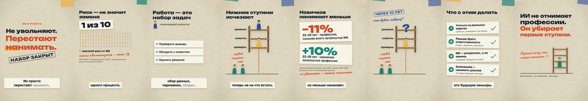
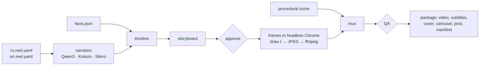
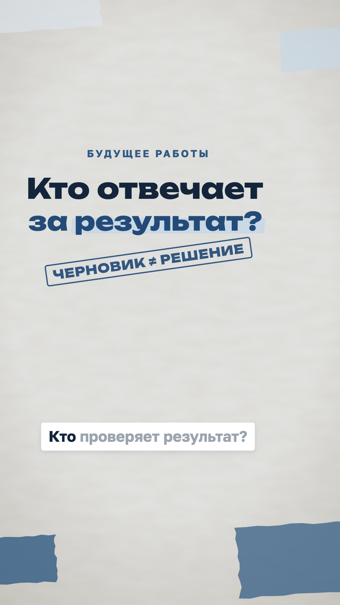

# Storygro

**Turn stories into growth.**

A toolkit for AI agents to turn ideas into reels, videos, carousels, and social posts. Build your audience and grow your brand through content.

<p align="center"></p>

<p align="center"><b>Example:</b> “What AI means for jobs — and where the real danger is”, 9:16, Russian and English, 84–85 s · <a href="https://github.com/eiler2005/Storygro/releases/tag/ai-jobs-2026-10-19">watch the videos and carousels</a> · <a href="examples/ai-jobs/">source</a> · <a href="examples/ai-jobs/sources.md">sources</a></p>

Storygro gives an agent (Claude Code, Codex, ChatGPT agent mode — anything that can run commands) a production line: research and facts → a script per language → narration → storyboard → rendered video, subtitles, cover and carousel → technical QA → a release folder with checksums. Every step leaves a file a person can read and approve. It runs locally; no account, server or paid API is needed for the included examples.

## What works today

- **Scripts as data.** One YAML file per language variant: narration with `{#cue}` markers, pauses, say-as hints (`[11%](=eleven percent)`), scene props bound to a `facts.json`.
- **Native 9:16 and other formats** with platform safe-area profiles (Reels, Shorts, feed), checked automatically at every cue.
- **Sixteen animated scenes**: eight vertical-first cut-paper explainer scenes (headline, crowd, task-stack, ladder, stat, chart, steps, outro) and eight landscape product scenes from the SlideCraft launch film. Custom scenes are small ES modules with a pure `draw(t)`.
- **Local narration in Russian and English** behind one provider interface: Kokoro-82M (English), Kokoro-RU with RUAccent (Russian, Dima/Sveta/Masha), Qwen3-TTS (reference narrator, Apple silicon), Silero CIS (Russian, explicit stress). Word timings come from the engine or from Whisper alignment against the script.
- **Topic selection:** public Wikipedia/Hacker News interest snapshots and a curated idea backlog with transparent editorial scoring. Sources, dates and failures stay visible.
- **Storyboards** (HTML/PDF) from the live player, an **approval gate** that hashes every input (script, facts, scene code, theme, fonts, assets), procedural **music and sound effects** mixed to −14 LUFS.
- **Rendering** through headless Chrome and ffmpeg: master and ≤ 25 MB web MP4, burned-in captions, SRT/VTT, covers, share cards, carousel cards.
- **QA that fails loudly:** codec, size, length, loudness, black frames, scene/image/font errors, every on-screen number traced to the data, text clear of platform UI, Whisper hearing ≥ 85 % of each scene (RU and EN). Skipped checks are reported as skipped.
- **Releases:** `deliver` and `package` refuse incomplete or unchecked outputs and write `manifest.json` with SHA-256, the engine commit, voice providers and QA verdicts.

**Not yet:** publishing to Instagram/YouTube and growth analytics (planned, need the owner's accounts), brand and series models, screen-recorded tutorials. `deliver` and `package` write local folders; nothing posts to a social account. See the [implementation plan](docs/planning/IMPLEMENTATION_PLAN.md).

## How it works



Durations come from the voice; scenes react to cues, so rewriting a line re-times the whole video. Each scene is a pure function of time, so any frame can be drawn in any order — stills, storyboards and the final render are the same pixels. Details: [architecture](docs/architecture.md).

## Quick start

Requirements: macOS or Linux, Node.js ≥ 22.12, Chrome or Chromium, [uv](https://docs.astral.sh/uv/). The Qwen3 voice and the speech check use MLX and need Apple silicon; elsewhere the check is reported as skipped and Kokoro/Silero work.

```sh
git clone https://github.com/eiler2005/Storygro.git && cd Storygro
npm ci
npm run check                      # TypeScript + tests

# preview without any Python: estimated timings
npm run storygro -- board examples/ai-jobs/en.reel.yaml --no-voice

# voices, Whisper, ffmpeg in ~/.storygro/venv (models download on first use)
npm run setup                      # English (Kokoro), ASR, audio
npm run setup:ru                   # + Kokoro-RU/RUAccent, Qwen3-TTS via mlx-audio, Silero CIS

npm run storygro -- voice   examples/ai-jobs/ru.reel.yaml
npm run storygro -- board   examples/ai-jobs/ru.reel.yaml     # read board.pdf
npm run storygro -- approve examples/ai-jobs/ru.reel.yaml
npm run storygro -- render  examples/ai-jobs/ru.reel.yaml     # MP4 + subtitles + QA
npm run storygro -- package examples/ai-jobs/episode.yaml     # after both variants and carousels
```

Outputs go to the ignored `.reel/` folder next to the spec. `STORYGRO_HOME` / `STORYGRO_PYTHON` relocate the Python environment (the prototype's `REELCRAFT_*` variables still work); `CHROME_PATH` and `FFMPEG` override binaries.

## Working with an agent

> Read AGENTS.md and docs/workflows.md. Make a 60–90 second vertical explainer about "[topic]" in Russian and English for "[audience]". Research current sources and keep each number with its source and quote. Show the mechanism with recurring objects. Stop after the storyboard so I can approve it.

The [workflows](docs/workflows.md) page shows what the agent does at each step and which files you review.

## Technology

| Layer | Stack |
|---|---|
| CLI and orchestration | Node.js, TypeScript (run with `tsx`, checked with `tsc`), `yaml`, `zod` |
| Pictures | plain DOM/SVG/CSS scenes, headless Chrome over the DevTools protocol (no Puppeteer), ffmpeg (`libx264`, AAC) |
| Voices | Kokoro EN, Kokoro-RU + RUAccent, Qwen3-TTS via mlx-audio, Silero CIS base + silero-stress; separate model terms |
| Speech check and alignment | Whisper (small.en, large-v3-turbo) via mlx-whisper |
| Audio | NumPy/SciPy synthesis, pyloudnorm loudness, soundfile |
| Environment | Python 3.12 managed by uv in `~/.storygro/venv`; ffmpeg from `imageio-ffmpeg` |

Full map of technologies, products, licences and implementation status: [technology](docs/technology.md). Internal design: [architecture](docs/architecture.md#technology-and-libraries).

## Repository layout

```text
src/            CLI and pipeline: spec, timeline, board/approval, render, QA, subtitles, package
runtime/        browser player, animation kit, cut-paper kit, safe-area profiles
scenes/         built-in scene modules
py/             voice providers (py/voices/), alignment, ASR, procedural score, voice design
examples/       ai-jobs (RU/EN explainer, carousels, episode) · slidecraft-launch (historical film + GIF)
content/        idea backlog, public interest signals, research and new production episodes
docs/           architecture, workflows, quality, voices, formats, scenes, contract, history, planning
agents/         role notes for director, scene-builder and QA
experiments/    bounded pilots, e.g. the HyperFrames renderer comparison (ADR 0001)
tests/          contract tests (node:test)
```

## Documentation

| Read | For |
|---|---|
| [Technology and product map](docs/technology.md) | every component, where it is used, required/optional status and licence |
| [Ideas and trends](docs/ideas.md) · [content workspace](content/README.md) | editorial selection, interest snapshots, new episodes |
| [Architecture](docs/architecture.md) | how the pipeline, player, voices, audio and gates fit; libraries; design choices; limits |
| [Workflows](docs/workflows.md) | commands and step-by-step flows: explainer, variants, carousel, package, new scene |
| [Writing a reel](docs/writing-a-reel.md) | the spec, script syntax, budgets, story shapes |
| [Scene catalog](docs/scenes.md) · [scene contract](docs/scene-contract.md) | every scene's props; how to write one |
| [Voices](docs/voices.md) | engines, licences, designing a narrator, pronunciation, adding a provider |
| [Formats](docs/formats.md) | presets, safe areas and their sources, captions, subtitles, carousels |
| [Quality](docs/quality.md) | approval, QA checks and what they do not prove, release manifests |
| [ADRs](docs/adr/) | decisions with evidence (renderer, voices) |
| [History](docs/history/slidecraft-launch.md) | the SlideCraft launch film and GIF Storygro grew out of |
| [Planning (RU)](docs/planning/README.md) | the owner's decisions, research, implementation plan, handoff, migration record |

## Development

```sh
npm ci && npm run check
```

Read [AGENTS.md](AGENTS.md) before changing the project. Rendering, voice and ASR checks need the local Python environment and Chrome; when you change the runtime, scenes, timing or audio, render and look at the result, not only the tests.

## License

Storygro is source-available under [PolyForm Shield 1.0.0](LICENSE), using the SlideCraft licensing model. Creating content for yourself, your employer or clients is a permitted noncompeting use; competing products need a separate agreement. See [COMMERCIAL.md](COMMERCIAL.md). Third-party models, components and fonts retain their own terms ([NOTICE](NOTICE)).

## New business explainer

[Future of work — who owns the result](content/episodes/future-of-work/README.md): original Russian narration with Kokoro-RU Dima, 9:16, an ILO source and an explicit distinction between research findings and the author's workflow advice. Source files live in `content/`; generated files and the review report are linked from the episode.

**68.63 s · 1080×1920 · 11/11 QA pass.** [Watch/download](https://github.com/eiler2005/Storygro/releases/tag/business-explainers-2026-10-19) · [review](content/episodes/future-of-work/REVIEW.md).

<p align="center"></p>
