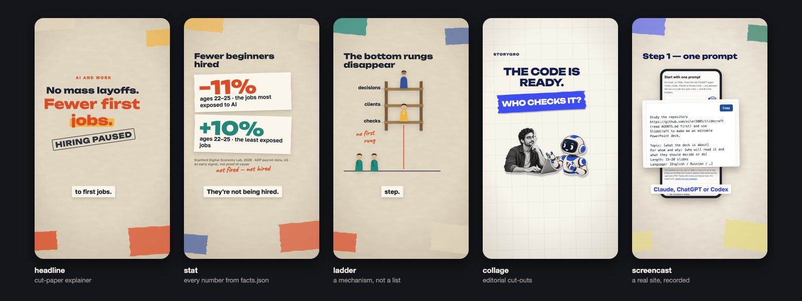
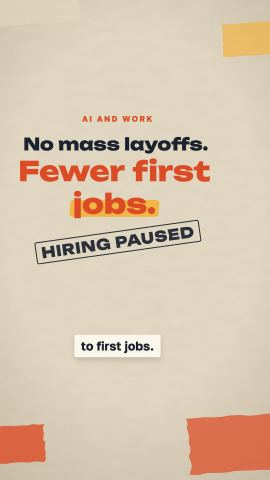
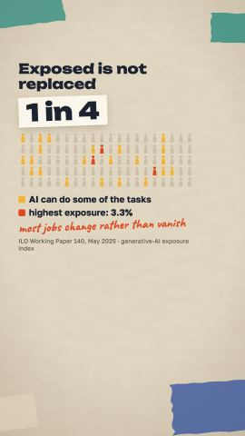
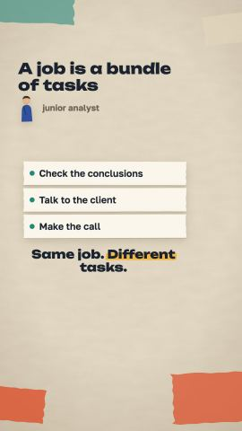
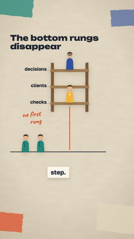
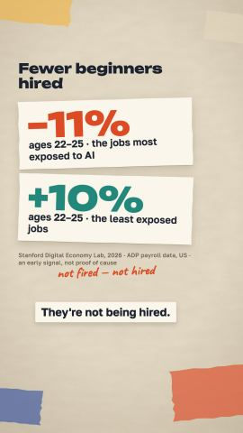
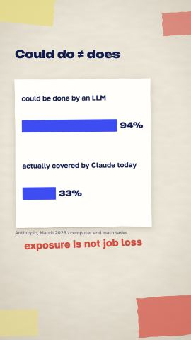
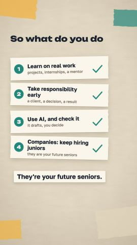
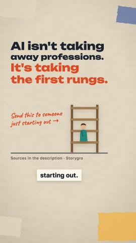
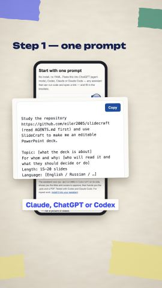

<h1 align="center">Storygro</h1>

<p align="center"><b>Turn stories into growth.</b><br>
A toolkit for AI agents to turn ideas into reels, videos, carousels and social posts — researched, narrated, rendered and checked on your own machine.</p>

<p align="center">
  <a href="https://github.com/eiler2005/Storygro/actions/workflows/check.yml"></a>
  <a href="#license"></a>
  
  
</p>

<p align="center">
  <a href="docs/start-here.md">Start here</a> · <a href="docs/features.md">Features</a> · <a href="docs/examples.md">Examples</a> · <a href="docs/explanation/pipeline.md">Pipeline</a> · <a href="docs/README.md">Docs</a> · <a href="ROADMAP.md">Roadmap</a> · <a href="CHANGELOG.md">Changelog</a>
</p>

<p align="center"></p>

---

## The easiest way: ask your agent

Open this repository in an agent that can run commands — Claude Code, Codex or any other with a shell — and fill in the brackets:

```text
Read AGENTS.md and docs/explanation/workflow.md. Make a 60–90 second vertical explainer
about "[topic]" for "[audience]" in [English / Russian]. After watching, a viewer should
understand "[one idea]". Research current primary sources first and keep every number with
its source and a quote. Show the mechanism with recurring objects, not a list of facts.
Stop after the storyboard so I can approve it.
```

The agent researches, writes the script and facts, narrates, builds a storyboard and waits. You approve; it renders, runs QA and packages a release. Every step leaves a file you can open. [The tutorial](docs/tutorials/explainer-from-a-topic.md) shows each one.

## What Storygro is

**Videos as code, with an editor's checks.** A video is a YAML script plus a facts file. The voice sets the timing; small JavaScript scenes draw every frame deterministically in headless Chrome; ffmpeg encodes. Gates sit where mistakes are expensive: a storyboard you approve before rendering, a facts gate that rejects any on-screen number not traceable to a source, and technical QA on the finished file — including Whisper listening to the narration.

**Local and accountless.** No server, no account, no API keys for the core. Voices run on your machine (Kokoro, Kokoro-RU, Qwen3-TTS, Silero). Publishing is a person's act; Storygro keeps the ledger.

**Made for agents and for the people who direct them.** [AGENTS.md](AGENTS.md) holds the rules; [how we work](docs/explanation/how-we-work.md) says who decides what, and which model fits which job.

## How it works

<p align="center"></p>

| Stage | You get | Read |
|---|---|---|
| **Choose** | trend signals without API keys, a watchlist per idea, an editorial ranking | [choose a topic](docs/how-to/choose-a-topic.md) |
| **Write** | `sources.md` with a quote per number, `facts.json`, a script per language, an optional real-site recording | [write a script](docs/how-to/write-a-script.md) |
| **Make** | narration and timings, a storyboard PDF to approve, master and web MP4, subtitles, stills | [workflow](docs/explanation/workflow.md) |
| **Check** | `QA.md`: codec, loudness, black frames, safe areas, facts, speech, brand rules | [quality gates](docs/explanation/quality.md) |
| **Ship** | a release folder with checksums; a manual publication ledger and metric snapshots | [carousel and release](docs/how-to/carousel-and-release.md) |

See [the pipeline](docs/explanation/pipeline.md) for one real run, from a trend scan on 19 October 2026 to a packaged video the same day.

## Eighteen scenes

<table>
  <tr>
    <td align="center" width="20%"><a href="docs/reference/scenes.md#headline"></a><br><sub><b>headline</b></sub></td>
    <td align="center" width="20%"><a href="docs/reference/scenes.md#crowd"></a><br><sub><b>crowd</b></sub></td>
    <td align="center" width="20%"><a href="docs/reference/scenes.md#task-stack"></a><br><sub><b>task-stack</b></sub></td>
    <td align="center" width="20%"><a href="docs/reference/scenes.md#ladder"></a><br><sub><b>ladder</b></sub></td>
    <td align="center" width="20%"><a href="docs/reference/scenes.md#stat"></a><br><sub><b>stat</b></sub></td>
  </tr>
  <tr>
    <td align="center"><a href="docs/reference/scenes.md#chart"></a><br><sub><b>chart</b></sub></td>
    <td align="center"><a href="docs/reference/scenes.md#steps"></a><br><sub><b>steps</b></sub></td>
    <td align="center"><a href="docs/reference/scenes.md#outro"></a><br><sub><b>outro</b></sub></td>
    <td align="center"><a href="docs/reference/scenes.md#collage"></a><br><sub><b>collage</b></sub></td>
    <td align="center"><a href="docs/reference/scenes.md#screencast"></a><br><sub><b>screencast</b></sub></td>
  </tr>
</table>

Ten vertical-first scenes above, plus eight landscape product scenes from the SlideCraft launch film: `statement`, `logo-reveal`, `chat`, `stack`, `grid`, `spotlight`, `pins`, `end-card`. Every frame is a pure function of time, so stills, storyboards and the video always agree. [All scenes with pictures](docs/features.md#eighteen-animated-scenes) · [props](docs/reference/scenes.md) · [add your own](docs/how-to/add-a-scene.md)

## Finished videos

| Video | What it shows | Length · QA | Watch |
|---|---|---|---|
| [**Where to check an AI agent's work**](content/videos/ai-agent-checks/README.md) (RU) | The first topic picked from the trend watchlist: τ-bench numbers, where to put checks, who is liable | 51.6 s · 12/12 | [release](https://github.com/eiler2005/Storygro/releases/tag/ai-agent-checks-2026-10-19) |
| [**SlideCraft demo**](content/videos/slidecraft-demo/README.md) (RU) | A product demo on a real screen recording: finger, taps, magnifier | 43.7 s · 12/12 | [release](https://github.com/eiler2005/Storygro/releases/tag/slidecraft-demo-2026-10-19) |
| [**Why micro1 buys companies' work data**](content/videos/micro1-work-data/README.md) (RU) | An editorial collage explainer checked against micro1's primary sources | 94.2 s · 11/11 | [release](https://github.com/eiler2005/Storygro/releases/tag/micro1-work-data-qwen-2026-10-19) |
| [**AI and jobs**](examples/ai-jobs/README.md) (RU + EN) | The reference bilingual explainer with carousels | 84–85 s | [release](https://github.com/eiler2005/Storygro/releases/tag/business-explainers-2026-10-19) |

None is published to social accounts yet; each needs the owner's viewing and listening first. More, including the historical SlideCraft launch film: [examples](docs/examples.md).

## Quick start

Requirements: Node.js ≥ 22.12, Chrome or Chromium, [uv](https://docs.astral.sh/uv/), macOS or Linux. Qwen3 voices and the Whisper speech check need Apple silicon; elsewhere Kokoro and Silero work and QA reports the speech check as skipped.

```sh
git clone https://github.com/eiler2005/Storygro && cd Storygro
npm ci && npm run hooks:install && npm run check

# frames and a storyboard in seconds, no voice model needed
npm run storygro -- board examples/ai-jobs/en.reel.yaml --no-voice

# voices, then a real render
npm run setup:ru && npm run assets:fetch
npm run storygro -- board   examples/ai-jobs/ru.reel.yaml
npm run storygro -- approve examples/ai-jobs/ru.reel.yaml
npm run storygro -- render  examples/ai-jobs/ru.reel.yaml
```

Step by step: [start here](docs/start-here.md). Every command: [CLI reference](docs/reference/cli.md).

## What you get

| File | What it is |
|---|---|
| `<name>.mp4`, `<name>-web.mp4` | master (H.264, CRF 16) and a web copy ≤ 25 MB, −14 LUFS |
| `<name>.srt`, `<name>.vtt` | subtitles from the word timings |
| `board.pdf` | the storyboard: key frame, narration, on-screen text, sound, warnings per scene |
| `stills/`, `carousel/` | cover and key frames; 1080×1350 carousel cards |
| `QA.md`, `qa.json` | every check with pass, fail or skip — skipped is never reported as passed |
| `post.md` | title, text with the synthetic-voice disclosure, tags |
| `manifest.json` | SHA-256 of every file, engine commit, voice providers, QA verdicts |

Outputs live in ignored `.reel/` folders; public copies go to GitHub Releases, never into Git.

## Repository

```text
production/   the engine: CLI (src/), browser player (runtime/), 18 scenes, Python voices and audio
content/      what we make: videos/<id>/, ideas, research, brand, series
examples/     reference and regression reels: ai-jobs, scene-gallery, editorial-collage, slidecraft-launch
docs/         tutorials, how-to, reference, explanation, ADRs; planning in Russian
tests/        node:test suites          agents/  director, scene-builder, qa roles
```

Full map and where to change what: [repository layout](docs/reference/repository-layout.md). Heavy media stays out of Git by rule and by check: [media policy](docs/reference/media-policy.md).

## Principles

- **Every number has a source.** Numbers live in data files with a quote; scenes never type them.
- **Voice first, picture second.** The storyboard is approved on real timings.
- **Deterministic frames.** Any moment renders the same, in any order.
- **A person decides.** The topic, the voice, the storyboard, the final watch and the upload.
- **Skipped is not passed, and a pass is not approval.**
- **Disclose synthetic voices.** Never clone a real person's voice without written consent.

## Honest limits

- Uploading to Instagram, YouTube or TikTok and reading their analytics through APIs are [planned](ROADMAP.md), not implemented; `publish` only records what a person did.
- Research is an agent workflow, not an unattended fact-checking service.
- Safe-area profiles are estimates; check a real upload on a phone.
- QA finds technical defects; it does not judge whether the story works.

## Privacy and network access

Storygro runs on your machine with no account and no telemetry. It goes online only when you ask: `npm ci`; `setup` (Python packages via uv, model weights from Hugging Face); `assets:fetch` (render inputs from this repository's GitHub Releases, checksum-verified); `trends` (public Google Trends RSS, Wikipedia and Hacker News); `capture` (the URL in your capture spec, in local Chrome). The preview server binds to loopback. See [SECURITY.md](SECURITY.md).

## Contributing

Issues and pull requests are welcome — scenes, voice providers, QA checks and how-to guides especially. Start with [CONTRIBUTING.md](CONTRIBUTING.md); `npm run check` runs the media policy, the doc link check, TypeScript and the tests.

## License

Storygro is **source-available** (not OSI open source) under the [PolyForm Shield License 1.0.0](LICENSE), following the SlideCraft licensing model:

- **Free for individuals and companies** to make content — for yourself, your employer or paying clients — and to adapt the software for permitted uses.
- **Don't compete with it** — no competing hosted content-generation service or white-label product built from Storygro.
- **Commercial licence** for competing or embedding uses: [denis.ermilov@gmail.com](mailto:denis.ermilov@gmail.com). Details: [COMMERCIAL.md](COMMERCIAL.md).

Third-party models, voices and fonts keep their own terms ([NOTICE](NOTICE), [technology](docs/explanation/technology.md), [voices](docs/reference/voices.md)). `reel: 1`, `.reel/`, `npm run reel` and `REELCRAFT_*` remain supported from the engine's earlier name.
