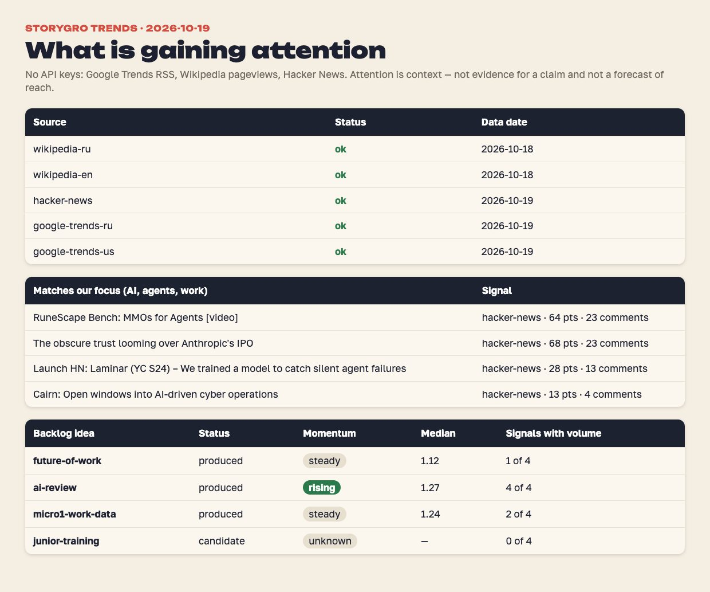
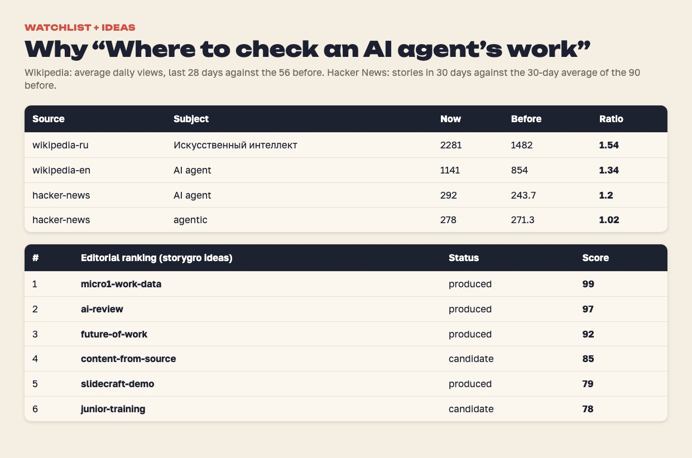
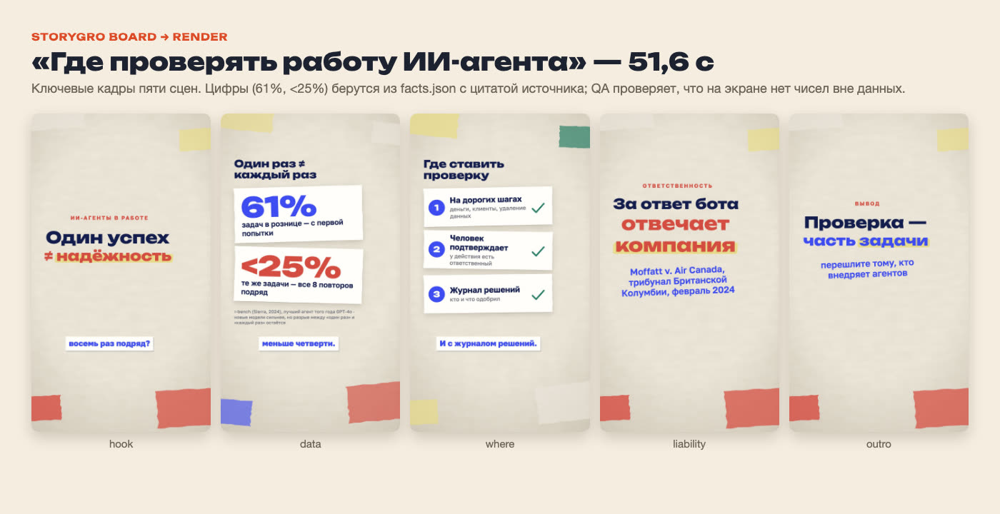
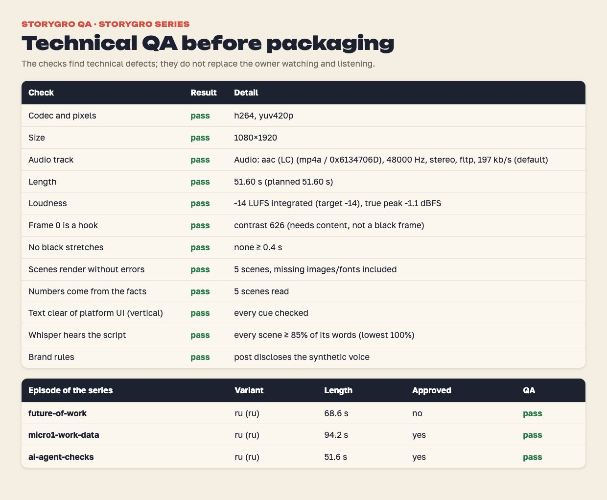

# От тренда к ролику: «Где проверять работу ИИ-агента»

> Для владельца и агентов, которые будут повторять процесс. Всё произошло 19 октября 2026 года за одну сессию. Это первый выпуск, тему которого выбрали по сигналам внимания, а не по прямому заказу. Технически весь конвейер описан в [docs/pipeline.md](../../../docs/explanation/pipeline.md).

## 1. Сканирование

```sh
npm run storygro -- trends production/trends/sources.yaml --backlog content/ideas/backlog.yaml \
  --out content/.signals/2026-10-19b.json --md content/.signals/2026-10-19b.md
```

Ответили все пять источников: Google Trends RU и US (сегодня), Wikipedia RU и EN (данные за 18 октября, обычная задержка), Hacker News (сегодня). Сырой отчёт лежит в игнорируемом `content/.signals/`, его можно воспроизвести этой же командой, но цифры будут другими.



**Что увидели.**

- В общих топах Google Trends и Wikipedia — футбол, знаменитости, кино. Для нашей аудитории там ничего нет. Это нормальный результат: общий топ — фон, а не источник тем.
- Фильтр фокуса нашёл только истории на Hacker News про агентов. Самая близкая к нашей теме: *Launch HN: Laminar — «We trained a model to catch silent agent failures»*. Её мысль: агент может нажать не ту кнопку или сослаться не на тот документ, при этом каждый вызов «успешен».
- Watchlist по идеям бэклога: у «Где проверять работу ИИ-агента» внимание растёт по всем четырём сигналам (медиана **1,27**). У статьи «Искусственный интеллект» в RU Wikipedia 2281 просмотр в день против 1482 раньше. У «AI agent» в EN — 1141 против 854. На HN историй с «AI agent» 292 за 30 дней против 244 в среднем раньше.

## 2. Выбор



| Идея | Динамика | Решение |
|---|---|---|
| Где проверять работу ИИ-агента | **растёт**, 4 из 4 сигналов с объёмом | **Делаем.** Внимание растёт, есть свежий повод (Laminar) и проверяемые первоисточники. Редакционный балл 97 |
| Будущее работы | стабильно, 1 из 4 | Уже выпущено |
| micro1 и рабочие данные | стабильно (1,24) | Уже выпущено |
| Обучение новичков | нет данных (малый объём) | Остаётся кандидатом: нужны исследования обучения |

Тренд — только контекст. Он показывает, что тема на слуху, но ничего не доказывает. Решение и обоснование записаны в [бэклоге](../../ideas/backlog.yaml) (`ai-review`, статус `produced`).

## 3. Проверка тезисов

Свежий повод (Laminar) — заявление компании, поэтому в ролик он не попал. В основу легли три первоисточника ([полная таблица](../../videos/ai-agent-checks/sources.md)):

1. **τ-bench** (Sierra, arXiv 2406.12045). Лучший агент 2024 года (GPT-4o) решал около **61%** задач в рознице с первой попытки. Одну и ту же задачу все восемь раз подряд он решал **меньше чем в 25%** случаев. Новые модели сильнее, но разрыв между «один раз» и «каждый раз» сохраняется. Это оговорено на экране.
2. **Moffatt v. Air Canada, 2024 BCCRT 149**. Трибунал Британской Колумбии решил, что компания отвечает за ответ своего чат-бота. Это решение трибунала по мелким искам, а не прецедент. В ролике так и сказано: «трибунал».
3. **Anthropic, Building effective agents**: точки проверки человеком и риск накопления ошибок. Это рекомендации вендора, поэтому три правила в ролике поданы как наш вывод.

Что сознательно **не взяли**: «агенты ошибаются в 75% случаев» — это неверное прочтение pass^8. «30% офисных задач» — TheAgentCompany меряет 175 упрощённых задач. «40% проектов отменят» — это прогноз Gartner, а не измерение.

Каждая цифра на экране лежит в [facts.json](../../videos/ai-agent-checks/facts.json) с цитатой. QA не пропустит число, которого там нет.

## 4. Ролик

Пять сцен, 51,6 с, вертикаль 1080×1920. Голос — тот же Qwen3, что в micro1: выбранный владельцем вариант C на скорости 0,96. Тема ролика: один успех ≠ надёжность → цифры τ-bench → где ставить проверку → кто отвечает → вывод.



## 5. Что нашёл контроль и что исправили в движке

| Проблема | Причина | Исправление (для всех роликов, не для одного) |
|---|---|---|
| Whisper «не слышал» «тау бенч», «24-го», «8» | Числа произносятся словами, ASR пишет их цифрами и наоборот | Сравнение речи сопоставляет числительные с цифрами, «процент» — с %, составные слова через дефис и раздельно |
| На кадре «<25%» счётчик проходил через «<23%» | Сцена `stat` анимировала счёт и у оценок-границ | Счёт вверх отключён для значений с <, >, ≈, ~ |
| Подпись поста могла забыть раскрытие синтеза | Правило не проверялось | Профиль бренда `content/brand.yaml` и проверка QA «Brand rules» |

Итог QA — 12 из 12: кодек, размер, звук, длина, громкость −14 LUFS, первый кадр, отсутствие чёрных пауз, ошибки сцен, цифры из фактов, безопасные зоны, распознавание речи (по 100% слов в каждой сцене) и правила бренда.



## 6. Что осталось за человеком

- Посмотреть и послушать ролик. Технический QA и утверждение агентом (`approved.json`: `claude-agent (technical; owner review pending)`) не заменяют редакторского одобрения.
- Опубликовать вручную и записать публикацию: `storygro publish plan …` → `mark … published --url …`. Через 7 дней добавить метрики: `storygro metrics add …`.
- Повторить сканирование через неделю. Если внимание к агентам останется высоким, следующим выпуском серии может стать «как мерить надёжность агента» (pass^k простыми словами).
