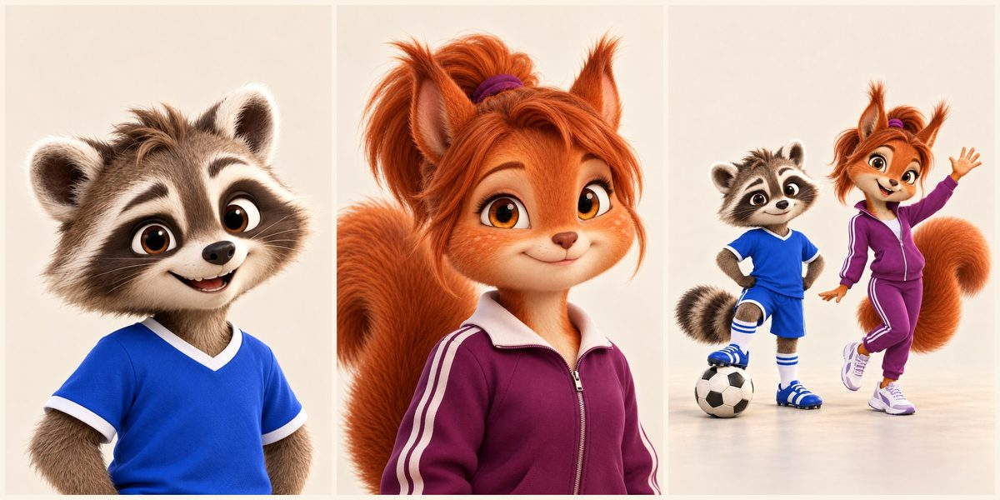

# «Маленькие большие дела · Легенды футбола» — библия серии

Познавательная рубрика о первых пятнадцати разных обладателях «Золотого мяча»: енот Матвей и белочка София знакомятся с легендой, зритель узнаёт, чем игрок прославился, за какой клуб играл и чем отличался от других. Для детей 6–10 лет и их родителей, Instagram Reels на русском. Серия: [football-legends.yaml](football-legends.yaml). Первый выпуск: [«Стэнли Мэтьюз»](../videos/football-legends-01-matthews/README.md).

Основа — два документа владельца от 28.10.2026: «рекомендации» (позиционирование, стиль, технические параметры, структура, промпты) и «Футболисты_1 выпуск» (сценарий и редакторские правила). Эта библия переводит их в настройки Storygro.

## Ведущие

Только два постоянных персонажа-животных. Других постоянных зверей, родителей (Марину и Дениса из «Семьи Матвея») и случайных персонажей на переднем плане нет. Футболист выпуска появляется как герой истории, а не как постоянный персонаж.

| Ведущий | Кто | Как выглядит (`images.cast`) | Эталон (`images.refs`) |
|---|---|---|---|
| **Матвей** (`@matvey`) | 6 лет, ведущий и футбольный энтузиаст: спрашивает, удивляется рекордам | енот, серо-коричневая шерсть, тёмная маска, полосатый хвост; синяя форма с белой отделкой, сине-белые гетры и бутсы | `cast/matvey-face.png`, `cast/hosts-full.png` |
| **София** (`@sofia`) | 8 лет, соведущая и исследовательница: замечает детали; занимается акробатикой и синхронным плаванием | белочка, рыже-каштановая шерсть, кремовая мордочка, хвостик с сиреневой резинкой; сливово-фиолетовый спортивный костюм с белыми полосками, бело-сиреневые кроссовки, без рюшей | `cast/sofia-face.png`, `cast/hosts-full.png` |

Лица утверждены владельцем 28.10.2026 («да, герои устраивают»). Эталонные PNG лежат локально в `football-legends/cast/` (вне Git, как все сгенерированные картинки); промпты, модель и SHA-256 — в [cast/cast.json](football-legends/cast/cast.json). Каждый выпуск копирует блоки `images.cast` и `images.refs` из первого выпуска. Тогда `storygro images` прикладывает эталоны к каждому кадру, где назван `@matvey` или `@sofia`, и ведущие не меняются от кадра к кадру. Без эталонов генератор каждый раз придумывает героев заново (рекомендации, п. 8.2).

Голос один — синтетический рассказчик OmniVoice B на скорости 0,90 (выбор владельца для русских выпусков). Ведущие действуют в картинках. Отдельных детских голосов пока нет: это вопрос владельцу в [ревью первого выпуска](../videos/football-legends-01-matthews/review.yaml).

## Как выглядит

**Поправка владельца от 31.10.2026:** на самом первом кадре обязательно также **имя футболиста**. Полная связка: «Маленькие большие дела» + «Легенды футбола» + золотой футбольный значок + имя героя; всё читается при `t=0` и сохраняется в центральном квадрате. В `series-cover` использовать `subtitleFrom: facts.series.episode`, где записано имя. После добавления строки заново проверить место над лицами/ушами, не сжимая весь монтаж. Впервые применено к [выпуску 8, Денис Лоу](../videos/football-legends-08-law/README.md); прежние выдачи без отдельного запроса не заменяются. Форма, стадион и атмосфера приближаются к историческим источникам: фиксировать дату и роль фото, различать перестройки трибун и эпохи воротников, убирать выдуманные городские силуэты и современные детали. Художественный 3D-стиль и одежда ведущих прежние; точность периода не означает документальную реконструкцию матча.

**Уточнение владельца от 30.10.2026, действует для новых и переделываемых выпусков:** общий первый кадр — точные названия «Маленькие большие дела» и «Легенды футбола» со значком золотого футбольного мяча. Всё видно уже при `t=0`, без пустого вступления; голос начинает историю сразу. Сцена [series-cover](../../production/scenes/series-cover.js), [общая тема](../../production/styles/cartoon/football-legends.css) и [значок](../../production/styles/cartoon/golden-ball.svg) общие, фон — из мира конкретного выпуска. После короткого чтения титула — переход по реплике к игровому кадру. Названия и лица в центральном квадрате, фон на весь экран. В этой итерации применено к Сивори и новому Масопусту; старые выдачи других эпизодов автоматически не заменены. [Производственный рецепт](../../docs/how-to/football-series.md).

Общие черты — выразительная семейная 3D-иллюстрация, неизменные Матвей и София, шрифты и оформление титров. **Атмосфера не одна на всю серию:** перед генерацией выбрать историческое место, форму клубной/сборной сцены, время суток, свет, палитру и три действия из конкретного текста. Для Сивори — серебристо-голубой Турин, чёрно-белая форма и «Комунале»; для Масопуста — солнечный Сантьяго, бирюзовое небо, охристые трибуны, красная дорожка, бело-красные чехословаки и жёлто-синие бразильцы, с отдельной бордово-золотой пражской сценой «Дуклы». Исторические эпизоды — художественная интерпретация, не документальная реконструкция гола. Не выдавать один современный стадион за все страны и эпохи. Нижние исходные рекомендации о едином золотом часе/сепии — историческая база; приоритет у этой поправки. Используем встроенный GPT Image; точный идентификатор модели инструмент не раскрывает, его не выдумываем.

- **Стиль**: премиальная стилизованная 3D-анимация уровня полнометражного семейного мультфильма, выразительная мимика, мягкий детализированный мех, кинематографичный свет, стадион. Не фотореализм и не «малышовость». Это `images.prompt` выпуска.
- **Палитра**: тёмно-синий `#13294b`, золото `#e2ad3b`, зелёный газона `#2f8f46`, кремовый `#fbf3e0`, оранжевый акцент `#e8741c`; сливовый `#7a2e6e` — цвет Софии. Тема — `theme.css` выпуска: субтитры в тёмно-синей плашке с золотым текущим словом, карточка игрока — коллекционная (кремовая бумага, золотая рамка, год оранжевым).
- **Эпохи**: наши дни — ведущие на современном стадионе в золотой час. История — тёплая винтажная цветокоррекция с лёгким зерном («warm sepia-tinted vintage grading with subtle film grain»), кепки и старые трибуны. Ведущие могут сидеть на старой трибуне как путешественники во времени.
- **Футболист**: дружеский узнаваемый 3D-шарж. В `images.cast` назвать игрока и 2–3 видимые черты, простая форма в цветах клуба той эпохи, без гербов, номеров и спонсоров (рекомендации, п. 7).
- **Сходство и команды** (уточнение владельца, 30.10.2026): сначала посмотреть архивный портрет и форму эпохи, затем закрепить портрет-эталон для всех картинок игрока. Партнёры отличаются лицами и причёсками, соперники — формой; пас ведёт к игроку своей команды. Проверять руки, ноги, единственный мяч и пространство передачи. Трофей сверять с историческим образцом или показывать командную победу без кубка. Оригиналы эталонов остаются вне Git, источники и контрольные суммы сохраняются.
- **В картинках нет текста**: имя, год, клуб, счёт и вопрос — слоями из `facts.json`.

## Технические параметры

Instagram Reels: полный кадр 9:16, 1080×1920, 30 кадров/с, MP4 со встроенными русскими субтитрами, 1:30–2:00 (`format: { preset: vertical, fps: 30 }`, `safe: reels`, `captions: { show: true, maxWords: 4 }`). С 29 октября 2026 действует утверждённый владельцем [стандарт всего репозитория](../../docs/adr/0007-instagram-reels.md): иллюстрация заполняет экран, добавленных полей нет; отступы применяются к тексту. Карточки и плашки не закрывают лица, субтитры располагаются выше нижнего интерфейса. В ленте Instagram показывает ролик обрезанным до 4:5, поэтому головы героев в каждом кадре — ниже верхней пятой части, а обложка и первый кадр держат лица ведущих в центральном квадрате (в превью ссылки остаётся квадрат); проверка — `storygro still … --guides` и листы QA `feed-preview.jpg`, `cover-preview.jpg`. Загружать как Reels с «Оригиналом» 9:16 (шаги в `UPLOAD.txt` папки выдачи) и после публикации проверить `storygro instagram-check <ссылка>`: Instagram должен хранить 1080×1920. Кадр знакомства при необходимости перекомпоновываем, а не уменьшаем весь монтаж. Проверяем каждую смену картинки и подписи, затем кадры готового MP4. Новый выпуск: `storygro new content/videos/<id> --style cartoon --lang ru --target instagram-reels`. При загрузке сохранить оригинальный 9:16. [Полный порядок работы](../../docs/how-to/instagram-without-cropping.md).

## Структура выпуска

С 30.10.2026 отдельная микрозаставка после хука заменена общей идентичностью в первом кадре. Таблица ниже описывает исходную структуру первого выпуска, а не обязательную паузу для новых.

**Пилот удержания — выпуск 6, по прямой просьбе владельца:** начало «Гол в финале. Поражение. И “Золотой мяч” в том же году. Как такое возможно?»; затем контекст, гол и возрастающий счёт, перелом к поражению, ответ про вклад игрока, поддержка и вопрос зрителю. Не говорить, что награда дана за проигрыш или только за один матч. Смены картинки следуют смыслу; укрупнение/общий план/реакция чередуются, статичный игровой кадр не держится весь абзац. Сохранён весь исходный рассказ и вопрос, добавлен только согласованный запросом хук. Старые сценарии без отдельного запроса не переписываем. Это проверяемая редакционная гипотеза: статистики досмотров пока нет. После явной публикации сравнивать удержание первых секунд, среднее время просмотра и досмотры у сопоставимой длительности; технические проверки не подтверждают рост удержания.

| Время | Часть | В первом выпуске |
|---|---|---|
| 0–2 с | Хук: вопрос или удивительный факт | «Может ли футболист стать лучшим в Европе в 41 год?», бейдж «41» |
| 2–4 с | Микрозаставка: мяч, Матвей его останавливает, София показывает на золотой трофей, титр «Легенды футбола» | «Оказывается, может!» |
| 4–12 с | Карточка игрока: имя, страна, год награды, клуб (`portrait`) | Стэнли Мэтьюз · Англия · 1956 · «Блэкпул» |
| основная часть | Одна главная история, один-два факта, мастерство в действии (финт, гол, сейв — 2–3 кадра) | дриблинг и финт плечом; финал Кубка Англии 1953, 1:3 → 4:3 |
| финал | Факт на память и вопрос зрителю | «техника, опыт и любовь к делу»; «А что ты умеешь делать лучше, чем год назад?» |

## Редакторские правила (владелец)

1. Называем награду и год её получения. В первые десятилетия это было признание лучшего футболиста Европы по тогдашним правилам, а не современная награда без ограничений по национальности.
2. Не превращаем выпуск в перечень трофеев: одна главная история, один-два ярких факта и понятное объяснение мастерства.
3. Перед публикацией проверяем исторические эпизоды: счёт, авторов голов, годы наград и названия клубов. Опираемся на хронологию UEFA, официальные страницы клубов и FIFA.

Добавлено при сборке первого выпуска:

- **Текст владельца не переписываем.** Если он плотный, по делу и понятен детям, оставляем дословно (просьба владельца 28.10.2026). Числа записываем для голоса словами (`[1956](=тысяча девятьсот пятьдесят шестом)`), на экране они остаются цифрами. Сомнительные места — вопросами в `review.yaml`.
- **Командная победа.** «Финал Мэтьюза» 1953 года выиграла команда: хет-трик забил Мортенсен, победный гол — Перри после передачи Мэтьюза. Не приписываем легенде чужие голы.
- **Ударения проверяем до рендера.** `storygro stress`, затем стенд трудных слов (`production/py/voice_bench.py`, 4 дубля). Для OmniVoice английские фамилии надёжнее латиницей: «Мэтьюз» по-русски звучало «Мэтью́з» во всех вариантах, `[Мэтьюз](=Matthews)` — верно в 8 из 8 дублей. Подробности — в [README выпуска](../videos/football-legends-01-matthews/README.md#голос-и-ударения). Для футбольного существительного правильно **голы́**, `гол+ы` ([Грамота.ру](https://gramota.ru/meta/gol)); прежняя инструкция «г+олы» перепутала его с кратким прилагательным «го́лы» и исправлена 30.10.2026 после уточнения владельца. Также: `удост+оенным`, `впер+ёд`. Сначала проверить нужную словоформу в словаре, затем слушать синтез. Отметка может исказить слово («Ре+але» → «Регле», «пол+езнее» → «Пол изнеет»); Whisper и модель фонем не подтверждают правильное ударение. В `stress: off` обычные отметки удаляются: для текущего Сивори проверяется явная подсказка `[голы](=голЫ)`. Старые выпущенные видео автоматически не переозвучиваются.

## Визуальные аналоги

Разбор аналогов от 28.10.2026: [references/football-legends-visual-2026-10-28.md](../research/references/football-legends-visual-2026-10-28.md). Из него в серию взяты: карточка как коллекционная наклейка, история в 2–3 кадрах дриблинга, ведущие как путешественники во времени на старой трибуне, табло со счётом из данных, повторяющийся финальный вопрос. От чужих роликов берём только приёмы — не персонажей, кадры, сценарии или музыку.

## Каталог выпусков

Пятнадцать разных обладателей, 1956–1971 (Ди Стефано выиграл дважды, в 1957 и 1959 годах, в серии он один раз). Клуб указан на момент награды. Перед каждым выпуском перепроверить по правилу 3.

| № | Год | Игрок | Страна | Клуб | Статус |
|---|---|---|---|---|---|
| 1 | 1956 | Стэнли Мэтьюз | Англия | «Блэкпул» | [собран](../videos/football-legends-01-matthews/README.md) |
| 2 | 1957 | Альфредо Ди Стефано | Испания (родился в Аргентине) | «Реал Мадрид» | [собран](../videos/football-legends-02-di-stefano/README.md) |
| 3 | 1958 | Раймон Копа | Франция | «Реал Мадрид» | [собран](../videos/football-legends-03-kopa/README.md) |
| 4 | 1960 | Луис Суарес Мирамонтес | Испания | «Барселона» | [собран](../videos/football-legends-04-suarez/README.md) |
| 5 | 1961 | Омар Сивори | Италия (родился в Аргентине) | «Ювентус» | [собран](../videos/football-legends-05-sivori/README.md), «Комунале» и новая палитра |
| 6 | 1962 | Йозеф Масопуст | Чехословакия | «Дукла» Прага | [собран](../videos/football-legends-06-masopust/README.md), общий титул и пилот удержания |
| 7 | 1963 | Лев Яшин | СССР | «Динамо» Москва | [собран](../videos/football-legends-07-yashin/README.md), напряжённые игровые эпизоды, сапфир/золото/мокрый газон |
| 8 | 1964 | Денис Лоу | Шотландия | «Манчестер Юнайтед» | сценарий у владельца |
| 9 | 1965 | Эйсебио | Португалия | «Бенфика» | сценарий у владельца |
| 10 | 1966 | Бобби Чарльтон | Англия | «Манчестер Юнайтед» | сценарий у владельца |
| 11 | 1967 | Флориан Альберт | Венгрия | «Ференцварош» | сценарий у владельца |
| 12 | 1968 | Джордж Бест | Северная Ирландия | «Манчестер Юнайтед» | сценарий у владельца |
| 13 | 1969 | Джанни Ривера | Италия | «Милан» | сценарий у владельца |
| 14 | 1970 | Герд Мюллер | ФРГ | «Бавария» | сценарий у владельца |
| 15 | 1971 | Йохан Кройф | Нидерланды | «Аякс» | сценарий у владельца |

## Как собрать следующий выпуск

1. `storygro new content/videos/football-legends-NN-<surname> --style cartoon --lang ru --target instagram-reels`, затем взять из серии палитру, `theme.css`, стиль картинок и прежние `images.cast`/`images.refs` ведущих. Голос по умолчанию остаётся выбранным OmniVoice B 0,90; подсказки имён вводятся после проверки.
2. Вставить текст владельца дословно, числа — словами для голоса; факты с цитатами — в `facts.json` и `sources.md`.
3. Добавить игрока в `images.cast` (2–3 видимые черты, форма эпохи без гербов), написать промпты, приложить эталоны ведущих. При генерации через `storygro images` или встроенный imagegen сохранять фактические промпты, модель, источники эталонов и SHA-256 в `images.json`; полные картинки остаются вне Git.
4. Технически одобрить сценарий (`approve --step script --agent`), выполнить `storygro stress` → стенд трудных слов → `storygro voice`. Собрать `board`, снять кадры у каждой подписи и проверить лица/кропы. Затем `approve --step storyboard --agent` → `render`; посмотреть фактический MP4 и записать ограничения проверки звука.
5. Выдать MP4, обложку и `UPLOAD.txt` через `storygro deliver`. Вопросы — в `review.yaml`, затем `storygro plan` и `storygro tracker`. Доставка на телефон и публикация выполняются по отдельному поручению владельца.
