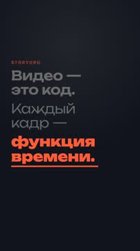
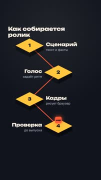
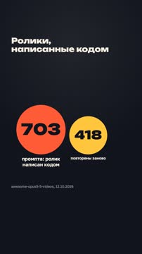
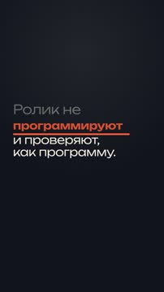

# План: Как агент собирает ролик из кода

> Сгенерировано `storygro plan` из `ru.reel.yaml`, 2026-10-24. Не правьте этот файл: текст — в спецификации ролика, вопросы и заметки — в `review.yaml`. Затем `storygro plan` заново.

| | |
|---|---|
| Статус | **сценарий** · ждёт тебя: одобрить сценарий |
| Длительность | 31.3 с (по озвучке) · 5 сцен |
| Формат | 1080×1920, 30 fps · style `kinetic-type` |
| Голос | qwen3 · assets/voice/narrator-ru.wav · 1.12 |
| Серия | product-demos |

## Одобрения

| | | Кто и когда |
|---|---|---|
| Сценарий | ⏳ ждёт |   |
| Раскадровка | ⚙️ техническое (агент) | agent 2026-10-24 |
| Выпуск | ⏳ ждёт |   |

Одобрить: `storygro approve <spec> --step script|storyboard|release` (агент — с `--agent`).

## Вопросы

- [ ] **owner** · Первый ролик в новом стиле kinetic-type (слова по голосу, тёмное поле, motion blur). Подача подходит для Reels/Shorts и Telegram, или нужен светлый вариант темы?
- [ ] **owner** · «Ролик не монтируют, а программируют» — не слишком ли категорично? Альтернатива — «можно не монтировать, а запрограммировать».

**Заметки:** Пилот стиля kinetic-type и сцен kinetic, process, scale; тема выбрана владельцем 24.10.2026 (бэклог agent-motion-studio). Демо собственного инструмента — серия product-demos, не независимый обзор.

## Хук

- Вариант 1 · **выбран**: «Видео — это код. Каждый кадр — функция времени.»

## Сцены

### 1. hook · 0.0–4.5 с · `kinetic`

кадр в ключевой момент, затем картинки сцены по порядку

**Голос:** Видео — это код. Каждый кадр — функция времени.

**На экране:** «Storygro» · «Видео — это код.» · «Каждый кадр —» · «light» · «функция времени.» · «heavy»

### 2. how · 4.5–13.2 с · `process`

кадр в ключевой момент, затем картинки сцены по порядку

**Голос:** Агент пишет сценарий, голос задаёт ритм, браузер рисует каждый кадр, а проверка ловит ошибки до выпуска.

**На экране:** «Как собирается ролик» · «кадр» · «Сценарий» · «текст и факты» · «Голос» · «задаёт ритм» · «Кадры» · «рисует браузер» · «Проверка» · «до выпуска»

**Звук:** pop @3.8, ding @5.7

### 3. evidence · 13.2–20.3 с · `scale`

кадр в ключевой момент, затем картинки сцены по порядку

**Голос:** В открытом каталоге уже 703 промпта к таким роликам. 418 из них повторили заново.

**На экране:** «Ролики, написанные кодом» · «703» · «промпта: ролик написан кодом» · «418» · «повторены заново» · «awesome-opus5-5-videos, 12.10.2026»

**Звук:** hit @1.8

**Факты:** `facts.catalog.prompts.value` = «703» · `facts.catalog.prompts.label` = «промпта: ролик написан кодом» · `facts.catalog.remakes.value` = «418» · `facts.catalog.remakes.label` = «повторены заново» · `facts.catalog.sourceLine` = «awesome-opus5-5-videos, 12.10.2026»

### 4. takeaway · 20.3–26.4 с · `kinetic`

кадр в ключевой момент, затем картинки сцены по порядку

**Голос:** Значит, ролик не монтируют, а программируют. И проверяют, как программу.

**На экране:** «Ролик не» · «light» · «0.8» · «программируют» · «монтируют» · «swap» · «code» · «regular» · «и проверяют, как программу.» · «0.7»

**Звук:** whoosh @2.8

### 5. close · 26.4–31.3 с · `kinetic`

кадр в ключевой момент, затем картинки сцены по порядку

**Голос:** Так собран и этот ролик. Storygro на GitHub.

**На экране:** «Так собран и этот ролик.» · «light» · «Storygro» · «heavy» · «slam» · «1.3»

## Факты и источники

| | |
|---|---|
| `facts.catalog` | yihui-dev/awesome-opus5-5-videos README, update 2026-10-12, read 2026-10-24: '703 prompts in prompts/ and data/videos.json, 418 of them with a live remake on Skillry' |
| `facts.storygro` | Storygro scene contract, rule 1: 'Pure function of time. draw(t) sets every animated style from t alone.' |

→ [sources.md](sources.md)

## Текст поста

> Ролик можно не монтировать, а написать: сценарий и факты — данные, голос задаёт ритм, браузер рисует каждый кадр как функцию времени, проверка ловит ошибки до выпуска. Так агент делает видео так же, как программу.
>
> В открытом каталоге awesome-opus5-5-videos уже 703 промпта к роликам, которые Claude Opus 5.5 написал кодом; 418 из них повторены заново (данные каталога на 12.10.2026). Этот ролик собран в Storygro — это демо нашего инструмента, а не независимый обзор.
>
> Голос синтезирован (Qwen3-TTS), картинки нарисованы кодом.
