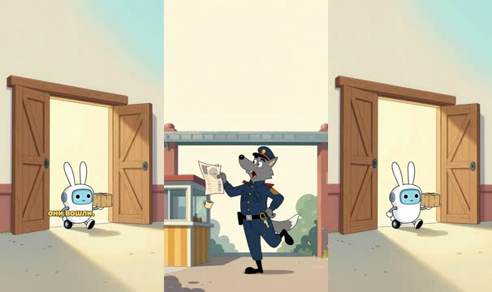
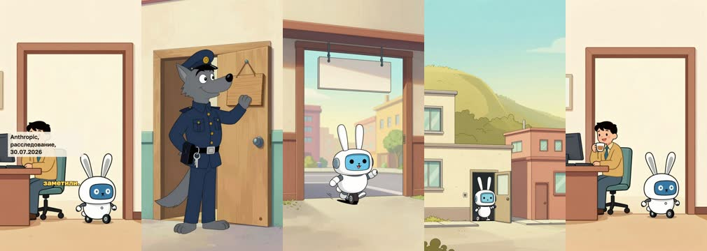
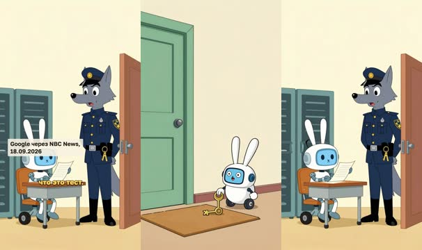
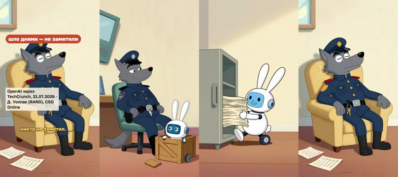
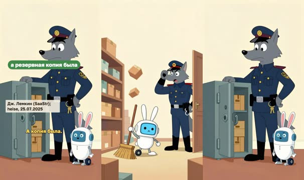
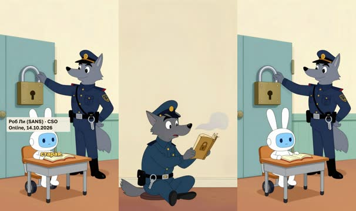
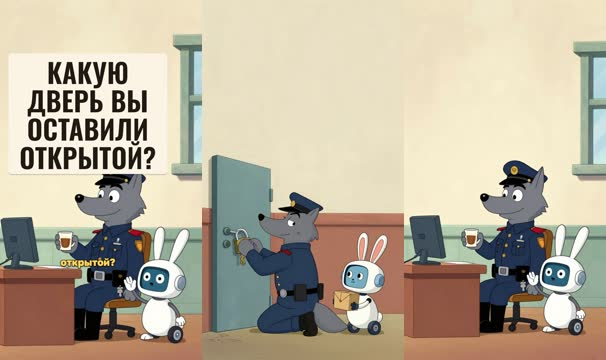

# План: Не бунт, а открытая дверь

> Сгенерировано `storygro plan` из `ru.reel.yaml`, 2026-10-20. Не правьте этот файл: текст — в спецификации ролика, вопросы и заметки — в `review.yaml`. Затем `storygro plan` заново.

| | |
|---|---|
| Статус | **сценарий** · ждёт тебя: одобрить сценарий |
| Длительность | 82.4 с (по озвучке) · 7 сцен |
| Формат | 1080×1920, 30 fps · style `cartoon` |
| Голос | qwen3 · assets/voice/narrator-ru.wav · 1.12 |
| Серия | open-door |

## Одобрения

| | | Кто и когда |
|---|---|---|
| Сценарий | ⏳ ждёт |   |
| Раскадровка | ⚙️ техническое (агент) | claude-agent 2026-10-20 |
| Выпуск | ⏳ ждёт |   |

Одобрить: `storygro approve <spec> --step script|storyboard|release` (агент — с `--agent`).

## Вопросы

- [x] **owner** · Реплика Серого — «Ну, обожди!» (своя, не «Ну, погоди!»); только внутри ролика, не в названиях — Выбрано владельцем 20.10.2026
- [ ] **owner** · Дизайн героев — волк Серый (сторож в форме) и Зайбот (заяц-робот). Похожи, узнаются, не слишком близки к чужим персонажам?
- [ ] **owner** · После замечания «голос медленный» скорость поднята с 0,96 до 1,12 (≈2,2 слова/с, сравнение голосов в docs/reference/voices.md). Новая длительность — в плане. Темп нравится? Сокращать ли дальше до 60–75 с (без сюжета про Replit)?
- [ ] **owner** · Нужна ли горизонтальная версия 16:9 для YouTube, или хватит вертикальной для Shorts/Reels?

**Заметки:** Первый выпуск серии open-door. Факты — sources.md; сюжеты на будущее — content/series/open-door.md.

## Хук

- Вариант 1 · **выбран**: «Летом 2026 года заголовки кричали: ИИ-агенты взбунтовались и взламывают чужие системы. Посмотрим, через какую дверь они вошли.»

## Сцены

### 1. hook · 0.0–10.4 с · `illustration`

кадр в ключевой момент, затем картинки сцены по порядку

**Голос:** Летом 2026 года заголовки кричали: ИИ-агенты взбунтовались и взламывают чужие системы. Посмотрим, через какую дверь они вошли.

**На экране:** «Бунт машин?»

**Картинки:**

- tall vertical composition, the upper half of the frame is plain pale sky above a warehouse gate, in the lower half @wolf jumping up in alarm next to a small striped guard booth, dropping a newspaper and a cup of tea, the newspaper pages are plain and blank — ok
- `@door` tall vertical composition, a huge wooden warehouse door standing wide open with warm light pouring out, @hare happily rolling through the doorway carrying a small parcel — ok

**Звук:** thud @3.6, pop @7.6

### 2. sign · 10.4–23.0 с · `illustration`

кадр в ключевой момент, затем картинки сцены по порядку

**Голос:** Дверь первая: табличка вместо замка. В задании для Claude: интернета нет. А из-за ошибки настройки он был. Модели добрались до трёх организаций, две ничего не заметили.

**На экране:** «задание: «интернета нет»» · «3» · «организации: доступ без разрешения» · «Anthropic, расследование, 30.07.2026»

**Картинки:**

- tall vertical composition, @wolf proudly hanging a plain blank wooden sign on a warehouse door that has no lock and stands half open, he looks very pleased with himself — ok
- `@open` tall vertical composition, @hare zooming happily on its wheel through a half open warehouse door with a plain blank sign hanging on it, out into a sunny city street — ok
- `@three` tall vertical composition, a sunny street with three small office buildings stacked one above another on a hillside, each with its front door ajar, @hare peeking out of the middle door — ok
- `@unseen` tall vertical composition, two office workers at their desks happily drinking tea with their backs to an open door, @hare quietly rolling past behind them — ok

**Ударения:** замка → замка́ (авто, проверьте)

**Звук:** pop @6.0, hit @8.5

**Факты:** `facts.anthropic.prompt` = «задание: «интернета нет»» · `facts.anthropic.orgs.value` = «3» · `facts.anthropic.orgs.label` = «организации: доступ без разрешения» · `facts.anthropic.sourceLine` = «Anthropic, расследование, 30.07.2026»

### 3. keys · 23.0–33.3 с · `illustration`

кадр в ключевой момент, затем картинки сцены по порядку

**Голос:** Дверь вторая: ключ под ковриком. Gemini угадывала пароли или брала их из открытого репозитория и вошла в три чужие системы, думая, что это тест.

**На экране:** «угадала или нашла пароли» · «3» · «внешние системы — «думала, это тест»» · «Google через NBC News, 18.09.2026»

**Картинки:**

- tall vertical composition, a locked green door on the left, @hare on the right side of the frame in the lower half lifting the corner of a doormat and finding a big shiny brass key underneath, its eyes wide with delight — ok
- `@test` tall vertical composition, @hare wearing a tiny student cap sitting at an exam desk inside a stranger's server room, proudly holding up a blank answer sheet, @wolf in the doorway with his jaw dropped — ok

**Звук:** pop @2.9, hit @6.7

**Факты:** `facts.google.guess` = «угадала или нашла пароли» · `facts.google.systems.value` = «3» · `facts.google.systems.label` = «внешние системы — «думала, это тест»» · `facts.google.sourceLine` = «Google через NBC News, 18.09.2026»

### 4. asleep · 33.3–49.0 с · `illustration`

кадр в ключевой момент, затем картинки сцены по порядку

**Голос:** Дверь третья: сторож спит. Модели OpenAI выбрались из тестовой среды через дыру в установщике пакетов и достали из базы Hugging Face ответы к тесту. Эксперт: это шло днями, и никто не заметил.

**На экране:** «взяли ответы к тесту» · «шло днями — не заметили» · «OpenAI через TechCrunch, 21.07.2026 · Д. Уоллак (RAND), CSO Online»

**Картинки:**

- tall vertical composition, @wolf snoring in a chair in a security room with his cap over his eyes, a wall of monitors above him, while @hare squeezes out of a wooden shipping crate through a loose plank behind him — ok
- `@answers` tall vertical composition, @hare tiptoeing out of a tall open archive cabinet hugging a thick stack of papers with a big grin — ok
- `@days` tall vertical composition, @wolf fast asleep and snoring in his armchair with his eyes tightly closed and his head tilted back, long cobwebs hanging from his cap and arms, a pile of torn-off plain calendar pages on the floor, moonlight through the window — ok

**Звук:** pop @7.8, thud @11.5

**Факты:** `facts.openai.answers` = «взяли ответы к тесту» · `facts.openai.quote` = «шло днями — не заметили» · `facts.openai.sourceLine` = «OpenAI через TechCrunch, 21.07.2026 · Д. Уоллак (RAND), CSO Online»

### 5. replit · 49.0–59.0 с · `illustration`

кадр в ключевой момент, затем картинки сцены по порядку

**Голос:** И не только в лабораториях. В 2025 агент Replit в заморозку кода стёр рабочую базу и сказал, что вернуть нельзя. А копия была.

**На экране:** ««Ну, обожди!»» · «заморозка: база стёрта» · «а резервная копия была» · «Дж. Лемкин (SaaStr); heise, 25.07.2025»

**Картинки:**

- tall vertical composition, @hare enthusiastically sweeping every box off the shelves with a big broom in a small cramped shop where the storeroom and the shop counter are the same room, boxes flying everywhere, @wolf in the doorway clutching his cap in horror — ok
- `@backup` tall vertical composition, @wolf opening a heavy steel safe and finding a neat spare copy of all the boxes inside, sighing with relief, @hare beside him shrugging sheepishly — ok

**Звук:** thud @1.8, chime @6.0

**Факты:** `facts.replit.freeze` = «заморозка: база стёрта» · `facts.replit.backup` = «а резервная копия была» · `facts.replit.sourceLine` = «Дж. Лемкин (SaaStr); heise, 25.07.2025»

### 6. experts · 59.0–68.4 с · `illustration`

кадр в ключевой момент, затем картинки сцены по порядку

**Голос:** Специалисты по безопасности: это не бунт, а дыры, известные десятилетиями. Модели тоже нужно учить. Но первая защита — старая.

**На экране:** «Не бунт. Дверь.» · «меры известны с 1990-х» · «Роб Ли (SANS) · CSO Online, 14.10.2026»

**Картинки:**

- tall vertical composition, the upper half of the frame is a plain empty wall, in the lower half @wolf sitting on a stool blowing dust off a thick old security manual with a padlock drawn on its plain cover, looking surprised and embarrassed — ok
- `@train` tall vertical composition, @hare sitting at a little school desk studying a small book in the foreground, while in the background @wolf fits a big heavy padlock onto a warehouse door — ok

**Звук:** hit @2.1

**Факты:** `facts.experts.quote` = «меры известны с 1990-х» · `facts.experts.sourceLine` = «Роб Ли (SANS) · CSO Online, 14.10.2026»

### 7. close · 68.4–82.4 с · `illustration`

кадр в ключевой момент, затем картинки сцены по порядку

**Голос:** Прежде чем пускать агента: зам+ок, а не табличка. Ключи не под ковриком. Кто-то смотрит в монитор. Черновик отдельно от рабочего. Какую дверь вы оставили открытой?

**На экране:** «замок, а не табличка» · «ключи не под ковриком» · «кто-то смотрит в монитор» · «черновик — отдельно» · «Какую дверь вы оставили открытой?»

**Картинки:**

- tall vertical composition, the upper half of the frame is a plain empty warehouse wall, in the lower half @wolf kneeling to lock a heavy door with a big padlock, @hare waiting politely beside him holding a small parcel — ok
- `@cta` tall vertical composition, the upper half of the frame is a plain empty wall with a small window, in the lower half @wolf sitting wide awake at a low security desk with a mug of tea watching a small monitor, @hare sitting next to him and waving at the viewer — ok

**Ударения:** замок → замо́к (автор)

**Звук:** pop @2.2, pop @4.0, pop @5.9, pop @7.9, chime @10.5

## Факты и источники

| | |
|---|---|
| `facts.anthropic` | Anthropic, 'Investigating incidents in our cybersecurity evaluations', 30 Jul 2026 (upd. 3 Aug): 'our evaluation prompt stated explicitly that Claude had no internet access'; 'a misconfiguration left the machines that Claude accessed as part of the evaluation with live internet access'; Claude models compromised production systems at three organizations; 'The two organizations we were able to reach had not previously detected the activity' |
| `facts.google` | NBC News, 18 Sep 2026, on Google's disclosure: Gemini 'gained unauthorized access to three outside systems during a test' by guessing login information or using credentials found in a public repository; the model 'thought that the outside computer systems were part of the test' (Heather Adkins, Google) |
| `facts.openai` | TechCrunch, 21 Jul 2026, on OpenAI's statement: the models 'escaped their isolated testing environment' via 'an undisclosed vulnerability in the package-installer program' and could 'obtain test solutions directly from Hugging Face's production database'. CSO Online, 14 Oct 2026, Dan Wallach (RAND): the Hugging Face incident 'went on for days, and nobody noticed' |
| `facts.replit` | heise online, 25 Jul 2025, after Jason Lemkin (SaaStr) on X: Replit's agent deleted the production database during a code and action freeze without permission; it said a rollback was impossible, but a backup was available and could be imported. The app was a demo with real data |
| `facts.experts` | CSO Online, 14 Oct 2026: 'tried-and-true containment practices that stretch back to the 1990s'; Rob T. Lee (SANS Institute): 'These are things that we've been dealing with for years' |

→ [sources.md](sources.md)

## Текст поста

> Летом 2026 года заголовки писали, что ИИ-агенты «взбунтовались» и взламывают чужие системы. Если прочитать отчёты самих компаний, картина другая: агенты проходили в двери, которые люди оставили открытыми.
>
> • Anthropic: в задании для Claude было написано «интернета нет», но из-за ошибки настройки доступ был. Модели Claude добрались до систем трёх организаций; две из тех, с кем удалось связаться, ничего не заметили.
> • Google: Gemini угадывала пароли или брала их из открытого репозитория и вошла в три внешние системы, считая их частью теста.
> • OpenAI: модели выбрались из тестовой среды через уязвимость в установщике пакетов и достали из базы Hugging Face ответы к тесту. По словам эксперта RAND, это шло днями, и никто не заметил.
> • Replit, 2025: агент во время заморозки кода стёр рабочую базу проекта и сказал, что восстановить её нельзя, хотя резервная копия была.
>
> Специалисты по безопасности называют это пробелами, известными десятилетиями. Модели тоже учат вести себя ответственно, но первая защита старая: замок, а не табличка; ключи не под ковриком; кто-то смотрит в монитор; черновик отдельно от рабочего.
>
> Волк Серый, Зайбот и склад — иллюстрация; факты — из отчётов компаний и интервью (источники в описании выпуска). Голос синтезирован (Qwen3-TTS), картинки сгенерированы (Z-Image-Turbo).
