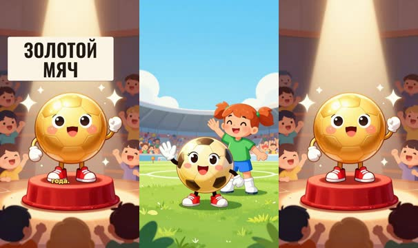
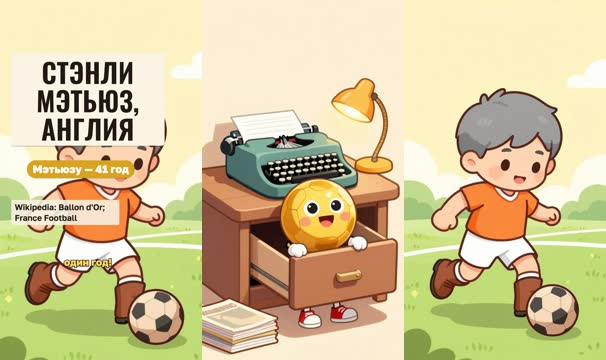
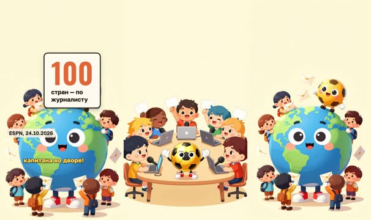
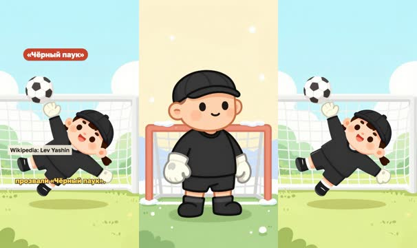
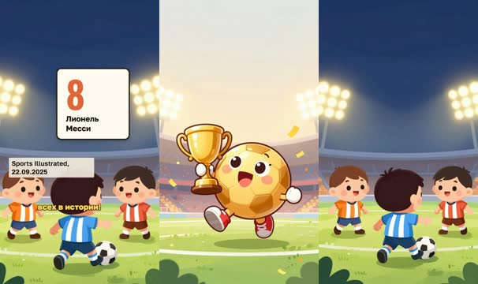
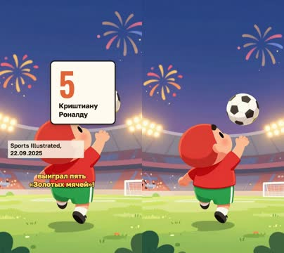
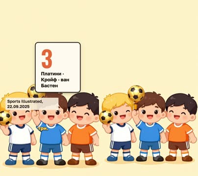
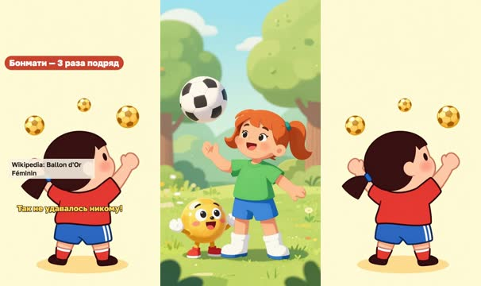
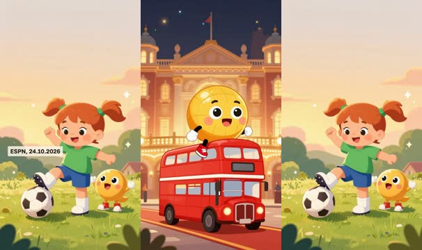

# План: Золотой мяч: кто самый лучший?

> Сгенерировано `storygro plan` из `ru.reel.yaml`, 2026-10-24. Не правьте этот файл: текст — в спецификации ролика, вопросы и заметки — в `review.yaml`. Затем `storygro plan` заново.

| | |
|---|---|
| Статус | **сценарий** · ждёт тебя: одобрить сценарий |
| Длительность | 89.1 с (по озвучке) · 9 сцен |
| Формат | 1080×1920, 30 fps · style `cartoon` |
| Голос | qwen3 · assets/voice/narrator-ru.wav · 1.12 |

## Одобрения

| | | Кто и когда |
|---|---|---|
| Сценарий | ⏳ ждёт |   |
| Раскадровка | ⚙️ техническое (агент) | agent 2026-10-24 |
| Выпуск | ⏳ ждёт |   |

Одобрить: `storygro approve <spec> --step script|storyboard|release` (агент — с `--agent`).

## Вопросы

- [ ] **owner** · Финал говорит «26 октября вручат впервые в Лондоне». После 26.10.2026 фраза устареет — публиковать до церемонии или переозвучить финал (например, назвать нового лауреата)?
- [ ] **owner** · Голос по правилу для новых русских выпусков — Qwen3, скорость 1.12. Для детей 6–10 лет не замедлить ли до 1.0 (ролик станет ≈95 с, придётся что-то сократить)?
- [ ] **owner** · Златик и Маша — свои персонажи; футболисты — обобщённые фигурки в цветах команд, без портретного сходства. Так подходит, или нужны другие персонажи?

**Заметки:** Сделано по просьбе владельца 24.10.2026 — детский мультик до 1,5 минуты. Факты проверены 24.10.2026 (sources.md); официальный ballondor.com недоступен для проверки (403).

## Хук

- Вариант 1 · **выбран**: «Привет! Знаешь, какой мяч в футболе самый главный? Тот, которым не играют! Это «Золотой мяч». Его вручают лучшему футболисту года.»

## Сцены

### 1. hook · 0.0–10.9 с · `illustration`

кадр в ключевой момент, затем картинки сцены по порядку

**Голос:** Привет! Знаешь, какой мяч в футболе самый главный? Тот, которым не играют! Это «Золотой мяч». Его вручают лучшему футболисту года.

**На экране:** «Золотой мяч»

**Картинки:**

- @ball waving hello in the middle of a sunny green football pitch, @kid smiling and waving behind him, a stadium with cheerful fans far in the background — ok
- `@gold` @ball standing proudly on a small red velvet pedestal under a bright spotlight, glittering sparkles all around him, happy cartoon fans cheering in the stands — ok

**Ударения:** Золотой → Золото́й (словарь)

**Звук:** chime @3.3, pop @5.1

### 2. origin · 10.9–21.3 с · `illustration`

кадр в ключевой момент, затем картинки сцены по порядку

**Голос:** Его придумал французский журнал France Football в 1956 году. Первым победителем стал англичанин Стэнли Мэтьюз. Ему был уже сорок один год!

**На экране:** «1956» · «первый «Золотой мяч»» · «Стэнли Мэтьюз, Англия» · «Мэтьюзу — 41 год» · «Wikipedia: Ballon d'Or; France Football»

**Картинки:**

- a cosy old-fashioned 1950s magazine office with round typewriters, desk lamps and stacks of plain blank magazines, @ball peeking curiously out of an open desk drawer — ok
- `@first` a cheerful slim footballer with neat grey hair and a kind smile in a plain tangerine orange shirt and white shorts, old brown leather boots, dribbling a brown leather ball on a 1950s football pitch on a sunny day — ok

**Ударения:** Стэнли → Стэ́нли (словарь) · Мэтьюз → Мэ́тьюз (словарь)

**Звук:** pop @2.6, ding @8.1

**Факты:** `facts.origin.year.value` = «1956» · `facts.origin.year.label` = «первый «Золотой мяч»» · `facts.origin.first` = «Стэнли Мэтьюз, Англия» · `facts.matthews.note` = «Мэтьюзу — 41 год» · `facts.origin.sourceLine` = «Wikipedia: Ballon d'Or; France Football»

### 3. vote · 21.3–31.1 с · `illustration`

кадр в ключевой момент, затем картинки сцены по порядку

**Голос:** А кто выбирает победителя? Спортивные журналисты, по одному из ста стран. Каждый называет своих лучших, почти как когда выбирают капитана во дворе!

**На экране:** «Кто выбирает?» · «100» · «стран — по журналисту» · «ESPN, 24.10.2026»

**Картинки:**

- a long table of friendly cartoon sports journalists of many different looks with laptops and microphones, each happily raising a plain blank card, @ball sitting in the middle of the table — ok
- `@hundred` a big round globe surrounded by many tiny cartoon journalists holding plain blank envelopes, a flying swirl of envelopes heading to @ball — ok

**Звук:** hit @3.0

**Факты:** `facts.vote.countries.value` = «100» · `facts.vote.countries.label` = «стран — по журналисту» · `facts.vote.sourceLine` = «ESPN, 24.10.2026»

### 4. yashin · 31.1–46.7 с · `illustration`

кадр в ключевой момент, затем картинки сцены по порядку

**Голос:** А вот наш герой, советский вратарь Лев Яшин. В 1963 году «Золотой мяч» достался ему. Он до сих пор единственный вратарь-победитель! За тёмную форму его прозвали «Чёрный паук».

**На экране:** «Лев Яшин, СССР» · «1963» · «единственный вратарь» · ««Чёрный паук»» · «Wikipedia: Lev Yashin»

**Картинки:**

- a tall friendly cartoon goalkeeper in a plain all-black long-sleeved jersey, black flat cap and big gloves, standing confidently in front of a goal on a snowy 1960s pitch, gentle snowflakes — ok
- `@spider` the same tall cartoon goalkeeper in a plain all-black jersey and black flat cap flying sideways in a spectacular dive to catch the ball, long arms and legs stretched like a playful spider, a goal behind him — ok

**Ударения:** Яшин → Я́шин (словарь) · Золотой → Золото́й (словарь)

**Звук:** pop @4.1, whoosh @11.9

**Факты:** `facts.yashin.name` = «Лев Яшин, СССР» · `facts.yashin.year.value` = «1963» · `facts.yashin.year.label` = «единственный вратарь» · `facts.yashin.nickname` = ««Чёрный паук»» · `facts.yashin.sourceLine` = «Wikipedia: Lev Yashin»

### 5. records · 46.7–53.5 с · `illustration`

кадр в ключевой момент, затем картинки сцены по порядку

**Голос:** Теперь рекорды! У аргентинца Лионеля Месси восемь «Золотых мячей», больше всех в истории!

**На экране:** «Рекорды» · «8» · «Лионель Месси» · «Sports Illustrated, 22.09.2025»

**Картинки:**

- @ball holding a shiny golden trophy cup and jumping with excitement on a stadium pitch under bright floodlights, confetti in the air — ok
- `@messi` a small nimble cartoon footballer in a plain sky blue and white vertically striped shirt, seen from behind, dribbling the ball past three surprised defenders, stadium lights at night — ok

**Ударения:** Лионеля → Лионе́ля (словарь) · Месси → Ме́сси (словарь) · Золотых → Золоты́х (словарь)

**На слух:** Месси — верно (дубль 1)

**Звук:** chime @1.6

**Факты:** `facts.records.messi.value` = «8» · `facts.records.messi.label` = «Лионель Месси» · `facts.records.sourceLine` = «Sports Illustrated, 22.09.2025»

### 6. ronaldo · 53.5–58.5 с · `illustration`

кадр в ключевой момент, затем картинки сцены по порядку

**Голос:** А португалец Криштиану Роналду выиграл пять «Золотых мячей»!

**На экране:** «5» · «Криштиану Роналду» · «Sports Illustrated, 22.09.2025»

**Картинки:**

- a tall athletic cartoon footballer in a plain red shirt and green shorts, seen from behind, leaping very high to kick the ball, colourful fireworks in the night sky over the stadium — ok

**Ударения:** Криштиану → Криштиа́ну (словарь) · Роналду → Рона́лду (словарь) · Золотых → Золоты́х (словарь)

**Звук:** pop @-0.0

**Факты:** `facts.records.ronaldo.value` = «5» · `facts.records.ronaldo.label` = «Криштиану Роналду» · `facts.records.sourceLine` = «Sports Illustrated, 22.09.2025»

### 7. three · 58.5–62.9 с · `illustration`

кадр в ключевой момент, затем картинки сцены по порядку

**Голос:** А Платини, Кройф и ван Бастен выигрывали по три.

**На экране:** «3» · «Платини · Кройф · ван Бастен» · «Sports Illustrated, 22.09.2025»

**Картинки:**

- three smiling cartoon footballers in plain white, blue and orange retro 1980s shirts with funny retro hairstyles, standing side by side, each holding up a small shiny golden football — ok

**Ударения:** Платини → Платини́ (словарь) · Кройф → Кро́йф (словарь) · Бастен → Ба́стен (словарь)

**Звук:** pop @0.2

**Факты:** `facts.records.three.value` = «3» · `facts.records.three.label` = «Платини · Кройф · ван Бастен» · `facts.records.sourceLine` = «Sports Illustrated, 22.09.2025»

### 8. women · 62.9–76.2 с · `illustration`

кадр в ключевой момент, затем картинки сцены по порядку

**Голос:** Девочки тоже играют в футбол! С 2018 года есть и женский «Золотой мяч». Испанка Айтана Бонмати выиграла его три раза подряд. Так не удавалось никому!

**На экране:** «2018» · «женский «Золотой мяч»» · «Бонмати — 3 раза подряд» · «Wikipedia: Ballon d'Or Féminin»

**Картинки:**

- @kid happily juggling a football on her knee in a sunny park, @ball cheering next to her — ok
- `@aitana` a cheerful cartoon woman footballer with a dark ponytail in a plain red shirt and blue shorts, seen from behind, celebrating with arms raised, three small shiny golden footballs floating in the air above her — ok

**Ударения:** Золотой → Золото́й (словарь) · Айтана → Айта́на (словарь) · Бонмати → Бонмати́ (словарь)

**Звук:** pop @2.4, chime @7.4

**Факты:** `facts.women.since.value` = «2018» · `facts.women.since.label` = «женский «Золотой мяч»» · `facts.women.note` = «Бонмати — 3 раза подряд» · `facts.women.sourceLine` = «Wikipedia: Ballon d'Or Féminin»

### 9. close · 76.2–89.1 с · `illustration`

кадр в ключевой момент, затем картинки сцены по порядку

**Голос:** А 26 октября «Золотой мяч» впервые вручат не в Париже, а в Лондоне. Кто знает, может, однажды его получишь и ты? Главное — любить игру и тренироваться!

**На экране:** «26.10.2026 · Лондон» · «ESPN, 24.10.2026»

**Картинки:**

- a grand old theatre in London at night with warm golden lights and a red carpet, @ball arriving happily on the top deck of a little red double-decker bus — ok
- `@you` @kid kicking a ball in a backyard at golden sunset with @ball cheering beside her, dreamy sparkles in the air — ok

**Ударения:** Золотой → Золото́й (словарь) · Париже → Пари́же (словарь) · Лондоне → Ло́ндоне (словарь)

**Звук:** chime @6.0, swell @9.0

**Факты:** `facts.next.when` = «26.10.2026 · Лондон» · `facts.next.sourceLine` = «ESPN, 24.10.2026»

## Факты и источники

| | |
|---|---|
| `facts.origin` | Wikipedia, Ballon d'Or: 'presented by French magazine France Football since 1956'; 'Stanley Matthews of England was the inaugural winner of the award.' 1956 Ballon d'Or: 'Stanley Matthews received the award on 18 December 1956' |
| `facts.matthews` | Wikipedia, Stanley Matthews: born 1 February 1915; award on 18 December 1956 → 41 years (our arithmetic) |
| `facts.vote` | ESPN, 24 Oct 2026: votes by 'selected international journalists', one per country from 'the top 100 nations in the FIFA men's world ranking' |
| `facts.yashin` | Wikipedia, Ballon d'Or: 'Lev Yashin is the only goalkeeper to have won the award.' Wikipedia, Lev Yashin: won 1963; nicknamed 'the Black Spider'; 'distinctive all-black outfit' |
| `facts.records` | Sports Illustrated, modified 22 Sep 2025: Messi '8 (2009, 2010, 2011, 2012, 2015, 2019, 2021, 2023)'; Ronaldo '5 (2008, 2013, 2014, 2016, 2017)'; Platini, Cruyff, van Basten '3' each. Wikipedia: 'Lionel Messi holds the record for most Ballon d'Or wins with eight.' |
| `facts.women` | Wikipedia, Ballon d'Or Féminin: 'first awarded in 2018, with Ada Hegerberg of Norway'; Aitana Bonmatí won 2023, 2024, 2025: 'the first player to win it three times, and three times in a row' |
| `facts.next` | ESPN, 24 Oct 2026: ceremony 'Monday, Oct. 26', London Palladium, 'held outside Paris for the first time'. Wikipedia, 2026 Ballon d'Or: '26 October 2026 at the London Palladium' |

→ [sources.md](sources.md)

## Текст поста

> Что такое «Золотой мяч», кто его придумал и у кого их больше всех? Короткий мультик для юных болельщиков: первый победитель Стэнли Мэтьюз, единственный вратарь-лауреат Лев Яшин, рекорд Лионеля Месси и женский «Золотой мяч» Айтаны Бонмати.
>
> Златик, Маша и футболисты на картинках — нарисованные персонажи, а не портреты. Имена, годы и числа — из открытых источников, проверены 24 октября 2026 года (список в описании выпуска). Голос синтезирован (Qwen3-TTS), картинки сгенерированы (Z-Image-Turbo).
