# План: Стэнли Мэтьюз

> Сгенерировано `storygro plan` из `ru.reel.yaml`, 2026-10-28. Не правьте этот файл: текст — в спецификации ролика, вопросы и заметки — в `review.yaml`. Затем `storygro plan` заново.

| | |
|---|---|
| Статус | **сценарий** · ждёт тебя: одобрить сценарий |
| Длительность | 87.0 с (по озвучке) · 12 сцен |
| Формат | 1080×1920, 30 fps · style `cartoon` |
| Голос | omnivoice · assets/voice/narrator-ru.wav · 0.9 |

## Одобрения

| | | Кто и когда |
|---|---|---|
| Сценарий | ✏️ изменено после одобрения | agent 2026-10-28 |
| Раскадровка | ⚙️ техническое (агент) | agent 2026-10-28 |
| Выпуск | ⏳ ждёт |   |

Одобрить: `storygro approve <spec> --step script|storyboard|release` (агент — с `--agent`).

## Вопросы

- [x] **owner** · После просмотра: подходят ли темп, картинка и сложность для детей 6–10 лет? Это вид для всей серии. — Владелец 28.10.2026: «давай комит и пуш, принимаем» — оставлено как есть
- [x] **owner** · «Мэтьюз» озвучен латиницей (Matthews): ударение верное, но местами слышен английский звук «th». Оставить так или вернуть русское «Мэтьюз», где голос часто ставит ударение на «ю»? — Владелец 28.10.2026: «давай комит и пуш, принимаем» — оставлено как есть
- [x] **owner** · Послушайте «камбэк» и «возрастным» — модель распознавания не уверена в ударении. «Камбэк» и «самым возрастным» — слова из вашего текста; оставить или заменить на «отыгралась» и «самым взрослым»? — Владелец 28.10.2026: «давай комит и пуш, принимаем» — оставлено как есть
- [ ] **owner** · Матвей и София сейчас только в картинках, текст читает один рассказчик. Нужны ли им свои синтетические детские голоса и реплики в следующих выпусках?
- [x] **owner** · Выпуск длится 87 с при ориентире 1:30–2:00: текст не растягивал, добавил только паузы после финта и «4:3». Устраивает или добавить сцену (например, анонс следующего героя — Ди Стефано)? — Владелец 28.10.2026: «давай комит и пуш, принимаем» — оставлено как есть

**Заметки:** Сделано по просьбе владельца 28.10.2026: серия для Instagram на русском по документам «рекомендации» и «Футболисты_1 выпуск», картинки GPT Image (Codex), визуальные аналоги изучены. Лица ведущих показаны владельцу до генерации и утверждены («да, герои устраивают»); эталоны приложены к каждому кадру с ведущими (images.refs). Текст рассказчика — сценарий владельца дословно по его указанию («если он хороший и плотный и по делу, то не меняй»); все факты проверены, источники в sources.md. Рендер 87,04 с, 1080×1920, 30 fps, −14 LUFS, 21 картинка GPT Image (ни одна не отклонена), OmniVoice B 0,90; QA 13/13 pass (preview/QA.md). Кадры готового MP4 просмотрены, подписи не закрывают лица. Прослушивание и одобрение владельца не зафиксированы. Публикации не было; веб-версия отправлена владельцу на телефон. 28.10.2026 владелец посмотрел и ответил «принимаем»: выпуск оставлен как есть, вопросы по выпуску закрыты. Вопрос о голосах ведущих относится к следующим выпускам и остаётся открытым. Одобрение релиза в approvals владелец записывает сам (storygro approve --step release --by …); агент его не записывает.

## Хук

- Вариант 1 · **выбран**: «Может ли футболист стать лучшим в Европе в 41 год?»

## Сцены

### 1. hook · 0.0–4.3 с · `illustration`

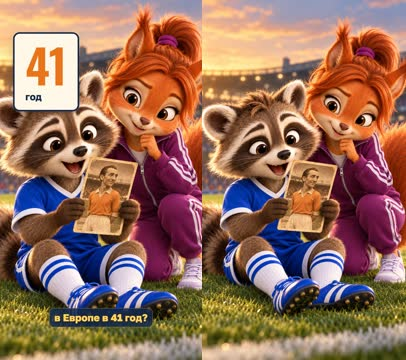

кадр в ключевой момент, затем картинки сцены по порядку

**Голос:** Может ли футболист стать лучшим в Европе в 41 год?

**На экране:** «41» · «год»

**Картинки:**

- @matvey on a green football pitch at golden hour holding up an old sepia football trading card with a portrait of @matthews, staring at it with huge astonished eyes and his mouth wide open, his ears up; @sofia leans in over his shoulder, curious, one eyebrow raised; a modern stadium softly blurred behind them, floodlights starting to glow — ok

**Звук:** swell @0.0, pop @2.6

**Факты:** `facts.age.value` = «41» · `facts.age.label` = «год»

### 2. intro · 4.3–6.6 с · `illustration`

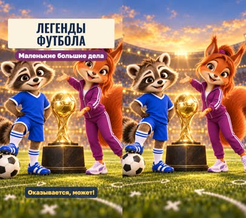

кадр в ключевой момент, затем картинки сцены по порядку

**Голос:** Оказывается, может!

**На экране:** «Легенды футбола» · «Маленькие большие дела»

**Картинки:**

- the series title moment: @matvey stops a rolling classic black-and-white football with his boot and grins with excitement; @sofia turns and gestures enthusiastically toward a luminous golden football-shaped trophy on a dark plinth between them; a soft golden light sweeps across the trophy, a few golden sparkles in the air; a beautiful stadium at golden hour with floodlights, faint white tactical chalk arrows and circles on the grass — ok

**Звук:** hit @0.0, chime @0.5

**Факты:** `facts.series.title` = «Легенды футбола» · `facts.series.project` = «Маленькие большие дела»

### 3. card · 6.6–18.8 с · `illustration`

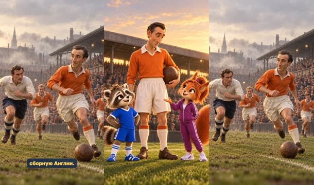

кадр в ключевой момент, затем картинки сцены по порядку

**Голос:** Знакомьтесь: Стэнли Мэтьюз — первый в истории обладатель «Золотого мяча». В 1956 году он играл за английский клуб «Бл+экпул» и сборную Англии.

**На экране:** «Стэнли Мэтьюз» · «Англия» · «1956» · ««Блэкпул» · крайний нападающий»

**Картинки:**

- a wide shot of a 1950s English football ground at sunset: the upper forty percent of the frame is open golden evening sky above a low old stadium roof, with nothing else in it; below it, in the middle distance in the centre of the frame, @matthews stands on the pitch holding an old leather ball under his arm, his head exactly at the vertical middle of the frame, packed old terraces with men in flat caps behind him; in the foreground at the bottom @matvey and @sofia look up at him with admiration, Sofia presenting him with an open hand; gentle vintage film grain on the historical part — ok
- `@club` a 1950s football match in England: @matthews runs down the right wing with the old leather ball at his feet, @blackpool teammates running in support, a defender from @bolton chasing; packed old terraces full of cheering men in flat caps and scarves, smoke and mist in the air, warm sepia-tinted vintage colour grading with subtle film grain; the upper third of the frame is hazy grey sky — ok

**Ударения:** Блэкпул → Блэ́кпул (автор)

**На слух:** Мэтьюз — верно (дубль 1)

**Факты:** `facts.matthews.name` = «Стэнли Мэтьюз» · `facts.matthews.country` = «Англия» · `facts.matthews.year` = «1956» · `facts.matthews.label` = ««Блэкпул» · крайний нападающий»

### 4. weapon · 18.8–26.8 с · `illustration`

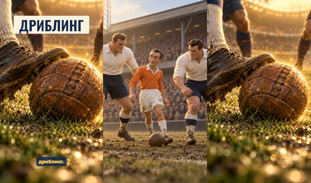

кадр в ключевой момент, затем картинки сцены по порядку

**Голос:** Мэтьюз не всегда был самым быстрым или сильным футболистом на поле, зато у него было особенное оружие — дриблинг.

**На экране:** «Дриблинг»

**Картинки:**

- @matthews, slim and wiry, stands calmly with the old leather ball at his feet between two much bigger, broad-shouldered @bolton defenders who tower over him on a muddy 1950s pitch; he looks small next to them but relaxed and smiling; packed terraces behind, warm sepia-tinted vintage grading with subtle film grain — ok
- `@weapon` an extreme close-up at grass level, with no person's face or head anywhere in the frame: only an old brown leather football and one muddy old leather football boot with a white sock gently touching it on wet grass, a warm magical golden glow and a few sparkles around the ball as if it were a secret weapon, blurred legs of defenders in the background, the upper part of the frame a soft golden blur of the stadium, vintage film grain — ok

**На слух:** Мэтьюз — верно (дубль 1)

**Звук:** ding @7.0

### 5. what · 26.8–33.3 с · `illustration`

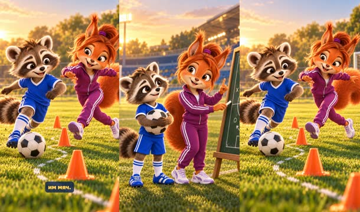

кадр в ключевой момент, затем картинки сцены по порядку

**Голос:** Что такое дриблинг? Это умение вести мяч, обыгрывать соперников и не отдавать им мяч.

**Картинки:**

- @sofia on a modern green training pitch stands beside a dark green chalkboard on an easel covered with simple white chalk tactical drawings of arrows, circles and crosses (no writing at all), holding a piece of chalk and raising one finger with a curious, clever look; @matvey hugs a classic black-and-white football and listens with wide eyes; golden-hour light, a stadium behind — ok
- `@def` @matvey dribbles a classic black-and-white football in a zigzag around a row of orange training cones, keeping the ball close to his boot, while @sofia stretches out one foot trying to steal it and misses, both laughing; a dotted white chalk line on the grass shows his zigzag path; golden-hour light on a modern pitch — ok

**Звук:** pop @0.0

### 6. feint · 33.3–40.7 с · `illustration`

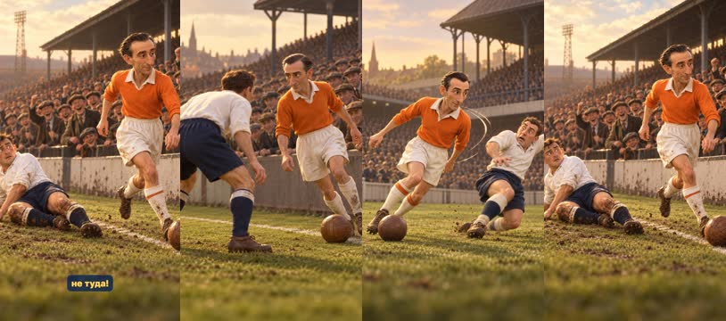

кадр в ключевой момент, затем картинки сцены по порядку

**Голос:** Мэтьюз мог сделать обманное движение, качнуть плечом — и защитник уже бежал совсем не туда!

**Картинки:**

- a one-on-one duel on a 1950s pitch near the right touchline: @matthews faces a crouching defender from @bolton, the old leather ball at his feet, the two of them eye to eye, tension in the air, crowd in flat caps leaning over the low wall behind; warm sepia-tinted vintage grading with subtle film grain — ok
- `@shoulder` @matthews dips his left shoulder sharply as if to go left, his body leaning, while the defender from @bolton throws himself the wrong way with arms flailing; curved motion lines show the fake; the ball stays at Matthews' right foot; 1950s pitch, crowd behind, warm sepia-tinted vintage grading with subtle film grain — ok
- `@gone` the defender from @bolton sits on the muddy grass looking confused, his head turned the wrong way, while @matthews glides away along the right touchline with the ball, light and quick; the crowd in flat caps cheers and laughs; warm sepia-tinted vintage grading with subtle film grain — ok

**На слух:** Мэтьюз — верно (дубль 1)

**Звук:** whoosh @3.0, pop @4.4

### 7. final · 40.7–48.4 с · `illustration`

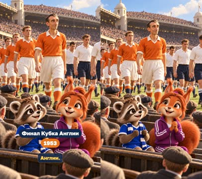

кадр в ключевой момент, затем картинки сцены по порядку

**Голос:** В 1953 году он помог «Бл+экпулу» выиграть знаменитый финал Кубка Англии.

**На экране:** «Финал Кубка Англии» · «1953»

**Картинки:**

- a grand old national stadium with two white domed towers on a sunny day in May 1953, a hundred thousand spectators in flat caps and hats, the two teams walking out side by side: @blackpool and @bolton, with @matthews among the Blackpool players; in the front row of the old stands @matvey and @sofia sit small among the 1950s crowd in their own modern clothes, wide-eyed like time travellers; warm vintage colour grading with subtle film grain — ok

**Ударения:** Блэкпулу → Блэ́кпулу (автор)

**Звук:** swell @0.0

**Факты:** `facts.final.title` = «Финал Кубка Англии» · `facts.final.year` = «1953»

### 8. comeback · 48.4–55.8 с · `illustration`

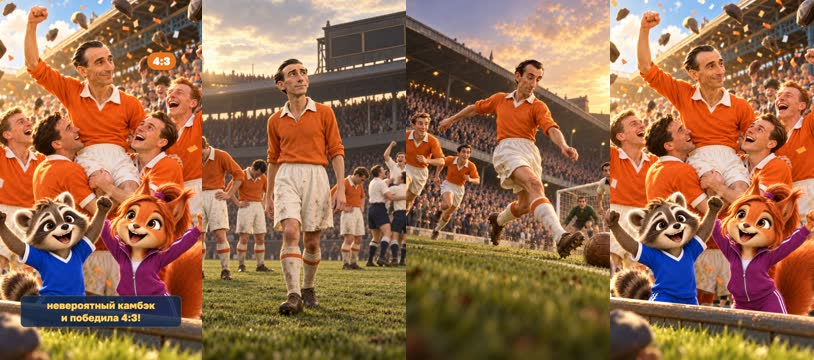

кадр в ключевой момент, затем картинки сцены по порядку

**Голос:** Команда проигрывала 1:3, но совершила невероятный камбэк и победила 4:3!

**На экране:** «1:3» · ««Блэкпул» — «Болтон»» · «4:3»

**Картинки:**

- the @blackpool players stand with their heads down and hands on hips, disappointed, while @bolton players celebrate in the background; @matthews looks up, calm and determined; an old wooden stadium scoreboard with blank panels behind them; 1953 cup final atmosphere, warm sepia-tinted vintage grading with subtle film grain — ok
- `@back` @matthews races down the right wing and crosses the old leather ball into the penalty area with a sweeping kick, @blackpool teammates sprinting in, the whole crowd rising to its feet; dynamic low angle, motion lines, warm vintage colour grading with subtle film grain — ok
- `@win` pure joy: @blackpool players hug @matthews and jump with their arms in the air, spectators throw their flat caps up into the sky, confetti and golden light; in the front row of the old stands @matvey and @sofia jump and cheer with their arms up; warm vintage colour grading turning brighter and more colourful — ok

**Звук:** riser @2.6, chime @4.3, swell @4.3

**Факты:** `facts.final.before` = «1:3» · `facts.final.teams` = ««Блэкпул» — «Болтон»» · `facts.final.after` = «4:3»

### 9. fifty · 55.8–70.5 с · `illustration`

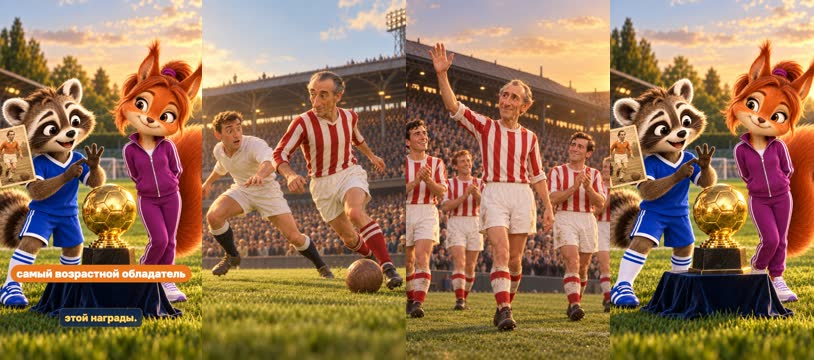

кадр в ключевой момент, затем картинки сцены по порядку

**Голос:** А самое удивительное — после получения «Золотого мяча» Мэтьюз продолжал играть ещё много лет. Он завершил карьеру только в 50 лет и до сих пор остаётся самым возрастным победителем этой награды.

**На экране:** «50» · «лет» · «самый возрастной обладатель»

**Картинки:**

- @matthews-old still dribbles the ball past a much younger, surprised defender in a plain white shirt in a 1960s match, light on his feet, a full stadium behind; warm vintage 1960s colour grading with subtle film grain — ok
- `@fifty` @matthews-old waves goodbye to a cheering crowd at the end of his last match, smiling warmly, his teammates applauding around him, the evening sun low and golden over the old stadium; warm vintage 1960s colour grading — ok
- `@record` @matvey and @sofia on a modern pitch at golden hour beside a luminous golden football-shaped trophy on a dark plinth; Matvey holds up an old sepia football card of @matthews and counts on his fingers in amazement; Sofia smiles knowingly with her paws behind her back — ok

**На слух:** Мэтьюз — верно (дубль 1)

**Звук:** ding @7.0, chime @9.7

**Факты:** `facts.career.end` = «50» · `facts.career.endLabel` = «лет» · `facts.career.record` = «самый возрастной обладатель»

### 10. lesson · 70.5–77.8 с · `illustration`

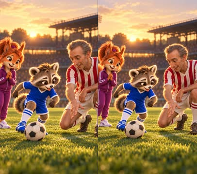

кадр в ключевой момент, затем картинки сцены по порядку

**Голос:** Вот что интересно: Мэтьюз доказывал, что возраст — не единственное, что определяет мастерство.

**Картинки:**

- a warm meeting across time on a green pitch at golden hour: @matthews-old kneels on one knee and shows @matvey how to dip a shoulder over the ball, both concentrating, Matvey copying the move with his tongue out; @sofia stands beside them watching with a delighted smile; the glow of the setting sun, a stadium softly blurred behind — ok

**На слух:** Мэтьюз — верно (дубль 1)

### 11. skills · 77.8–82.0 с · `kinetic`

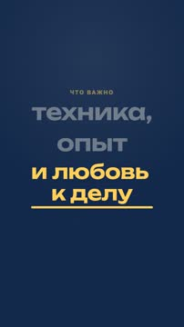

кадр в ключевой момент, затем картинки сцены по порядку

**Голос:** Важны техника, опыт и любовь к тому, чем занимаешься.

**На экране:** «#13294b» · «Что важно» · «техника,» · «опыт» · «и любовь к делу»

**Звук:** pop @0.6, pop @1.8, pop @2.1

**Факты:** `facts.lesson.kicker` = «Что важно» · `facts.lesson.a` = «техника,» · `facts.lesson.b` = «опыт» · `facts.lesson.c` = «и любовь к делу»

### 12. question · 82.0–87.0 с · `illustration`

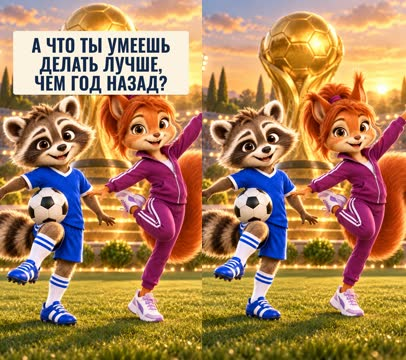

кадр в ключевой момент, затем картинки сцены по порядку

**Голос:** А что ты умеешь делать лучше, чем год назад?

**На экране:** «А что ты умеешь делать лучше, чем год назад?»

**Картинки:**

- @matvey and @sofia close to the camera on a pitch at sunset, smiling straight at the viewer: Matvey proudly keeps the ball up on his knee, Sofia balances gracefully on one foot in a gymnast pose with her arms out; the luminous golden football-shaped trophy glows on its plinth behind them, warm golden-hour stadium lights — ok

**Звук:** chime @0.3

**Факты:** `facts.question.text` = «А что ты умеешь делать лучше, чем год назад?»

## Факты и источники

| | |
|---|---|
| `facts.series` | Owner's brief «рекомендации» (2026-10-28): «Маленькие большие дела · Легенды футбола · Истории обладателей «Золотого мяча»» |
| `facts.matthews` | UEFA.com, «The Wizard of Dribble, Sir Stanley Matthews» (2015): inaugural European Footballer of the Year in 1956; Blackpool between his two Stoke spells. Position: the owner's script «Крайний нападающий» |
| `facts.age` | Our arithmetic: born 1 February 1915 (Wikipedia, «Stanley Matthews»), award presented December 1956 → 41 full years; topendsports «1956 Ballon d'Or» and SI list him as 41 |
| `facts.final` | Wikipedia, «1953 FA Cup final»: 2 May 1953, Blackpool won 4–3; UEFA.com: «With Blackpool trailing Bolton Wanderers FC 3-1 … recovered to win 4-3» |
| `facts.career` | UEFA.com: «He made his last competitive appearance five days after his 50th birthday»; oldest winner: SI «Oldest Ballon d'Or winners of all time» |
| `facts.lesson` | The owner's script, episode 1: «Важны техника, опыт и любовь к тому, чем занимаешься» |
| `facts.question` | The owner's script, episode 1: «Вопрос зрителю: «А что ты умеешь делать лучше, чем год назад?»» |

→ [sources.md](sources.md)

## Текст поста

> Может ли футболист стать лучшим в Европе в 41 год? Енот Матвей и белочка София знакомятся со Стэнли Мэтьюзом — первым обладателем «Золотого мяча» (1956). Что такое дриблинг, как «Блэкпул» отыгрался с 1:3 до 4:3 в финале Кубка Англии 1953 года и почему Мэтьюз играл до 50 лет.
>
> Вопрос для разговора с ребёнком: что ты умеешь делать лучше, чем год назад?
>
> Выпуск 1 рубрики «Легенды футбола» проекта «Маленькие большие дела». Источники: UEFA.com, хроника финала 1953 года. Картинки нарисованы GPT Image — это дружеские шаржи, а не фотографии; ролик не связан с футболистом, клубами и организаторами награды. Голос рассказчика синтетический (OmniVoice).
