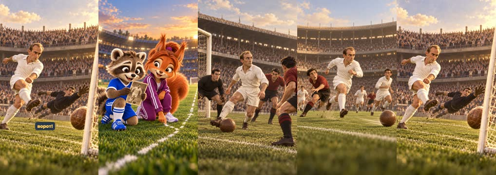
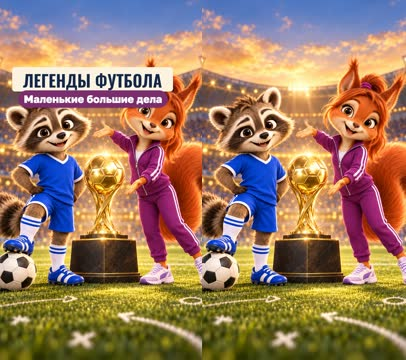
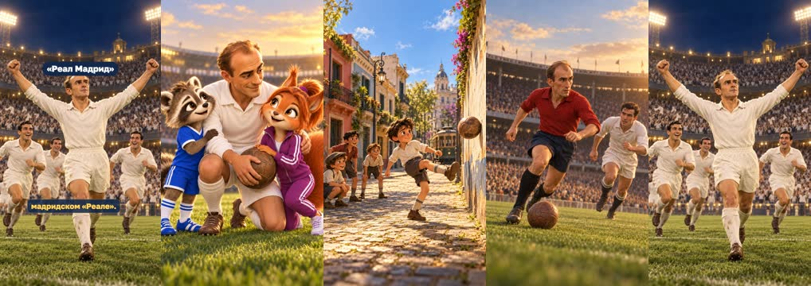
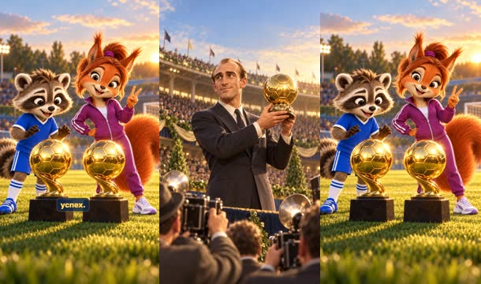
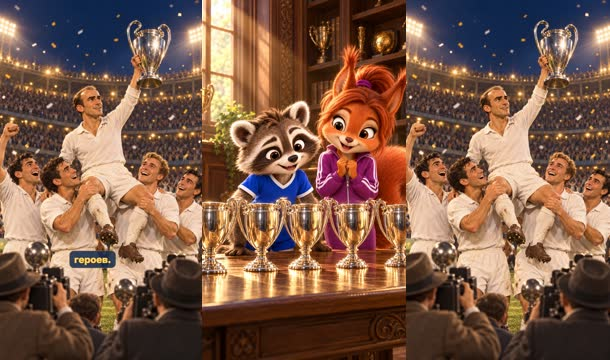
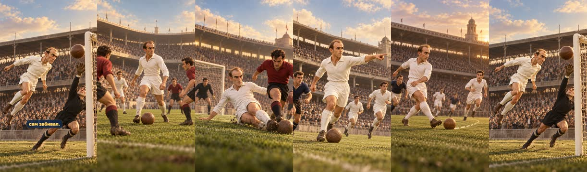
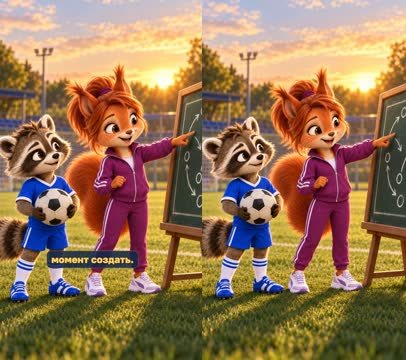
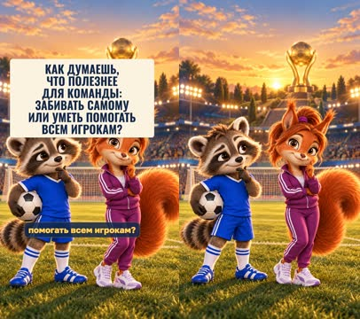
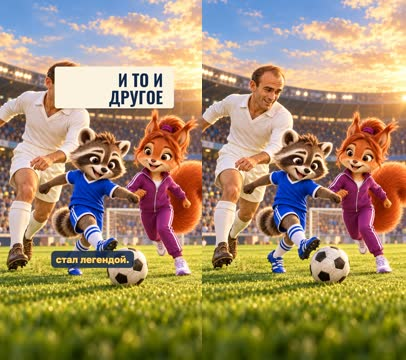

# План: Альфредо Ди Стефано

> Сгенерировано `storygro plan` из `ru.reel.yaml`, 2026-10-29. Не правьте этот файл: текст — в спецификации ролика, вопросы и заметки — в `review.yaml`. Затем `storygro plan` заново.

| | |
|---|---|
| Статус | **сценарий** · ждёт тебя: одобрить сценарий |
| Длительность | 92.9 с (по озвучке) · 9 сцен |
| Формат | 1080×1920, 30 fps · style `cartoon` |
| Голос | omnivoice · assets/voice/narrator-ru.wav · 0.9 |

## Одобрения

| | | Кто и когда |
|---|---|---|
| Сценарий | ⚙️ техническое (агент) | agent 2026-10-29 |
| Раскадровка | ⚙️ техническое (агент) | agent 2026-10-29 |
| Выпуск | ⏳ ждёт |   |

Одобрить: `storygro approve <spec> --step script|storyboard|release` (агент — с `--agent`).

## Вопросы

- [ ] **owner** · В тексте сценария есть строка «Official website Real Madrid C.F.+1» — это след от копирования ссылки на источник, а не текст рассказчика. Я её не озвучивал; источник указан в sources.md. Так и задумано?
- [ ] **owner** · Между хуком и карточкой — двухсекундная заставка рубрики без слов (тот же кадр, что в выпуске 1, титр «Легенды футбола»). В первом выпуске на ней звучало «Оказывается, может!» из вашего текста; здесь слов не добавлял. Оставить так?
- [ ] **owner** · Послушайте «Ди Стефано» (ударение отмечено: Ди Сте́фано), «Буэнос-Айресе» (Буэ́нос-А́йресе), «голы» и «вперёд» в начале. Распознавание речи слышит слова верно, но ударение оно не различает.
- [ ] **owner** · Вы заметили «впЯред» и «голЫ». В новой версии стоят отметки «впер+ёд» и «г+олы»; «вперёд» модель фонем подтверждает, «голы» — нет (оба дубля для неё одинаковы). Как теперь звучит?
- [ ] **owner** · На карточке вопроса — ваш вопрос полностью, в шесть строк. Если на телефоне это много, можно оставить «Что полезнее для команды: забивать самому или помогать всем игрокам?».

**Заметки:** Сделано по просьбе владельца 29.10.2026: «теперь сделай вот такой ролик по аналогии с предыдущим — второй из серии» (сценарий «2. Альфредо Ди Стефано — футболист, который успевал везде»). Текст рассказчика — дословно; факты проверены по Wikipedia и UEFA.com (sources.md); сайт «Реала» во время проверки не открылся. Сразу по стандарту Reels с поправками 29.10.2026: текст ниже линии ленты 4:5, головы ниже верхней пятой части, обложка — первый кадр, загрузка как Reels с «Оригиналом» (UPLOAD.txt), проверка instagram-check. Реплика об универсальности разделена на две сцены без изменения слов: выравнивание Whisper теряло первую половину длинной реплики. Одобрения агента — только технические.

## Хук

- Вариант 1 · **выбран**: «Представьте футболиста, который не просто забивает г+олы, а участвует почти в каждой важной атаке команды. Он может начать атаку возле своих ворот, отдать передачу, побежать впер+ёд — и через несколько секунд уже оказаться у чужих ворот!»

## Сцены

### 1. hook · 0.0–16.5 с · `illustration`

кадр в ключевой момент, затем картинки сцены по порядку

**Голос:** Представьте футболиста, который не просто забивает г+олы, а участвует почти в каждой важной атаке команды. Он может начать атаку возле своих ворот, отдать передачу, побежать впер+ёд — и через несколько секунд уже оказаться у чужих ворот!

**Картинки:**

- @matvey and @sofia on a modern green football pitch at golden hour: Matvey holds up an old sepia football trading card with a portrait of @distefano, staring at it with huge excited eyes; @sofia kneels beside him and traces a long dotted white chalk line on the grass that runs from one goal far behind them towards the other, explaining with a clever smile; a modern stadium softly blurred behind, floodlights starting to glow — ok
- `@own` a 1950s match in a packed old stadium: @distefano wins the old leather ball in front of his own penalty area, right next to his own goal and his goalkeeper, already looking up the pitch to start an attack; @rivals around him; warm sepia-tinted vintage grading with subtle film grain — ok
- `@pass` @distefano at the halfway line plays a long pass with the old leather ball to a teammate from @madrid and immediately sprints forward past a surprised opponent from @rivals, motion lines behind him; a packed 1950s stadium; warm sepia-tinted vintage grading with subtle film grain — ok
- `@goal` seconds later @distefano is already in front of the opponents' goal at the other end of the pitch, shooting the old leather ball past a diving goalkeeper in a dark kit into the net, the 1950s crowd behind the goal rising; warm sepia-tinted vintage grading with subtle film grain — ok

**Ударения:** голы → го́лы (автор) · вперёд → вперё́д (автор)

**На слух:** вперёд — верно (дубль 1)

**Звук:** swell @0.0, pop @6.9, whoosh @12.5

### 2. intro · 16.5–18.7 с · `illustration`

кадр в ключевой момент, затем картинки сцены по порядку

**Голос:** 

**На экране:** «Легенды футбола» · «Маленькие большие дела»

**Картинки:**

- shots/intro.jpg — ok

**Звук:** hit @0.0, chime @0.5

**Факты:** `facts.series.title` = «Легенды футбола» · `facts.series.project` = «Маленькие большие дела»

### 3. card · 18.7–29.9 с · `illustration`

кадр в ключевой момент, затем картинки сцены по порядку

**Голос:** Так играл Альфредо Ди Ст+ефано. Он родился в аргентинском Бу+энос-Айресе, а позднее выступал за сборную Испании. Но особенно прославился в мадридском «Реале».

**На экране:** «Альфредо Ди Стефано» · «Испания» · «1957 · 1959» · ««Реал Мадрид» · нападающий» · «Буэнос-Айрес» · «сборная Испании» · ««Реал Мадрид»»

**Картинки:**

- @distefano kneels on one knee on a modern green pitch at golden hour between @matvey and @sofia, holding an old brown leather football, all three smiling warmly at one another; their three heads close together in the upper middle of the frame; a modern stadium softly blurred behind; the lower part of the frame simple green grass — ok
- `@born` a sunny 1930s street in an old neighbourhood of Buenos Aires: colourful low houses with balconies, cobblestones, a tram in the distance; a boy of about ten in a white shirt and shorts kicks a worn leather ball against a wall while other children watch; warm nostalgic vintage colours — ok
- `@spain` @distefano-spain dribbles the old leather ball forward in a late-1950s international match in a full stadium, an opponent in a plain white shirt chasing him; warm vintage colour grading with subtle film grain — ok
- `@real` @distefano in his all-white kit raises his arms in celebration in front of a huge, packed 1950s stadium at night under the floodlights, the white-clad crowd cheering; @madrid running towards him; warm vintage colour grading with subtle film grain — ok

**Ударения:** Стефано → Сте́фано (автор) · Буэнос-Айресе → Буэ́нос-Айресе (автор)

**Факты:** `facts.player.name` = «Альфредо Ди Стефано» · `facts.player.country` = «Испания» · `facts.player.years` = «1957 · 1959» · `facts.player.label` = ««Реал Мадрид» · нападающий» · `facts.born.city` = «Буэнос-Айрес» · `facts.born.spain` = «сборная Испании» · `facts.born.club` = ««Реал Мадрид»»

### 4. award · 29.9–45.8 с · `illustration`

кадр в ключевой момент, затем картинки сцены по порядку

**Голос:** Ди Ст+ефано был настолько хорош, что получил «Золотой мяч» дважды: в 1957 и 1959 годах. Это важно: он не просто один раз стал лучшим в Европе, а сумел повторить успех.

**На экране:** «2» · ««Золотых мяча»» · «1957» · «1959»

**Картинки:**

- @distefano in an elegant 1950s dark suit and tie holds up a luminous golden football-shaped trophy on a small stage, smiling modestly, photographers with old flash cameras around him, warm golden light; warm vintage colour grading with subtle film grain — ok
- `@twice` @matvey and @sofia on a modern pitch at golden hour stand beside two identical luminous golden football-shaped trophies on dark plinths; Sofia proudly shows two fingers, Matvey looks from one trophy to the other with his mouth open in amazement — ok

**Ударения:** Золотой → Золото́й (словарь) · Стефано → Сте́фано (автор)

**На слух:** Золотой — верно (дубль 1)

**Звук:** ding @4.5, ding @6.7, chime @9.7

**Факты:** `facts.award.count` = «2» · `facts.award.label` = ««Золотых мяча»» · `facts.award.first` = «1957» · `facts.award.second` = «1959»

### 5. cups · 45.8–62.3 с · `illustration`

кадр в ключевой момент, затем картинки сцены по порядку

**Голос:** Вместе с ним «Реал Мадрид» выиграл пять Кубков европейских чемпионов подряд — с 1956 по 1960 год. Это была невероятная команда, а Ди Ст+ефано стал одним из её главных героев.

**На экране:** «5» · «Кубков чемпионов подряд» · «1956–1960»

**Картинки:**

- a row of five identical large shining silver trophy cups with big handles standing side by side on a long wooden table in an old trophy room, warm light from a window; @matvey and @sofia stand behind the right half of the table and lean in to look at the cups with wide eyes, their heads between one third and one half of the frame height; the upper left quarter shows only calm wooden shelves and the window, with no heads; warm colours — ok
- `@team` @madrid lift @distefano onto their shoulders, he holds up a large shining silver trophy cup with big handles, all of them laughing in a packed 1950s stadium at night under floodlights, confetti in the air; the crowd behind them cheering; the bottom quarter of the frame shows only grass and the backs of photographers; warm vintage colour grading turning brighter — ok

**Ударения:** Стефано → Сте́фано (автор)

**Звук:** riser @5.6, chime @10.5, swell @10.5

**Факты:** `facts.cups.count` = «5» · `facts.cups.label` = «Кубков чемпионов подряд» · `facts.cups.years` = «1956–1960»

### 6. skill · 62.3–70.9 с · `illustration`

кадр в ключевой момент, затем картинки сцены по порядку

**Голос:** Его особенность заключалась в универсальности. Он помогал обороняться, строил атаки, отдавал передачи и сам забивал.

**На экране:** «Универсальность»

**Картинки:**

- @distefano stands in the middle of an old 1950s pitch with the old leather ball at his feet, head up, scanning the whole field like a conductor, teammates from @madrid and @rivals around him; a full stadium; warm sepia-tinted vintage grading with subtle film grain — ok
- `@def` @distefano sprints back to defend near his own goal and slides in to take the old leather ball cleanly from an attacker from @rivals; a 1950s stadium; warm sepia-tinted vintage grading with subtle film grain — ok
- `@build` @distefano carries the old leather ball forward through midfield with his head up, pointing with one arm to show a teammate from @madrid where to run; a 1950s stadium; warm sepia-tinted vintage grading with subtle film grain — ok
- `@pass` @distefano plays a precise pass with the inside of his boot, the old leather ball rolling along a curved dotted path to a teammate from @madrid who is running free; a 1950s stadium; warm sepia-tinted vintage grading with subtle film grain — ok
- `@score` @distefano heads the old leather ball powerfully into the net past a goalkeeper in a dark kit, the crowd behind the goal leaping up; a 1950s stadium; warm sepia-tinted vintage grading with subtle film grain — ok

**Звук:** pop @3.4, pop @5.1, whoosh @6.2, hit @7.2

**Факты:** `facts.skill.title` = «Универсальность»

### 7. create · 70.9–77.9 с · `illustration`

кадр в ключевой момент, затем картинки сцены по порядку

**Голос:** Ди Ст+ефано не ждал, пока команда создаст для него момент. Он сам помогал этот момент создать.

**Картинки:**

- @sofia stands beside a dark green chalkboard on an easel on a modern pitch at golden hour; the board shows simple white chalk arrows and circles of a team moving together (no writing at all); she points at the arrows while @matvey, holding a black-and-white football, follows them with wide eyes — changed

**Ударения:** Стефано → Сте́фано (автор)

### 8. question · 77.9–85.8 с · `illustration`

кадр в ключевой момент, затем картинки сцены по порядку

**Голос:** Как думаешь, что полезнее для команды: забивать самому или уметь помогать всем игрокам?

**На экране:** «Как думаешь, что полезнее для команды: забивать самому или уметь помогать всем игрокам?»

**Картинки:**

- @matvey and @sofia on a modern pitch at sunset, both thinking: Matvey holds a black-and-white football and looks towards a goal, one paw on his chin; Sofia taps her cheek thoughtfully and looks at the viewer; the luminous golden football-shaped trophy glows on its plinth far behind them, warm golden-hour stadium lights — ok

**Звук:** chime @0.3

**Факты:** `facts.question.text` = «Как думаешь, что полезнее для команды: забивать самому или уметь помогать всем игрокам?»

### 9. answer · 85.8–92.9 с · `illustration`

кадр в ключевой момент, затем картинки сцены по порядку

**Голос:** Наверное, лучший ответ — и то и другое. Именно поэтому Ди Ст+ефано стал легендой.

**На экране:** «И то и другое»

**Картинки:**

- @distefano in his all-white kit, @matvey and @sofia on a modern green pitch at golden hour pass a black-and-white football between them in a little triangle, all three laughing, Matvey about to shoot towards a goal; a modern stadium softly blurred behind — ok

**Ударения:** Стефано → Сте́фано (автор)

**Звук:** pop @2.0, swell @3.0

**Факты:** `facts.answer.text` = «И то и другое»

## Факты и источники

| | |
|---|---|
| `facts.series` | Owner's brief «рекомендации» (2026-10-28): «Маленькие большие дела · Легенды футбола · Истории обладателей «Золотого мяча»» |
| `facts.player` | Owner's script, episode 2: «1957 и 1959 годы · «Реал Мадрид» · Нападающий»; Wikipedia «Alfredo Di Stéfano»: «He was awarded the Ballon d'Or in 1957 and 1959», Spain 1957–1961 |
| `facts.born` | Wikipedia «Alfredo Di Stéfano»: «Place of birth: Buenos Aires, Argentina»; «He played international football for Argentina and Colombia before becoming a naturalised citizen of Spain and playing for its national team» |
| `facts.award` | Wikipedia «Alfredo Di Stéfano»: «He was awarded the Ballon d'Or in 1957 and 1959» |
| `facts.cups` | UEFA.com, «The greatest teams of all time: Real Madrid 1956-60» (2015): «In their five consecutive European Cup-winning campaigns…»; «Di Stéfano notably scored in all five of their final wins» |
| `facts.skill` | The owner's script, episode 2: «Его особенность заключалась в универсальности» |
| `facts.question` | The owner's script, episode 2: «Вопрос зрителю: «Как думаешь, что полезнее для команды: забивать самому или уметь помогать всем игрокам?»» |
| `facts.answer` | The owner's script, episode 2: «Наверное, лучший ответ — и то и другое» |

→ [sources.md](sources.md)

## Текст поста

> Как думаешь, что полезнее для команды: забивать самому или уметь помогать всем игрокам? Енот Матвей и белочка София знакомятся с Альфредо Ди Стефано — он родился в Буэнос-Айресе, играл за сборную Испании, дважды получил «Золотой мяч» (1957 и 1959) и вместе с «Реалом» выиграл пять Кубков европейских чемпионов подряд (1956–1960).
>
> Выпуск 2 рубрики «Легенды футбола» проекта «Маленькие большие дела». Источники: UEFA.com, Wikipedia. Картинки нарисованы GPT Image — это дружеские шаржи, а не фотографии; ролик не связан с футболистом, клубами и организаторами награды. Голос рассказчика синтетический (OmniVoice).
