# План: Раймон Копа — мастер обводки

> Сгенерировано `storygro plan` из `ru.reel.yaml`, 2026-10-30. Не правьте этот файл: текст — в спецификации ролика, вопросы и заметки — в `review.yaml`. Затем `storygro plan` заново.

| | |
|---|---|
| Статус | **сценарий** · ждёт тебя: одобрить сценарий |
| Длительность | 84.4 с (по озвучке) · 13 сцен |
| Формат | 1080×1920, 30 fps · style `cartoon` |
| Голос | omnivoice · assets/voice/narrator-ru.wav · 0.9 |
| Серия | football-legends |

## Одобрения

| | | Кто и когда |
|---|---|---|
| Сценарий | ⚙️ техническое (агент) | agent 2026-10-30 |
| Раскадровка | ⚙️ техническое (агент) | agent 2026-10-30 |
| Выпуск | ⏳ ждёт |   |

Одобрить: `storygro approve <spec> --step script|storyboard|release` (агент — с `--agent`).

## Вопросы

- [ ] **owner** · Подходят ли смешной хук с финтом, крупные планы мяча и финальный выбор «обводка или пас» для серии?
- [ ] **owner** · Послушайте «Раймон Копа» и «Жюст Фонтен». Для «Копа» после проб используется фонетическая подсказка «КапА», для «Фонтен» отмечено ударение. Проверки редукции гласных записаны в preview/voice-checks.json; они не заменяют слух.

**Заметки:** Запрос владельца 30.10.2026: выпуск 3 про Раймона Копа с прежними героями и визуальными экспериментами для Instagram. Рассказчик сохраняет слова сценария; удалены только копировальная строка «Site Officiel+1» и служебные метки разделов. Инсценировки финтов иллюстративны; 13 голов принадлежат Фонтену, не Копа. Вирусный охват не обещается. Одобрения агента только технические. Имена проверены пробами: обычное Копа/Коп+а сохраняло полный о в 8 из 8 дублей; фонетическая запись Кап+а изменила чтение на k a p a в 4 из 4. Фонт+ен прошёл критерий редукции в 3 из 4 дублей. Эпизод использует stress marks с явными подсказками, общая базовая голосовая настройка не менялась. Рендер 84.37 с, 15/15 QA pass; полный декод обоих MP4 по 2530 кадров; просмотрены 37 моментов MP4. Кропы ленты/обложки проверены. Фонемная модель оставила 3 неясных слова, требуется слух владельца. Ролик не опубликован.

## Хук

- Вариант 1 · **выбран**: «Представьте защитника, который внимательно следит за мячом и старается угадать каждое движение соперника.»

## Сцены

### 1. hook · 0.0–8.1 с · `illustration`

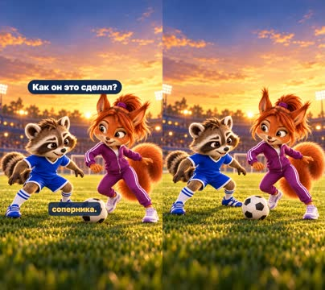

кадр в ключевой момент, затем картинки сцены по порядку

**Голос:** Представьте защитника, который внимательно следит за мячом и старается угадать каждое движение соперника.

**На экране:** «Как он это сделал?»

**Картинки:**

- shots/hook.png — ok

**Звук:** swell @0.0

**Факты:** `facts.hook.text` = «Как он это сделал?»

### 2. surprise · 8.1–13.6 с · `illustration`

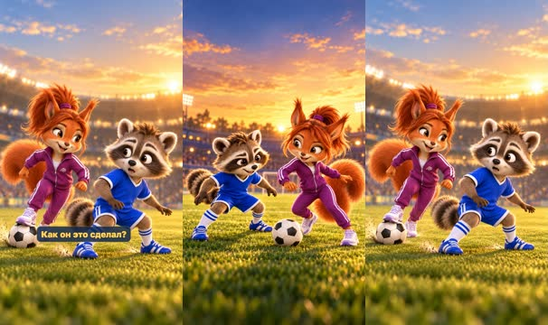

кадр в ключевой момент, затем картинки сцены по порядку

**Голос:** И вдруг — раз! — футболист оказывается с другой стороны. Как он это сделал?

**Картинки:**

- shots/hook.png — ok
- `@turn` shots/hook-reveal.png — ok

**Звук:** whoosh @0.9, pop @0.9

### 3. intro · 13.6–15.1 с · `illustration`

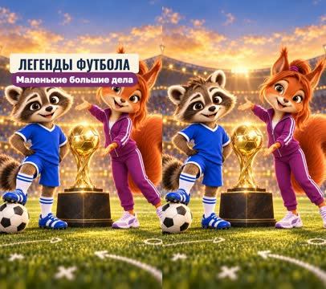

кадр в ключевой момент, затем картинки сцены по порядку

**Голос:**

**На экране:** «Легенды футбола» · «Маленькие большие дела»

**Картинки:**

- shots/intro.jpg — ok

**Звук:** chime @0.0

**Факты:** `facts.series.title` = «Легенды футбола» · `facts.series.project` = «Маленькие большие дела»

### 4. card · 15.1–19.8 с · `illustration`

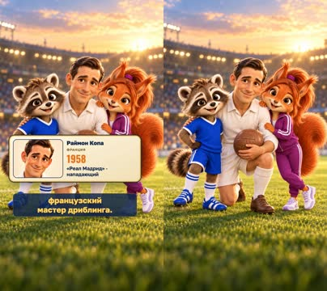

кадр в ключевой момент, затем картинки сцены по порядку

**Голос:** Так мог играть Райм+он Копа — французский мастер дриблинга.

**На экране:** «Раймон Копа» · «Франция» · «1958» · ««Реал Мадрид» · нападающий»

**Картинки:**

- shots/card.png — ok

**Ударения:** Раймон → Раймо́н (автор) · Капа → Капа́ (автор)

**На слух:** Копа — верно (дубль 1)

**Факты:** `facts.player.name` = «Раймон Копа» · `facts.player.country` = «Франция» · `facts.player.year` = «1958» · `facts.player.label` = ««Реал Мадрид» · нападающий»

### 5. award · 19.8–30.2 с · `illustration`

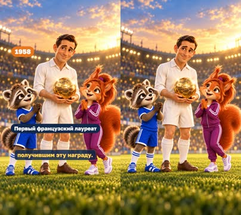

кадр в ключевой момент, затем картинки сцены по порядку

**Голос:** В 1958 году он получил «Золотой мяч», выступая за мадридский «Реал». Он стал первым французом, получившим эту награду.

**На экране:** «1958» · «Первый французский лауреат»

**Картинки:**

- shots/award.png — ok

**Ударения:** Золотой → Золото́й (словарь)

**На слух:** Золотой — верно (дубль 1)

**Факты:** `facts.award.year` = «1958» · `facts.award.first` = «Первый французский лауреат»

### 6. tight · 30.2–34.8 с · `illustration`

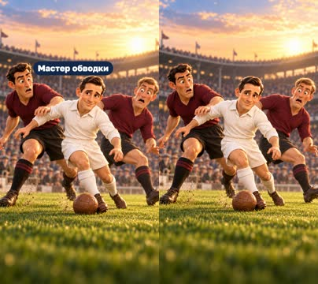

кадр в ключевой момент, затем картинки сцены по порядку

**Голос:** Копа умел обводить соперников в очень тесном пространстве.

**На экране:** «Мастер обводки»

**Картинки:**

- shots/tight.png — ok

**Ударения:** Капа → Капа́ (автор)

**На слух:** Копа — неясно (дубль 1)

**Факты:** `facts.skill.tight` = «Мастер обводки»

### 7. moves · 34.8–40.3 с · `illustration`

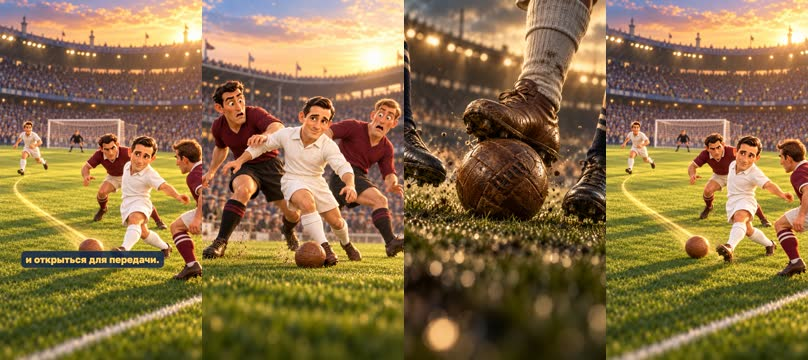

кадр в ключевой момент, затем картинки сцены по порядку

**Голос:** Он мог резко изменить направление, быстро прокинуть мяч и открыться для передачи.

**Картинки:**

- shots/tight.png — ok
- `@touch` shots/boots.png — ok
- `@open` shots/pass.png — ok

**Звук:** pop @2.5, whoosh @3.6

### 8. choice · 40.3–46.4 с · `illustration`

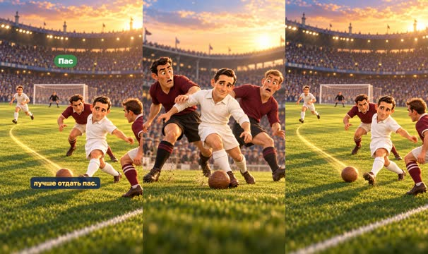

кадр в ключевой момент, затем картинки сцены по порядку

**Голос:** Но главное — он понимал, когда стоит обыгрывать соперника, а когда лучше отдать пас.

**На экране:** «Обводка» · «Пас»

**Картинки:**

- shots/tight.png — ok
- `@pass` shots/pass.png — ok

**Факты:** `facts.skill.dribble` = «Обводка» · `facts.skill.pass` = «Пас»

### 9. france · 46.4–56.2 с · `illustration`

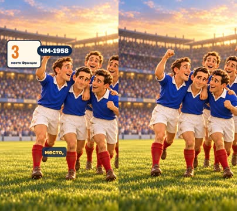

кадр в ключевой момент, затем картинки сцены по порядку

**Голос:** В сборной Франции Копа тоже прославился. На чемпионате мира 1958 года французы заняли третье место,

**На экране:** «3» · «место Франции» · «ЧМ-1958»

**Картинки:**

- shots/france.png — ok

**Ударения:** Капа → Капа́ (автор)

**На слух:** Копа — неясно (дубль 1)

**Факты:** `facts.france.place` = «3» · `facts.france.placeLabel` = «место Франции» · `facts.france.year` = «ЧМ-1958»

### 10. fontaine · 56.2–62.0 с · `illustration`

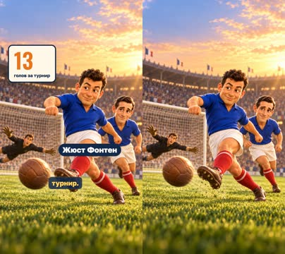

кадр в ключевой момент, затем картинки сцены по порядку

**Голос:** а его партнёр по атаке Жюст Фонт+ен забил невероятные 13 голов за турнир.

**На экране:** «13» · «голов за турнир» · «Жюст Фонтен»

**Картинки:**

- shots/fontaine.png — ok

**Ударения:** Фонтен → Фонте́н (автор)

**На слух:** Фонтен — неясно (дубль 1)

**Звук:** chime @3.8

**Факты:** `facts.fontaine.goals` = «13» · `facts.fontaine.label` = «голов за турнир» · `facts.fontaine.name` = «Жюст Фонтен»

### 11. team · 62.0–69.1 с · `illustration`

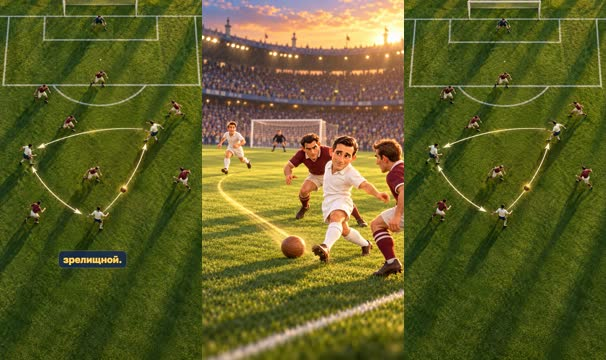

кадр в ключевой момент, затем картинки сцены по порядку

**Голос:** Копа помогал команде создавать опасные моменты, и его техника делала игру особенно зрелищной.

**Картинки:**

- shots/pass.png — ok
- `@3.2` shots/team.png — ok

**Ударения:** Капа → Капа́ (автор)

**На слух:** Копа — верно (дубль 1)

### 12. lesson · 69.1–77.5 с · `illustration`

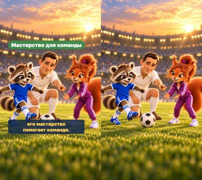

кадр в ключевой момент, затем картинки сцены по порядку

**Голос:** Красивые финты — это здорово, но футболист становится по-настоящему полезным, когда его мастерство помогает команде.

**На экране:** «Мастерство для команды»

**Картинки:**

- shots/lesson.png — ok

**Факты:** `facts.skill.team` = «Мастерство для команды»

### 13. question · 77.5–84.4 с · `illustration`

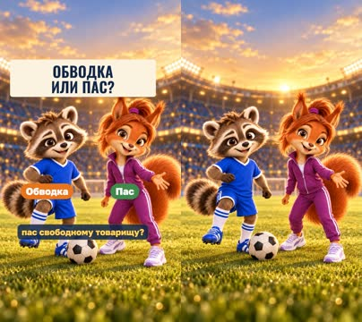

кадр в ключевой момент, затем картинки сцены по порядку

**Голос:** Ты бы попробовал обвести соперника или отдал бы пас свободному товарищу?

**На экране:** «Обводка или пас?» · «Обводка» · «Пас»

**Картинки:**

- shots/question.png — ok

**Звук:** chime @0.0

**Факты:** `facts.question.short` = «Обводка или пас?» · `facts.skill.dribble` = «Обводка» · `facts.skill.pass` = «Пас»

## Факты и источники

| | |
|---|---|
| `facts.series` | Owner's brief «рекомендации» (2026-10-28): «Маленькие большие дела · Легенды футбола · Истории обладателей «Золотого мяча»» |
| `facts.player` | [S1] https://www.uefa.com/ballondor/news/0292-1c27056169a7-bc88d1fdba43-1000--ballon-d-or-laureates-who-has-won-football-s-most-prestig/; [S2] https://www.fff.fr/equipe-nationale/joueur/8778-kopa-raymond/fiche.html; position from the owner script and Real Madrid profile |
| `facts.hook` | Owner script, 2026-10-30: closing question of the opening paragraph. |
| `facts.award` | [S1] https://www.uefa.com/ballondor/news/0292-1c27056169a7-bc88d1fdba43-1000--ballon-d-or-laureates-who-has-won-football-s-most-prestig/; [S2] https://www.fff.fr/equipe-nationale/joueur/8778-kopa-raymond/fiche.html |
| `facts.skill` | Owner script, 2026-10-30; [S3] https://www.realmadrid.com/en-US/the-club/history/football-legends/raymond-kopaszewski/; [S5] https://www.uefa.com/news-media/news/01ee-0e76fea7895f-3c3039e41339-1000--goals-not-coal-for-kopa/ |
| `facts.france` | [S4] https://inside.fifa.com/tournaments/mens/worldcup/1958sweden/news/fontaine-s-record-13-goal-haul-2837513 |
| `facts.fontaine` | [S4] https://inside.fifa.com/tournaments/mens/worldcup/1958sweden/news/fontaine-s-record-13-goal-haul-2837513 |
| `facts.question` | Owner script, 2026-10-30, final question. |

→ [sources.md](sources.md)

## Текст поста

> Обвести соперника или отдать пас? Матвей и София знакомятся с Раймоном Копа — первым французским обладателем «Золотого мяча» (1958). Его техника впечатляла, а умение вовремя поделиться мячом помогало команде.
>
> Выбери свой вариант: ОБВОДКА или ПАС — и объясни почему.
>
> Выпуск 3 рубрики «Легенды футбола» проекта «Маленькие большие дела». Источники: UEFA, Fédération Française de Football, Real Madrid, FIFA. Иллюстрации созданы с помощью GPT Image; это дружеские шаржи, а не документальная съёмка матчей. Голос рассказчика синтетический (OmniVoice). Ролик не связан с футболистами, клубами и организаторами награды.
