# План: Луис Суарес Мирамонтес — архитектор футбола

> Сгенерировано `storygro plan` из `ru.reel.yaml`, 2026-10-30. Не правьте этот файл: текст — в спецификации ролика, вопросы и заметки — в `review.yaml`. Затем `storygro plan` заново.

| | |
|---|---|
| Статус | **сценарий** · ждёт тебя: одобрить сценарий |
| Длительность | 91.3 с (по озвучке) · 15 сцен |
| Формат | 1080×1920, 30 fps · style `cartoon` |
| Голос | omnivoice · assets/voice/narrator-ru.wav · 0.9 |
| Серия | football-legends |

## Одобрения

| | | Кто и когда |
|---|---|---|
| Сценарий | ⚙️ техническое (агент) | agent 2026-10-30 |
| Раскадровка | ⚙️ техническое (агент) | agent 2026-10-30 |
| Выпуск | ⏳ ждёт |   |

Одобрить: `storygro approve <spec> --step script|storyboard|release` (агент — с `--agent`).

## Вопросы

- [ ] **owner** · Подтвердите сходство исторического Суареса, различимость игроков и качество иллюстраций.
- [ ] **owner** · Послушайте произношение «Луис Суарес Мирамонтес» и названий клубов; ASR не доказывает правильность ударений.

**Заметки:** Owner request, 30 October 2026: episode 4, exact supplied narration, original Matvey/Sofia; particular attention to likeness, era-specific kits and distinct teammates. Removed only pasted UEFA citation markers and section labels. Technical approvals are not owner approvals. Рендер 91.33 с, 15/15 QA pass; полный декод по 2737 кадров; просмотрены 35 моментов MP4, лента 4:5 и квадрат обложки. 163 момента субтитров и 78 обратных переходов без ошибок. Стенд имени: 3/4 подтверждены, 1 неясен; фамилия в реплике награждения требует слуха владельца. Ролик не опубликован.

## Хук

- Вариант 1 · **выбран**: «Когда слышишь слово «архитектор», обычно представляешь человека, который строит дома.»

## Сцены

### 1. hook · 0.0–5.8 с · `illustration`

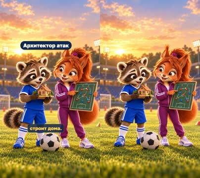

кадр в ключевой момент, затем картинки сцены по порядку

**Голос:** Когда слышишь слово «архитектор», обычно представляешь человека, который строит дома.

**На экране:** «Архитектор атак»

**Картинки:**

- shots/hook.png — ok

**Звук:** swell @0.0

**Факты:** `facts.hook.text` = «Архитектор атак»

### 2. build · 5.8–10.0 с · `illustration`

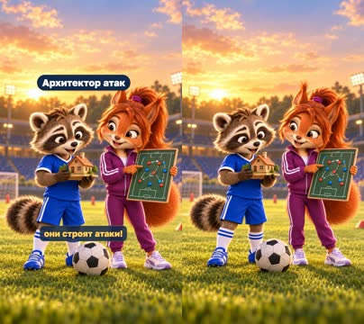

кадр в ключевой момент, затем картинки сцены по порядку

**Голос:** Но в футболе тоже есть архитекторы — они строят атаки!

**На экране:** «Архитектор атак»

**Картинки:**

- shots/hook.png — ok

**Звук:** pop @0.0

**Факты:** `facts.hook.text` = «Архитектор атак»

### 3. intro · 10.0–11.5 с · `illustration`

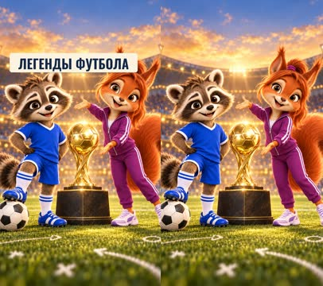

кадр в ключевой момент, затем картинки сцены по порядку

**Голос:**

**На экране:** «Легенды футбола»

**Картинки:**

- shots/intro.jpg — ok

**Звук:** chime @0.0

**Факты:** `facts.series.title` = «Легенды футбола»

### 4. card · 11.5–16.1 с · `illustration`

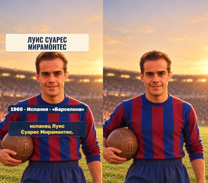

кадр в ключевой момент, затем картинки сцены по порядку

**Голос:** Один из самых известных — испанец Луис Суарес Мирамонтес.

**На экране:** «Луис Суарес Мирамонтес» · «1960 · Испания · «Барселона»»

**Картинки:**

- shots/card-v2.png — ok

**Факты:** `facts.player.name` = «Луис Суарес Мирамонтес» · `facts.player.card` = «1960 · Испания · «Барселона»»

### 5. names · 16.1–23.7 с · `illustration`

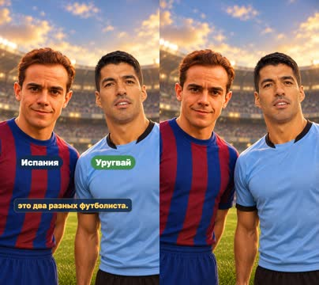

кадр в ключевой момент, затем картинки сцены по порядку

**Голос:** Не путайте его с более современным уругвайским нападающим Луисом Суаресом: это два разных футболиста.

**На экране:** «Испания» · «Уругвай»

**Картинки:**

- shots/names.png — ok

**Факты:** `facts.names.spain` = «Испания» · `facts.names.uruguay` = «Уругвай»

### 6. award · 23.7–31.6 с · `illustration`

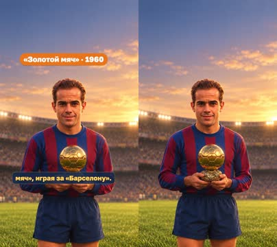

кадр в ключевой момент, затем картинки сцены по порядку

**Голос:** В 1960 году Луис Суарес Мирамонтес получил «Золотой мяч», играя за «Барселону».

**На экране:** ««Золотой мяч» · 1960»

**Картинки:**

- shots/award-v2.png — ok

**На слух:** Золотой — верно (дубль 1)

**Факты:** `facts.award.full` = ««Золотой мяч» · 1960»

### 7. first · 31.6–36.8 с · `illustration`

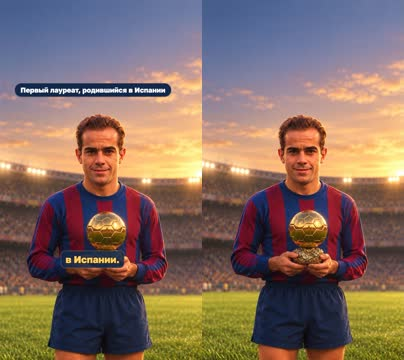

кадр в ключевой момент, затем картинки сцены по порядку

**Голос:** Он стал первым испанцем, выигравшим награду, который родился в Испании.

**На экране:** «Первый лауреат, родившийся в Испании»

**Картинки:**

- shots/award-v2.png — ok

**Факты:** `facts.award.first` = «Первый лауреат, родившийся в Испании»

### 8. work · 36.8–46.1 с · `illustration`

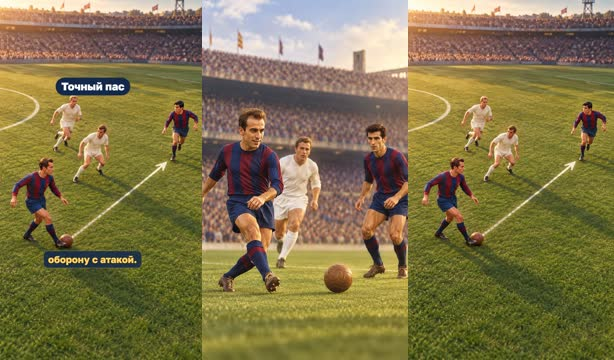

кадр в ключевой момент, затем картинки сцены по порядку

**Голос:** Суарес был полузащитником. Его работа — находить свободных партнёров, выбирать точные передачи и связывать оборону с атакой.

**На экране:** «Точный пас»

**Картинки:**

- shots/pass.png — ok
- `@link` shots/vision.png — ok

**Факты:** `facts.skill.pass` = «Точный пас»

### 9. map · 46.1–54.3 с · `illustration`

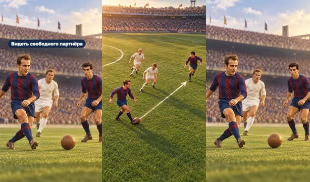

кадр в ключевой момент, затем картинки сцены по порядку

**Голос:** Он видел поле словно карту: понимал, кто свободен, куда направить мяч и где через секунду появится возможность.

**На экране:** «Видеть свободного партнёра»

**Картинки:**

- shots/vision.png — ok
- `@chance` shots/pass.png — ok

**Факты:** `facts.skill.vision` = «Видеть свободного партнёра»

### 10. inter · 54.3–61.7 с · `illustration`

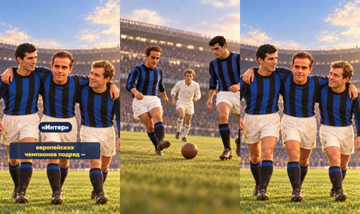

кадр в ключевой момент, затем картинки сцены по порядку

**Голос:** Позже он перешёл в итальянский «Интер» и помог клубу выиграть два Кубка европейских чемпионов подряд —

**На экране:** ««Интер»»

**Картинки:**

- shots/inter.png — ok
- `@4` shots/inter-team.png — ok

**Факты:** `facts.inter.name` = ««Интер»»

### 11. cups · 61.7–68.1 с · `illustration`

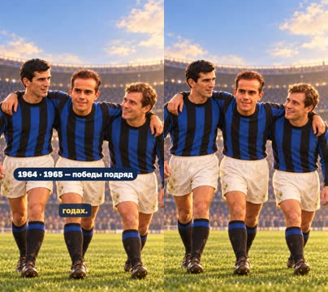

кадр в ключевой момент, затем картинки сцены по порядку

**Голос:** в 1964 и 1965 годах.

**На экране:** «1964 · 1965 — победы подряд»

**Картинки:**

- shots/inter-team.png — ok

**Факты:** `facts.inter.full` = «1964 · 1965 — победы подряд»

### 12. spain · 68.1–74.5 с · `illustration`

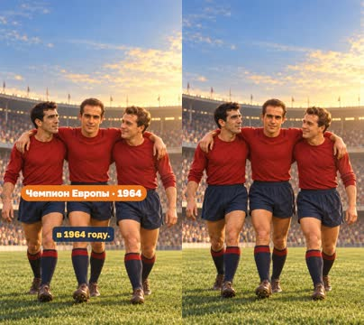

кадр в ключевой момент, затем картинки сцены по порядку

**Голос:** А со сборной Испании он стал чемпионом Европы в 1964 году.

**На экране:** «Чемпион Европы · 1964»

**Картинки:**

- shots/spain-v2.png — ok

**Факты:** `facts.spain.full` = «Чемпион Европы · 1964»

### 13. lesson · 74.5–80.9 с · `illustration`

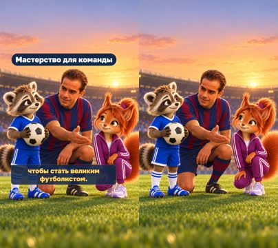

кадр в ключевой момент, затем картинки сцены по порядку

**Голос:** Суарес показывает, что не обязательно забивать больше всех, чтобы стать великим футболистом.

**На экране:** «Мастерство для команды»

**Картинки:**

- shots/lesson.png — ok

**Факты:** `facts.skill.team` = «Мастерство для команды»

### 14. chance · 80.9–85.2 с · `illustration`

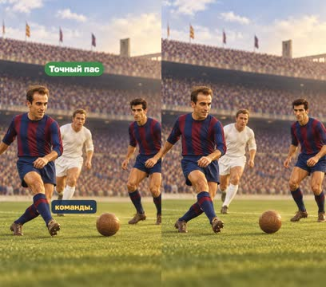

кадр в ключевой момент, затем картинки сцены по порядку

**Голос:** Иногда один точный пас создаёт шанс для всей команды.

**На экране:** «Точный пас»

**Картинки:**

- shots/pass.png — ok

**Звук:** chime @0.0

**Факты:** `facts.skill.pass` = «Точный пас»

### 15. question · 85.2–91.3 с · `illustration`

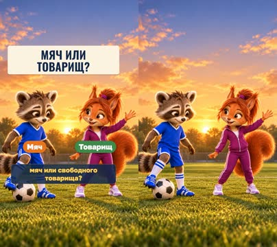

кадр в ключевой момент, затем картинки сцены по порядку

**Голос:** Что ты заметил бы первым на поле: мяч или свободного товарища?

**На экране:** «Мяч или товарищ?» · «Мяч» · «Товарищ»

**Картинки:**

- shots/question.png — ok

**Звук:** chime @0.0

**Факты:** `facts.question.short` = «Мяч или товарищ?» · `facts.question.ball` = «Мяч» · `facts.question.mate` = «Товарищ»

## Факты и источники

| | |
|---|---|
| `facts.series` | Owner's brief «рекомендации» (2026-10-28): «Маленькие большие дела · Легенды футбола · Истории обладателей «Золотого мяча»» |
| `facts.hook` | Owner script, 30 October 2026: architecture metaphor. |
| `facts.player` | [S1] https://www.uefa.com/news-media/news/0283-187370f4166c-84a2b286587c-1000--remembering-spain-icon-luis-suarez/; [S4] https://www.fcbarcelona.com/en/ficha/648220/luis-suarez |
| `facts.names` | [S3] https://www.fcbarcelona.com/en/football/first-team/news/1122399/from-one-luis-suarez-to-another |
| `facts.award` | [S1] https://www.uefa.com/news-media/news/0283-187370f4166c-84a2b286587c-1000--remembering-spain-icon-luis-suarez/ |
| `facts.skill` | [S2] https://www.uefa.com/uefaeuro/history/news/0253-0d80144ac44a-042b512864ec-1000--luis-suarez-spain-s-first-euro-superstar/; [S5] https://www.inter.it/it/notizie/2016-10-28-luis-suarez-faro-e-architetto; owner lesson. |
| `facts.inter` | [S1] https://www.uefa.com/news-media/news/0283-187370f4166c-84a2b286587c-1000--remembering-spain-icon-luis-suarez/; [S5] https://www.inter.it/it/notizie/2016-10-28-luis-suarez-faro-e-architetto |
| `facts.spain` | [S1] https://www.uefa.com/news-media/news/0283-187370f4166c-84a2b286587c-1000--remembering-spain-icon-luis-suarez/; [S2] https://www.uefa.com/uefaeuro/history/news/0253-0d80144ac44a-042b512864ec-1000--luis-suarez-spain-s-first-euro-superstar/ |
| `facts.question` | Owner script, 30 October 2026, closing question. |

→ [sources.md](sources.md)

## Текст поста

> Футбольный архитектор строит атаки. Матвей и София знакомятся с Луисом Суаресом Мирамонтесом — испанским полузащитником, обладателем «Золотого мяча» 1960 года. Это другой футболист, не современный уругвайский нападающий.
>
> Что замечаешь первым: МЯЧ или СВОБОДНОГО ТОВАРИЩА?
>
> Выпуск 4 рубрики «Легенды футбола» проекта «Маленькие большие дела». Источники: UEFA, FC Barcelona, Inter. Иллюстрации созданы с помощью GPT Image по архивным визуальным ориентирам; игровые эпизоды условные, это не запись исторических матчей. Голос рассказчика синтетический (OmniVoice). Ролик не связан с футболистами, клубами или организаторами награды.
