# План: Омар Сивори — маленький волшебник с мячом

> Сгенерировано `storygro plan` из `ru.reel.yaml`, 2026-10-30. Не правьте этот файл: текст — в спецификации ролика, вопросы и заметки — в `review.yaml`. Затем `storygro plan` заново.

| | |
|---|---|
| Статус | **сценарий** · ждёт тебя: одобрить сценарий |
| Длительность | 82.8 с (по озвучке) · 15 сцен |
| Формат | 1080×1920, 30 fps · style `cartoon` |
| Голос | omnivoice · assets/voice/narrator-ru.wav · 0.9 |
| Серия | football-legends |

## Одобрения

| | | Кто и когда |
|---|---|---|
| Сценарий | ✏️ изменено после одобрения | agent 2026-10-30 |
| Раскадровка | ⚙️ техническое (агент) | agent 2026-10-30 |
| Выпуск | ⏳ ждёт |   |

Одобрить: `storygro approve <spec> --step script|storyboard|release` (агент — с `--agent`).

## Вопросы

- [ ] **owner** · Подходят ли туринский «Комунале», новая прохладная палитра, сходство Сивори и игровые эпизоды?
- [ ] **owner** · Послушайте «Омар Сивори», «Ювентус» и «голы»: автоматические проверки не доказывают правильное ударение.

**Заметки:** Owner request 30 October 2026: episode 5, previous hosts, Juventus stadium and distinct atmosphere. Exact narration retained except pasted source labels. Historical Turin Comunale, not the 2011 stadium. Owner confirmed удостоенным in probe B, rejected the goals probes and explicitly clarified stress on Ы. The agent had confused homographs: corrected to голы́, shared dictionary гол+ы, scene hint голЫ. Confirmed удостОенным retained. Same OmniVoice B, 0.90, stress off. Old O-based scores invalid. Final 82.82 s; QA 15/15; full decode 2483 frames per file; 38 inspected MP4 moments; 164 caption samples and 81 reverse seeks without layout failures. Technical approvals only; corrected MP4 owner listening open; not published.

## Хук

- Вариант 1 · **выбран**: «Можно ли обыграть защитника, который кажется гораздо сильнее и крупнее тебя?»

## Сцены

### 1. hook · 0.0–5.8 с · `illustration`

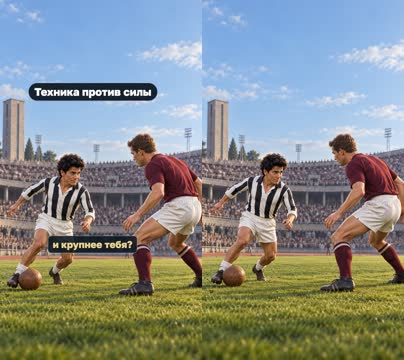

кадр в ключевой момент, затем картинки сцены по порядку

**Голос:** Можно ли обыграть защитника, который кажется гораздо сильнее и крупнее тебя?

**На экране:** «Техника против силы»

**Картинки:**

- shots/hook-v2.png — ok

**Звук:** swell @0.0

**Факты:** `facts.hook.text` = «Техника против силы»

### 2. answer · 5.8–11.6 с · `illustration`

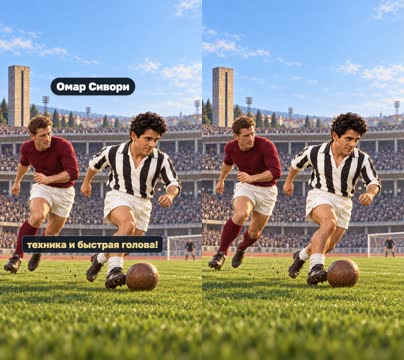

кадр в ключевой момент, затем картинки сцены по порядку

**Голос:** Омар Сивори показывал, что да — если у тебя отличная техника и быстрая голова!

**На экране:** «Омар Сивори»

**Картинки:**

- shots/reveal.png — ok

**Звук:** whoosh @0.0

**Факты:** `facts.player.name` = «Омар Сивори»

### 3. intro · 11.6–13.1 с · `illustration`

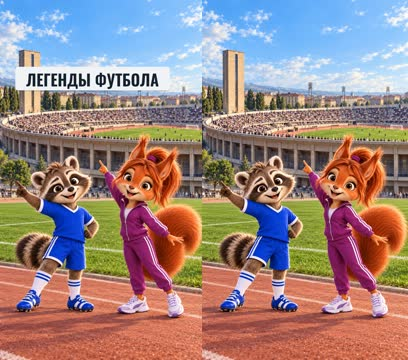

кадр в ключевой момент, затем картинки сцены по порядку

**Голос:**

**На экране:** «Легенды футбола»

**Картинки:**

- shots/intro.png — ok

**Звук:** chime @0.0

**Факты:** `facts.series.title` = «Легенды футбола»

### 4. roots · 13.1–18.5 с · `illustration`

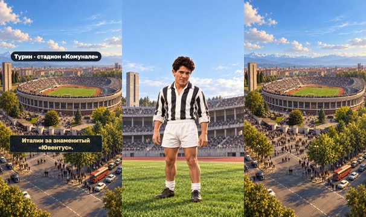

кадр в ключевой момент, затем картинки сцены по порядку

**Голос:** Сивори родился в Аргентине, а потом играл в Италии за знаменитый «Ювентус».

**На экране:** «Родился в Аргентине» · «Турин · стадион «Комунале»»

**Картинки:**

- shots/card.png — ok
- `@italy` shots/stadium.png — ok

**Факты:** `facts.player.birth` = «Родился в Аргентине» · `facts.venue.name` = «Турин · стадион «Комунале»»

### 5. award · 18.5–23.4 с · `illustration`

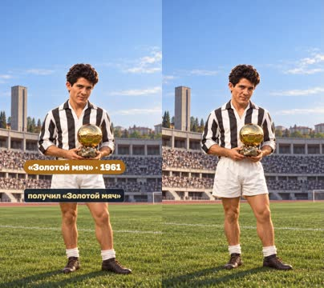

кадр в ключевой момент, затем картинки сцены по порядку

**Голос:** В 1961 году он получил «Золотой мяч»

**На экране:** ««Золотой мяч» · 1961»

**Картинки:**

- shots/award.png — ok

**На слух:** Золотой — верно (дубль 1)

**Факты:** `facts.award.full` = ««Золотой мяч» · 1961»

### 6. first · 23.4–28.4 с · `illustration`

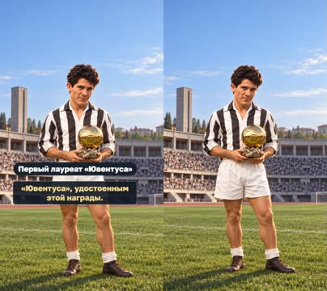

кадр в ключевой момент, затем картинки сцены по порядку

**Голос:** и стал первым футболистом «Ювентуса», удостоенным этой награды.

**На экране:** «Первый лауреат «Ювентуса»»

**Картинки:**

- shots/award.png — ok

**Факты:** `facts.award.first` = «Первый лауреат «Ювентуса»»

### 7. skill · 28.4–33.2 с · `illustration`

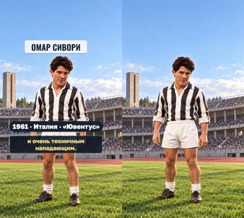

кадр в ключевой момент, затем картинки сцены по порядку

**Голос:** Сивори был невысоким, ловким и очень техничным нападающим.

**На экране:** «Омар Сивори» · «1961 · Италия · «Ювентус»»

**Картинки:**

- shots/card.png — ok

**Факты:** `facts.player.name` = «Омар Сивори» · `facts.player.card` = «1961 · Италия · «Ювентус»»

### 8. control · 33.2–39.8 с · `illustration`

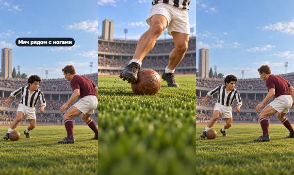

кадр в ключевой момент, затем картинки сцены по порядку

**Голос:** Он мог вести мяч так близко к ногам, что защитнику было трудно понять, куда тот двинется дальше.

**На экране:** «Мяч рядом с ногами»

**Картинки:**

- shots/boots-v2.png — ok
- `@3.5` shots/hook-v2.png — ok

**Факты:** `facts.skill.control` = «Мяч рядом с ногами»

### 9. escape · 39.8–43.8 с · `illustration`

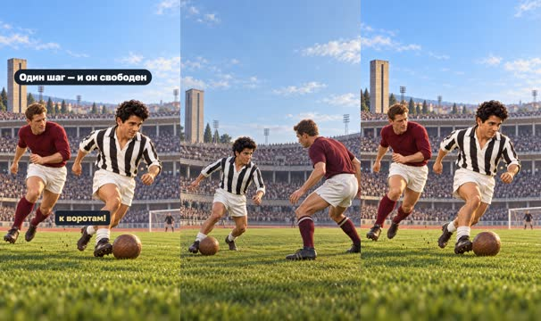

кадр в ключевой момент, затем картинки сцены по порядку

**Голос:** Один неверный шаг — и Сивори уже убегал к воротам!

**На экране:** «Один шаг — и он свободен»

**Картинки:**

- shots/hook-v2.png — ok
- `@escape` shots/reveal.png — ok

**Звук:** whoosh @1.7

**Факты:** `facts.skill.escape` = «Один шаг — и он свободен»

### 10. space · 43.8–53.6 с · `illustration`

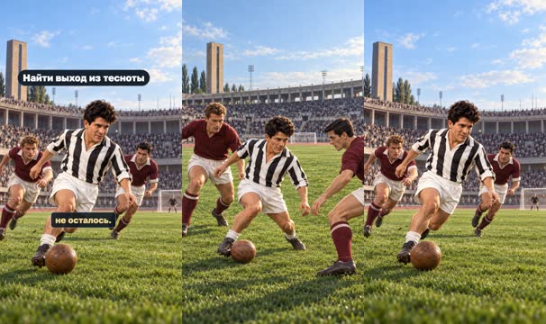

кадр в ключевой момент, затем картинки сцены по порядку

**Голос:** Он любил неожиданные решения, смело шёл в обводку и умел создавать опасность даже там, где, казалось, места для атаки совсем не осталось.

**На экране:** «Найти выход из тесноты»

**Картинки:**

- shots/tight.png — ok
- `@gap` shots/gap.png — ok

**Факты:** `facts.skill.space` = «Найти выход из тесноты»

### 11. bridge · 53.6–56.7 с · `illustration`

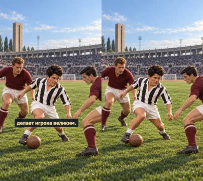

кадр в ключевой момент, затем картинки сцены по порядку

**Голос:** Но одна техника не делает игрока великим.

**Картинки:**

- shots/tight.png — ok

### 12. goals · 56.7–64.6 с · `illustration`

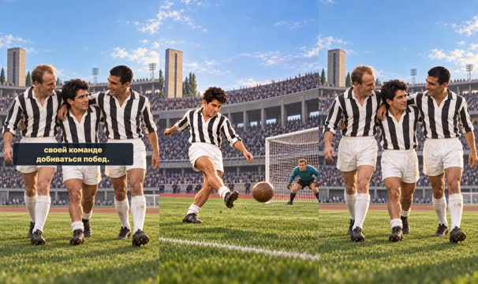

кадр в ключевой момент, затем картинки сцены по порядку

**Голос:** Сивори ещё и забивал голы, находил правильные моменты для удара и помогал своей команде добиваться побед.

**На экране:** «Техника и голы»

**Картинки:**

- shots/finish-clean.png — ok
- `@team` shots/team.png — ok

**Звук:** pop @0.0

**Факты:** `facts.skill.goals` = «Техника и голы»

### 13. lesson · 64.6–70.5 с · `illustration`

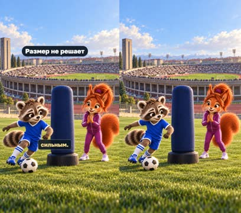

кадр в ключевой момент, затем картинки сцены по порядку

**Голос:** Его карьера напоминает: не всегда нужно быть самым большим или самым сильным.

**На экране:** «Размер не решает»

**Картинки:**

- shots/lesson.png — ok

**Факты:** `facts.skill.lesson` = «Размер не решает»

### 14. qualities · 70.5–75.9 с · `illustration`

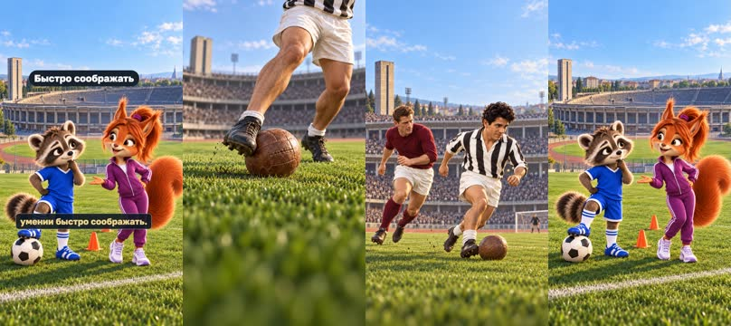

кадр в ключевой момент, затем картинки сцены по порядку

**Голос:** Иногда преимущество — в ловкости, смелости и умении быстро соображать.

**На экране:** «Ловкость» · «Смелость» · «Быстро соображать»

**Картинки:**

- shots/boots-v2.png — ok
- `@courage` shots/reveal.png — ok
- `@think` shots/question.png — ok

**Факты:** `facts.skill.agility` = «Ловкость» · `facts.skill.courage` = «Смелость» · `facts.skill.think` = «Быстро соображать»

### 15. question · 75.9–82.8 с · `illustration`

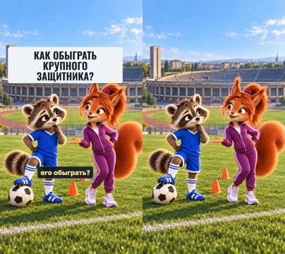

кадр в ключевой момент, затем картинки сцены по порядку

**Голос:** Если защитник намного крупнее тебя, какие качества помогут его обыграть?

**На экране:** «Как обыграть крупного защитника?»

**Картинки:**

- shots/question.png — ok

**Звук:** chime @0.0

**Факты:** `facts.question.short` = «Как обыграть крупного защитника?»

## Факты и источники

| | |
|---|---|
| `facts.series` | Owner's brief «рекомендации» (2026-10-28): «Маленькие большие дела · Легенды футбола · Истории обладателей «Золотого мяча»» |
| `facts.hook` | Owner script, 30 October 2026, opening challenge. |
| `facts.player` | [S1] https://halloffame.juventus.com/en/hall-of-fame/omar-sivori; [S2] https://www.uefa.com/news-media/news/01a6-0f8468996d18-885e335d5842-1000--juve-legend-sivori-dies/; [S3] https://www.uefa.com/ballondor/news/0292-1c27056169a7-bc88d1fdba43-1000--ballon-d-or-laureates-who-has-won-football-s-most-prestig/ |
| `facts.venue` | [S4] https://www.juventus.com/en/news/articles/29-june-1933-juve-debut-at-the-comunale; [S5] https://museotorino.it/view/s/bf2dbd90ce2d4a33b9a29bbc0def2037 |
| `facts.award` | [S1] https://halloffame.juventus.com/en/hall-of-fame/omar-sivori; [S3] https://www.uefa.com/ballondor/news/0292-1c27056169a7-bc88d1fdba43-1000--ballon-d-or-laureates-who-has-won-football-s-most-prestig/ |
| `facts.skill` | [S1] https://halloffame.juventus.com/en/hall-of-fame/omar-sivori; [S2] https://www.uefa.com/news-media/news/01a6-0f8468996d18-885e335d5842-1000--juve-legend-sivori-dies/; owner illustration/lesson. |
| `facts.question` | Owner script, 30 October 2026, final question. |

→ [sources.md](sources.md)

## Текст поста

> Крупнее — не значит непобедимее. Матвей и София знакомятся с Омаром Сивори, первым обладателем «Золотого мяча» в истории «Ювентуса» (1961). Ловкость, смелость и быстрая мысль помогали ему находить выход из тесноты.
>
> А ты чем обыграл бы большого защитника?
>
> Выпуск 5 рубрики «Легенды футбола» проекта «Маленькие большие дела». Источники: Juventus, UEFA, MuseoTorino. В исторических сценах — туринский «Комунале», домашний стадион «Ювентуса» той эпохи. Иллюстрации созданы с помощью GPT Image по архивным ориентирам; игровые эпизоды условные, это не документальная запись матчей. Голос рассказчика синтетический (OmniVoice). Ролик не связан с футболистами, клубами или организаторами награды.
