# План: Йозеф Масопуст — гол в финале чемпионата мира

> Сгенерировано `storygro plan` из `ru.reel.yaml`, 2026-10-30. Не правьте этот файл: текст — в спецификации ролика, вопросы и заметки — в `review.yaml`. Затем `storygro plan` заново.

| | |
|---|---|
| Статус | **сценарий** · ждёт тебя: одобрить сценарий |
| Длительность | 88.1 с (по озвучке) · 16 сцен |
| Формат | 1080×1920, 30 fps · style `cartoon` |
| Голос | omnivoice · assets/voice/narrator-ru.wav · 0.9 |
| Серия | football-legends |

## Одобрения

| | | Кто и когда |
|---|---|---|
| Сценарий | ⚙️ техническое (агент) | agent 2026-10-30 |
| Раскадровка | ⚙️ техническое (агент) | agent 2026-10-30 |
| Выпуск | ⏳ ждёт |   |

Одобрить: `storygro approve <spec> --step script|storyboard|release` (агент — с `--agent`).

## Вопросы

- [ ] **owner** · Подходят ли произношение «Йозеф Масопуст», «Дукла» и рассказчик в готовом MP4?
- [ ] **owner** · Работает ли начало с парадоксом и ответ после поражения? Обложка, темп, исторические образы и итоговый вопрос?

**Заметки:** Owner authorised first-frame series identity, episode-specific detailed atmosphere, built-in newest available GPT Image, and a retention experiment. Added only an opening curiosity hook; the supplied story and final question remain, pasted source labels removed. Technical approval is not owner approval. No promise of reach or completion rate. Final technical version 88.09 s; QA 15/15, full decode 2638 frames per file, 41 inspected MP4 moments; 175 caption samples and 90 reverse seeks including frame-zero/reveal boundary, no layout failures. Feed/cover inspected. Four name/club bench runs generated; no stress verdict. Owner listening and retention evaluation remain open; no publication.

## Хук

- Вариант 1 · **выбран**: «Гол в финале. Поражение. И «Золотой мяч» в том же году. Как такое возможно?»

## Сцены

### 1. hook · 0.0–5.3 с · `series-cover`

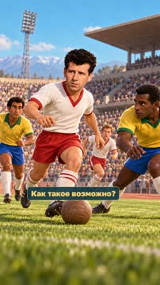

кадр в ключевой момент, затем картинки сцены по порядку

**Голос:** Гол в финале. Поражение. И «Золотой мяч» в том же году. Как такое возможно?

**На экране:** «Маленькие большие дела» · «Легенды футбола» · «match»

**На слух:** Золотой — верно (дубль 1)

**Звук:** chime @0.0

**Факты:** `facts.series.project` = «Маленькие большие дела» · `facts.series.title` = «Легенды футбола»

### 2. setup · 5.3–14.4 с · `illustration`

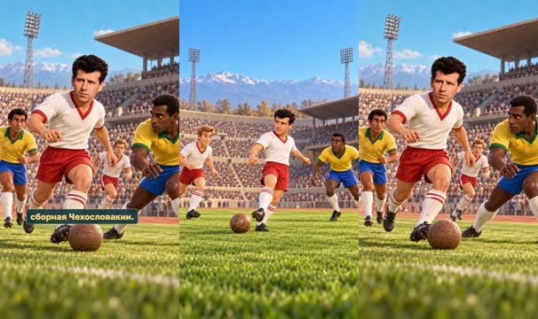

кадр в ключевой момент, затем картинки сцены по порядку

**Голос:** Представьте: финал чемпионата мира! На поле сборная Бразилии, действующие чемпионы мира, а напротив — сборная Чехословакии.

**Картинки:**

- shots/pass.png — ok
- `@rivals` shots/final-v2.png — ok

### 3. lead · 14.4–17.6 с · `illustration`

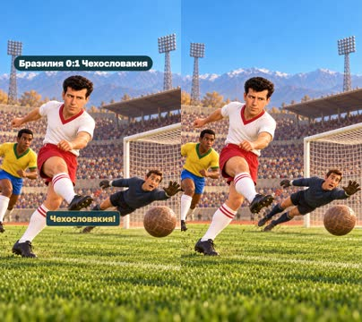

кадр в ключевой момент, затем картинки сцены по порядку

**Голос:** И вдруг первой забивает Чехословакия!

**На экране:** «Бразилия 0:1 Чехословакия»

**Картинки:**

- shots/goal.png — ok

**Звук:** swell @0.0

**Факты:** `facts.match.lead` = «Бразилия 0:1 Чехословакия»

### 4. identity · 17.6–20.3 с · `illustration`

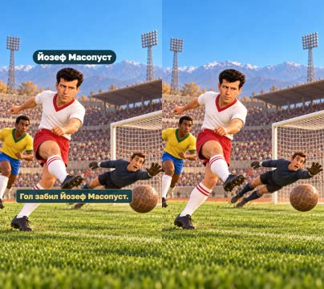

кадр в ключевой момент, затем картинки сцены по порядку

**Голос:** Гол забил Йозеф Масопуст.

**На экране:** «Йозеф Масопуст»

**Картинки:**

- shots/goal.png — ok

**Факты:** `facts.player.name` = «Йозеф Масопуст»

### 5. club · 20.3–26.9 с · `illustration`

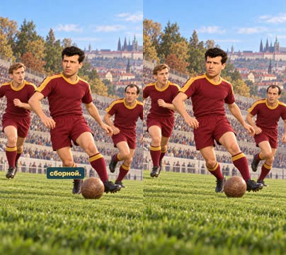

кадр в ключевой момент, затем картинки сцены по порядку

**Голос:** Он был полузащитником пражского клуба «Дукла» и одним из важнейших игроков своей сборной.

**Картинки:**

- shots/dukla.png — ok

### 6. award · 26.9–32.2 с · `illustration`

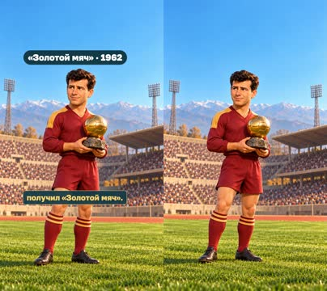

кадр в ключевой момент, затем картинки сцены по порядку

**Голос:** В 1962 году Масопуст получил «Золотой мяч».

**На экране:** ««Золотой мяч» · 1962»

**Картинки:**

- shots/award.png — ok

**На слух:** Золотой — верно (дубль 1)

**Факты:** `facts.player.award` = ««Золотой мяч» · 1962»

### 7. skills · 32.2–38.5 с · `illustration`

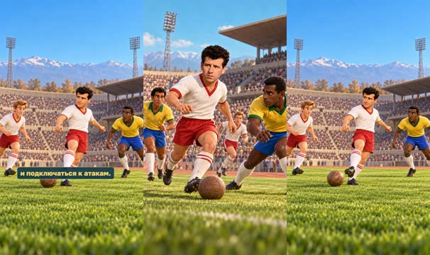

кадр в ключевой момент, затем картинки сцены по порядку

**Голос:** Его ценили за умение контролировать мяч, отдавать передачи и подключаться к атакам.

**Картинки:**

- shots/final-v2.png — ok
- `@pass` shots/pass.png — ok

### 8. minute · 38.5–43.6 с · `illustration`

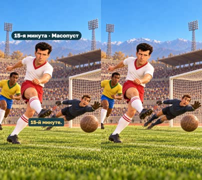

кадр в ключевой момент, затем картинки сцены по порядку

**Голос:** В финале чемпионата мира Масопуст открыл счёт на 15-й минуте.

**На экране:** «15-я минута · Масопуст»

**Картинки:**

- shots/goal.png — ok

**Факты:** `facts.match.minute` = «15-я минута · Масопуст»

### 9. equalise · 43.6–49.2 с · `illustration`

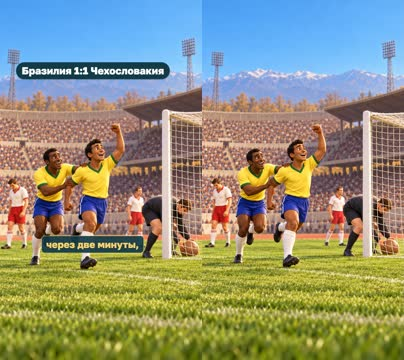

кадр в ключевой момент, затем картинки сцены по порядку

**Голос:** Но радость была недолгой: Бразилия сравняла счёт всего через две минуты,

**На экране:** «Бразилия 1:1 Чехословакия»

**Картинки:**

- shots/brazil.png — ok

**Факты:** `facts.match.equal` = «Бразилия 1:1 Чехословакия»

### 10. result · 49.2–52.9 с · `illustration`

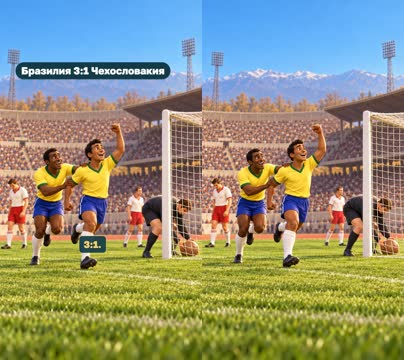

кадр в ключевой момент, затем картинки сцены по порядку

**Голос:** а затем забила ещё два мяча и победила 3:1.

**На экране:** «Бразилия 3:1 Чехословакия»

**Картинки:**

- shots/brazil.png — ok

**Звук:** whoosh @0.0

**Факты:** `facts.match.final` = «Бразилия 3:1 Чехословакия»

### 11. doubt · 52.9–57.1 с · `illustration`

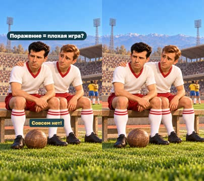

кадр в ключевой момент, затем картинки сцены по порядку

**Голос:** Значит ли это, что Масопуст сыграл плохо? Совсем нет!

**На экране:** «Поражение = плохая игра?»

**Картинки:**

- shots/defeat-v2.png — ok

**Факты:** `facts.story.doubt` = «Поражение = плохая игра?»

### 12. payoff · 57.1–64.1 с · `illustration`

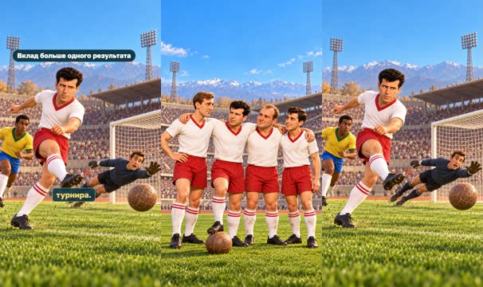

кадр в ключевой момент, затем картинки сцены по порядку

**Голос:** Он помог своей команде добраться до финала чемпионата мира и забил гол в самом важном матче турнира.

**На экране:** «Вклад больше одного результата»

**Картинки:**

- shots/team-v2.png — ok
- `@goal` shots/goal.png — ok

**Факты:** `facts.story.payoff` = «Вклад больше одного результата»

### 13. lesson · 64.1–68.5 с · `illustration`

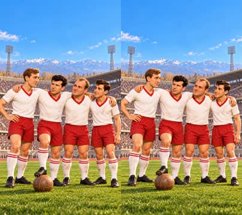

кадр в ключевой момент, затем картинки сцены по порядку

**Голос:** В спорте результат не всегда зависит от одного человека.

**Картинки:**

- shots/team-v2.png — ok

### 14. loss · 68.5–73.7 с · `illustration`

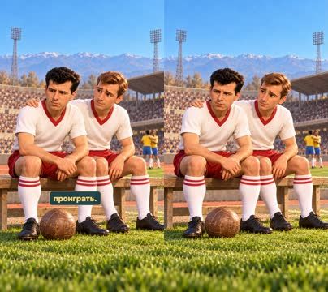

кадр в ключевой момент, затем картинки сцены по порядку

**Голос:** Даже если ты сделал что-то замечательное, команда может проиграть.

**Картинки:**

- shots/defeat-v2.png — ok

### 15. contribution · 73.7–80.6 с · `illustration`

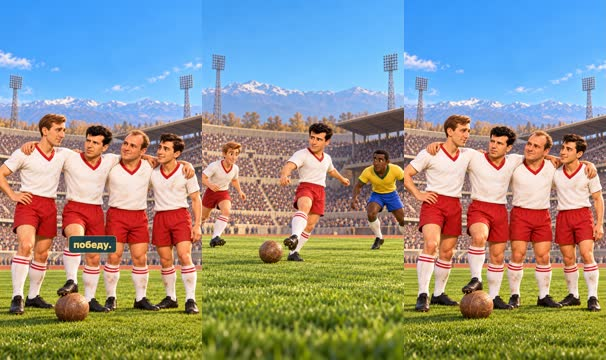

кадр в ключевой момент, затем картинки сцены по порядку

**Голос:** И наоборот: иногда можно сыграть неидеально, но всё равно внести огромный вклад в общую победу.

**Картинки:**

- shots/pass.png — ok
- `@team` shots/team-v2.png — ok

### 16. question · 80.6–88.1 с · `illustration`

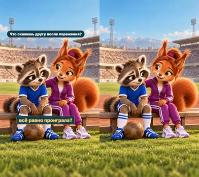

кадр в ключевой момент, затем картинки сцены по порядку

**Голос:** Как бы ты поддержал друга, который забил красивый гол, но его команда всё равно проиграла?

**На экране:** «Что скажешь другу после поражения?»

**Картинки:**

- shots/support.png — ok

**Звук:** chime @0.0

**Факты:** `facts.story.question` = «Что скажешь другу после поражения?»

## Факты и источники

| | |
|---|---|
| `facts.series` | Owner brief, 30 October 2026: first-frame project/series identity, golden football emblem, distinct detailed historical atmosphere; subsequent request to test retention hooks. |
| `facts.player` | [S2] https://www.uefa.com/news-media/news/0222-0f8a9ecabdbc-a5e988df6a89-1000--uefa-president-s-award-to-josef-masopust/; [S3] https://ballondor.com/all-rankings?year=1962 |
| `facts.match` | [S1] https://datencenter.dfb.de/en/data-center/fifa-world-cup/1962-in-chile/final/136944 |
| `facts.story` | Owner supplied script and authorised retention experiment; editorial questions and lesson, not measured performance. |

→ [sources.md](sources.md)

## Текст поста

> Гол в финале. Поражение. И «Золотой мяч» в том же году. Матвей и София разбираются, почему один результат не описывает весь вклад игрока.
>
> Как бы ты поддержал друга после такой игры?
>
> Выпуск 6 «Легенд футбола» проекта «Маленькие большие дела». Финал 1962 года: Бразилия — Чехословакия, 3:1; гол Масопуста на 15-й минуте. Источники: DFB, UEFA, Ballon d’Or. Исторические сцены — художественные иллюстрации GPT Image по архивным ориентирам, не документальная запись конкретных эпизодов. Голос рассказчика синтетический (OmniVoice). Не связано с футболистами, федерациями или организаторами награды.
