# План: Лев Яшин — вратарь, который получил «Золотой мяч»

> Сгенерировано `storygro plan` из `ru.reel.yaml`, 2026-10-31. Не правьте этот файл: текст — в спецификации ролика, вопросы и заметки — в `review.yaml`. Затем `storygro plan` заново.

| | |
|---|---|
| Статус | **сценарий** · ждёт тебя: одобрить сценарий |
| Длительность | 90.2 с (по озвучке) · 17 сцен |
| Формат | 1080×1920, 30 fps · style `cartoon` |
| Голос | omnivoice · assets/voice/narrator-ru.wav · 0.9 |
| Серия | football-legends |

## Одобрения

| | | Кто и когда |
|---|---|---|
| Сценарий | ✏️ изменено после одобрения | agent 2026-10-31 |
| Раскадровка | ⚙️ техническое (агент) | agent 2026-10-31 |
| Выпуск | ⏳ ждёт |   |

Одобрить: `storygro approve <spec> --step script|storyboard|release` (агент — с `--agent`).

## Вопросы

- [ ] **owner** · Подходят ли «Льву Яшину», «вратарём», «голы́» и рассказчик в готовом MP4?
- [ ] **owner** · Подходит ли заставка «Лев Яшин · Чёрный паук» с силуэтом паука на сетке и прежними ведущими?

**Заметки:** Cover revision requested by owner, 31 October 2026: apply shared player-name/nickname/visual-metaphor format to episode7. New cover adds Yashin with a separate graphic spider shadow on the goal net; human anatomy remains normal. Names, series titles and golden emblem readable at frame zero. Original narration, selected OmniVoice B0.90/off, cues, all remaining scene art and timing retained. Prior technical metrics are historical until current rerender/QA. Technical approvals only; no owner approval or public upload. Current rerender: 90.19s, 17scenes, QA15/15; both MP4 fully decode 2702frames, 46 inspected MP4 moments plus feed/cover. 175 caption samples/98 reverse seeks, no failures. All 17 narration SHA256 hashes and every scene start/duration equal the pre-spider version. 18 generations/11 selected art. Cover change only; technical approval, owner editorial review remains open.

## Хук

- Вариант 1 · **выбран**: «Удар в угол! Успеет ли вратарь?»

## Сцены

### 1. hook · 0.0–2.5 с · `series-cover`

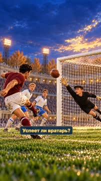

кадр в ключевой момент, затем картинки сцены по порядку

**Голос:** Удар в угол! Успеет ли вратарь?

**На экране:** «Маленькие большие дела» · «Легенды футбола» · «shot» · «Лев Яшин · «Чёрный паук»»

**Звук:** swell @0.0, whoosh @1.7

**Факты:** `facts.series.project` = «Маленькие большие дела» · `facts.series.title` = «Легенды футбола» · `facts.series.episode` = «Лев Яшин · «Чёрный паук»»

### 2. attack · 2.5–5.7 с · `illustration`

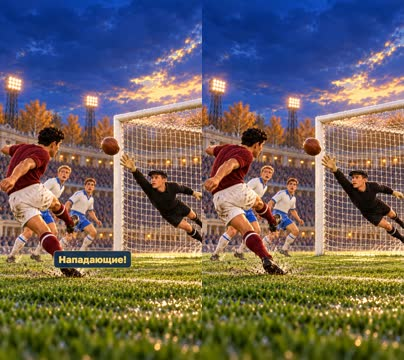

кадр в ключевой момент, затем картинки сцены по порядку

**Голос:** Кто обычно забивает голы? Нападающие!

**Картинки:**

- shots/threat-v2.png — ok

### 3. keeper · 5.7–13.4 с · `illustration`

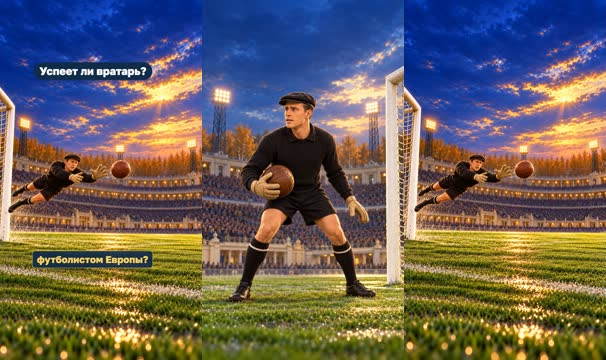

кадр в ключевой момент, затем картинки сцены по порядку

**Голос:** А кто старается не дать им забить? Правильно, вратарь. Но может ли вратарь стать лучшим футболистом Европы?

**На экране:** «Успеет ли вратарь?»

**Картинки:**

- shots/portrait.png — ok
- `@best` shots/dive-v3.png — ok

**Факты:** `facts.story.hook` = «Успеет ли вратарь?»

### 4. identity · 13.4–20.9 с · `illustration`

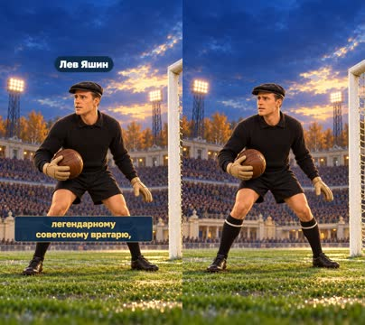

кадр в ключевой момент, затем картинки сцены по порядку

**Голос:** В 1963 году это удалось Льву Яшину — легендарному советскому вратарю,

**На экране:** «Лев Яшин»

**Картинки:**

- shots/portrait.png — ok

**Факты:** `facts.player.name` = «Лев Яшин»

### 5. club · 20.9–25.0 с · `illustration`

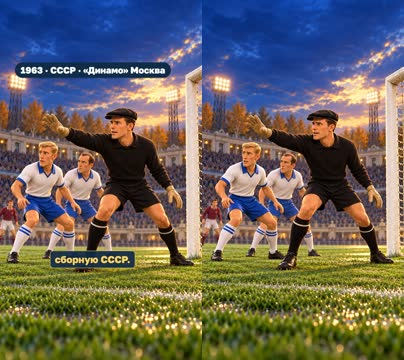

кадр в ключевой момент, затем картинки сцены по порядку

**Голос:** который играл за московское «Динамо» и сборную СССР.

**На экране:** «1963 · СССР · «Динамо» Москва»

**Картинки:**

- shots/defence.png — ok

**Факты:** `facts.player.card` = «1963 · СССР · «Динамо» Москва»

### 6. award · 25.0–30.4 с · `illustration`

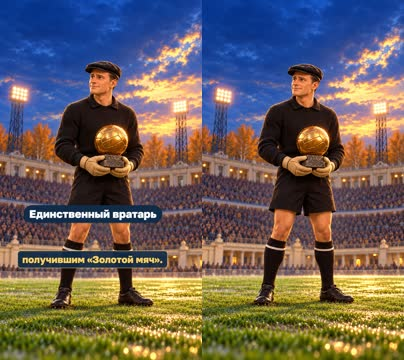

кадр в ключевой момент, затем картинки сцены по порядку

**Голос:** Он стал и по сей день остаётся единственным вратарём, получившим «Золотой мяч».

**На экране:** «Единственный вратарь»

**Картинки:**

- shots/award.png — ok

**На слух:** Золотой — верно (дубль 1)

**Звук:** chime @0.0

**Факты:** `facts.player.only` = «Единственный вратарь»

### 7. spider · 30.4–35.9 с · `illustration`

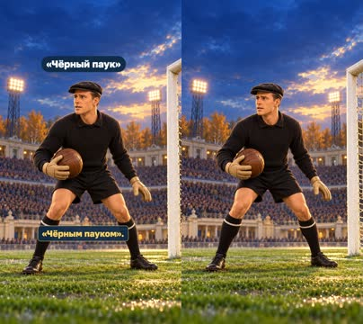

кадр в ключевой момент, затем картинки сцены по порядку

**Голос:** Яшин выступал в тёмной форме, поэтому его часто называли «Чёрным пауком».

**На экране:** ««Чёрный паук»»

**Картинки:**

- shots/portrait.png — ok

**Факты:** `facts.player.nickname` = ««Чёрный паук»»

### 8. save · 35.9–39.1 с · `illustration`

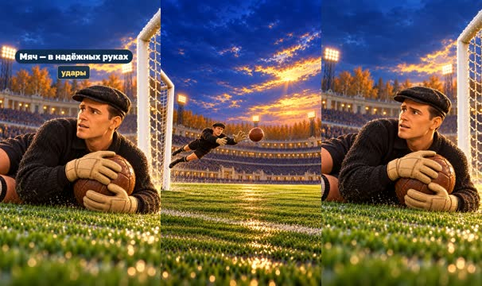

кадр в ключевой момент, затем картинки сцены по порядку

**Голос:** Он прыгал за мячом, ловил сильные удары

**На экране:** «Мяч — в надёжных руках»

**Картинки:**

- shots/dive-v3.png — ok
- `@catch` shots/catch.png — ok

**Звук:** pop @1.6

**Факты:** `facts.skill.save` = «Мяч — в надёжных руках»

### 9. rush · 39.1–43.7 с · `illustration`

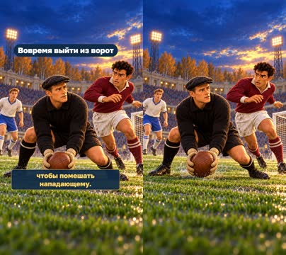

кадр в ключевой момент, затем картинки сцены по порядку

**Голос:** и мог вовремя выбежать из ворот, чтобы помешать нападающему.

**На экране:** «Вовремя выйти из ворот»

**Картинки:**

- shots/rush-v2.png — ok

**Факты:** `facts.skill.rush` = «Вовремя выйти из ворот»

### 10. power · 43.7–47.6 с · `illustration`

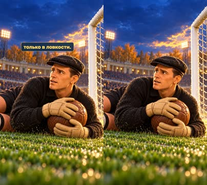

кадр в ключевой момент, затем картинки сцены по порядку

**Голос:** Но его главная суперсила была не только в ловкости.

**Картинки:**

- shots/catch.png — ok

### 11. talk · 47.6–56.4 с · `illustration`

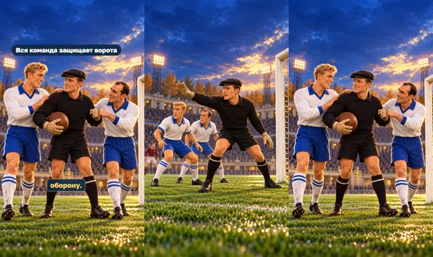

кадр в ключевой момент, затем картинки сцены по порядку

**Голос:** Яшин постоянно разговаривал с защитниками, подсказывал им, где занять позицию, и помогал всей команде организовать оборону.

**На экране:** «Он руководил обороной» · «Вся команда защищает ворота»

**Картинки:**

- shots/defence.png — ok
- `@team` shots/team.png — ok

**Факты:** `facts.skill.organise` = «Он руководил обороной» · `facts.skill.position` = «Вся команда защищает ворота»

### 12. euro · 56.4–63.5 с · `illustration`

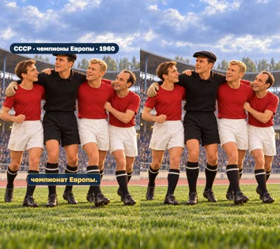

кадр в ключевой момент, затем картинки сцены по порядку

**Голос:** В 1960 году сборная СССР с Яшиным выиграла первый чемпионат Европы.

**На экране:** «СССР · чемпионы Европы · 1960»

**Картинки:**

- shots/europe-v2.png — ok

**Факты:** `facts.history.euro` = «СССР · чемпионы Европы · 1960»

### 13. recognition · 63.5–68.1 с · `illustration`

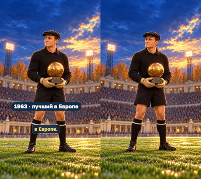

кадр в ключевой момент, затем картинки сцены по порядку

**Голос:** А три года спустя футбольный мир признал его лучшим в Европе.

**На экране:** «1963 · лучший в Европе»

**Картинки:**

- shots/award.png — ok

**Факты:** `facts.history.recognition` = «1963 · лучший в Европе»

### 14. lesson · 68.1–72.8 с · `illustration`

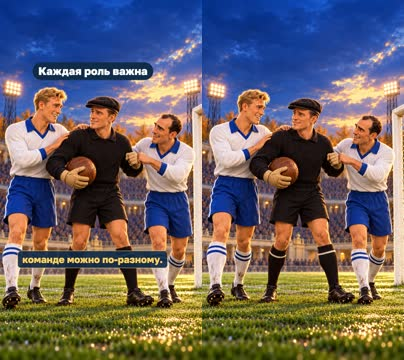

кадр в ключевой момент, затем картинки сцены по порядку

**Голос:** История Яшина показывает, что быть полезным команде можно по-разному.

**На экране:** «Каждая роль важна»

**Картинки:**

- shots/team.png — ok

**Факты:** `facts.story.lesson` = «Каждая роль важна»

### 15. not-goals · 72.8–75.5 с · `illustration`

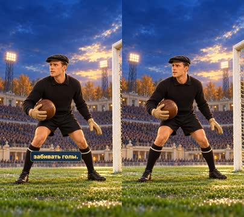

кадр в ключевой момент, затем картинки сцены по порядку

**Голос:** Вратарь не обязан забивать голы.

**Картинки:**

- shots/portrait.png — ok

### 16. read · 75.5–82.2 с · `illustration`

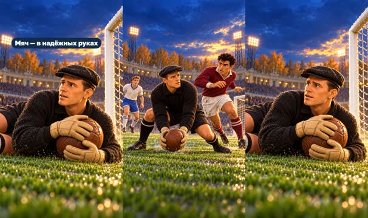

кадр в ключевой момент, затем картинки сцены по порядку

**Голос:** Его задача — вовремя прочитать игру, принять решение и спасти команду в самый трудный момент.

**На экране:** «Мяч — в надёжных руках»

**Картинки:**

- shots/rush-v2.png — ok
- `@save` shots/catch.png — ok

**Звук:** pop @3.8

**Факты:** `facts.skill.save` = «Мяч — в надёжных руках»

### 17. question · 82.2–90.2 с · `illustration`

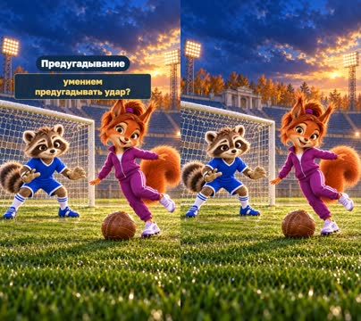

кадр в ключевой момент, затем картинки сцены по порядку

**Голос:** Каким навыком должен обладать хороший вратарь — смелостью, реакцией или умением предугадывать удар?

**На экране:** «Что важнее для вратаря?» · «Смелость» · «Реакция» · «Предугадывание»

**Картинки:**

- shots/question.png — ok

**Звук:** chime @0.0

**Факты:** `facts.story.question` = «Что важнее для вратаря?» · `facts.story.courage` = «Смелость» · `facts.story.reaction` = «Реакция» · `facts.story.prediction` = «Предугадывание»

## Факты и источники

| | |
|---|---|
| `facts.series` | Owner script and request, 30 October 2026: episode7 Lev Yashin, a more suspenseful vivid detailed video, shared project/series title and golden football emblem on frame zero. Owner request, 31 October 2026: apply the nickname/metaphor cover to episode7; nickname verified in S1 https://ballondor.com/news/posts/can-a-goalkeeper-win-the-ballon-dor-what-history-says |
| `facts.player` | [S1] https://ballondor.com/news/posts/can-a-goalkeeper-win-the-ballon-dor-what-history-says; [S2] https://www.uefa.com/uefaeuro/history/news/0253-0d7f20bc921c-495824f652eb-1000--uefaeuro1960-team-of-the-tournament/; [S4] https://stars.fcdynamo.ru/yashin.html |
| `facts.history` | [S2] https://www.uefa.com/uefaeuro/history/news/0253-0d7f20bc921c-495824f652eb-1000--uefaeuro1960-team-of-the-tournament/; [S1] https://ballondor.com/news/posts/can-a-goalkeeper-win-the-ballon-dor-what-history-says |
| `facts.skill` | [S3] https://inside.fifa.com/tournaments/mens/worldcup/2018russia/news/2018-fifa-world-cup-russiatm-official-poster-unveiled-at-moscow-metro-2921534; [S2] https://www.uefa.com/uefaeuro/history/news/0253-0d7f20bc921c-495824f652eb-1000--uefaeuro1960-team-of-the-tournament/; owner script |
| `facts.story` | Owner script and request, 30 October 2026: episode7 Lev Yashin, a more suspenseful vivid detailed video, shared project/series title and golden football emblem on frame zero. |

→ [sources.md](sources.md)

## Текст поста

> Удар в угол — успеет ли вратарь? Матвей и София знакомятся со Львом Яшиным: единственным вратарём, получившим «Золотой мяч» (1963). Его сила — не только реакция, но и решения, смелость и помощь защитникам.
>
> Что важнее для вратаря: смелость, реакция или умение предугадать удар?
>
> Выпуск 7 «Легенд футбола» проекта «Маленькие большие дела». Источники: Ballon d’Or, UEFA, FIFA, «Динамо» Москва. Иллюстрации созданы встроенным GPT Image по архивным ориентирам; игровые сцены, свет и погода художественные, не запись конкретного матча. Источник образа: Henk Lindeboom / Anefo, Nationaal Archief (CC BY-SA 3.0 NL), адаптировано в 3D-иллюстрации. Голос рассказчика синтетический (OmniVoice). Ролик не связан с футболистами, клубами или организаторами награды.
>
> «Чёрный паук» — прозвище Яшина. Силуэт паука на сетке в заставке — шутливая визуальная метафора его реакции; вратарь остаётся обычным человеком.
