# План: Денис Лоу — король голов

> Сгенерировано `storygro plan` из `ru.reel.yaml`, 2026-10-31. Не правьте этот файл: текст — в спецификации ролика, вопросы и заметки — в `review.yaml`. Затем `storygro plan` заново.

| | |
|---|---|
| Статус | **сценарий** · ждёт тебя: одобрить сценарий |
| Длительность | 82.3 с (по озвучке) · 13 сцен |
| Формат | 1080×1920, 30 fps · style `cartoon` |
| Голос | omnivoice · assets/voice/narrator-ru.wav · 0.9 |
| Серия | football-legends |

## Одобрения

| | | Кто и когда |
|---|---|---|
| Сценарий | ⚙️ техническое (агент) | agent 2026-10-31 |
| Раскадровка | ⚙️ техническое (агент) | agent 2026-10-31 |
| Выпуск | ⏳ ждёт |   |

Одобрить: `storygro approve <spec> --step script|storyboard|release` (агент — с `--agent`).

## Вопросы

- [ ] **owner** · Подходят ли имена Денис Лоу, Бобби Чарльтон, Джордж Бест и произношение чисел в готовом MP4?
- [ ] **owner** · Подходят ли сходство футболистов, атмосфера старого «Олд Траффорд» и имя героя на первом кадре?

**Заметки:** Owner script retained verbatim, except pasted source placeholders and section headings; numbers use pronunciation hints with unchanged captions. Frame zero adds the player name to the shared identity. Technical checks do not establish owner editorial or listening approval. Technical final: 82.26s, 13scenes, QA 15/15; both MP4 fully decoded (2466frames each), 36 inspected moments, feed/cover reviewed, 161 caption samples and 76 reverse seeks without geometry failures. 20 imagegen generations, 12 selected. Historical-detail pass, separate period club/national kits, distinct Trinity faces, old Stretford End, player name at frame zero; shifted action captions/statistics and moved clipped ball inside frame. Owner listening/editorial approval remains open. No publication.

## Хук

- Вариант 1 · **выбран**: «Представьте нападающего, который за карьеру в одном клубе забил больше двухсот голов.»

## Сцены

### 1. hook · 0.0–6.3 с · `series-cover`

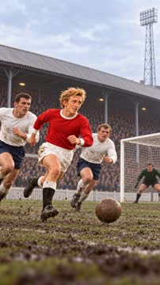

кадр в ключевой момент, затем картинки сцены по порядку

**Голос:** Представьте нападающего, который за карьеру в одном клубе забил больше двухсот голов.

**На экране:** «Маленькие большие дела» · «Легенды футбола» · «Денис Лоу» · «shot»

**Звук:** swell @0.0, whoosh @3.0

**Факты:** `facts.series.project` = «Маленькие большие дела» · `facts.series.title` = «Легенды футбола» · `facts.series.episode` = «Денис Лоу»

### 2. identity · 6.3–11.5 с · `illustration`

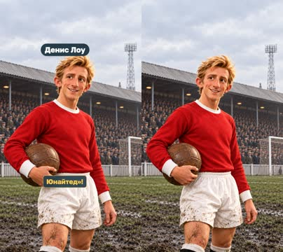

кадр в ключевой момент, затем картинки сцены по порядку

**Голос:** Так играл Денис Лоу — один из самых знаменитых футболистов «Манчестер Юнайтед»!

**На экране:** «Денис Лоу»

**Картинки:**

- shots/portrait-v2.png — ok

**Факты:** `facts.player.name` = «Денис Лоу»

### 3. scotland · 11.5–15.8 с · `illustration`

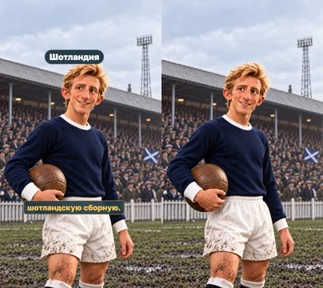

кадр в ключевой момент, затем картинки сцены по порядку

**Голос:** Он родился в Шотландии и представлял шотландскую сборную.

**На экране:** «Шотландия»

**Картинки:**

- shots/scotland-v2.png — ok

**Факты:** `facts.player.country` = «Шотландия»

### 4. award · 15.8–23.0 с · `illustration`

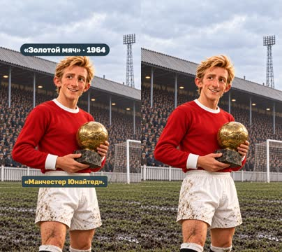

кадр в ключевой момент, затем картинки сцены по порядку

**Голос:** В 1964 году Лоу получил «Золотой мяч», выступая за «Манчестер Юнайтед».

**На экране:** ««Золотой мяч» · 1964»

**Картинки:**

- shots/award-v2.png — ok

**На слух:** Золотой — верно (дубль 1)

**Звук:** chime @0.0

**Факты:** `facts.player.award` = ««Золотой мяч» · 1964»

### 5. moment · 23.0–28.0 с · `illustration`

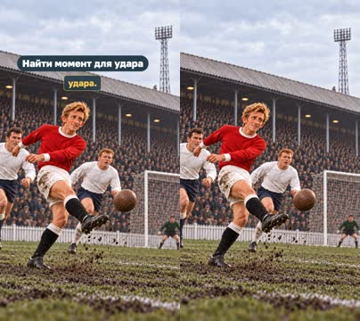

кадр в ключевой момент, затем картинки сцены по порядку

**Голос:** Лоу был нападающим, который умел быстро находить момент для удара.

**На экране:** «Найти момент для удара»

**Картинки:**

- shots/strike-v3.png — ok

**Факты:** `facts.skill.moment` = «Найти момент для удара»

### 6. position · 28.0–35.5 с · `illustration`

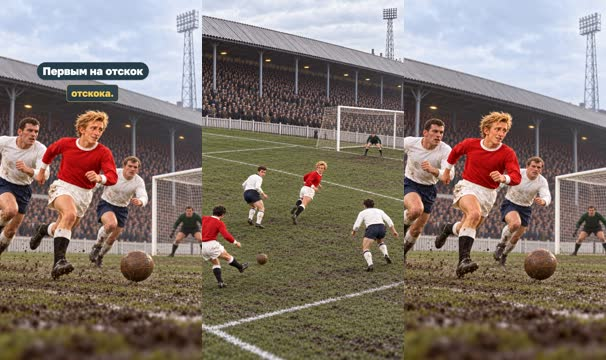

кадр в ключевой момент, затем картинки сцены по порядку

**Голос:** Он мог оказаться рядом с воротами, когда защитники отвлеклись, или первым добежать до мяча после отскока.

**На экране:** «Первым на отскок»

**Картинки:**

- shots/run.png — ok
- `@rebound` shots/rebound-v2.png — ok

**Звук:** whoosh @4.2

**Факты:** `facts.skill.rebound` = «Первым на отскок»

### 7. second · 35.5–42.0 с · `illustration`

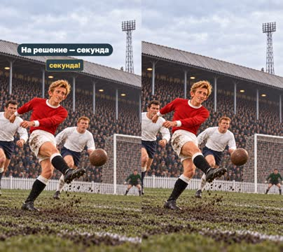

кадр в ключевой момент, затем картинки сцены по порядку

**Голос:** В футболе такое умение очень важно: иногда на размышления остаётся всего одна секунда!

**На экране:** «На решение — секунда»

**Картинки:**

- shots/strike-v3.png — ok

**Факты:** `facts.story.second` = «На решение — секунда»

### 8. club · 42.0–51.0 с · `illustration`

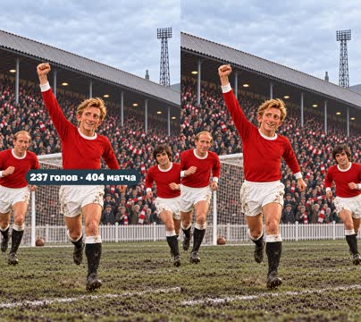

кадр в ключевой момент, затем картинки сцены по порядку

**Голос:** За время игры за «Манчестер Юнайтед» Лоу забил 237 голов в 404 матчах. Это впечатляющий результат!

**На экране:** «237 голов · 404 матча»

**Картинки:**

- shots/celebration.png — ok

**Звук:** pop @0.0

**Факты:** `facts.stats.total` = «237 голов · 404 матча»

### 9. trinity · 51.0–57.7 с · `illustration`

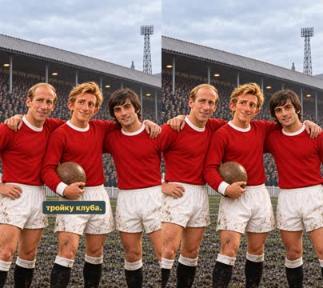

кадр в ключевой момент, затем картинки сцены по порядку

**Голос:** Вместе с Бобби Чарльтоном и Джорджем Бестом он вошёл в знаменитую атакующую тройку клуба.

**Картинки:**

- shots/trinity.png — ok

### 10. different · 57.7–61.9 с · `illustration`

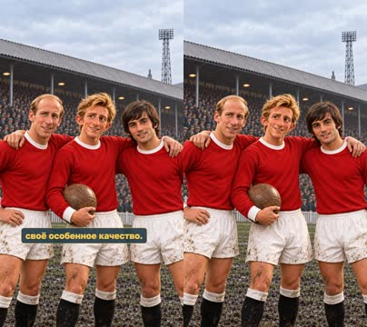

кадр в ключевой момент, затем картинки сцены по порядку

**Голос:** У каждого из этой троицы было своё особенное качество.

**Картинки:**

- shots/trinity.png — ok

### 11. talents · 61.9–68.7 с · `illustration`

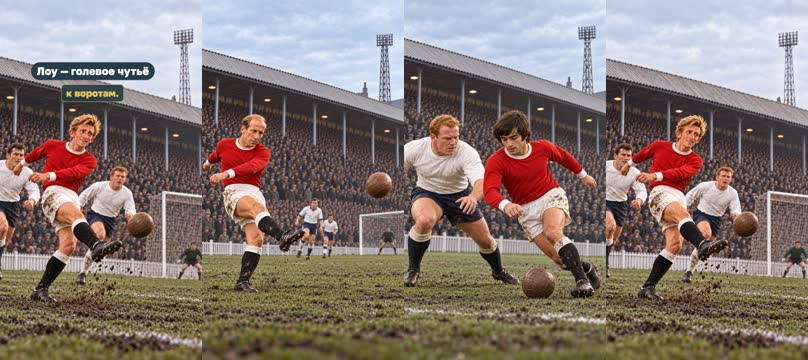

кадр в ключевой момент, затем картинки сцены по порядку

**Голос:** Чарльтон отлично бил издалека, Бест славился дриблингом, а Лоу умел находить путь к воротам.

**На экране:** «Чарльтон — дальний удар» · «Бест — дриблинг» · «Лоу — голевое чутьё»

**Картинки:**

- shots/charlton.png — ok
- `@best` shots/best.png — ok
- `@law` shots/strike-v3.png — ok

**Факты:** `facts.skill.charlton` = «Чарльтон — дальний удар» · `facts.skill.best` = «Бест — дриблинг» · `facts.skill.law` = «Лоу — голевое чутьё»

### 12. team · 68.7–74.9 с · `illustration`

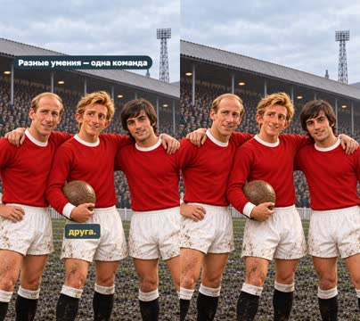

кадр в ключевой момент, затем картинки сцены по порядку

**Голос:** Вот почему футбол — командная игра: три разных мастера могли усиливать друг друга.

**На экране:** «Разные умения — одна команда»

**Картинки:**

- shots/trinity.png — ok

**Факты:** `facts.skill.team` = «Разные умения — одна команда»

### 13. question · 74.9–82.3 с · `illustration`

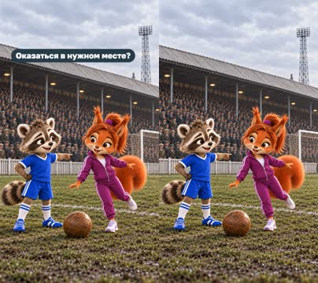

кадр в ключевой момент, затем картинки сцены по порядку

**Голос:** Что помогает забивать больше: сильный удар или умение вовремя оказаться в нужном месте?

**На экране:** «Что помогает забивать больше?» · «Сильный удар?» · «Оказаться в нужном месте?»

**Картинки:**

- shots/question-v2.png — ok

**Звук:** chime @0.0

**Факты:** `facts.story.question` = «Что помогает забивать больше?» · `facts.story.power` = «Сильный удар?» · `facts.story.position` = «Оказаться в нужном месте?»

## Факты и источники

| | |
|---|---|
| `facts.series` | Owner supplied episode8 script and first-frame player-name requirement, 31 October 2026. |
| `facts.player` | [S1] https://app.francefootball.fr/ballon-d-or/palmares/; [S2] https://www.manutd.com/en/mutv/videos/detail/video-obituary-of-man-utd-icon-denis-law; [S4] https://www.premierleague.com/en/news/4115640 |
| `facts.stats` | [S2] https://www.manutd.com/en/mutv/videos/detail/video-obituary-of-man-utd-icon-denis-law; all first-team Manchester United appearances, not league-only or entire career |
| `facts.skill` | [S3] https://www.tottenhamhotspur.com/news/1060505/cliffs-united-memories-the-united-trinity; owner script |
| `facts.story` | Owner supplied episode8 script and first-frame player-name requirement, 31 October 2026. |

→ [sources.md](sources.md)

## Текст поста

> Сильный удар или вовремя оказаться в нужном месте? Матвей и София знакомятся с Денисом Лоу — обладателем «Золотого мяча» 1964 года. За «Манчестер Юнайтед» он забил 237 голов в 404 матчах во всех турнирах.
>
> Чарльтон, Бест и Лоу: разные умения помогают одной команде. А что выбрал бы ты?
>
> Выпуск 8 проекта «Маленькие большие дела · Легенды футбола». Источники: France Football, Manchester United, Premier League, Tottenham Hotspur (воспоминания Клиффа Джонса). Иллюстрации созданы встроенным GPT Image; игровые действия, свет и атмосфера — художественная интерпретация, не запись конкретного матча. Архивный ориентир: Hugo van Gelderen / Anefo, Nationaal Archief, CC0. Голос рассказчика синтетический (OmniVoice).
