# План: Эусебио — «Чёрная пантера», которая не сдавалась

> Сгенерировано `storygro plan` из `ru.reel.yaml`, 2026-10-31. Не правьте этот файл: текст — в спецификации ролика, вопросы и заметки — в `review.yaml`. Затем `storygro plan` заново.

| | |
|---|---|
| Статус | **сценарий** · ждёт тебя: одобрить сценарий |
| Длительность | 98.4 с (по озвучке) · 13 сцен |
| Формат | 1080×1920, 30 fps · style `cartoon` |
| Голос | omnivoice · assets/voice/narrator-ru.wav · 0.82 |
| Серия | football-legends |

## Одобрения

| | | Кто и когда |
|---|---|---|
| Сценарий | ⚙️ техническое (агент) | agent 2026-10-31 |
| Раскадровка | ⚙️ техническое (агент) | agent 2026-10-31 |
| Выпуск | ⏳ ждёт |   |

Одобрить: `storygro approve <spec> --step script|storyboard|release` (агент — с `--agent`).

## Вопросы

- [ ] **owner** · Подходит ли рабочая редакция с ранним первым голом, последовательным камбэком и сохранённым финальным вопросом?
- [ ] **owner** · Подходит ли Эусебио в действии на заставке и игрушечная «Чёрная пантера» как метафора прозвища?
- [ ] **owner** · В V2 подходят ли замедленный темп, исправленное «панте́рой», пауза после 5:3 и остальные имена/интонации?

**Заметки:** V2 owner-requested pacing/stress revision, 31 October 2026. Same OmniVoice B narrator at 0.82/off instead of 0.90/off; explicit пантЭрой pronunciation hint; final 5:3 held 1.60s after speech, other result/photo holds extended. 98.436s, 13 scenes, 1080x1920/30; QA pass, 47 MP4 moments and feed/cover inspected; master/web decode 2953/2953 frames. 142 runtime samples/76 caption phrases clear; 16 reverse seeks have identical visible DOM, with separately recorded maximum 1/255 GPU pixel rounding. First visible goal 5.492000000000001s. 8 selected illustrations/9 generations. Real player1963/venue2003 photos with clear dates; attribution/licences in post/docs only. V1 delivery preserved. Voice speed, duration and photo changes confound FL-R1; no measured retention result. The model interface cannot receive audio: final auditory/stress/editorial owner review remains open, ASR is technical evidence only. No publication.

## Хук

- Вариант 1 · **выбран**: «Ноль: три. Вы бы опустили руки? А Эусебио уже идёт в атаку.»
- Вариант 2: «Четыре гола одного игрока. Но спасут ли они команду?»
- Вариант 3: «Почему его называли «Чёрной пантерой»?»

## Сцены

### 1. hook · 0.0–4.5 с · `series-cover`

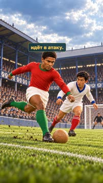

кадр в ключевой момент, затем картинки сцены по порядку

**Голос:** Ноль: три. Вы бы опустили руки? А Эусебио уже идёт в атаку.

**На экране:** «Маленькие большие дела» · «Легенды футбола» · «Эусебио · «Чёрная пантера»» · «reveal»

**Звук:** swell @0.0, whoosh @2.5

**Факты:** `facts.series.project` = «Маленькие большие дела» · `facts.series.title` = «Легенды футбола» · `facts.series.episode` = «Эусебио · «Чёрная пантера»»

### 2. first · 4.5–10.4 с · `illustration`

кадр в ключевой момент, затем картинки сцены по порядку

**Голос:** Удар — и первый ответный гол! Но как сравнять счёт, а потом ещё и победить?

**На экране:** «1:3»

**Картинки:**

- shots/strike.png — ok
- `@net` shots/net.png — ok

**Звук:** hit @1.0

**Факты:** `facts.match.first` = «1:3»

### 3. context · 10.4–19.1 с · `archive-photo`

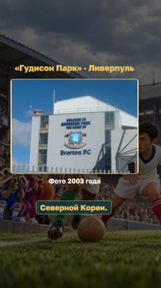

кадр в ключевой момент, затем картинки сцены по порядку

**Голос:** Это был чемпионат мира 1966 года. Португалия играла против Северной Кореи.

**На экране:** ««Гудисон Парк» · Ливерпуль» · «Фото 2003 года» · «contain»

**Факты:** `facts.archive.stadiumTitle` = ««Гудисон Парк» · Ливерпуль» · `facts.archive.stadiumDate` = «Фото 2003 года»

### 4. identity · 19.1–29.0 с · `archive-photo`

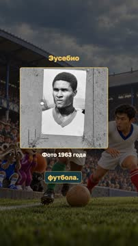

кадр в ключевой момент, затем картинки сцены по порядку

**Голос:** Эусебио — нападающий сборной Португалии и «Бенфики». Он родился в Мозамбике, а затем стал звездой португальского футбола.

**На экране:** «Эусебио» · «Фото 1963 года» · «cover» · «50% 45%»

**Факты:** `facts.archive.playerTitle` = «Эусебио» · `facts.archive.playerDate` = «Фото 1963 года»

### 5. panther · 29.0–35.8 с · `illustration`

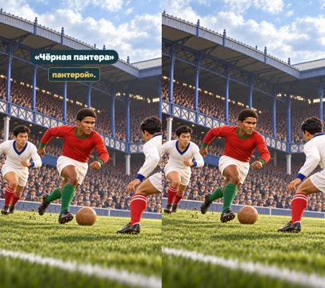

кадр в ключевой момент, затем картинки сцены по порядку

**Голос:** Скорость, сила, мощный удар. За стремительные рывки его прозвали «Чёрной пантерой».

**На экране:** «Скорость · сила · удар» · ««Чёрная пантера»»

**Картинки:**

- shots/sprint.png — ok

**Звук:** whoosh @5.2

**Факты:** `facts.story.speed` = «Скорость · сила · удар» · `facts.player.nickname` = ««Чёрная пантера»»

### 6. award · 35.8–42.8 с · `archive-photo`

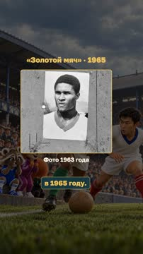

кадр в ключевой момент, затем картинки сцены по порядку

**Голос:** «Золотой мяч» он получил ещё годом раньше — в 1965 году.

**На экране:** ««Золотой мяч» · 1965» · «Фото 1963 года» · «cover» · «50% 45%»

**На слух:** Золотой — верно (дубль 1)

**Звук:** chime @0.0

**Факты:** `facts.player.award` = ««Золотой мяч» · 1965» · `facts.archive.playerDate` = «Фото 1963 года»

### 7. second · 42.8–49.8 с · `illustration`

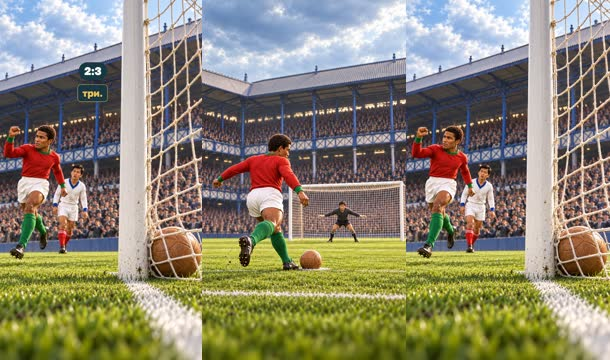

кадр в ключевой момент, затем картинки сцены по порядку

**Голос:** Вернёмся к матчу. Португалия всё ещё проигрывает. Эусебио бьёт пенальти — два: три.

**На экране:** «Пенальти» · «2:3»

**Картинки:**

- shots/penalty-v2.png — ok
- `@goal` shots/net.png — ok

**Звук:** hit @5.7

**Факты:** `facts.match.penalty` = «Пенальти» · `facts.match.second` = «2:3»

### 8. equal · 49.8–55.6 с · `illustration`

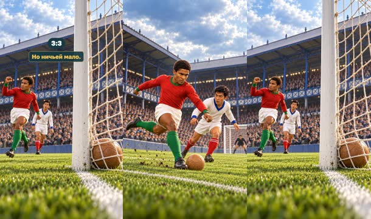

кадр в ключевой момент, затем картинки сцены по порядку

**Голос:** После перерыва — ещё один точный удар. Уже три: три! Но ничьей мало.

**На экране:** «3:3»

**Картинки:**

- shots/strike.png — ok
- `@goal` shots/net.png — ok

**Звук:** hit @2.7

**Факты:** `facts.match.equal` = «3:3»

### 9. lead · 55.6–64.0 с · `illustration`

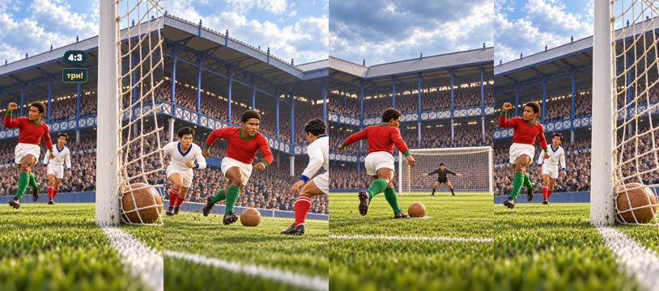

кадр в ключевой момент, затем картинки сцены по порядку

**Голос:** Рывок. Его останавливают с нарушением. Снова пенальти. И теперь Португалия впереди — четыре: три!

**На экране:** «Пенальти» · «4:3»

**Картинки:**

- shots/sprint.png — ok
- `@penalty` shots/penalty-v2.png — ok
- `@goal` shots/net.png — ok

**Звук:** whoosh @3.2, hit @4.4

**Факты:** `facts.match.penalty` = «Пенальти» · `facts.match.lead` = «4:3»

### 10. win · 64.0–72.9 с · `illustration`

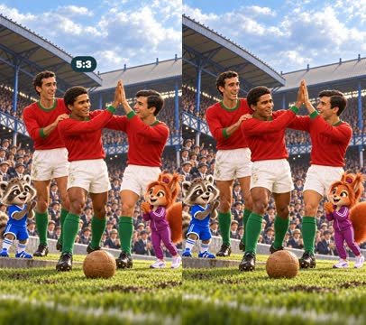

кадр в ключевой момент, затем картинки сцены по порядку

**Голос:** Четыре гола в одном матче! А пятый мяч Португалии забил его партнёр. Команда победила пять: три!

**На экране:** «4 гола Эусебио» · «Пятый мяч — гол партнёра» · «5:3»

**Картинки:**

- shots/celebration.png — ok

**Звук:** chime @5.2

**Факты:** `facts.match.four` = «4 гола Эусебио» · `facts.match.team` = «Пятый мяч — гол партнёра» · `facts.match.final` = «5:3»

### 11. tournament · 72.9–81.5 с · `illustration`

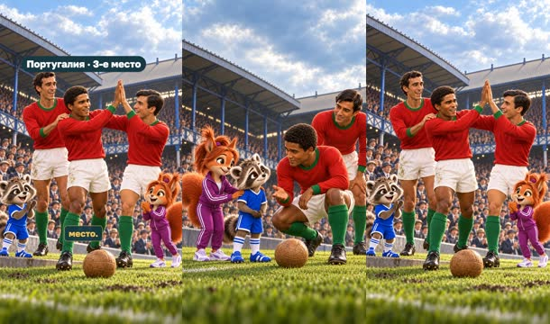

кадр в ключевой момент, затем картинки сцены по порядку

**Голос:** На том чемпионате Эусебио забил девять голов и стал лучшим бомбардиром. Португалия заняла третье место.

**На экране:** «9 голов за турнир» · «Португалия · 3-е место»

**Картинки:**

- shots/support.png — ok
- `@bronze` shots/celebration.png — ok

**Факты:** `facts.tournament.goals` = «9 голов за турнир» · `facts.tournament.bronze` = «Португалия · 3-е место»

### 12. lesson · 81.5–90.4 с · `illustration`

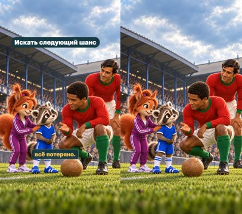

кадр в ключевой момент, затем картинки сцены по порядку

**Голос:** Один игрок не может всегда спасти команду. Но пока матч не закончен, нельзя заранее решить, что всё потеряно.

**На экране:** «Искать следующий шанс»

**Картинки:**

- shots/support.png — ok

**Факты:** `facts.story.hope` = «Искать следующий шанс»

### 13. question · 90.4–98.4 с · `illustration`

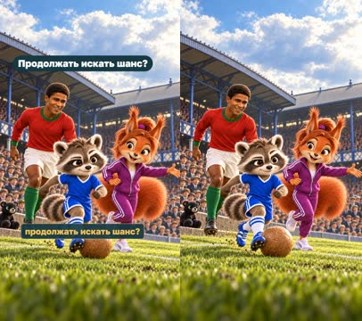

кадр в ключевой момент, затем картинки сцены по порядку

**Голос:** Если твоя команда проигрывает, что лучше: опустить руки или продолжать искать шанс?

**На экране:** «Если команда проигрывает…» · «Опустить руки?» · «Продолжать искать шанс?»

**Картинки:**

- shots/question.png — ok

**Звук:** chime @0.0

**Факты:** `facts.story.question` = «Если команда проигрывает…» · `facts.story.giveUp` = «Опустить руки?» · `facts.story.try` = «Продолжать искать шанс?»

## Факты и источники

| | |
|---|---|
| `facts.series` | [O1] Owner DOCX9: both titles, golden ball, name AND player at frame zero. [S3] FPF nickname. |
| `facts.player` | [S2] SL Benfica,1965 Ballon d’Or; [S3] FPF, Benfica, Pantera Negra, skills; [S4] The FA, born in Mozambique. |
| `facts.match` | [S1] FIFA: Portugal5–3 Korea DPR,23July1966,Goodison Park; Eusebio27,43pen,56,59pen,Jose Augusto80. All scores ordered Portugal:Korea DPR. |
| `facts.tournament` | [S1] FIFA and [S3] FPF: nine goals, Golden Boot, Portugal third in1966. The1965 award predates that tournament. |
| `facts.story` | [O1] Owner9 lesson/question, adapted opening/action captions under requested research workflow; editorial text, not historical quotations. |
| `facts.archive` | [V1] Anefo/Nationaal Archief portrait22Oct1963,CC0; [P2] Simon Paul/Nsno1878,Goodisonend.jpg,summer2003,author public-domain release on Commons. Photo dates are not match dates. |

→ [sources.md](sources.md)

## Текст поста

> 0:3 — и всё потеряно? Эусебио и сборная Португалии продолжили искать шанс. В четвертьфинале чемпионата мира 1966 они победили Северную Корею 5:3: четыре гола забил Эусебио, пятый — его партнёр Жозе Аугушту.
>
> «Золотой мяч» Эусебио получил ещё в 1965 году. На чемпионате мира 1966 он стал лучшим бомбардиром с девятью голами, а Португалия заняла третье место.
>
> Если твоя команда проигрывает, что лучше: опустить руки или продолжать искать шанс?
>
> Выпуск 9 проекта «Маленькие большие дела · Легенды футбола». Источники: FIFA, FPF, SL Benfica, The FA. Форма и эпоха: Historical Football Kits; облик игрока: портрет Anefo/Nationaal Archief 1963 года, CC0. Иллюстрации созданы встроенным GPT Image; действия, ведущие и пантера-игрушка — художественная интерпретация, не запись матча. Голос рассказчика синтетический (OmniVoice).
>
> Реальные фото: Эусебио — Anefo / Nationaal Archief,22.10.1963,CC0 (commons.wikimedia.org/wiki/File:Wereldelftal._Eusebio,_Bestanddeelnr_915-6597.jpg); «Гудисон Парк» — Simon Paul / Nsno1878,лето2003,public-domain release (commons.wikimedia.org/wiki/File:Goodisonend.jpg). Даты фото подписаны; поздний вид стадиона не изображает матч1966. Портрет показан с кадрированием, фото стадиона целиком; без AI-ретуши.
