# План: Месси и Роналду — два пути к рекордам

> Сгенерировано `storygro plan` из `ru.reel.yaml`, 2026-10-31. Не правьте этот файл: текст — в спецификации ролика, вопросы и заметки — в `review.yaml`. Затем `storygro plan` заново.

| | |
|---|---|
| Статус | **сценарий** · ждёт тебя: одобрить сценарий |
| Длительность | 98.7 с (по озвучке) · 11 сцен |
| Формат | 1080×1920, 30 fps · style `cartoon` |
| Голос | omnivoice · assets/voice/narrator-ru.wav · 0.82 |
| Серия | football-now |

## Одобрения

| | | Кто и когда |
|---|---|---|
| Сценарий | ⚙️ техническое (агент) | agent 2026-10-31 |
| Раскадровка | ⚙️ техническое (агент) | agent 2026-10-31 |
| Выпуск | ⏳ ждёт |   |

Одобрить: `storygro approve <spec> --step script|storyboard|release` (агент — с `--agent`).

## Вопросы

- [ ] **owner** · Подходит ли авторский сценарий современного спецвыпуска и связь со следующей темой?
- [ ] **owner** · Подходит ли формат с настоящими футболистами в центре, меньшими ведущими рядом и простыми примерами передач? Новые рисованные лица генератор отклонил.
- [ ] **owner** · Подходят ли спокойный темп, ударения имён и паузы в готовом видео?

**Заметки:** Technical review cut, 31 October2026: 98.65899999999999s, 11 scenes,1080x1920/30; QA15/15, master/web fully decoded2957/2957 frames. Inspected37 MP4 moments and feed/cover;68 caption phrases/239 runtime samples clear;142 reverse seeks with Exact visible DOM/SVG state; observed raster max 30/255 at at most 32 pixels above1 intensity across 1080x1920, with the full tolerance and samples recorded separately. Every scene shows actual footballers as protagonists; Matvey/Sofia are smaller supporting hosts. 7 authentic licensed photos, one selected illustrated host background. Built-in GPT Image blocked new recognisable player faces; successful requests used fictional cast/environment only, no bypass or photo retouch. OmniVoice B0.82/off unchanged; opening Messi retake uses explicit МЭсси hint; phoneme heuristic positive. Current model interface cannot receive audio; subjective auditory/stress/editorial owner review stays open. NOW-R1 is confounded by new paired/photo format and length, no measured retention. No owner approvals or publication recorded.

## Хук

- Вариант 1 · **выбран**: «От легенд прошлого — к звёздам нашего времени! Месси и Роналду. В чём секрет их долгой карьеры?»
- Вариант 2: «Один взлетает за мячом. Другой будто прячет его у ноги. Кто тебе ближе?»
- Вариант 3: «Как удивлять футболом больше двадцати лет?»

## Сцены

### 1. hook · 0.0–7.4 с · `photo-pair`

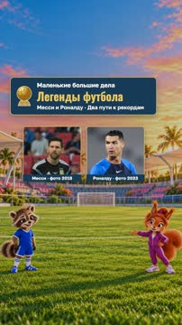

кадр в ключевой момент, затем картинки сцены по порядку

**Голос:** От легенд прошлого — к звёздам нашего времени! Месси и Роналду. В чём секрет их долгой карьеры?

**На экране:** «Маленькие большие дела» · «Легенды футбола» · «Месси и Роналду · Два пути к рекордам» · «Месси · фото 2018» · «cover» · «50% 0%» · «Роналду · фото 2023»

**На слух:** Месси — верно (дубль 1)

**Звук:** swell @0.0, whoosh @3.6

**Факты:** `facts.series.project` = «Маленькие большие дела» · `facts.series.title` = «Легенды футбола» · `facts.series.episode` = «Месси и Роналду · Два пути к рекордам» · `facts.cover.messi` = «Месси · фото 2018» · `facts.cover.ronaldo` = «Роналду · фото 2023»

### 2. ronaldo-action · 7.4–14.8 с · `photo-focus`

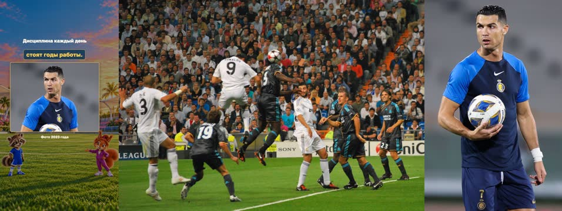

кадр в ключевой момент, затем картинки сцены по порядку

**Голос:** У Криштиану — мощный рывок, высокий прыжок, точный удар. Но за силой стоят годы работы.

**На экране:** «Криштиану Роналду» · «Рывок · прыжок · удар» · «Дисциплина каждый день»

**Картинки:**

- shots/ronaldo-jump.jpg — ok
- `@land` shots/ronaldo.jpg — ok

**Звук:** hit @4.4

**Факты:** `facts.photoDates.ronaldoJump` = «Фото 2009 года» · `facts.photoDates.ronaldo` = «Фото 2023 года» · `facts.players.ronaldo` = «Криштиану Роналду» · `facts.players.skills` = «Рывок · прыжок · удар» · `facts.players.discipline` = «Дисциплина каждый день»

### 3. ronaldo-photo · 14.8–24.6 с · `photo-focus`

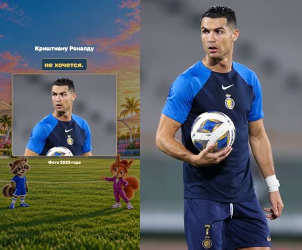

кадр в ключевой момент, затем картинки сцены по порядку

**Голос:** Роналду постоянно тренируется и стремится стать лучше. Дисциплина помогает повторять сложное, даже когда не хочется.

**На экране:** «Криштиану Роналду»

**Картинки:**

- shots/ronaldo.jpg — ok

**Факты:** `facts.photoDates.ronaldo` = «Фото 2023 года» · `facts.players.ronaldo` = «Криштиану Роналду»

### 4. ronaldo-record · 24.6–33.9 с · `photo-focus`

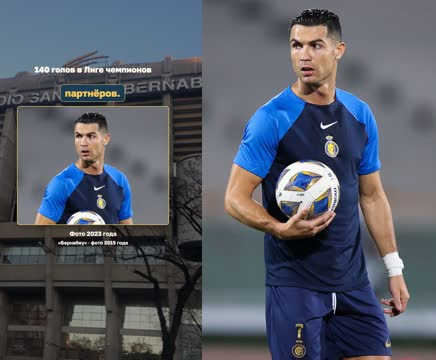

кадр в ключевой момент, затем картинки сцены по порядку

**Голос:** В Лиге чемпионов он забил 140 голов. Это рекорд турнира. Но личный рекорд тоже зависит от партнёров.

**На экране:** «140 голов в Лиге чемпионов» · ««Бернабеу» · фото 2015 года»

**Картинки:**

- shots/ronaldo.jpg — ok

**Факты:** `facts.photoDates.ronaldo` = «Фото 2023 года» · `facts.records.ronaldo` = «140 голов в Лиге чемпионов» · `facts.archive.venuePhoto` = ««Бернабеу» · фото 2015 года»

### 5. messi-photo · 33.9–45.0 с · `photo-focus`

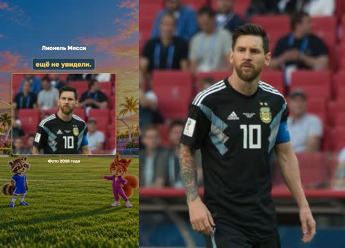

кадр в ключевой момент, затем картинки сцены по порядку

**Голос:** Лионель Месси вырос в аргентинском городе Росарио. Невысокий мальчик стал футболистом, который замечает то, что другие ещё не увидели.

**На экране:** «Лионель Месси»

**Картинки:**

- shots/messi.jpg — ok

**На слух:** Лионель — неясно (дубль 2) · Месси — верно (дубль 2)

**Факты:** `facts.photoDates.messi` = «Фото 2018 года» · `facts.players.messi` = «Лионель Месси»

### 6. messi-action · 45.0–55.6 с · `photo-focus`

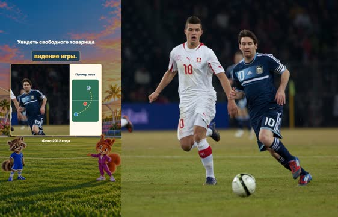

кадр в ключевой момент, затем картинки сцены по порядку

**Голос:** Мяч рядом с левой ногой. Месси умеет внезапно изменить направление и найти свободного партнёра. Так проявляется его видение игры.

**На экране:** «Лионель Месси» · «Увидеть свободного товарища» · «Пример паса»

**Картинки:**

- shots/messi-control.jpg — ok

**На слух:** Месси — верно (дубль 2)

**Звук:** whoosh @2.1

**Факты:** `facts.photoDates.messiControl` = «Фото 2012 года» · `facts.players.messi` = «Лионель Месси» · `facts.players.vision` = «Увидеть свободного товарища» · `facts.story.passExample` = «Пример паса»

### 7. messi-record · 55.6–64.6 с · `photo-focus`

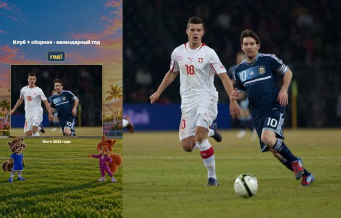

кадр в ключевой момент, затем картинки сцены по порядку

**Голос:** В 2012 году он забил 91 гол за клуб и сборную. За один календарный год!

**На экране:** «91 гол за 2012 год» · «Клуб + сборная · календарный год»

**Картинки:**

- shots/messi-control.jpg — ok

**Звук:** chime @5.7

**Факты:** `facts.photoDates.messiControl` = «Фото 2012 года» · `facts.records.messi` = «91 гол за 2012 год» · `facts.records.messiNote` = «Клуб + сборная · календарный год»

### 8. longevity · 64.6–74.2 с · `photo-pair`

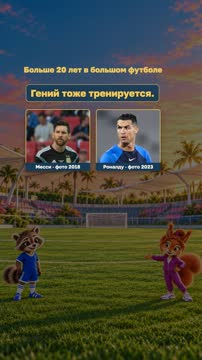

кадр в ключевой момент, затем картинки сцены по порядку

**Голос:** Оба играют на взрослом уровне больше двадцати лет. У обоих есть талант, и оба много работают. Гений тоже тренируется.

**На экране:** «Месси · фото 2018» · «cover» · «50% 0%» · «Роналду · фото 2023» · «Больше 20 лет в большом футболе»

**Факты:** `facts.cover.messi` = «Месси · фото 2018» · `facts.cover.ronaldo` = «Роналду · фото 2023» · `facts.players.longevity` = «Больше 20 лет в большом футболе»

### 9. respect · 74.2–84.9 с · `photo-pair`

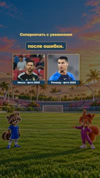

кадр в ключевой момент, затем картинки сцены по порядку

**Голос:** Можно мечтать о рекорде и помнить о команде. Уважать соперника и судью, поддерживать партнёров и не сдаваться после ошибки.

**На экране:** «Месси · фото 2018» · «cover» · «50% 0%» · «Роналду · фото 2023» · «Соперничать с уважением»

**Факты:** `facts.cover.messi` = «Месси · фото 2018» · `facts.cover.ronaldo` = «Роналду · фото 2023» · `facts.story.respect` = «Соперничать с уважением»

### 10. next · 84.9–92.3 с · `photo-pair`

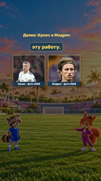

кадр в ключевой момент, затем картинки сцены по порядку

**Голос:** Дальше — Модрич и Кроос: как они строили атаки «Реала» и кто сегодня продолжает эту работу.

**На экране:** «Кроос · фото 2018» · «cover» · «50% 0%» · «Модрич · фото 2018» · «Далее: Кроос и Модрич»

**Факты:** `facts.cover.kroos` = «Кроос · фото 2018» · `facts.cover.modric` = «Модрич · фото 2018» · `facts.story.next` = «Далее: Кроос и Модрич»

### 11. question · 92.3–98.7 с · `photo-pair`

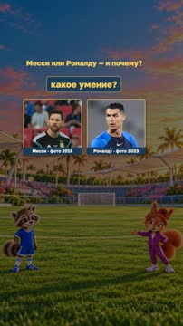

кадр в ключевой момент, затем картинки сцены по порядку

**Голос:** Кто тебе нравится больше, Месси или Роналду, и за какое умение?

**На экране:** «Месси · фото 2018» · «cover» · «50% 0%» · «Роналду · фото 2023» · «Месси или Роналду — и почему?»

**На слух:** Месси — верно (дубль 2)

**Звук:** chime @0.0

**Факты:** `facts.cover.messi` = «Месси · фото 2018» · `facts.cover.ronaldo` = «Роналду · фото 2023» · `facts.story.question` = «Месси или Роналду — и почему?»

## Факты и источники

| | |
|---|---|
| `facts.series` | [O1] Owner31Oct2026 requests two modern specials between historical legends; identity/cast retained. |
| `facts.players` | [S1] Inter Miami current profile; [S2] Saudi Pro League; [S5] FC Barcelona biography. [S7] More than twenty years calculated from senior appearances2003/2004 to31Oct2026. |
| `facts.records` | [S4] UEFA140 Champions League goals,2003–2022 across three clubs; [S6] FC Barcelona91 goals in calendar2012,79club+12Argentina. Different statistics, not a head-to-head total. |
| `facts.story` | [O1] Requested discipline/physical skills/genius and preference question; editorial lesson and cross-promotion, not quotations. [O2] Owner requires footballers as visual protagonists; hosts support them. Authentic player photos therefore remain visible in every story scene. |
| `facts.archive` | [P1–P3] Specific Commons file pages; photo date, not upload date. |
| `facts.cover` | [P1] "2018-06-16"; [P2] "Taken on 19 September 2023"; [P7] "2018-10-03 19:20:48"; [P8] "2018-06-26 19:30:51"; native original photos, no generated player faces. |
| `facts.photoDates` | [P1] "2018-06-16"; [P2] "Taken on 19 September 2023"; [P3] "2015-01-11 17:48:27"; [P4] "2009-09-30 21:57:46"; [P5] "2012-02-29 23:31:46"; [P6] "2012-02-29"; [P7] "2018-10-03 19:20:48"; [P8] "2018-06-26 19:30:51" |

→ [sources.md](sources.md)

## Текст поста

> От легенд прошлого — к звёздам нашего времени! Месси и Роналду: разные игровые качества, талант и постоянная работа у обоих. Рекорды относятся к разным показателям:140 голов Роналду в Лиге чемпионов и91 гол Месси за календарный2012год. Кто нравится тебе больше и за какое умение? Дальше — Кроос и Модрич.
>
> «Маленькие большие дела · Легенды футбола». Игроки показаны настоящими фото, ведущие и фон — иллюстрации GPT Image. Фото без AI-ретуши; кадрирование указано в источниках. Примеры пасов — учебные схемы, не реконструкция матча. Голос синтетический, OmniVoice B.
>
> Фото: Месси2018 — Екатерина Лаут, CC BY-SA 3.0; Роналду2023 — Mehdi Marizad, CC BY 4.0; Бернабеу2015 — Acruz319, CC BY-SA 4.0; Прыжок Роналду2009 — Alejandro Ramos, CC BY-SA 2.0; Месси2012 — Ludovic Péron, CC BY-SA 3.0; Кроос2018 — Антон Зайцев, CC BY-SA 3.0; Модрич2018 — Светлана Бекетова, CC BY-SA 3.0.
> Полные страницы файлов, даты, лицензии и условия: https://github.com/eiler2005/Storygro/blob/series/football-legends/content/videos/football-now-01-messi-ronaldo/CREDITS.md
