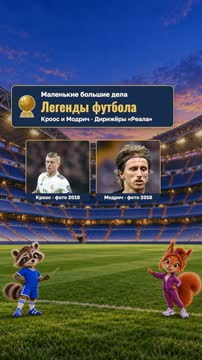
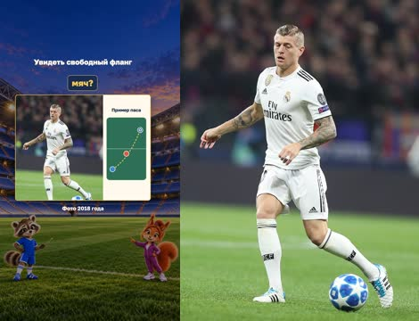
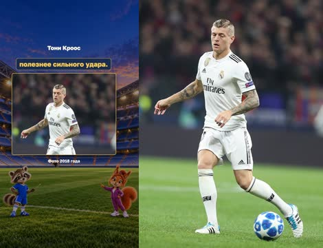
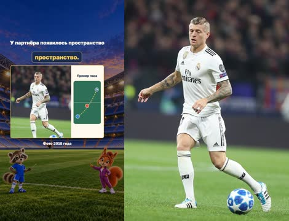
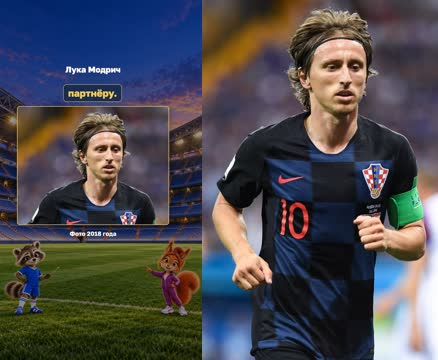
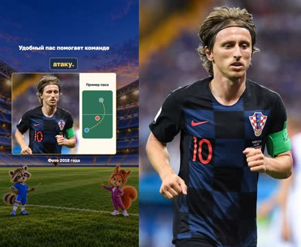
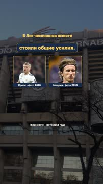
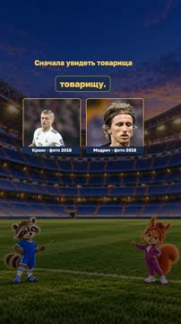
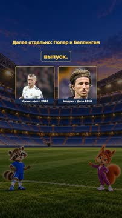

# План: Кроос и Модрич — дирижёры «Реала»

> Сгенерировано `storygro plan` из `ru.reel.yaml`, 2026-10-31. Не правьте этот файл: текст — в спецификации ролика, вопросы и заметки — в `review.yaml`. Затем `storygro plan` заново.

| | |
|---|---|
| Статус | **сценарий** · ждёт тебя: одобрить сценарий |
| Длительность | 108.3 с (по озвучке) · 11 сцен |
| Формат | 1080×1920, 30 fps · style `cartoon` |
| Голос | omnivoice · assets/voice/narrator-ru.wav · 0.82 |
| Серия | football-now |

## Одобрения

| | | Кто и когда |
|---|---|---|
| Сценарий | ⚙️ техническое (агент) | agent 2026-10-31 |
| Раскадровка | ⚙️ техническое (агент) | agent 2026-10-31 |
| Выпуск | ⏳ ждёт |   |

Одобрить: `storygro approve <spec> --step script|storyboard|release` (агент — с `--agent`).

## Вопросы

- [ ] **owner** · Подходит ли авторский сценарий современного спецвыпуска и связь со следующей темой?
- [ ] **owner** · Подходит ли формат с настоящими футболистами в центре, меньшими ведущими рядом и простыми примерами передач? Новые рисованные лица генератор отклонил.
- [ ] **owner** · Подходят ли спокойный темп, ударения имён и паузы в готовом видео?

**Заметки:** Technical review cut, 31 October2026: 108.279s, 11 scenes,1080x1920/30; QA14/14, master/web fully decoded3245/3245 frames. Inspected43 MP4 moments and feed/cover;73 caption phrases/251 runtime samples clear;148 reverse seeks with Exact visible DOM/SVG state; observed raster max 30/255 at at most 28 pixels above1 intensity across 1080x1920, with the full tolerance and samples recorded separately. Every scene shows actual footballers as protagonists; Matvey/Sofia are smaller supporting hosts. 3 authentic licensed photos, one selected illustrated host background. Built-in GPT Image blocked new recognisable player faces; successful requests used fictional cast/environment only, no bypass or photo retouch. OmniVoice B0.82/off unchanged; short ending only announces separate future Guler/Bellingham episodes, not produced. Current model interface cannot receive audio; subjective auditory/stress/editorial owner review stays open. NOW-R1 is confounded by new paired/photo format and length, no measured retention. No owner approvals or publication recorded.

## Хук

- Вариант 1 · **выбран**: «Гол забивает нападающий. А кто придумал атаку? Сегодня — Тони Кроос и Лука Модрич.»
- Вариант 2: «Два дирижёра — и ни одного оркестра. Как они управляли игрой?»
- Вариант 3: «Кто заменит Крооса и Модрича?»

## Сцены

### 1. hook · 0.0–6.5 с · `photo-pair`

кадр в ключевой момент, затем картинки сцены по порядку

**Голос:** Гол забивает нападающий. А кто придумал атаку? Сегодня — Тони Кроос и Лука Модрич.

**На экране:** «Маленькие большие дела» · «Легенды футбола» · «Кроос и Модрич · Дирижёры «Реала»» · «Кроос · фото 2018» · «cover» · «50% 0%» · «Модрич · фото 2018»

**Звук:** swell @0.0, whoosh @2.0

**Факты:** `facts.series.project` = «Маленькие большие дела» · `facts.series.title` = «Легенды футбола» · `facts.series.episode` = «Кроос и Модрич · Дирижёры «Реала»» · `facts.cover.kroos` = «Кроос · фото 2018» · `facts.cover.modric` = «Модрич · фото 2018»

### 2. blocked · 6.5–15.7 с · `photo-focus`

кадр в ключевой момент, затем картинки сцены по порядку

**Голос:** Представь: защитник перекрыл дорогу к воротам. Но на другом краю поля свободен партнёр. Как доставить ему мяч?

**На экране:** «Центр закрыт. Где свободно?» · «Увидеть свободный фланг» · «Пример паса»

**Картинки:**

- shots/kroos.jpg — ok

**Факты:** `facts.photoDates.kroos` = «Фото 2018 года» · `facts.story.blocked` = «Центр закрыт. Где свободно?» · `facts.players.tempo` = «Увидеть свободный фланг» · `facts.story.passExample` = «Пример паса»

### 3. kroos-photo · 15.7–24.9 с · `photo-focus`

кадр в ключевой момент, затем картинки сцены по порядку

**Голос:** Тони Кроос славился точными передачами и умением выбирать темп. Иногда короткий пас полезнее сильного удара.

**На экране:** «Тони Кроос»

**Картинки:**

- shots/kroos.jpg — ok

**Факты:** `facts.photoDates.kroos` = «Фото 2018 года» · `facts.players.kroos` = «Тони Кроос»

### 4. switch · 24.9–36.0 с · `photo-focus`

кадр в ключевой момент, затем картинки сцены по порядку

**Голос:** Кроос замечал свободный фланг. Передача — и мяч уже у товарища. Соперники разворачивались, а у команды появлялось пространство.

**На экране:** «Увидеть свободный фланг» · «У партнёра появилось пространство» · «Пример паса»

**Картинки:**

- shots/kroos.jpg — ok

**Звук:** whoosh @3.9

**Факты:** `facts.photoDates.kroos` = «Фото 2018 года» · `facts.players.tempo` = «Увидеть свободный фланг» · `facts.story.receive` = «У партнёра появилось пространство» · `facts.story.passExample` = «Пример паса»

### 5. modric-photo · 36.0–45.7 с · `photo-focus`

кадр в ключевой момент, затем картинки сцены по порядку

**Голос:** Лука Модрич видел неожиданные решения. Он мог отправить мяч внешней стороной стопы — мимо защитников, прямо партнёру.

**На экране:** «Лука Модрич»

**Картинки:**

- shots/modric.jpg — ok

**Факты:** `facts.photoDates.modric` = «Фото 2018 года» · `facts.players.modric` = «Лука Модрич»

### 6. outside · 45.7–58.5 с · `photo-focus`

кадр в ключевой момент, затем картинки сцены по порядку

**Голос:** Модрич славился пасами внешней стороной стопы. Так можно обогнуть защитника и найти товарища. Красота движения полезна, когда помогает продолжить атаку.

**На экране:** «Пас внешней стороной стопы» · «Удобный пас помогает команде» · «Пример паса»

**Картинки:**

- shots/modric.jpg — ok

**Звук:** whoosh @3.8, chime @7.5

**Факты:** `facts.photoDates.modric` = «Фото 2018 года» · `facts.players.outside` = «Пас внешней стороной стопы» · `facts.story.finish` = «Удобный пас помогает команде» · `facts.story.passExample` = «Пример паса»

### 7. trio · 58.5–68.2 с · `photo-pair`

кадр в ключевой момент, затем картинки сцены по порядку

**Голос:** Рядом с ними играл Каземиро, помогавший защищать команду. Успех создавал не один волшебный пас, а взаимодействие.

**На экране:** «Кроос · фото 2018» · «cover» · «50% 0%» · «Модрич · фото 2018» · «Кроос · Модрич · Каземиро»

**Факты:** `facts.cover.kroos` = «Кроос · фото 2018» · `facts.cover.modric` = «Модрич · фото 2018» · `facts.players.trio` = «Кроос · Модрич · Каземиро»

### 8. legacy · 68.2–78.1 с · `photo-pair`

кадр в ключевой момент, затем картинки сцены по порядку

**Голос:** Вместе Кроос и Модрич помогли «Реалу» пять раз выиграть Лигу чемпионов. За красивыми атаками стояли общие усилия.

**На экране:** «Кроос · фото 2018» · «cover» · «50% 0%» · «Модрич · фото 2018» · «5 Лиг чемпионов вместе» · ««Бернабеу» · фото 2015 года»

**Факты:** `facts.cover.kroos` = «Кроос · фото 2018» · `facts.cover.modric` = «Модрич · фото 2018» · `facts.legacy.joint` = «5 Лиг чемпионов вместе» · `facts.archive.venuePhoto` = ««Бернабеу» · фото 2015 года»

### 9. dates · 78.1–90.1 с · `photo-pair`

кадр в ключевой момент, затем картинки сцены по порядку

**Голос:** Кроос завершил карьеру в 2024 году. Модрич ушёл из «Реала» в 2025 году. Их история в клубе уже особая.

**На экране:** «Кроос · фото 2018» · «cover» · «50% 0%» · «Модрич · фото 2018» · «Их история в «Реале»»

**Факты:** `facts.cover.kroos` = «Кроос · фото 2018» · `facts.cover.modric` = «Модрич · фото 2018» · `facts.story.legacyHeading` = «Их история в «Реале»»

### 10. lesson · 90.1–101.2 с · `photo-pair`

кадр в ключевой момент, затем картинки сцены по порядку

**Голос:** Хочешь помочь команде? Сначала посмотри, кто свободен, а потом отдай удобный пас. Великие атаки начинаются с внимания к товарищу.

**На экране:** «Кроос · фото 2018» · «cover» · «50% 0%» · «Модрич · фото 2018» · «Сначала увидеть товарища»

**Факты:** `facts.cover.kroos` = «Кроос · фото 2018» · `facts.cover.modric` = «Модрич · фото 2018» · `facts.story.lesson` = «Сначала увидеть товарища»

### 11. next · 101.2–108.3 с · `photo-pair`

кадр в ключевой момент, затем картинки сцены по порядку

**Голос:** Дальше — Арда Гюлер и Джуд Беллингем. Каждому посвятим отдельный выпуск.

**На экране:** «Кроос · фото 2018» · «cover» · «50% 0%» · «Модрич · фото 2018» · «Далее отдельно: Гюлер и Беллингем»

**Звук:** chime @0.0

**Факты:** `facts.cover.kroos` = «Кроос · фото 2018» · `facts.cover.modric` = «Модрич · фото 2018» · `facts.story.next` = «Далее отдельно: Гюлер и Беллингем»

## Факты и источники

| | |
|---|---|
| `facts.series` | [O1] Owner clarifies episode2 is Kroos/Modric, Guler/Bellingham future only; shared identity retained. Conductors is an editorial metaphor, not sourced nickname. |
| `facts.players` | [S1] Real Madrid Kroos legacy profile; [S2/S3] Modric profile/interview. Casemiro is third member, not erased from history. |
| `facts.legacy` | [S1/S2/S4] Five joint Real Madrid UCL wins2016,2017,2018,2022,2024; Kroos2013 Bayern win and Modric2014 Real win are not joint. [S5] Kroos retirement2024; [S6] Modric departure2025, not retirement. |
| `facts.story` | [O1] Editorial child-friendly demonstration and requested future bridge, not named-match reconstruction or official heir designation; [S7] current squad contains Guler and Bellingham. [O2] Owner requires footballers as visual protagonists; hosts support them. Authentic player photos therefore remain visible in every story scene. |
| `facts.archive` | [P1–P3] Specific Commons file pages; photo date, not upload date. |
| `facts.cover` | [P1] "2018-10-03 19:20:48"; [P2] "2018-06-26 19:30:51"; native original photos, no generated player faces. |
| `facts.photoDates` | [P1] "2018-10-03 19:20:48"; [P2] "2018-06-26 19:30:51"; [P3] "2015-01-11 17:48:27" |

→ [sources.md](sources.md)

## Текст поста

> Кроос и Модрич: точность, темп и неожиданный пас, который помогает команде. Пять общих побед в Лиге чемпионов с «Реалом». Кроос завершил карьеру в2024; Модрич ушёл из клуба в2025. В будущих отдельных роликах — Гюлер и Беллингем, здесь только анонс.
>
> «Маленькие большие дела · Легенды футбола». Игроки показаны настоящими фото, ведущие и фон — иллюстрации GPT Image. Фото без AI-ретуши; кадрирование указано в источниках. Примеры пасов — учебные схемы, не реконструкция матча. Голос синтетический, OmniVoice B.
>
> Фото: Кроос2018 — Антон Зайцев, CC BY-SA 3.0; Модрич2018 — Светлана Бекетова, CC BY-SA 3.0; Бернабеу2015 — Acruz319, CC BY-SA 4.0.
> Полные страницы файлов, даты, лицензии и условия: https://github.com/eiler2005/Storygro/blob/series/football-legends/content/videos/football-now-02-madrid-playmakers/CREDITS.md
