# План: Звёзды футбола: собираем альбом

> Сгенерировано `storygro plan` из `ru.reel.yaml`, 2026-10-24. Не правьте этот файл: текст — в спецификации ролика, вопросы и заметки — в `review.yaml`. Затем `storygro plan` заново.

| | |
|---|---|
| Статус | **сценарий** · ждёт тебя: одобрить сценарий |
| Длительность | 117.5 с (по озвучке) · 19 сцен |
| Формат | 1080×1920, 30 fps · style `cartoon` |
| Голос | qwen3 · assets/voice/narrator-ru.wav · 1.12 |

## Одобрения

| | | Кто и когда |
|---|---|---|
| Сценарий | ⏳ ждёт |   |
| Раскадровка | ✏️ изменено после одобрения | agent 2026-10-24 |
| Выпуск | ⏳ ждёт |   |

Одобрить: `storygro approve <spec> --step script|storyboard|release` (агент — с `--agent`).

## Вопросы

- [ ] **owner** · В таблице у Лукаку «сейчас Наполи», но с 12.08.2026 он в «Фенербахче» — в ролике так. Оставить?
- [ ] **owner** · Около 2 минут, по одному факту на игрока. Детям нравится такой темп, или лучше два коротких ролика по 7 игроков?
- [ ] **owner** · Ударения имён взяты из русской Википедии (Ме́сси, Лу́ка Мо́дрич, Ма́нуэль Но́йер, Брю́йне …). Послушайте, всё ли звучит так, как привыкли дети.

**Заметки:** Сделано по просьбе владельца 24.10.2026 по его таблице 14 футболистов. Формат (альбом с прогрессом, карточка, главы) взят как принцип из разобранного рилса (private/references/ig-football-kids, не публикуется).

## Хук

- Вариант 1 · **выбран**: «Привет! Сегодня соберём альбом из четырнадцати звёзд футбола — и о каждой узнаем весёлый факт. Поехали!»

## Сцены

### 1. intro · 0.0–8.5 с · `illustration`

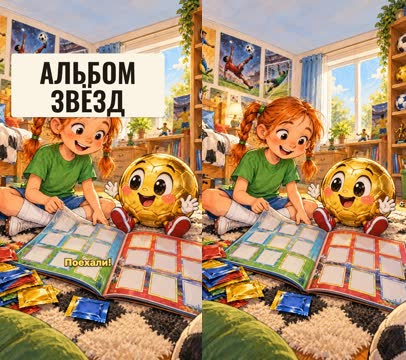

кадр в ключевой момент, затем картинки сцены по порядку

**Голос:** Привет! Сегодня соберём альбом из четырнадцати звёзд футбола — и о каждой узнаем весёлый факт. Поехали!

**На экране:** «Альбом звёзд»

**Картинки:**

- @kid and @ball sitting on a cosy rug in a sunny children's room full of football posters without text, toys and a shelf of balls, opening a big sticker album with empty colourful card slots, a pile of blank sticker packs beside them — ok

**Ударения:** узнаем → узнаём (авто, проверьте)

**Звук:** whoosh @7.1

### 2. ch-attack · 8.5–10.2 с · `kinetic`

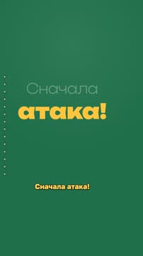

кадр в ключевой момент, затем картинки сцены по порядку

**Голос:** Сначала атака!

**На экране:** «#1f6f4a» · «Сначала» · «light» · «атака!» · «slam» · «1.4»

**Звук:** hit @0.5

### 3. p-ronaldinho · 10.2–16.6 с · `illustration`

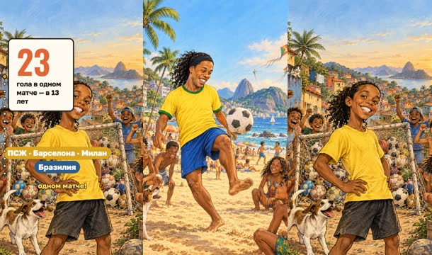

кадр в ключевой момент, затем картинки сцены по порядку

**Голос:** Роналдиньо из Бразилии в тринадцать лет забил все двадцать три гола в одном матче!

**На экране:** «Роналдиньо» · «23» · «гола в одном матче — в 13 лет» · «ПСЖ · Барселона · Милан» · «Бразилия»

**Картинки:**

- a friendly recognisable caricature of the Brazilian footballer Ronaldinho with his long curly black hair held back by a headband and his famous huge toothy smile, in a plain yellow shirt with green trim and blue shorts, juggling a ball on a sunny beach pitch in Rio with palm trees, kites and children watching — ok
- `@goals` a thirteen-year-old boy who is clearly a young Ronaldinho, curly black hair and a huge toothy smile, in a plain yellow shirt, standing proudly in front of a small goal whose net overflows with dozens of footballs, cheering neighbourhood kids around him — ok

**Ударения:** Бразилии → Брази́лии (словарь)

**Звук:** chime @1.7

**Факты:** `facts.ronaldinho.surname` = «Роналдиньо» · `facts.ronaldinho.goals.value` = «23» · `facts.ronaldinho.goals.label` = «гола в одном матче — в 13 лет» · `facts.ronaldinho.clubs` = «ПСЖ · Барселона · Милан» · `facts.ronaldinho.country` = «Бразилия»

### 4. p-yamal · 16.6–24.7 с · `illustration`

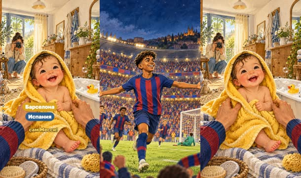

кадр в ключевой момент, затем картинки сцены по порядку

**Голос:** Ламин Ямаль из «Барселоны» — самый юный автор гола на чемпионатах Европы. А малышом его купал сам Месси!

**На экране:** «Ямаль» · «16» · «лет — гол на Евро» · «Барселона» · «Испания»

**Картинки:**

- a friendly recognisable caricature of the young Spanish winger Lamine Yamal, a slim teenager with short dark curly hair, in a plain blue and dark red vertically striped shirt, celebrating a goal with arms wide open in a packed night stadium — ok
- `@baby` a laughing baby wrapped in a fluffy yellow towel next to a small white tub with soap bubbles, a yellow rubber duck and a tiny football, two big friendly hands in blue and dark red striped sleeves tucking the towel, a photographer with a camera in the background, a sunny dressing room — ok

**Ударения:** Ямаль → Яма́ль (словарь) · Барселоны → Барсело́ны (словарь) · Европы → Евро́пы (словарь) · Месси → Ме́сси (словарь)

**На слух:** Месси — верно (дубль 2)

**Звук:** pop @5.0

**Факты:** `facts.yamal.surname` = «Ямаль» · `facts.yamal.age.value` = «16» · `facts.yamal.age.label` = «лет — гол на Евро» · `facts.yamal.clubs` = «Барселона» · `facts.yamal.country` = «Испания»

### 5. p-olise · 24.7–32.4 с · `illustration`

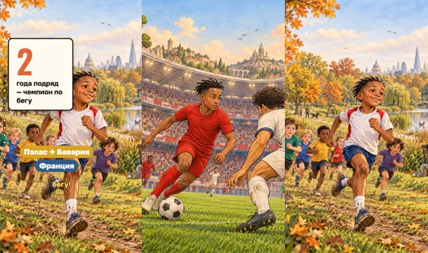

кадр в ключевой момент, затем картинки сцены по порядку

**Голос:** Майкл Олисе играет за «Баварию». А в детстве он два года подряд был чемпионом своего района по бегу!

**На экране:** «Олисе» · «2» · «года подряд — чемпион по бегу» · «Пэлас → Бавария» · «Франция»

**Картинки:**

- a friendly recognisable caricature of the French winger Michael Olise, slim, short dark hair, calm focused face, in a plain red shirt and red shorts, dribbling past a defender in a big stadium — ok
- `@run` a young boy who is clearly a child Michael Olise, short dark hair, winning a cross-country race across a green London park with autumn trees, other children running behind him — ok

**Ударения:** Олисе → Оли́се (словарь) · Баварию → Бава́рию (словарь)

**Факты:** `facts.olise.surname` = «Олисе» · `facts.olise.run.value` = «2» · `facts.olise.run.label` = «года подряд — чемпион по бегу» · `facts.olise.clubs` = «Пэлас → Бавария» · `facts.olise.country` = «Франция»

### 6. p-dembele · 32.4–40.2 с · `illustration`

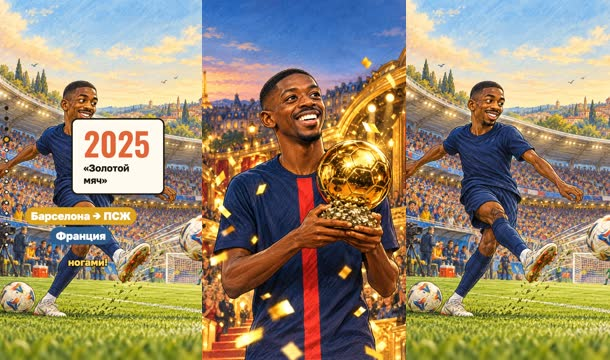

кадр в ключевой момент, затем картинки сцены по порядку

**Голос:** Усман Дембеле получил «Золотой мяч» 2025 года и бьёт одинаково хорошо обеими ногами!

**На экране:** «Дембеле» · «2025» · ««Золотой мяч»» · «Барселона → ПСЖ» · «Франция»

**Картинки:**

- a friendly recognisable caricature of the French forward Ousmane Dembélé with his big joyful smile, in a plain dark navy blue shirt with one red vertical stripe, holding a shiny golden football trophy on a stage, golden confetti falling — ok
- `@feet` Ousmane Dembélé as a friendly caricature in a plain dark navy blue shirt, shooting with his left foot while a second ball waits by his right foot, playful motion lines, a stadium behind — ok

**Ударения:** Дембеле → Дембеле́ (словарь) · Золотой → Золото́й (словарь)

**На слух:** Золотой — верно (дубль 2)

**Звук:** chime @1.1

**Факты:** `facts.dembele.surname` = «Дембеле» · `facts.dembele.ballon.value` = «2025» · `facts.dembele.ballon.label` = ««Золотой мяч»» · `facts.dembele.clubs` = «Барселона → ПСЖ» · `facts.dembele.country` = «Франция»

### 7. p-lautaro · 40.2–46.6 с · `illustration`

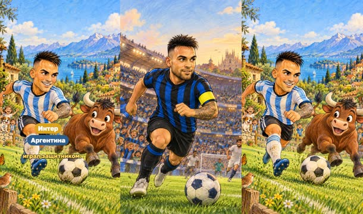

кадр в ключевой момент, затем картинки сцены по порядку

**Голос:** Лаутаро Мартинес — «Эль Торо», то есть «Бык»! А в детстве он играл защитником.

**На экране:** «Мартинес» · «Интер» · «Аргентина»

**Картинки:**

- a friendly recognisable caricature of the Argentine striker Lautaro Martínez, strong, dark hair and a beard, with a captain armband, in a plain blue and black vertically striped shirt, running with the ball in a stadium — ok
- `@bull` Lautaro Martínez as a friendly caricature charging forward, with a cheerful cartoon bull galloping beside him with a ball, on a green pitch — ok

**Ударения:** Мартинес → Марти́нес (словарь) · Торо → То́ро (словарь)

**Звук:** thud @1.7

**Факты:** `facts.lautaro.surname` = «Мартинес» · `facts.lautaro.clubs` = «Интер» · `facts.lautaro.country` = «Аргентина»

### 8. p-alvarez · 46.6–53.8 с · `illustration`

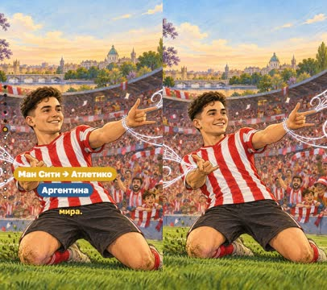

кадр в ключевой момент, затем картинки сцены по порядку

**Голос:** Хулиан Альварес — «Паук»: после гола он будто стреляет паутиной! А ещё он чемпион мира.

**На экране:** «Альварес» · «Ман Сити → Атлетико» · «Аргентина»

**Картинки:**

- a friendly recognisable caricature of the Argentine forward Julián Álvarez, a young face with short dark hair, in a plain red and white vertically striped shirt, celebrating a goal by pretending to shoot spider webs from his wrists, playful white web swirls in the air, fans cheering — ok

**Ударения:** Альварес → А́льварес (словарь) · Паук → Пау́к (словарь)

**Звук:** whoosh @1.4

**Факты:** `facts.alvarez.surname` = «Альварес» · `facts.alvarez.clubs` = «Ман Сити → Атлетико» · `facts.alvarez.country` = «Аргентина»

### 9. p-lukaku · 53.8–61.6 с · `illustration`

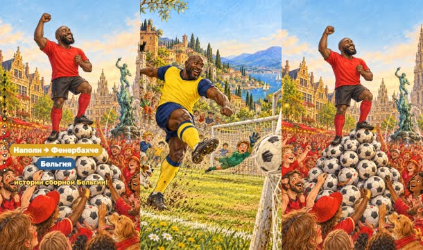

кадр в ключевой момент, затем картинки сцены по порядку

**Голос:** Ромелу Лукаку играл за «Рому» и «Наполи», а теперь — за «Фенербахче». Он лучший бомбардир в истории сборной Бельгии!

**На экране:** «Лукаку» · «Наполи → Фенербахче» · «Бельгия»

**Картинки:**

- a friendly recognisable caricature of the Belgian striker Romelu Lukaku, very tall and powerful, with a shaved head and a beard, in a plain yellow and navy blue shirt, striking the ball with great power, the net bulging — ok
- `@top` Romelu Lukaku as a friendly caricature in a plain red shirt standing on top of a tall pile of footballs, cheering fans in red around him — ok

**Ударения:** Лукаку → Лука́ку (словарь) · Рому → Ро́му (словарь) · Наполи → На́поли (словарь) · Фенербахче → Фенерба́хче (словарь) · Бельгии → Бе́льгии (словарь)

**Звук:** hit @4.5

**Факты:** `facts.lukaku.surname` = «Лукаку» · `facts.lukaku.clubs` = «Наполи → Фенербахче» · `facts.lukaku.country` = «Бельгия»

### 10. ch-mid · 61.6–63.4 с · `kinetic`

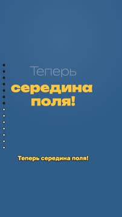

кадр в ключевой момент, затем картинки сцены по порядку

**Голос:** Теперь середина поля!

**На экране:** «#2f5d8a» · «Теперь» · «light» · «середина поля!» · «slam» · «1.1»

**Звук:** hit @0.6

### 11. p-modric · 63.4–69.5 с · `illustration`

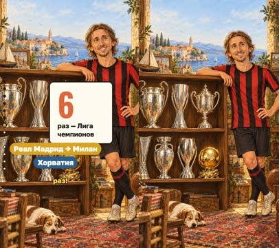

кадр в ключевой момент, затем картинки сцены по порядку

**Голос:** Лука Модрич из Хорватии получил «Золотой мяч» и выигрывал Лигу чемпионов шесть раз!

**На экране:** «Модрич» · «6» · «раз — Лига чемпионов» · «Реал Мадрид → Милан» · «Хорватия»

**Картинки:**

- a friendly recognisable caricature of the Croatian midfielder Luka Modrić, slim, with shoulder-length light brown hair and a thin hairband, in a plain red and black vertically striped shirt, proudly standing next to a long shelf with six shiny silver trophy cups and one golden football — ok

**Ударения:** Модрич → Мо́дрич (словарь) · Хорватии → Хорва́тии (словарь) · Золотой → Золото́й (словарь) · Лигу → Ли́гу (словарь)

**На слух:** Золотой — верно (дубль 1)

**Звук:** chime @3.0

**Факты:** `facts.modric.surname` = «Модрич» · `facts.modric.cl.value` = «6» · `facts.modric.cl.label` = «раз — Лига чемпионов» · `facts.modric.clubs` = «Реал Мадрид → Милан» · `facts.modric.country` = «Хорватия»

### 12. p-debruyne · 69.5–75.3 с · `illustration`

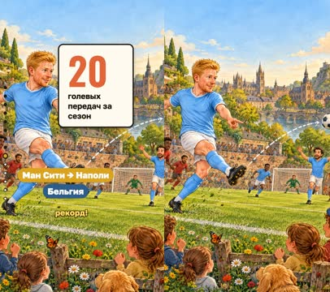

кадр в ключевой момент, затем картинки сцены по порядку

**Голос:** Кевин Де Брюйне за один сезон отдал двадцать голевых передач и повторил рекорд!

**На экране:** «Де Брюйне» · «20» · «голевых передач за сезон» · «Ман Сити → Наполи» · «Бельгия»

**Картинки:**

- a friendly recognisable caricature of the Belgian midfielder Kevin De Bruyne with ginger hair, in a plain sky blue shirt, making a long perfect pass, a dotted curved line showing the ball flying to a happy teammate — ok

**Ударения:** Брюйне → Брю+йне (словарь)

**Звук:** pop @1.2

**Факты:** `facts.debruyne.surname` = «Де Брюйне» · `facts.debruyne.assists.value` = «20» · `facts.debruyne.assists.label` = «голевых передач за сезон» · `facts.debruyne.clubs` = «Ман Сити → Наполи» · `facts.debruyne.country` = «Бельгия»

### 13. p-guler · 75.3–83.6 с · `illustration`

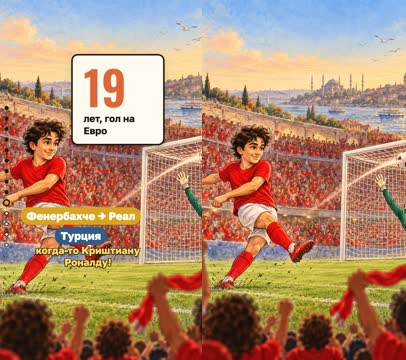

кадр в ключевой момент, затем картинки сцены по порядку

**Голос:** Арда Гюлер забил в первом же своём матче на Евро — в девятнадцать лет, как когда-то Криштиану Роналду!

**На экране:** «Гюлер» · «19» · «лет, гол на Евро» · «Фенербахче → Реал» · «Турция»

**Картинки:**

- a friendly recognisable caricature of the young Turkish midfielder Arda Güler with longish dark wavy hair, in a plain red shirt, curling a left-foot shot into the top corner of the goal, fans cheering in red — ok

**Ударения:** Гюлер → Гюле́р (словарь) · Евро → Е́вро (словарь) · Криштиану → Криштиа́ну (словарь) · Роналду → Рона́лду (словарь)

**Звук:** chime @1.0

**Факты:** `facts.guler.surname` = «Гюлер» · `facts.guler.age.value` = «19» · `facts.guler.age.label` = «лет, гол на Евро» · `facts.guler.clubs` = «Фенербахче → Реал» · `facts.guler.country` = «Турция»

### 14. ch-keepers · 83.6–85.7 с · `kinetic`

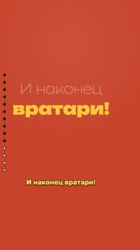

кадр в ключевой момент, затем картинки сцены по порядку

**Голос:** И наконец вратари!

**На экране:** «#c8432b» · «И наконец» · «light» · «вратари!» · «slam» · «1.3»

**Звук:** hit @0.9

### 15. p-stclair · 85.7–91.1 с · `illustration`

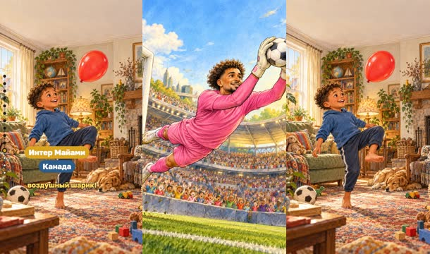

кадр в ключевой момент, затем картинки сцены по порядку

**Голос:** Дейн Сент-Клэр из Канады в детстве подолгу чеканил воздушный шарик!

**На экране:** «Сент-Клэр» · «Интер Майами» · «Канада»

**Картинки:**

- a friendly recognisable caricature of the Canadian goalkeeper Dayne St. Clair in a plain bright pink goalkeeper kit with big gloves, diving to catch the ball in a sunny stadium — ok
- `@balloon` a little boy who is clearly a child Dayne St. Clair, laughing in a cosy living room as he juggles a red balloon with his knees and feet — ok

**Ударения:** Сент-Клэр → Сент-Клэ́р (словарь) · Канады → Кана́ды (словарь)

**Звук:** pop @2.2

**Факты:** `facts.stclair.surname` = «Сент-Клэр» · `facts.stclair.clubs` = «Интер Майами» · `facts.stclair.country` = «Канада»

### 16. p-neuer · 91.1–98.5 с · `illustration`

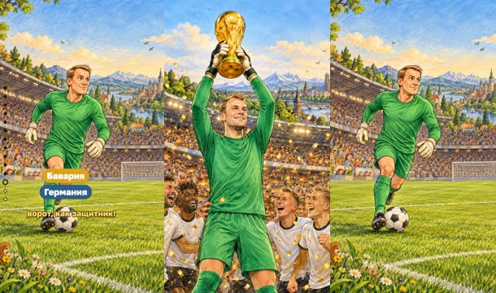

кадр в ключевой момент, затем картинки сцены по порядку

**Голос:** Мануэль Нойер — чемпион мира 2014 года. Он часто выбегает из ворот, как защитник!

**На экране:** «Нойер» · «2014» · «чемпион мира» · «Бавария» · «Германия»

**Картинки:**

- a friendly recognisable caricature of the German goalkeeper Manuel Neuer, tall, with short blond hair, in a plain green goalkeeper kit, lifting a big shiny golden cup, golden confetti falling — ok
- `@sweeper` Manuel Neuer as a friendly caricature in a plain green goalkeeper kit running far out of his goal into the middle of the pitch with the ball at his feet, an empty goal far behind him — ok

**Ударения:** Нойер → Но́йер (словарь)

**Звук:** chime @1.1

**Факты:** `facts.neuer.surname` = «Нойер» · `facts.neuer.cup.value` = «2014» · `facts.neuer.cup.label` = «чемпион мира» · `facts.neuer.clubs` = «Бавария» · `facts.neuer.country` = «Германия»

### 17. p-donnarumma · 98.5–104.0 с · `illustration`

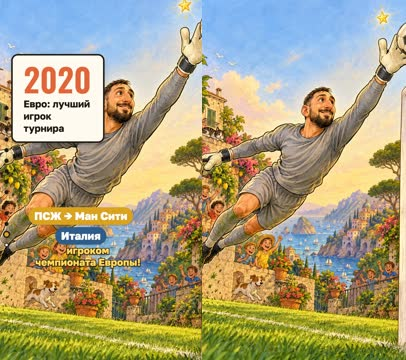

кадр в ключевой момент, затем картинки сцены по порядку

**Голос:** Джанлуиджи Доннарумма — первый вратарь, ставший лучшим игроком чемпионата Европы!

**На экране:** «Доннарумма» · «2020» · «Евро: лучший игрок турнира» · «ПСЖ → Ман Сити» · «Италия»

**Картинки:**

- a friendly recognisable caricature of the Italian goalkeeper Gianluigi Donnarumma, very tall, with short dark hair and a beard, in a plain grey goalkeeper kit with huge gloves, making a flying save, a small golden star sparkling above him — ok

**Ударения:** Доннарумма → Доннару́мма (словарь) · Европы → Евро́пы (словарь)

**Звук:** chime @1.7

**Факты:** `facts.donnarumma.surname` = «Доннарумма» · `facts.donnarumma.euro.value` = «2020» · `facts.donnarumma.euro.label` = «Евро: лучший игрок турнира» · `facts.donnarumma.clubs` = «ПСЖ → Ман Сити» · `facts.donnarumma.country` = «Италия»

### 18. p-courtois · 104.0–110.2 с · `illustration`

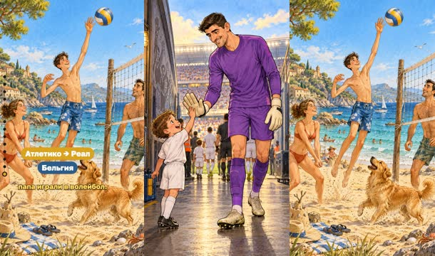

кадр в ключевой момент, затем картинки сцены по порядку

**Голос:** Тибо Куртуа ростом два метра и один сантиметр! А его мама и папа играли в волейбол.

**На экране:** «Куртуа» · «2,01 м» · «рост» · «Атлетико → Реал» · «Бельгия»

**Картинки:**

- a friendly recognisable caricature of the very tall Belgian goalkeeper Thibaut Courtois, the whole figure from head to boots fully inside the frame, in a plain purple goalkeeper kit and big gloves, standing in a stadium tunnel and bending down to high-five a small amazed boy mascot — ok
- `@volley` a happy family of a mother, a father and a tall boy who is clearly a young Thibaut Courtois, playing volleyball on a sunny beach — ok

**Ударения:** Куртуа → Куртуа́ (словарь)

**Звук:** pop @1.0

**Факты:** `facts.courtois.surname` = «Куртуа» · `facts.courtois.height.value` = «2,01 м» · `facts.courtois.height.label` = «рост» · `facts.courtois.clubs` = «Атлетико → Реал» · `facts.courtois.country` = «Бельгия»

### 19. outro · 110.2–117.5 с · `illustration`

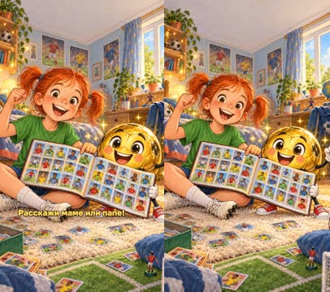

кадр в ключевой момент, затем картинки сцены по порядку

**Голос:** Альбом собран! А кто понравился тебе больше всех? Расскажи маме или папе!

**На экране:** «Альбом собран!»

**Картинки:**

- @kid and @ball proudly holding up a finished sticker album whose pages are full of small colourful drawn football player cards, sparkles around them, in a cosy children's room — ok

**Звук:** chime @1.4, swell @4.0

## Факты и источники

| | |
|---|---|
| `facts.ronaldinho` | https://en.wikipedia.org/wiki/Ronaldinho: 'His first brush with the media came at the age of 13, when he scored all 23 goals in a 23–0 victory against a local team.' Clubs PSG 2001–03, Barcelona 2003–08, Milan 2008–11. |
| `facts.yamal` | https://en.wikipedia.org/wiki/Lamine_Yamal: 'becoming the youngest goalscorer in Euro tournament history four days before his 17th birthday'; born 13 July 2007; in a 2007 UNICEF photo shoot with Barcelona 'he was bathed by a 20-year-old Lionel Messi'. Age 16 = four days before 17 (our arithmetic). |
| `facts.olise` | https://en.wikipedia.org/wiki/Michael_Olise: 'He was a cross-country running champion for the London borough of Hillingdon for two consecutive years'; Crystal Palace 2021–24, Bayern Munich from July 2024. |
| `facts.dembele` | https://en.wikipedia.org/wiki/Ousmane_Dembélé: 'That same month, he won the 2025 Ballon d'Or.'; 'He is well known for his ability to use either foot.'; Barcelona 2017–23, PSG from 12 August 2023. |
| `facts.lautaro` | https://en.wikipedia.org/wiki/Lautaro_Martínez: 'he has been nicknamed El Toro ("The Bull", in Spanish)'; 'Martínez initially played as a defender in his youth'; captain of Inter Milan. |
| `facts.alvarez` | https://en.wikipedia.org/wiki/Julián_Álvarez: nickname La Araña for his 'web-shooter goal celebration'; won the 2022 FIFA World Cup with Argentina; Manchester City 2022–24, Atlético Madrid from 2024. |
| `facts.lukaku` | https://en.wikipedia.org/wiki/Romelu_Lukaku: 'On 12 August 2026, Lukaku joined Süper Lig side Fenerbahçe on a one-year deal.'; 'Belgium's all-time top goalscorer'; Roma (loan 2023–24), Napoli 2024–26. ESPN: 'Fenerbahce sign Romelu Lukaku from Napoli'. |
| `facts.modric` | https://en.wikipedia.org/wiki/Luka_Modrić: 2018 Ballon d'Or; 'including six UEFA Champions League titles'; 'He joined AC Milan in 2025 on a free transfer.' Real Madrid 2012–25. |
| `facts.debruyne` | https://en.wikipedia.org/wiki/Kevin_De_Bruyne: 'registered his 20th league assist, which equalled Thierry Henry's record for the most assists in a season' (2019–20); 'In June 2025, he joined Napoli on a free transfer.' |
| `facts.guler` | https://en.wikipedia.org/wiki/Arda_Güler: 'becoming the first teenager to score on his European Championship debut since Cristiano Ronaldo in 2004', 'aged 19 years and 114 days'; Fenerbahçe, Real Madrid from 2023. |
| `facts.stclair` | https://en.wikipedia.org/wiki/Dayne_St._Clair: 'he would juggle a balloon for long periods when he could not play with a ball indoors'; 'On January 4, 2026, St. Clair signed with Inter Miami through the 2026 season.' |
| `facts.neuer` | https://en.wikipedia.org/wiki/Manuel_Neuer: 'Four years later, Neuer won the 2014 tournament with Germany.'; 'Neuer has been described as a "sweeper-keeper" because of his playing style.' |
| `facts.donnarumma` | https://en.wikipedia.org/wiki/Gianluigi_Donnarumma: UEFA Euro 2020 Player of the Tournament, 'the first time a goalkeeper had won the award'; 'On 2 September 2025, Premier League club Manchester City announced the signing of Donnarumma'. |
| `facts.courtois` | https://en.wikipedia.org/wiki/Thibaut_Courtois: height '2.01 m (6 ft 7 in)'; 'His parents were volleyball players, and he played the sport in his childhood'; Atlético Madrid (loan) 2011–14, Real Madrid from 2018. |

→ [sources.md](sources.md)

## Текст поста

> Собираем альбом из 14 звёзд футбола: Роналдиньо, Ламин Ямаль, Майкл Олисе, Усман Дембеле, Лаутаро Мартинес, Хулиан Альварес, Ромелу Лукаку, Лука Модрич, Кевин Де Брюйне, Арда Гюлер, Дейн Сент-Клэр, Мануэль Нойер, Джанлуиджи Доннарумма и Тибо Куртуа. О каждом — один весёлый факт.
>
> Футболисты нарисованы как дружеские шаржи, Златик и Маша — наши персонажи; ролик не связан с клубами и игроками. Клубы и факты проверены по открытым источникам 24 октября 2026 года (список в описании выпуска). Голос синтезирован (Qwen3-TTS), картинки сгенерированы (Z-Image-Turbo).
