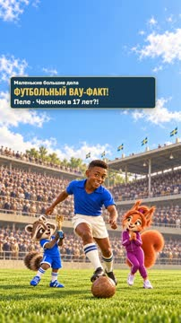
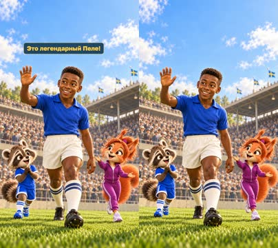
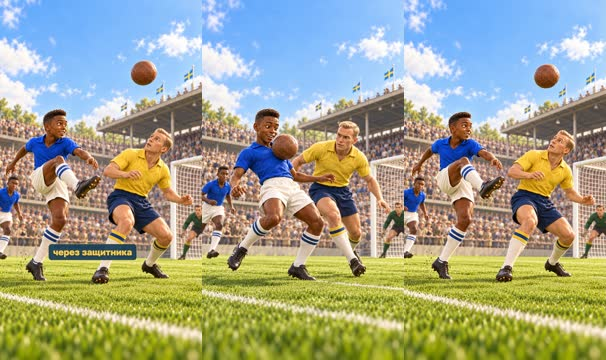
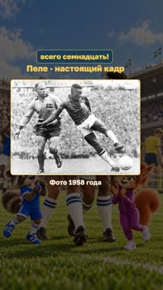
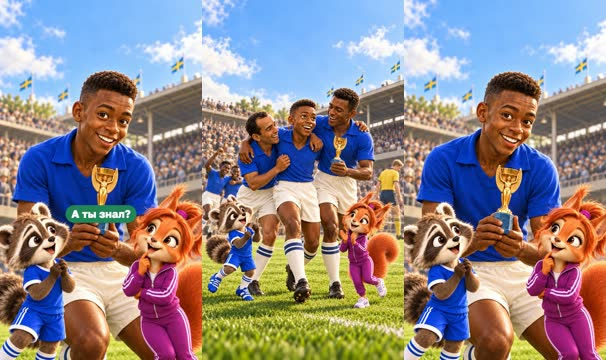

# План: Пеле — чемпион мира в 17 лет?!

> Сгенерировано `storygro plan` из `ru.reel.yaml`, 2026-10-31. Не правьте этот файл: текст — в спецификации ролика, вопросы и заметки — в `review.yaml`. Затем `storygro plan` заново.

| | |
|---|---|
| Статус | **сценарий** · ждёт тебя: одобрить сценарий |
| Длительность | 25.0 с (по озвучке) · 6 сцен |
| Формат | 1080×1920, 30 fps · style `cartoon` |
| Голос | omnivoice · assets/voice/narrator-ru.wav · 0.82 |
| Серия | football-wow |

## Одобрения

| | | Кто и когда |
|---|---|---|
| Сценарий | ⚙️ техническое (агент) | agent 2026-10-31 |
| Раскадровка | ⚙️ техническое (агент) | agent 2026-10-31 |
| Выпуск | ⏳ ждёт |   |

Одобрить: `storygro approve <spec> --step script|storyboard|release` (агент — с `--agent`).

## Вопросы

- [ ] **owner** · Подходит ли первый короткий сюжет с исправленным первым титулом Бразилии?
- [ ] **owner** · Достаточно ли выразительный мультфильм: Пеле главный, ведущие рядом, одна фото-вставка?
- [ ] **owner** · Подходят ли спокойный темп, реплики и ударения в готовом ролике?

**Заметки:** Technical review cut31Oct2026: 25s,6 scenes,8 selected detailed drawings/9 successful built-in generations,1 authentic photo insert3s; illustrated22s (88%). Native1080x1920/30, QA14/14; master/web fully decode750/750frames,19 sampled MP4 moments and feed/cover viewed. 98 text/cue samples,14 caption phrases,69 reverse seeks, no layout/state/technical-text errors. Exact visible DOM/SVG restored; raster differences recorded separately (max1/255). Same OmniVoice B0.82/off, calm short script, meaningful net/final holds; old short intro retaken with legend context and final-vowel ПелЕ hint after ASR spelled Пелле and shifted Да over a boundary. Final subjective stress/pace/editorial owner review remains open. Source DOCX unchanged, first-title error corrected only in adaptation, missing episode7 preserved. No owner approval or publication; WOW-R1 confounded and unmeasured.

## Хук

- Вариант 1 · **выбран**: «Чемпион мира в семнадцать лет?!»
- Вариант 2: «Ему семнадцать. А перед ним — финал!»
- Вариант 3: «Кто стал самым юным чемпионом мира?»

## Сцены

### 1. hook · 0.0–3.8 с · `series-cover`

кадр в ключевой момент, затем картинки сцены по порядку

**Голос:** Чемпион мира в семнадцать лет?!

**На экране:** «Маленькие большие дела» · «ФУТБОЛЬНЫЙ ВАУ-ФАКТ!» · «Пеле · Чемпион в 17 лет?!»

**Факты:** `facts.series.project` = «Маленькие большие дела» · `facts.series.title` = «ФУТБОЛЬНЫЙ ВАУ-ФАКТ!» · `facts.series.episode` = «Пеле · Чемпион в 17 лет?!»

### 2. meet · 3.8–6.8 с · `illustration`

кадр в ключевой момент, затем картинки сцены по порядку

**Голос:** Это легендарный Пеле!

**Картинки:**

- shots/meet.png — ok

### 3. flick · 6.8–12.5 с · `illustration`

кадр в ключевой момент, затем картинки сцены по порядку

**Голос:** В 1958 году он перебросил мяч через защитника

**Картинки:**

- shots/control.png — ok
- `@over` shots/flick.png — ok

### 4. goal · 12.5–17.7 с · `illustration`

кадр в ключевой момент, затем картинки сцены по порядку

**Голос:** и забил! Бразилия впервые стала чемпионом мира!

**Картинки:**

- shots/strike.png — ok
- `@team` shots/net.png — ok

**Звук:** thud @0.9, swell @0.9

### 5. archive · 17.7–20.7 с · `archive-photo`

кадр в ключевой момент, затем картинки сцены по порядку

**Голос:** И ему было всего семнадцать!

**На экране:** «Пеле · настоящий кадр» · «Фото 1958 года» · «contain»

**Факты:** `facts.archive.title` = «Пеле · настоящий кадр» · `facts.archive.date` = «Фото 1958 года»

### 6. payoff · 20.7–25.0 с · `illustration`

кадр в ключевой момент, затем картинки сцены по порядку

**Голос:** Самый молодой чемпион мира. А ты знал?

**На экране:** «Самый молодой чемпион мира» · «А ты знал?»

**Картинки:**

- shots/celebrate.png — ok
- `@ask` shots/champion.png — ok

**Факты:** `facts.hero.achievement` = «Самый молодой чемпион мира» · `facts.hero.question` = «А ты знал?»

## Факты и источники

| | |
|---|---|
| `facts.series` | [O1] Exact owner rubric and title. [S1] "17 years and 249 days"; title rounds age to17. |
| `facts.hero` | [S1] "17 years and 249 days", youngest champion. [S2] "Primeiro título" in1958; final5–2. [S3] Swedish FA1958 final venue/age/two goals. [S5] First goal: chest control, flick over defender and finish. Artwork camera/celebration are imagined. |
| `facts.archive` | [P1] "29 June 1958" is photo date, "25 October 2020" upload date; unknown photographer / El Gráfico. |

→ [sources.md](sources.md)

## Текст поста

> Пеле помог Бразилии впервые стать чемпионом мира в 1958 году. Ему было всего 17 лет — самый молодой чемпион мира. А ты знал?
>
> «Маленькие большие дела · ФУТБОЛЬНЫЙ ВАУ-ФАКТ!» Рисованная история по историческим фактам: юный Пеле, хитрый переброс мяча, удар и радость команды. Иллюстрации — встроенный GPT Image; постановка и камера воображаемые. Голос синтетический, выбранный OmniVoice B. Ведущие вымышлены, маленький кубок у Матвея — игровая реплика.
>
> Одна настоящая фотография: неизвестный фотограф / El Gráfico, 29 июня 1958. Wikimedia Commons, файл Pele v sweden 1958.jpg; PD-AR-Photo/PD-1996 (Аргентина/США), оригинал без AI-ретуши. Источник: https://commons.wikimedia.org/wiki/File:Pele_v_sweden_1958.jpg
>
> Факты: FIFA, CBF, Svenska Fotboll; последовательность первого гола — AP. Полные источники и отдельные права: https://github.com/eiler2005/Storygro/blob/series/football-legends/content/videos/football-wow-01-pele/CREDITS.md
