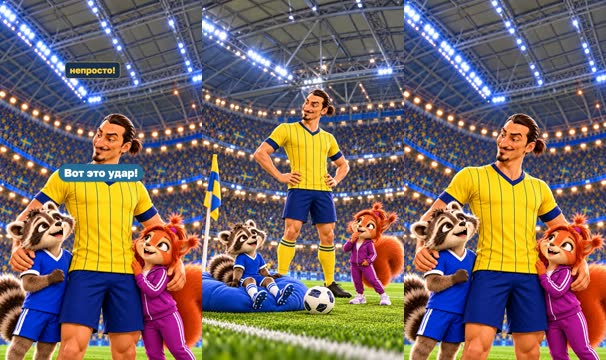

# План: Златан — через себя почти с 30 метров?!

> Сгенерировано `storygro plan` из `ru.reel.yaml`, 2026-10-31. Не правьте этот файл: текст — в спецификации ролика, вопросы и заметки — в `review.yaml`. Затем `storygro plan` заново.

| | |
|---|---|
| Статус | **сценарий** · ждёт тебя: одобрить сценарий |
| Длительность | 25.0 с (по озвучке) · 7 сцен |
| Формат | 1080×1920, 30 fps · style `cartoon` |
| Голос | omnivoice · assets/voice/narrator-ru.wav · 0.82 |
| Серия | football-wow |

## Одобрения

| | | Кто и когда |
|---|---|---|
| Сценарий | ⚙️ техническое (агент) | agent 2026-10-31 |
| Раскадровка | ⚙️ техническое (агент) | agent 2026-10-31 |
| Выпуск | ⚙️ техническое (агент) | agent 2026-10-31 |

Одобрить: `storygro approve <spec> --step script|storyboard|release` (агент — с `--agent`).

## Вопросы

- [ ] **owner** · Подходит ли короткая история гола через себя и финальная шутка ведущих?
- [ ] **owner** · Узнаваем ли Златан, понятны ли прыжок/дуга/далёкие ворота и достаточно ли рисунков?
- [ ] **owner** · Подходят ли темп, ударения имён и паузы в готовом видео?

**Заметки:** Technical review cut 31 October 2026: 25s, 7 scenes, 9 selected detailed drawings / 15 successful built-in generations; one authentic June 2012 photo insert 3s, illustrated 22s (88%). Native 1080x1920/30, QA 14/14, ASR all scenes 100%; master/web fully decode 750 frames each, 27 final MP4 moments and feed/square cover viewed. 113 text/cue samples, 16 caption phrases, 81 reverse seeks, no layout/state/technical-text errors. Exact DOM/SVG restored, separate raster difference max 1/255. Cover recomposed to retain complete host faces in square crop. First render ASR recognised all words but timed the initial words of setup/goal across scene boundaries; moved only their lead pads, kept voice/reference/speed and total 25s, then re-rendered/reviewed. Goal post-speech hold 1.00s. Names added to shared lexicon; stress off preserved. Owner listening/stress/pace/editorial review remains open; no owner approval or publication, WOW-R2 unmeasured.

## Хук

- Вариант 1 · **выбран**: «Через себя — почти с тридцати метров?!»
- Вариант 2: «Вратарь далеко. А Златан — спиной к воротам!»
- Вариант 3: «Он даже не смотрит на ворота. И забивает?!»

## Сцены

### 1. hook · 0.0–3.8 с · `series-cover`

кадр в ключевой момент, затем картинки сцены по порядку

**Голос:** Через себя — почти с тридцати метров?!

**На экране:** «Маленькие большие дела» · «ФУТБОЛЬНЫЙ ВАУ-ФАКТ!» · «Златан · Около 30 метров?!»

**Факты:** `facts.series.project` = «Маленькие большие дела» · `facts.series.title` = «ФУТБОЛЬНЫЙ ВАУ-ФАКТ!» · `facts.series.episode` = «Златан · Около 30 метров?!»

### 2. setup · 3.8–7.6 с · `illustration`

кадр в ключевой момент, затем картинки сцены по порядку

**Голос:** Вратарь Англии выбежал из ворот.

**На экране:** «Ноябрь 2012»

**Картинки:**

- shots/header-v2.png — ok

**Факты:** `facts.story.date` = «Ноябрь 2012»

### 3. turn · 7.6–10.5 с · `illustration`

кадр в ключевой момент, затем картинки сцены по порядку

**Голос:** Златан — спиной к воротам.

**Картинки:**

- shots/turn-v3.png — ok

### 4. kick · 10.5–14.1 с · `illustration`

кадр в ключевой момент, затем картинки сцены по порядку

**Голос:** Прыжок — и удар через себя!

**Картинки:**

- shots/lift.png — ok
- `@strike` shots/kick.png — ok

**Звук:** thud @1.2

### 5. goal · 14.1–18.3 с · `illustration`

кадр в ключевой момент, затем картинки сцены по порядку

**Голос:** Мяч летит в ворота! Гол!

**Картинки:**

- shots/flight.png — ok
- `@net` shots/net.png — ok

**Звук:** swell @1.8

### 6. archive · 18.3–21.3 с · `archive-photo`

кадр в ключевой момент, затем картинки сцены по порядку

**Голос:** Это Златан Ибрагимович!

**На экране:** «Златан · настоящий кадр» · «Фото июня 2012» · «contain»

**Факты:** `facts.archive.title` = «Златан · настоящий кадр» · `facts.archive.caption` = «Фото июня 2012»

### 7. joke · 21.3–25.0 с · `illustration`

кадр в ключевой момент, затем картинки сцены по порядку

**Голос:** Такой удар повторить непросто!

**На экране:** «Вот это удар!»

**Картинки:**

- shots/cushion.png — ok
- `@2.5` shots/hero.png — ok

**Факты:** `facts.story.reaction` = «Вот это удар!»

## Факты и источники

| | |
|---|---|
| `facts.series` | [O1] Exact owner rubric/name. [S1] "30 metres"; approximate, not independent measurement. |
| `facts.story` | [S1] "14 November 2012", overhead after Hart headed clearance. [S2] Same match and venue. O1 fictional hosts joke, not real history. |
| `facts.archive` | [P1] EURO2012 photo, June; file date17June, described match15June. Not the November goal. |

→ [sources.md](sources.md)

## Текст поста

> В ноябре 2012 года Златан Ибрагимович забил Англии ударом через себя примерно с 30 метров. Вратарь вышел из ворот и отбил мяч головой — Златан воспользовался моментом.
>
> «Маленькие большие дела · ФУТБОЛЬНЫЙ ВАУ-ФАКТ!» Подробная рисованная история, новые оригинальные композиции по историческому эпизоду. Кадры и юмор ведущих — художественная постановка, не архивная видеозапись. Рисунки созданы встроенным GPT Image, голос синтетический: выбранный OmniVoice B.
>
> Одна настоящая фотография: Илья Хохлов / Football.ua, июнь 2012, CC BY-SA 3.0; без AI-ретуши, native contain. Это снимок с EURO, не ноябрьского гола. Файл и лицензия: https://commons.wikimedia.org/wiki/File:Zlatan_Ibrahimovi%C4%87_Euro_2012_vs_England.JPG ; https://creativecommons.org/licenses/by-sa/3.0/
> Архитектурный референс: Richard Matthews, Friends Arena, 14 ноября 2012, CC BY 2.0; в видео фотография арены не вставлялась. https://commons.wikimedia.org/wiki/File:Friends_Arena,_Stockholm.jpg
>
> Факты: UEFA, Swedish FA, программа FA, Sveriges Radio. Полные источники и отдельные права: https://github.com/eiler2005/Storygro/blob/series/football-legends/content/videos/football-wow-02-zlatan/CREDITS.md
