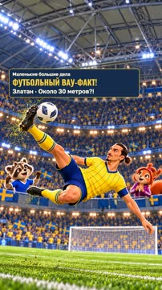
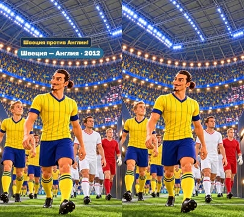
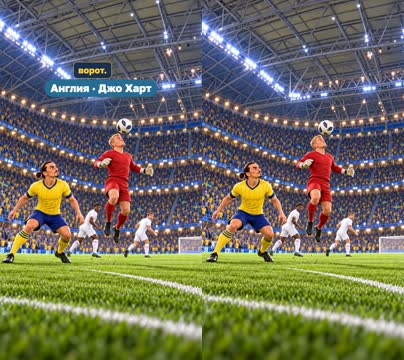
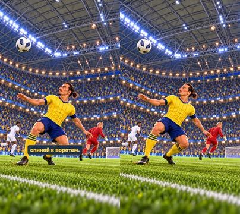
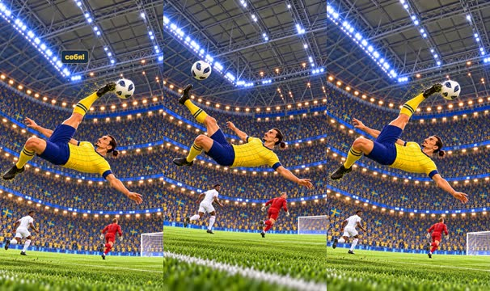
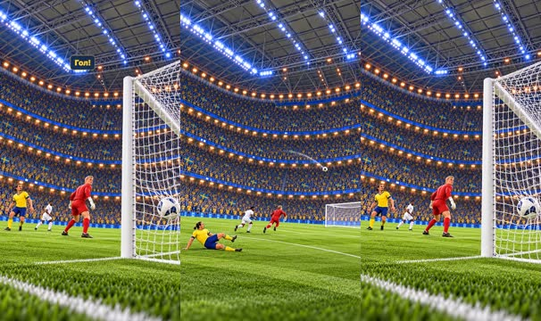
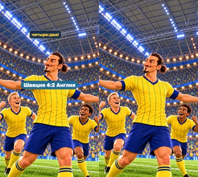
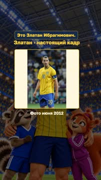
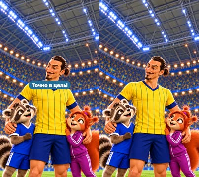

# План: Златан — через себя почти с 30 метров?!

> Сгенерировано `storygro plan` из `ru.reel.yaml`, 2026-10-31. Не правьте этот файл: текст — в спецификации ролика, вопросы и заметки — в `review.yaml`. Затем `storygro plan` заново.

| | |
|---|---|
| Статус | **сценарий** · ждёт тебя: одобрить сценарий |
| Длительность | 30.6 с (по озвучке) · 9 сцен |
| Формат | 1080×1920, 30 fps · style `cartoon` |
| Голос | omnivoice · assets/voice/narrator-ru.wav · 0.96 |
| Серия | football-wow |

## Одобрения

| | | Кто и когда |
|---|---|---|
| Сценарий | ⚙️ техническое (агент) | agent 2026-10-31 |
| Раскадровка | ⚙️ техническое (агент) | agent 2026-10-31 |
| Выпуск | ⚙️ техническое (агент) | agent 2026-10-31 |

Одобрить: `storygro approve <spec> --step script|storyboard|release` (агент — с `--agent`).

## Вопросы

- [ ] **owner** · Понятна ли история удара и подходит ли вывод «Феноменальный удар! Спиной к воротам — но точно в цель»?
- [ ] **owner** · Узнаваем ли Златан, понятны ли прыжок/дуга/далёкие ворота и достаточно ли рисунков?
- [ ] **owner** · Имя в пробе F принято. Подходит ли его звучание в цельном ролике и более спокойный финал?

**Заметки:** V3 30.607s: ten original drawings/17 built-in GPT Image generations, one unchanged June photo 2.411s. Body OmniVoice B0.96; conclusion B0.82 with two pauses and a final hold, 6.970s total. Owner accepted E pronunciation then F conversion to the original synthetic narrator B; accepted name waveform patched into three lines, other samples retained. This sample acceptance is not script/storyboard/release approval. QA14/14, every-scene ASR100%; master/web915 frames each,34 MP4 samples and crops inspected;174 runtime samples,122 reverse seeks,26 caption phrases without layout/state errors. Source clips and speed override are reusable features. V1/V2 retained, no publication or retention evidence. Full-film listening remains open.

## Хук

- Вариант 1 · **выбран**: «Через себя — почти с тридцати метров?!»
- Вариант 2: «Вратарь далеко. А Златан — спиной к воротам!»
- Вариант 3: «Он даже не смотрит на ворота. И забивает?!»

## Сцены

### 1. hook · 0.0–2.7 с · `series-cover`

кадр в ключевой момент, затем картинки сцены по порядку

**Голос:** Через себя — почти с тридцати метров?!

**На экране:** «Маленькие большие дела» · «ФУТБОЛЬНЫЙ ВАУ-ФАКТ!» · «Златан · Около 30 метров?!»

**Факты:** `facts.series.project` = «Маленькие большие дела» · `facts.series.title` = «ФУТБОЛЬНЫЙ ВАУ-ФАКТ!» · `facts.series.episode` = «Златан · Около 30 метров?!»

### 2. match · 2.7–6.2 с · `illustration`

кадр в ключевой момент, затем картинки сцены по порядку

**Голос:** Первый матч на новой арене: Швеция против Англии!

**На экране:** «Швеция — Англия · 2012»

**Картинки:**

- shots/arrival.png — ok

**Факты:** `facts.story.match` = «Швеция — Англия · 2012»

### 3. setup · 6.2–9.4 с · `illustration`

кадр в ключевой момент, затем картинки сцены по порядку

**Голос:** Вратарь англичан Джо Харт выбежал из ворот.

**На экране:** «Англия · Джо Харт»

**Картинки:**

- shots/header-v2.png — ok

**Факты:** `facts.story.keeperTag` = «Англия · Джо Харт»

### 4. turn · 9.4–11.6 с · `illustration`

кадр в ключевой момент, затем картинки сцены по порядку

**Голос:** Златан — спиной к воротам.

**Источник озвучки:** `assets/voice/corrections/turn.wav`

**Картинки:**

- shots/turn-v3.png — ok

### 5. kick · 11.6–14.1 с · `illustration`

кадр в ключевой момент, затем картинки сцены по порядку

**Голос:** Прыжок — и удар через себя!

**Картинки:**

- shots/lift.png — ok
- `@strike` shots/kick.png — ok

**Звук:** thud @1.0

### 6. goal · 14.1–16.7 с · `illustration`

кадр в ключевой момент, затем картинки сцены по порядку

**Голос:** Мяч летит в ворота! Гол!

**Картинки:**

- shots/flight.png — ok
- `@net` shots/net.png — ok

**Звук:** swell @0.9

### 7. result · 16.7–21.2 с · `illustration`

кадр в ключевой момент, затем картинки сцены по порядку

**Голос:** Все четыре гола Швеции забил Златан! Победа — четыре:два!

**Источник озвучки:** `assets/voice/corrections/result.wav`

**На экране:** «Швеция 4:2 Англия»

**Картинки:**

- shots/celebration.png — ok

**Факты:** `facts.story.result` = «Швеция 4:2 Англия»

### 8. archive · 21.2–23.6 с · `archive-photo`

кадр в ключевой момент, затем картинки сцены по порядку

**Голос:** Это Златан Ибрагимович.

**Источник озвучки:** `assets/voice/corrections/archive-context.wav`

**На экране:** «Златан · настоящий кадр» · «Фото июня 2012» · «contain»

**Факты:** `facts.archive.title` = «Златан · настоящий кадр» · `facts.archive.caption` = «Фото июня 2012»

### 9. finale · 23.6–30.6 с · `illustration`

кадр в ключевой момент, затем картинки сцены по порядку

**Голос:** Феноменальный удар! Спиной к воротам — но точно в цель.

**Темп реплики:** 0.82

**На экране:** «Феноменальный удар!» · «Спиной к воротам» · «Точно в цель!»

**Картинки:**

- shots/hero.png — ok

**Факты:** `facts.story.finaleTitle` = «Феноменальный удар!» · `facts.story.finaleBack` = «Спиной к воротам» · `facts.story.finaleTarget` = «Точно в цель!»

## Факты и источники

| | |
|---|---|
| `facts.series` | [O1] Exact owner rubric/name. [S1] "30 metres"; approximate, not independent measurement. |
| `facts.story` | [S1] UEFA: "Sweden 4-2 England", "Wednesday, November 14, 2012", "Joe Hart", final overhead after Hart headed clearance. [S2] Same match and venue. O1 fictional hosts joke, not history. [S1] "all four goals", "opening game at the Friends Arena", "Sweden 4-2 England". The four-goal figure concerns this match, not a career total; imagined arrival/celebration poses are not archive frames. Final assessment/short takeaway is editorial, based on the overhead goal (S1), not an athlete quotation. |
| `facts.archive` | [P1] EURO2012 photo, June; file date17June, described match15June. Not the November goal. |

→ [sources.md](sources.md)

## Текст поста

> В ноябре 2012 года в матче Швеция — Англия Златан Ибрагимович забил ударом через себя примерно с 30 метров. Вратарь англичан Джо Харт выбежал из ворот и отбил мяч головой — Златан воспользовался моментом.
>
> «Маленькие большие дела · ФУТБОЛЬНЫЙ ВАУ-ФАКТ!» Подробная рисованная история, новые оригинальные композиции по историческому эпизоду. Кадры и юмор ведущих — художественная постановка, не архивная видеозапись. Рисунки созданы встроенным GPT Image, голос синтетический: выбранный OmniVoice B.
>
> Одна настоящая фотография: Илья Хохлов / Football.ua, июнь 2012, CC BY-SA 3.0; без AI-ретуши, native contain. Это снимок с EURO, не ноябрьского гола. Файл и лицензия: https://commons.wikimedia.org/wiki/File:Zlatan_Ibrahimovi%C4%87_Euro_2012_vs_England.JPG ; https://creativecommons.org/licenses/by-sa/3.0/
> Архитектурный референс: Richard Matthews, Friends Arena, 14 ноября 2012, CC BY 2.0; в видео фотография арены не вставлялась. https://commons.wikimedia.org/wiki/File:Friends_Arena,_Stockholm.jpg
>
> Факты: UEFA, Swedish FA, программа FA, Sveriges Radio. Полные источники и отдельные права: https://github.com/eiler2005/Storygro/blob/series/football-legends/content/videos/football-wow-02-zlatan/CREDITS.md
