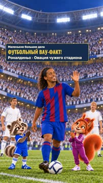
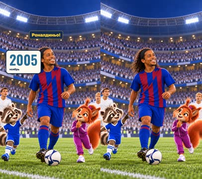
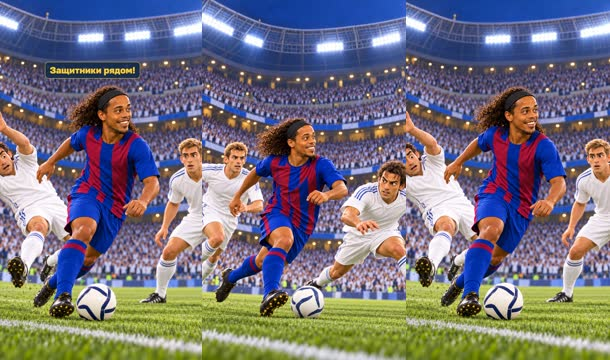
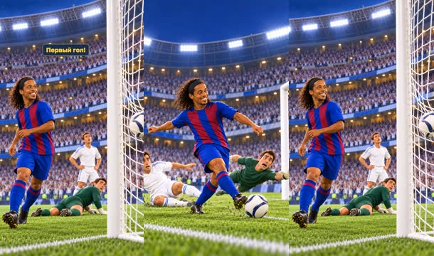
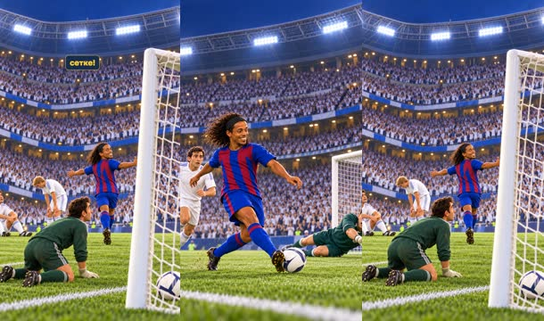
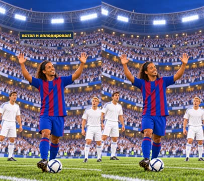
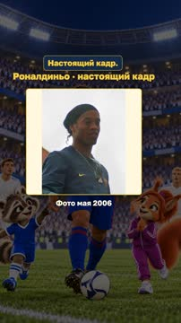
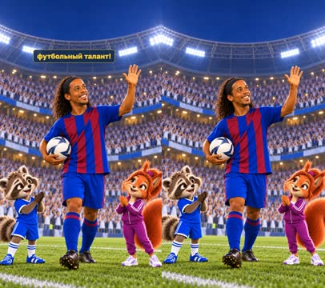

# План: Роналдиньо — ему аплодировал чужой стадион?!

> Сгенерировано `storygro plan` из `ru.reel.yaml`, 2026-10-31. Не правьте этот файл: текст — в спецификации ролика, вопросы и заметки — в `review.yaml`. Затем `storygro plan` заново.

| | |
|---|---|
| Статус | **сценарий** · ждёт тебя: одобрить сценарий |
| Длительность | 28.1 с (по озвучке) · 8 сцен |
| Формат | 1080×1920, 30 fps · style `cartoon` |
| Голос | omnivoice · assets/voice/narrator-ru.wav · 0.92 |
| Серия | football-wow |

## Одобрения

| | | Кто и когда |
|---|---|---|
| Сценарий | ⚙️ техническое (агент) | agent 2026-10-31 |
| Раскадровка | ⚙️ техническое (агент) | agent 2026-10-31 |
| Выпуск | ⚙️ техническое (агент) | agent 2026-10-31 |

Одобрить: `storygro approve <spec> --step script|storyboard|release` (агент — с `--agent`).

## Вопросы

- [ ] **owner** · Подходит ли короткая история двух голов и овации чужого стадиона, финальная реакция ведущих?
- [ ] **owner** · Узнаваем ли Роналдиньо (улыбка, кудри, повязка), понятны ли финт/удары/овация секторами и достаточно ли рисунков?
- [ ] **owner** · Подходит ли ускоренный до 0.92 темп (просьба 31.10.2026), ударение «Роналдиньо» и паузы после голов и овации?

**Заметки:** Technical review cut 31 October 2026: 28.12s, 8 scenes, 10 selected drawings (cover-v5 plus nine story frames; four cover versions and three regeneration passes recorded in images.json); one authentic May 2006 photo insert 3.0s, illustrated 25.1s (89%). Native 1080x1920/30, QA 14/14, ASR 100% of words in every scene; master MP4 moments 0.5/12.6/18.6/22.6/26.8s and feed/cover previews viewed. Voice OmniVoice B 0.92/off per the owner's 31.10.2026 request (~12% faster than the calm 0.82 cut); holds kept: ovation +1.1s and final +1.2s after speech. Owner likeness notes applied (leaner face, trademark front teeth); ball pattern normalised (no stars, no classic pentagons); hosts kept out of match-action shots; year badge from facts on the left. Lexicon: Роналдиньо added with a sourced norm, stress off preserved. Owner listening/editorial review remains open; no owner approval or publication; WOW-R3 unmeasured.

## Хук

- Вариант 1 · **выбран**: «Почему они аплодируют футболисту другой команды?!»
- Вариант 2: «Чужой стадион встал. И аплодирует!»
- Вариант 3: «Два гола — и овация соперника!»

## Сцены

### 1. hook · 0.0–3.8 с · `series-cover`

кадр в ключевой момент, затем картинки сцены по порядку

**Голос:** Почему они аплодируют футболисту другой команды?!

**На экране:** «Маленькие большие дела» · «ФУТБОЛЬНЫЙ ВАУ-ФАКТ!» · «Роналдиньо · Овация чужего стадиона»

**Факты:** `facts.series.project` = «Маленькие большие дела» · `facts.series.title` = «ФУТБОЛЬНЫЙ ВАУ-ФАКТ!» · `facts.series.episode` = «Роналдиньо · Овация чужего стадиона»

### 2. hero · 3.8–6.8 с · `illustration`

кадр в ключевой момент, затем картинки сцены по порядку

**Голос:** Потому что это Роналдиньо!

**На экране:** «2005» · «ноябрь»

**Картинки:**

- New original shot: @ronaldinho's entrance. Medium-full frontal view on the Bernabeu pitch, evening floodlights: recognisable Ronaldinho (age 25, warm broad smile, long dark curly hair under a thin headband, light stubble) strides forward with the ONE white dark-angular-panel ball at his right foot, joyful confidence; plain blue-and-garnet vertical-striped shirt, blue shorts, blue socks, no crest/numbers/print. Two all-white-kit Madrid players small in the mid-distance behind, different faces. @matvey at lower left and @sofia at lower right, much smaller, pointing at him excitedly from the sideline; their faces/ears 66-74% height inside the central 80% width. Upper 30% quiet stands/roof for a caption. Packed white-clad seated crowd, cool navy/white atmosphere, emerald pitch, rich fabric/fur/grass detail, cinematic family-film light. Absolutely no text, letters, numbers, logos, ads, watermark or borders. — ok

**Факты:** `facts.story.year` = «2005»

### 3. run · 6.8–10.2 с · `illustration`

кадр в ключевой момент, затем картинки сцены по порядку

**Голос:** Мяч у Роналдиньо. Защитники рядом!

**Картинки:**

- New original WIDE action shot, attack direction toward RIGHT: @ronaldinho at speed with the ONE white dark-angular-panel ball at his feet, body leaning forward, curly hair flowing, same plain blue-garnet vertical-striped kit, blue shorts and socks; two DIFFERENT all-white Madrid defenders close in from his right-front, one lunging low, faces distinct and determined. Santiago Bernabeu bowl behind with seated white-clad crowd, roof ring, bright floodlights, cool evening air, vivid green pitch. No hosts on the pitch. Ordinary anatomy, two arms/two legs each. Upper 28% quiet roof/stands; all faces and the ball between 40% and 75% height, middle 80% width. The raccoon and squirrel host characters must NOT appear anywhere in this frame: no animal characters or mascots, only human players and the crowd. No text, numbers, logos, ads, watermark or borders. — ok
- `@feint` Next original action state of the SAME run, closer medium shot: @ronaldinho's body feint — he drops his shoulder and pushes the ONE ball past the lunging white defender, who is visibly off-balance with arms windmilling; a SECOND different white defender steps up ahead, knees bent. Ronaldinho's smiling focused face clear in 3/4 view, thin headband and long curls readable, plain striped kit. Same one ball only, evening Bernabeu crowd soft behind, floodlights. Ordinary human anatomy. Upper 28% quiet; faces 40-70% height, middle 80% width. The raccoon and squirrel host characters must NOT appear anywhere in this frame: no animal characters or mascots, only human players and the crowd. No text, numbers, logos, ads, watermark or borders. — ok

### 4. goal1 · 10.2–13.4 с · `illustration`

кадр в ключевой момент, затем картинки сцены по порядку

**Голос:** Удар! Первый гол!

**Картинки:**

- New original shot inside the penalty area, attack toward RIGHT: @ronaldinho strikes the ONE white dark-angular-panel ball with his right instep, leg swung through, body tilted, curly hair and headband readable, plain blue-garnet striped kit; a sliding all-white defender late behind him; the Madrid goalkeeper, a distinct man in a plain DARK GREEN keeper kit, dives to his left but cannot reach; white goal with white net at right. Readable boot/ball contact moment, expressive faces. Evening floodlights, packed white-clad stands blurred behind, emerald grass. Upper 26% quiet; action middle 80% width. The raccoon and squirrel host characters must NOT appear anywhere in this frame: no animal characters or mascots, only human players and the crowd. No text, numbers, logos, ads, watermark or borders. — ok
- `@net` Next original consequence shot from beside the RIGHT goal: the ONE white ball clearly inside the bulging white net; the dark-green-kit goalkeeper on the grass behind the line looking back; one white defender slumped nearby with hands on hips; @ronaldinho farther left beginning to turn away with a grin, head in a natural relaxed three-quarter turn with ordinary neck anatomy, not twisted, same plain striped kit and headband. Readable satisfying goal, no duplicated balls. Bernabeu stands and evening light behind. Important ball/net in middle 50-73% height; upper 25% quiet roof/stands. The raccoon and squirrel host characters must NOT appear anywhere in this frame: no animal characters or mascots, only human players and the crowd. No text, numbers, logos, ads, watermark or borders. — ok

**Звук:** thud @0.1, swell @1.2

### 5. goal2 · 13.4–16.8 с · `illustration`

кадр в ключевой момент, затем картинки сцены по порядку

**Голос:** Потом второй — и снова в сетке!

**Картинки:**

- New original shot, different camera from the left sideline: @ronaldinho cuts inside from the left onto his right foot and drives a low shot; hips rotated, standing leg planted, curly hair swinging, thin headband, plain blue-garnet striped kit; a THIRD different all-white defender trailing half a metre behind; the dark-green-kit goalkeeper stretches low to his right; white goal at right beyond them. ONE white dark-angular-panel ball only, evening Bernabeu, seated white-clad crowd with far sections just starting to rise. Upper 26% quiet; faces and ball 40-75% height, middle 80% width. The raccoon and squirrel host characters must NOT appear anywhere in this frame: no animal characters or mascots, only human players and the crowd. No text, numbers, logos, ads, watermark or borders. — ok
- `@net` Next original consequence shot from behind and slightly above the RIGHT goal: the ONE white ball rests inside the net; the dark-green-kit goalkeeper stranded on his knees; two different white defenders slump, one sitting on the grass; beyond them, through the goal frame, LARGE sections of the white-clad crowd are visibly rising to their feet. @ronaldinho mid-distance turning toward the crowd with arms opening, grin visible, plain striped kit. No duplicated balls, no text on stands. Evening floodlights; upper 25% quiet roof. The raccoon and squirrel host characters must NOT appear anywhere in this frame: no animal characters or mascots, only human players and the crowd. No text, numbers, logos, ads, watermark or borders. — ok

**Звук:** thud @0.1, swell @1.5

### 6. ovation · 16.8–21.4 с · `illustration`

кадр в ключевой момент, затем картинки сцены по порядку

**Голос:** И чужой стадион встал и аплодировал!

**Картинки:**

- New original WIDE payoff shot from the pitch: LARGE sections of the white-clad Bernabeu crowd STAND and APPLAUD, many hands together, some leaning forward in awe; a few seated gaps remain so it reads as sections, not literally every single person. Centre: recognisable @ronaldinho, same plain blue-garnet striped kit and thin headband, smiling broadly and raising both open hands toward the stands in thanks; the ONE white ball rests at his feet. Two all-white players nearby look on amazed, distinct faces. No hosts in this shot: the raccoon and squirrel host characters must NOT appear anywhere in this frame, no animal characters or mascots, only human players and the crowd. Evening floodlights, cool navy/white palette, emerald grass, rich crowd detail. Ronaldinho's face around 52-58% height and central; upper 30% stands/roof only. No text, numbers, logos, ads, watermark or borders. — ok

### 7. archive · 21.4–24.4 с · `archive-photo`

кадр в ключевой момент, затем картинки сцены по порядку

**Голос:** Это Роналдиньо. Настоящий кадр.

**На экране:** «Роналдиньо · настоящий кадр» · «Фото мая 2006» · «contain»

**Факты:** `facts.archive.title` = «Роналдиньо · настоящий кадр» · `facts.archive.caption` = «Фото мая 2006»

### 8. applaud · 24.4–28.1 с · `illustration`

кадр в ключевой момент, затем картинки сцены по порядку

**Голос:** Вот что значит футбольный талант!

**Картинки:**

- New original playful closing shot at the sideline: @matvey and @sofia stand and applaud with delight — Matvey mid-clap so hard his ears bounce, Sofia smiling and clapping neatly — both smaller at the lower sides; CENTRE foreground and clearly larger: recognisable @ronaldinho in his plain blue-garnet striped kit and thin headband, laughing warmly and waving to the crowd with one hand, the ONE white ball under his other arm. Behind them the standing applauding white-clad crowd glows in the evening floodlight. Leave clear space around 45-52% height centre for a later caption; do not draw any text. Upper 26% quiet roof/stands; hosts' faces 66-74% height inside central 80% width. No letters, numbers, logos, ads, watermark or borders. — ok

## Факты и источники

| | |
|---|---|
| `facts.series` | [O1] Exact owner rubric/name; episode line is the owner's №5 promise shortened for the cover. |
| `facts.story` | [S1] 19 November 2005, Real Madrid 0-3 Barcelona at the Santiago Bernabeu; [S2] Ronaldinho's goals 59' and 77'; [S3] sections of the home crowd rose to applaud him. O1 hosts' applause is fictional. |
| `facts.archive` | [P1] 7 May 2006 title-celebration photo, same 2005-06 season; not the November match. |

→ [sources.md](sources.md)

## Текст поста

> 19 ноября 2005 года на «Сантьяго Бернабеу» Роналдиньо забил два гола «Реалу» — и части трибун встали, чтобы аплодировать игроку соперника.
>
> «Маленькие большие дела · ФУТБОЛЬНЫЙ ВАУ-ФАКТ!» Подробная рисованная история по историческому эпизоду; кадры и юмор ведущих — художественная постановка, не архивная запись. Рисунки созданы встроенным GPT Image, голос синтетический: выбранный OmniVoice B (скорость 0,92 по просьбе владельца).
>
> Одна настоящая фотография: Darz Mol, 7 мая 2006, CC BY-SA 3.0 — празднование чемпионства того же сезона, не ноябрьский матч. Файл и лицензия: https://commons.wikimedia.org/wiki/File:Ronaldinho-7-5-2006.jpg ; https://creativecommons.org/licenses/by-sa/3.0/
> Архитектурный референс (в видео не вставлялся): Footballkickit, «Сантьяго Бернабеу», 2007, CC BY 3.0. https://commons.wikimedia.org/wiki/File:Santiago_Bernab%C3%A9u_Stadium,_2007.jpg
>
> Факты: FC Barcelona, Wikipedia El Clasico, ESPN, These Football Times. Полные источники и отдельные права: CREDITS.md выпуска.
