# План: Интер Майами: финальный пас

> Сгенерировано `storygro plan` из `ru.reel.yaml`, 2026-10-25. Не правьте этот файл: текст — в спецификации ролика, вопросы и заметки — в `review.yaml`. Затем `storygro plan` заново.

| | |
|---|---|
| Статус | **сценарий** · ждёт тебя: одобрить сценарий |
| Длительность | 114.5 с (по озвучке) · 12 сцен |
| Формат | 1080×1920, 30 fps · style `cartoon` |
| Голос | qwen3 · assets/voice/narrator-ru.wav · 1.12 |

## Одобрения

| | | Кто и когда |
|---|---|---|
| Сценарий | ⚙️ техническое (агент) | agent 2026-10-25 |
| Раскадровка | ⚙️ техническое (агент) | agent 2026-10-25 |
| Выпуск | ⏳ ждёт |   |

Одобрить: `storygro approve <spec> --step script|storyboard|release` (агент — с `--agent`).

## Вопросы

- [ ] **owner** · После просмотра: подходят ли темп, произношение имён и уровень сложности для ребёнка 10–12 лет?

**Заметки:** Owner requested approximately two minutes, ages 10–12, iPhone. Owner explicitly selected illustrated world plus real player photographs after image generation declined real-person likenesses. Rendered 114.48 seconds at 1080x1920, 30 fps. All twelve rendered scenes visually inspected; all six real photo cards checked. Automated QA passed all thirteen checks, including final-mix ASR and four dictionary phoneme checks. No subjective audio listening or owner script/storyboard/release approval recorded. Local viewing copies delivered to Downloads/inter-miami-magic-pass-ru.

## Хук

- Вариант 1 · **выбран**: «В Майами начинается необычный матч. Маше нужно пройти всё поле и создать гол. Помогут шесть звёзд «Интер Майами» — и их настоящие футбольные истории.»

## Сцены

### 1. intro · 0.0–10.5 с · `illustration`

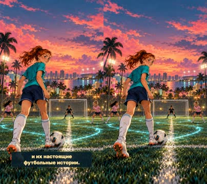

кадр в ключевой момент, затем картинки сцены по порядку

**Голос:** В Майами начинается необычный матч. Маше нужно пройти всё поле и создать гол. Помогут шесть звёзд «Интер Майами» — и их настоящие футбольные истории.

**На экране:** «ФИНАЛЬНЫЙ ПАС» · «ИНТЕР МАЙАМИ» · «Футбольная фантазия»

**Картинки:**

- Masha faces the distant goal on an evening Miami neighborhood pitch. A football quest begins, luminous passing lanes on the grass. — ok

**Звук:** whoosh @0.0

**Факты:** `facts.story.title` = «ФИНАЛЬНЫЙ ПАС» · `facts.story.club` = «ИНТЕР МАЙАМИ» · `facts.story.fiction` = «Футбольная фантазия»

### 2. fail · 10.5–18.4 с · `illustration`

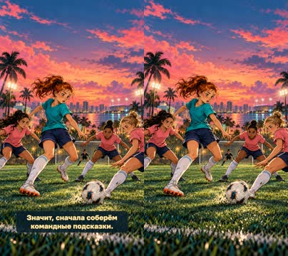

кадр в ключевой момент, затем картинки сцены по порядку

**Голос:** Маша бросается вперёд одна. Тупик! Защитники закрыли дорогу. Значит, сначала соберём командные подсказки.

**На экране:** «СОЛО НЕ ПРОЙТИ»

**Картинки:**

- Masha attempts to dribble alone through three original teenage defenders in plain coral shirts, gets blocked without collision, the white football rolls away. She looks surprised then thoughtful. Clearly drawn overlapping tactical lanes, cinematic low perspective, no distress. Detailed tropical Miami pitch; faces and action in lower half, top third calm blue-pink sky. — ok

**Звук:** whoosh @0.0

**Факты:** `facts.story.solo` = «СОЛО НЕ ПРОЙТИ»

### 3. messi · 18.4–29.1 с · `illustration`

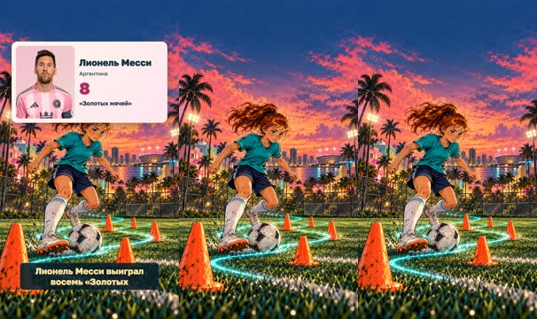

кадр в ключевой момент, затем картинки сцены по порядку

**Голос:** Лионель Месси выиграл восемь «Золотых мячей» — больше всех. Наша первая подсказка: держи мяч рядом. Маша проходит змейку, словно мяч привязан к бутсе!

**На экране:** «Лионель Месси» · «Аргентина» · «8» · ««Золотых мячей»» · «КОНТРОЛЬ МЯЧА»

**Картинки:**

- Masha dribbles a white ball closely through a zig-zag of orange cones; dynamic low view, teal jersey, copper ponytail, precise footwork. Glowing turquoise path, evening Miami field. Upper third calm. — ok
- `@play` shots/dribble.png — ok

**Ударения:** Месси → Ме́сси (словарь)

**На слух:** Лионель — верно (дубль 1) · Месси — верно (дубль 1) · Золотых — верно (дубль 1)

**Звук:** whoosh @4.2

**Факты:** `facts.messi.name` = «Лионель Месси» · `facts.messi.country` = «Аргентина» · `facts.messi.value` = «8» · `facts.messi.label` = ««Золотых мячей»» · `facts.messi.skill` = «КОНТРОЛЬ МЯЧА»

### 4. suarez · 29.1–41.0 с · `illustration`

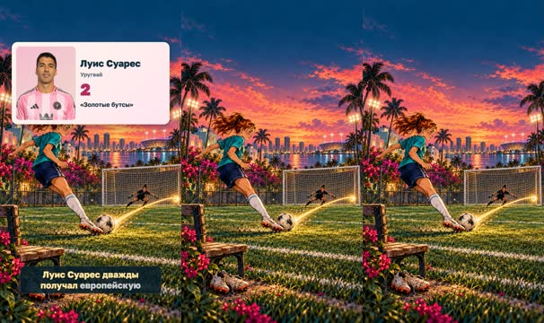

кадр в ключевой момент, затем картинки сцены по порядку

**Голос:** Луис Суарес дважды получал европейскую «Золотую бутсу». Это награда, а не обувь для матча! Маша запоминает: важна точность, а не просто сильный удар.

**На экране:** «Луис Суарес» · «Уругвай» · «2» · ««Золотые бутсы»» · «ТОЧНОСТЬ»

**Картинки:**

- Masha aims a controlled inside-foot shot into the far corner of the goal. A golden arc leads from white ball to the net. Side view, rich evening Miami detail, upper third calm. — ok
- `@play` shots/finish.png — ok

**Звук:** whoosh @6.9

**Факты:** `facts.suarez.name` = «Луис Суарес» · `facts.suarez.country` = «Уругвай» · `facts.suarez.value` = «2» · `facts.suarez.label` = ««Золотые бутсы»» · `facts.suarez.skill` = «ТОЧНОСТЬ»

### 5. depaul · 41.0–50.3 с · `illustration`

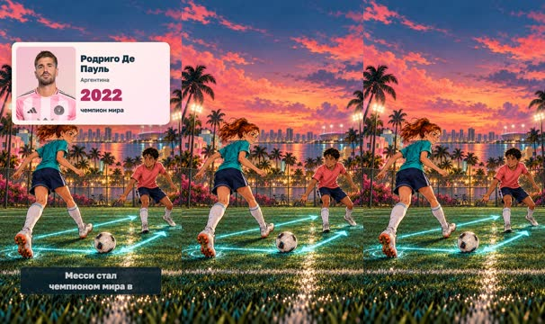

кадр в ключевой момент, затем картинки сцены по порядку

**Голос:** Родриго Де Пауль вместе с Месси стал чемпионом мира в две тысячи двадцать втором году. Подсказка: отдал пас — сразу откройся снова.

**На экране:** «Родриго Де Пауль» · «Аргентина» · «2022» · «чемпион мира» · «ПАС И РЫВОК»

**Картинки:**

- Masha makes a one-two pass with an original curly-haired boy teammate in pale pink. A luminous triangle connects them and the white football. Evening Miami field; action in lower half, upper third calm. — ok
- `@play` shots/pass.png — ok

**Ударения:** Месси → Ме́сси (словарь)

**На слух:** Месси — верно (дубль 3)

**Звук:** whoosh @5.8

**Факты:** `facts.depaul.name` = «Родриго Де Пауль» · `facts.depaul.country` = «Аргентина» · `facts.depaul.value` = «2022» · `facts.depaul.label` = «чемпион мира» · `facts.depaul.skill` = «ПАС И РЫВОК»

### 6. casemiro · 50.3–61.4 с · `illustration`

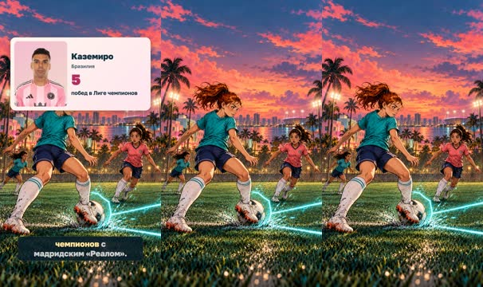

кадр в ключевой момент, затем картинки сцены по порядку

**Голос:** Каземиро пять раз выигрывал Лигу чемпионов с мадридским «Реалом». Наш урок: замечай чужой пас заранее. Маша перекрывает дорожку — мяч снова у команды!

**На экране:** «Каземиро» · «Бразилия» · «5» · «побед в Лиге чемпионов» · «ПЕРЕХВАТ»

**Картинки:**

- Masha steps calmly across a passing lane and intercepts a white football before it reaches an original teenage opponent in a coral jersey. Clean sporting interception, no contact or tackling. The luminous turquoise passing line breaks against a subtle shield-shaped glow. Athletic stance, determined face, layered stadium grass, little water droplets and palm silhouettes. Action lower half, top third calm. — ok
- `@play` shots/shield.png — ok

**Звук:** whoosh @3.8

**Факты:** `facts.casemiro.name` = «Каземиро» · `facts.casemiro.country` = «Бразилия» · `facts.casemiro.value` = «5» · `facts.casemiro.label` = «побед в Лиге чемпионов» · `facts.casemiro.skill` = «ПЕРЕХВАТ»

### 7. berterame · 61.4–72.4 с · `illustration`

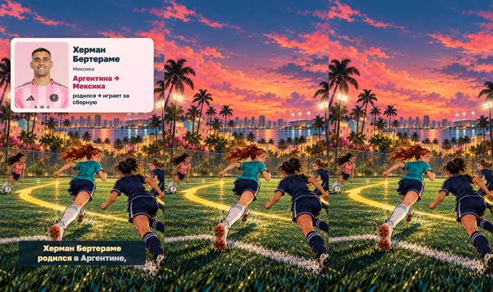

кадр в ключевой момент, затем картинки сцены по порядку

**Голос:** Херман Бертераме родился в Аргентине, а играет за сборную Мексики. Нападающему нужна свободная зона. Маша убегает туда, где защитник её не ждёт.

**На экране:** «Херман Бертераме» · «Мексика» · «Аргентина → Мексика» · «родился → играет за сборную» · «ОТКРЫВАНИЕ»

**Картинки:**

- Masha sprints diagonally into open space away from two original teenage defenders in coral jerseys. A teammate with dark curly hair holds the white ball at far left, looking toward her run. Sweeping gold path on turf shows the empty space. Miami neighborhood lights, distant sea, detailed chain fence and lush foliage. Dynamic elevated camera, characters lower half; calm top third. — ok
- `@play` shots/run.png — ok

**Звук:** whoosh @5.4

**Факты:** `facts.berterame.name` = «Херман Бертераме» · `facts.berterame.country` = «Мексика» · `facts.berterame.value` = «Аргентина → Мексика» · `facts.berterame.label` = «родился → играет за сборную» · `facts.berterame.skill` = «ОТКРЫВАНИЕ»

### 8. stclair · 72.4–83.9 с · `illustration`

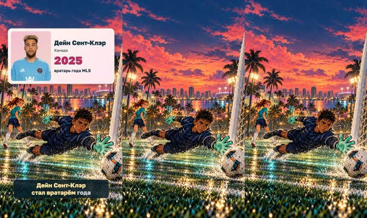

кадр в ключевой момент, затем картинки сцены по порядку

**Голос:** Дейн Сент-Клэр стал вратарём года MLS в две тысячи двадцать пятом году, ещё в «Миннесоте». Вратарь тоже герой: спасение может стать началом атаки!

**На экране:** «Дейн Сент-Клэр» · «Канада» · «2025» · «вратарь года MLS» · «РЕАКЦИЯ»

**Картинки:**

- An original teenage boy goalkeeper with medium brown skin, short dark curls, plain midnight-navy goalkeeper kit and bright mint gloves makes a spectacular horizontal dive toward a white football near the goal. Masha in teal watches farther away. Clear safe sporty motion, no celebrities. Detailed woven net, raindrops, floodlights and Miami palms, turquoise and gold lighting. Characters in lower half; calm dark sky above. — ok
- `@play` shots/save.png — ok

**Звук:** whoosh @7.1

**Факты:** `facts.stclair.name` = «Дейн Сент-Клэр» · `facts.stclair.country` = «Канада» · `facts.stclair.value` = «2025» · `facts.stclair.label` = «вратарь года MLS» · `facts.stclair.skill` = «РЕАКЦИЯ»

### 9. choice · 83.9–92.9 с · `illustration`

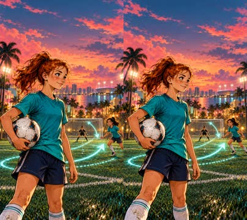

кадр в ключевой момент, затем картинки сцены по порядку

**Голос:** Последняя атака. Маша видит ворота, но путь закрыт. Ударить самой или отдать пас? Как поступишь ты?

**На экране:** «УДАР ИЛИ ПАС?»

**Картинки:**

- Close medium portrait of Masha holding a white football at hip height, thinking with a small determined smile, teal jersey, copper high ponytail and freckles. Behind her, imagined translucent luminous passing lanes branch toward a distant goal and a free teammate. Art deco Miami evening park, sparkling bokeh, upper quarter calm. No words or symbols resembling letters. — ok

**Звук:** whoosh @0.0

**Факты:** `facts.story.choice` = «УДАР ИЛИ ПАС?»

### 10. combo · 92.9–99.4 с · `illustration`

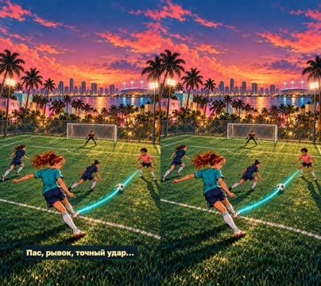

кадр в ключевой момент, затем картинки сцены по порядку

**Голос:** Маша поднимает голову. Справа свободен партнёр! Пас, рывок, точный удар…

**На экране:** «УВИДЕТЬ ПАРТНЁРА»

**Картинки:**

- An elevated dramatic view of the same Miami football field: Masha in teal passes the white ball diagonally to a free dark-curly-haired teammate in a coral shirt on the right, while defenders in navy turn too late. A single elegant turquoise curved light trail traces this decisive pass. Realistic field perspective, net at the upper middle, lush warm-lit neighborhood. Action in middle and lower portions. — ok

**Звук:** whoosh @0.0

**Факты:** `facts.story.combination` = «УВИДЕТЬ ПАРТНЁРА»

### 11. goal · 99.4–105.8 с · `illustration`

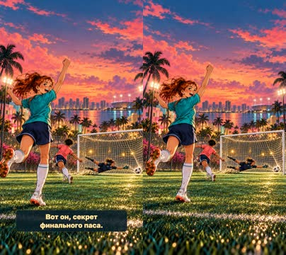

кадр в ключевой момент, затем картинки сцены по порядку

**Голос:** Гол! Его забил товарищ, а создала вся команда. Вот он, секрет финального паса.

**На экране:** «ГОООЛ!»

**Картинки:**

- The original curly-haired boy teammate in coral pink scores into the corner of the goal; white football clearly inside the net, original navy goalkeeper landing on the other side. Masha in teal celebrates the assist in foreground with arms lifted. No real people. Surging gold and turquoise light, detailed net tension and turf, Miami palms and a sky of pink clouds. — ok

**Звук:** chime @0.1

**Факты:** `facts.story.goal` = «ГОООЛ!»

### 12. close · 105.8–114.5 с · `illustration`

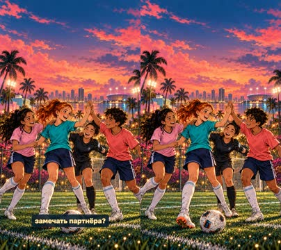

кадр в ключевой момент, затем картинки сцены по порядку

**Голос:** Теперь твой ход: какую подсказку проверишь на следующей тренировке? Контроль мяча, точность или умение замечать партнёра?

**На экране:** «СИЛА — В КОМАНДЕ»

**Картинки:**

- Masha and her original diverse teenage football friends celebrate together in a loose huddle on a warmly illuminated Miami neighborhood pitch, smiling and offering high fives. Masha faces camera at lower center, her copper ponytail and teal kit consistent. A white football on turf; softly glowing net, distant bay, palm fronds, bougainvillea, confetti-like fireflies. Calm rich navy upper third for end title, emotional satisfying ending. — ok

**Звук:** whoosh @0.0

**Факты:** `facts.story.team` = «СИЛА — В КОМАНДЕ»

## Факты и источники

| | |
|---|---|
| `facts.story` | Original screenplay; count is our selection from the MLS roster: https://www.mlssoccer.com/clubs/inter-miami-cf/roster/ |
| `facts.messi` | https://www.intermiamicf.com/news/leo-messi-nominated-for-2026-ballon-d-or — “a record eight times” |
| `facts.suarez` | https://en.atleticodemadrid.com/noticias/the-numbers-from-luis-suarezs-career-presented-by-versus — “Suárez has won the European Golden Shoe twice in his career: in 2014 (shared with Ronaldo) and 2016.” |
| `facts.depaul` | https://www.mlssoccer.com/news/busquets-de-paul-messi-inter-miami-s-world-cup-champions-make-mls-history — “De Paul and Messi captured the 2022 World Cup with Argentina” |
| `facts.casemiro` | https://www.intermiamicf.com/news/inter-miami-cf-signs-five-time-uefa-champions-league-winning-midfielder-casemiro — “During his time with Los Blancos, he won five UEFA Champions League titles” |
| `facts.berterame` | https://es.intermiamicf.com/noticias/inter-miami-cf-ficha-al-delantero-internacional-mexicano-german-berterame-como-jugador-designado — “Nacido en Argentina y naturalizado mexicano” |
| `facts.stclair` | https://www.mlssoccer.com/news/minnesota-united-fc-goalkeeper-dayne-st-clair-named-2025-mls-goalkeeper-of-the-year — “has been named the 2025 MLS Goalkeeper of the Year” |

→ [sources.md](sources.md)

## Текст поста

> Шесть звёзд «Интер Майами» и одна командная задача: помочь Маше создать гол. Месси, Суарес, Де Пауль, Каземиро, Бертераме и Сент-Клэр. Приключение вымышленное; биографические факты проверены 25 октября 2026 года.
>
> Рисованный мир создан GPT Image; настоящие портреты — с официальных страниц Inter Miami CF / MLS, права сохраняются у их владельцев. Голос синтетический: Qwen3-TTS, не голос футболистов. Ролик не связан с клубом и не одобрен игроками. Источники: sources.md. Версия для семейного просмотра.
