# План: Мимо ворот

> Сгенерировано `storygro plan` из `ru.reel.yaml`, 2026-10-25. Не правьте этот файл: текст — в спецификации ролика, вопросы и заметки — в `review.yaml`. Затем `storygro plan` заново.

| | |
|---|---|
| Статус | **сценарий** · ждёт тебя: одобрить сценарий |
| Длительность | 123.5 с (по озвучке) · 15 сцен |
| Формат | 1080×1920, 30 fps · style `cartoon` |
| Голос | omnivoice · assets/voice/narrator-ru.wav · 0.9 |

## Одобрения

| | | Кто и когда |
|---|---|---|
| Сценарий | ⚙️ техническое (агент) | agent 2026-10-25 |
| Раскадровка | ⚙️ техническое (агент) | agent 2026-10-25 |
| Выпуск | ⏳ ждёт |   |

Одобрить: `storygro approve <spec> --step script|storyboard|release` (агент — с `--agent`).

## Вопросы

Открытых вопросов нет.

**Заметки:** Сделано по просьбе владельца 25.10.2026 — мультик для Instagram на русском, около 2 минут, по его сценарию «Эпизод 1 – Мимо ворот», картинки GPT Image, высокая детализация. Вымышленная история, чисел и фактов из реального мира нет. Рендер 122,87 с, 1080×1920, 30 fps, 26 картинок GPT Image (ни одна не отклонена), OmniVoice B 0,90; QA 12/12 pass (.reel/ru/QA.md, копия в preview/QA.md). Кадры готового MP4 просмотрены; субъективного прослушивания и одобрения владельца нет. Публикации не было. 25.10.2026 владелец прослушал: ударения «свисток» и «лиса» и интонация финального вопроса были неверны, остальное ок. Исправлено (README, «Правки после просмотра»); новая версия 123,47 с, QA 13/13, «свисто́к» и «лиса́» подтверждены фонемной проверкой. Вопросы о сценарии, счёте («мы проиграли» при равном счёте) и образах героев закрыты ответом владельца «остальное ок» — оставлено как есть. Повторное прослушивание исправленной версии владельцем ещё не зафиксировано.

## Хук

- Вариант 1 · **выбран**: «Матвей стоит у мяча. Счёт равный, до конца матча — секунды. Все ждут его удара. Тренер кивает: «Матвей, спокойно. Ты готов».»

## Сцены

### 1. penalty · 0.0–8.8 с · `illustration`

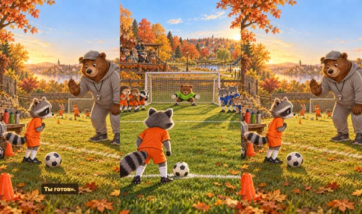

кадр в ключевой момент, затем картинки сцены по порядку

**Голос:** Матвей стоит у мяча. Счёт равный, до конца матча — секунды. Все ждут его удара. Тренер кивает: «Матвей, спокойно. Ты готов».

**На экране:** «Мимо ворот» · «Эпизод 1»

**Картинки:**

- a low view from behind @matvey standing at the penalty spot of a small green training pitch, a white football at his feet, looking ahead at the goal where @keeper crouches ready; @team and @rivals wait in a row at the edge of the penalty box, holding their breath; a small wooden stand with animal parents, autumn trees with orange leaves, a park and little houses behind, warm late-afternoon sun — ok
- `@coach` @coach on the touchline of a small training pitch, gently raising one paw in a calm reassuring gesture and nodding with a warm smile; in the foreground @matvey seen from the side beside a white football, nervous, his tail tense; a bench with water bottles and a mesh bag of balls, cones and autumn leaves on the grass, warm late-afternoon light — ok

**Звук:** swell @0.0

**Факты:** `facts.episode.title` = «Мимо ворот» · `facts.episode.label` = «Эпизод 1»

### 2. dream · 8.8–17.0 с · `illustration`

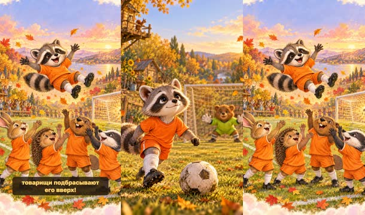

кадр в ключевой момент, затем картинки сцены по порядку

**Голос:** Матвей смотрит на ворота. В голове уже картинка: он забивает, команда ликует, товарищи подбрасывают его вверх!

**Картинки:**

- close-up of @matvey looking up at the goal with wide hopeful shining eyes and a tiny dreamy smile, the white football in front of him, the goal net and @keeper softly blurred behind him, warm golden light, small leaves floating in the air — ok
- `@dream` a dreamy daydream vignette with soft cloud-shaped edges and golden sparkles: @team joyfully tossing @matvey high up into the air above a football pitch, Matvey laughing with arms spread wide, the ball shining in the net, confetti of autumn leaves, everything glowing in pastel gold and pink like a happy dream — ok

**Звук:** chime @1.9

### 3. kick · 17.0–22.2 с · `illustration`

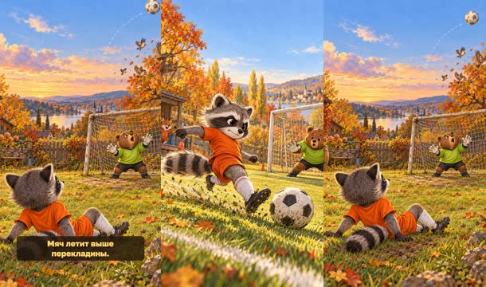

кадр в ключевой момент, затем картинки сцены по порядку

**Голос:** Он разбегается изо всех сил и бьёт. Мяч летит выше перекладины.

**Картинки:**

- @matvey running at the white football as fast as he can, a long blur of speed lines and kicked-up grass behind him, his body leaning far back, his tail flying, his mouth tight with effort, about to kick; @keeper ready in the goal ahead; dynamic low side angle on the training pitch, autumn trees — ok
- `@over` the white football flying high over the crossbar of a small goal into the autumn sky, a dotted motion trail curving upward, @keeper looking up with his mouth open, a few startled sparrows scattering from a tree behind the goal; seen from behind @matvey who has fallen back onto the grass, watching the ball fly away — ok

**Звук:** whoosh @0.8, whoosh @2.6

### 4. whistle · 22.2–33.9 с · `illustration`

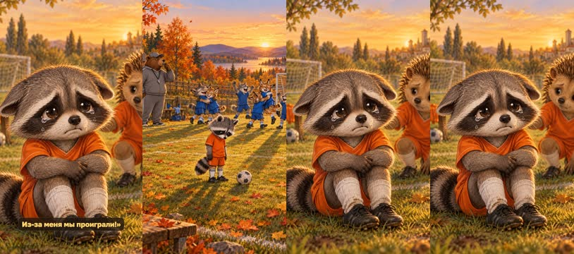

кадр в ключевой момент, затем картинки сцены по порядку

**Голос:** Свист+ок. Матч окончен. Соперники радуются, а Матвей стоит неподвижно. Его уши опускаются, глаза наполняются слезами. «Я всё испортил… Из-за меня мы проиграли!»

**Картинки:**

- end of the match: @rivals jumping and hugging with joy in the background, @coach blowing his whistle on the touchline, and in the middle of the pitch @matvey standing completely still and small, shoulders down, looking at the ground, a lonely white football beside him; long late-afternoon shadows, falling autumn leaves — ok
- `@tears` close-up portrait of @matvey with his round ears drooping down, big eyes filling with shiny tears, his lower lip trembling, a teammate hedgehog in an orange kit softly blurred behind him; muted golden evening light, gentle and touching, not scary — ok
- `@cry` shots/whistle-2.jpg — ok

**Ударения:** Свисток → Свисто́к (автор)

**На слух:** Свисток — верно (дубль 1)

### 5. home · 33.9–45.3 с · `illustration`

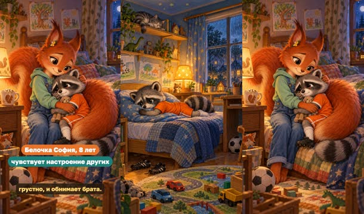

кадр в ключевой момент, затем картинки сцены по порядку

**Голос:** Дома Матвей плачет: «Больше не пойду на этот футбол!» Сестра-белочка София тихо садится рядом. Она всегда чувствует, когда кому-то грустно, и обнимает брата.

**На экране:** «Белочка София, 8 лет» · «чувствует настроение других»

**Картинки:**

- a cosy children's bedroom in the evening: @matvey lying face down on his bed hugging a pillow and crying, his black football boots kicked into the corner, a football under the desk, toy cars, crayon drawings on the wall without any writing, a warm table lamp, rain on the window, a sleepy cat on the shelf — ok
- `@sofia` @sofia sitting on the edge of the bed and gently hugging her little brother @matvey, wrapping her huge fluffy tail around him like a blanket, her face soft and caring, Matvey sniffling but leaning into the hug; a mug of hot cocoa with marshmallows on the bedside table, a warm lamp glow, the cosy bedroom with toys and crayon drawings without writing — ok

> ⚠️ Ударение не проверено: Сестра-белочка — найти и добавить в словарь: `storygro stress <spec> --lookup --write`

**Факты:** `facts.sofia.name` = «Белочка София, 8 лет» · `facts.sofia.trait` = «чувствует настроение других»

### 6. why · 45.3–50.3 с · `illustration`

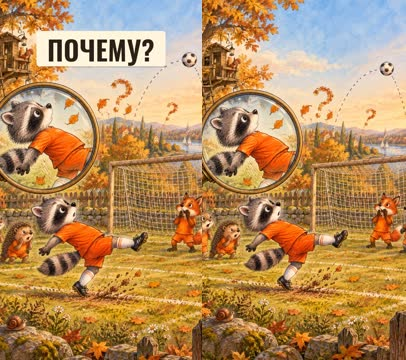

кадр в ключевой момент, затем картинки сцены по порядку

**Голос:** А ты как думаешь: почему мяч улетел выше ворот?

**На экране:** «Почему?»

**Картинки:**

- a playful frozen replay of the kick drawn like a page from a sketchbook: @matvey frozen mid-kick leaning far backwards, the white football rising along a dotted arc that goes over the crossbar, a big magnifying glass hovering over his leaning body, a few question-mark-shaped curls of wind made of leaves, warm paper texture — ok

**Звук:** pop @1.7

**Факты:** `facts.story.why` = «Почему?»

### 7. mom · 50.3–58.2 с · `illustration`

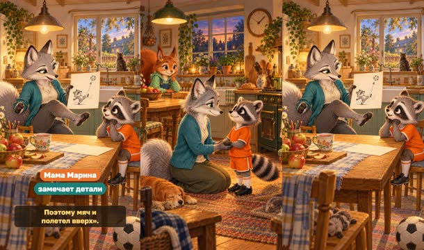

кадр в ключевой момент, затем картинки сцены по порядку

**Голос:** Мама-лис+а Марина всё замечает. «Ты очень сильно разогнался и откинулся назад. Поэтому мяч и полетел вверх».

**На экране:** «Мама Марина» · «замечает детали»

**Картинки:**

- a warm family kitchen in the evening: @marina kneeling to eye level with @matvey, holding his paws and looking at him attentively and kindly; @sofia watching from the table behind; jars, a basket of apples, a pot of soup steaming on the stove, potted herbs on the windowsill, a ticking clock without numbers — ok
- `@detail` @marina sitting at the kitchen table and showing @matvey a quick pencil sketch on a sheet of paper: a little raccoon figure leaning back while kicking and a ball flying up along a dotted arrow; with her other paw she leans back to demonstrate; Matvey looks at the sketch with sudden interest, tears drying; cosy kitchen details, apples, a cup of tea, warm lamp light — ok

**Ударения:** Мама-лиса → Мама-лиса́ (автор)

**На слух:** Мама-лиса — верно (дубль 2)

**Факты:** `facts.marina.name` = «Мама Марина» · `facts.marina.trait` = «замечает детали»

### 8. dad · 58.2–67.6 с · `illustration`

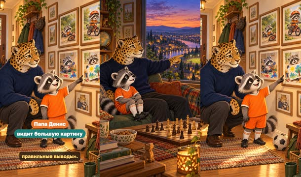

кадр в ключевой момент, затем картинки сцены по порядку

**Голос:** Папа-леопард Денис видит большую картину. «Тренировки — это наш опыт. Даже неудачный опыт помогает сделать правильные выводы».

**На экране:** «Папа Денис» · «видит большую картину»

**Картинки:**

- @denis sitting beside @matvey on a big sofa by a tall window, both looking out at the evening town: rooftops, glowing windows, a winding river, and far away the small lit-up football pitch; Denis points calmly towards the horizon, Matvey listens; a chess board with a game in progress on the low table, books and a globe on the shelf — ok
- `@exp` @denis kneeling beside @matvey in front of a wall of framed family pictures that tell a story of learning: in one picture little Matvey falls off a small bicycle, in the next he rides it happily; in another he spills paint, in the next he proudly shows a colourful painting; Matvey begins to smile with understanding; warm hallway light, a coat rack, a little rug — ok

**Факты:** `facts.denis.name` = «Папа Денис» · `facts.denis.trait` = «видит большую картину»

### 9. idea · 67.6–75.0 с · `illustration`

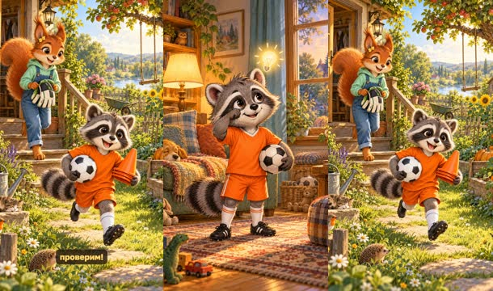

кадр в ключевой момент, затем картинки сцены по порядку

**Голос:** Матвей вытирает слёзы. Он ведь экспериментатор, ему всё нужно попробовать самому. Значит — проверим!

**На экране:** «Енот Матвей, 6 лет» · «экспериментатор»

**Картинки:**

- @matvey wiping the last tear with the back of his paw, his eyes starting to light up with a brave new idea, a glowing little light bulb drawn as a doodle above his head, his football clutched under one arm; behind him the cosy living room with a lamp and a window — ok
- `@try` @matvey running happily out of the back door into the garden with the white football and a stack of orange cones, @sofia following with a pair of big goalkeeper gloves, morning sunshine, a wooden porch, a swing on an apple tree, a vegetable bed with pumpkins and sunflowers — ok

**Звук:** ding @5.8

**Факты:** `facts.matvey.name` = «Енот Матвей, 6 лет» · `facts.matvey.trait` = «экспериментатор»

### 10. test-fast · 75.0–84.3 с · `illustration`

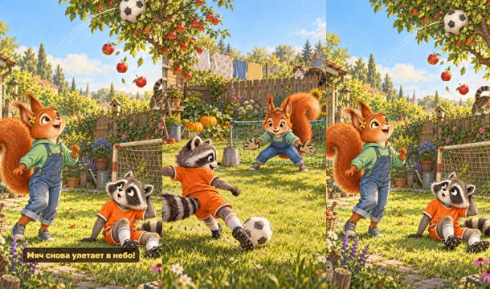

кадр в ключевой момент, затем картинки сцены по порядку

**Голос:** Во дворе Матвей ставит опыт. София — в воротах. Сначала как на матче: разбег изо всех сил, корпус назад… Мяч снова улетает в небо!

**Картинки:**

- a sunny backyard: a small goal made from two buckets and a garden net, @sofia crouching in it wearing big goalkeeper gloves, and @matvey sprinting at the white football with speed lines, leaning far back; an apple tree, a wooden fence, a cat on the fence, washing hanging on a line, sunflowers and pumpkins — ok
- `@up` the white football flying high over the little backyard goal straight into the branches of an apple tree, three red apples falling, @sofia laughing and looking up, @matvey sitting on the grass with a surprised but curious face, scratching his head; the cat on the fence ducking, sunny garden details — ok

**Звук:** whoosh @7.1

### 11. test-calm · 84.3–91.9 с · `illustration`

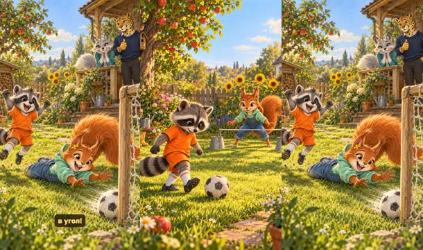

кадр в ключевой момент, затем картинки сцены по порядку

**Голос:** А теперь спокойно: короткий разбег, корпус над мячом, глаза — на мяч. Удар! Мяч летит низко и точно в угол!

**Картинки:**

- @matvey taking a short calm step towards the white football, his body leaning forward over the ball, his eyes fixed on the ball, focused and relaxed, tongue sticking out a little in concentration; @sofia in the bucket goal behind, the sunny backyard with the apple tree and sunflowers — ok
- `@low` the white football rolling fast and low into the corner of the little backyard goal past @sofia who dives the wrong way and laughs, @matvey jumping with joy with both arms up; @marina and @denis watching from the wooden porch, Marina noticing with a knowing smile, Denis giving a thumbs up; sunny garden, apple tree, sunflowers — ok

**Звук:** hit @4.7

### 12. plan · 91.9–97.2 с · `kinetic`

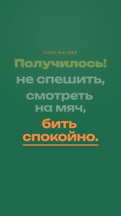

кадр в ключевой момент, затем картинки сцены по порядку

**Голос:** Получилось! Вот и план: не спешить, смотреть на мяч, бить спокойно.

**На экране:** «#1f6a4c» · «План Матвея» · «Получилось!» · «slam» · «не спешить,» · «смотреть на мяч,» · «бить спокойно.»

**Звук:** pop @1.9, pop @2.8, pop @4.0

### 13. again · 97.2–104.2 с · `illustration`

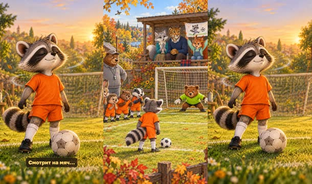

кадр в ключевой момент, затем картинки сцены по порядку

**Голос:** Следующая тренировка. И снова решающий удар. Матвей делает вдох. Не спешит. Смотрит на мяч…

**Картинки:**

- the same small green training pitch on a bright day: @matvey standing at the penalty spot again with the white football, @keeper ready in the goal, @team watching hopefully, @coach smiling on the touchline; in the little wooden stand @marina, @denis and @sofia sit together, Sofia holding up a hand-painted banner with a drawing of a raccoon and a ball and no writing; autumn trees, birds — ok
- `@breath` close-up of @matvey with his eyes calmly closed, taking a slow deep breath, a small peaceful smile, soft swirls of air drawn around him, the white football in front of his boot, the goal softly blurred behind, gentle golden light — ok

### 14. goal · 104.2–112.1 с · `illustration`

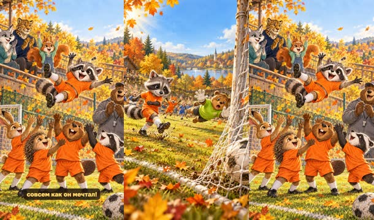

кадр в ключевой момент, затем картинки сцены по порядку

**Голос:** Гол! Мяч влетает точно в угол! Команда ликует, а товарищи подбрасывают Матвея вверх — совсем как он мечтал!

**На экране:** «Гол!»

**Картинки:**

- the white football bulging the net low in the corner of the goal, @keeper diving the other way, @matvey just after a calm, balanced kick with his body over the ball, the net rippling, leaves swirling, bright sunshine, dynamic angle from the side of the goal — ok
- `@toss` @team joyfully tossing @matvey high up into the air on the football pitch, Matvey laughing with arms spread wide; in the stand behind them @marina, @denis and @sofia jump and cheer; @coach claps; confetti of golden autumn leaves, bright happy colours — the same joyful moment Matvey once dreamed about, now real — ok

**Звук:** chime @0.1, swell @2.7

**Факты:** `facts.story.goal` = «Гол!»

### 15. close · 112.1–123.5 с · `illustration`

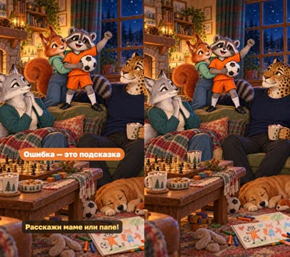

кадр в ключевой момент, затем картинки сцены по порядку

**Голос:** Вечером Матвей говорит: «Ошибка — это не конец. Это подсказка!» А тебе какая ошибка помогла научиться? Расскажи маме или папе!

**На экране:** «Ошибка — это подсказка»

**Картинки:**

- a cosy family evening in the living room: @matvey standing on the sofa holding his white football proudly and smiling, @sofia hugging him from the side, @marina and @denis sitting close and smiling at him; a warm fireplace, a blanket, mugs of cocoa, a chess board, the window showing a starry sky and a crescent moon, toys and crayon drawings without writing — ok

**Звук:** chime @4.8

**Факты:** `facts.story.lesson` = «Ошибка — это подсказка»

## Факты и источники

| | |
|---|---|
| `facts.episode` | Owner's screenplay, 2026-10-25: «Эпизод 1 – Мимо ворот» |
| `facts.matvey` | Owner's screenplay: «Матвей-енот — экспериментатор, которому нужно всё потрогать и попробовать»; «енот 6 лет по имени Матвей» |
| `facts.sofia` | Owner's screenplay: «София-белочка — внимательная исследовательница, которая тонко чувствует настроение других»; «старшая сестра белочка София 8 лет» |
| `facts.marina` | Owner's screenplay: «Марина-серебристая лисица — быстрая, наблюдательная, практичная. Она замечает детали» |
| `facts.denis` | Owner's screenplay: «Денис-леопард — стратег, который видит большую картину и думает на несколько ходов вперёд» |
| `facts.story` | Our wording of the owner's summary: «тренировки — это наш опыт и даже опыт бывает отрицательным, это помогает делать правильные выводы» |

→ [sources.md](sources.md)

## Текст поста

> Енот Матвей промахивается с решающего пенальти и плачет: «Больше не пойду на этот футбол!» Сестра-белочка София, мама-лиса Марина и папа-леопард Денис помогают ему понять, что пошло не так, а дома во дворе Матвей ставит опыт — и на следующей тренировке забивает. Ошибка — это не конец, а подсказка.
>
> Эпизод 1 мультсериала о семье Матвея для детей 5–8 лет. Картинки нарисованы GPT Image, голос рассказчика синтетический (OmniVoice). Вопрос для разговора с ребёнком: какая ошибка помогла тебе научиться?
