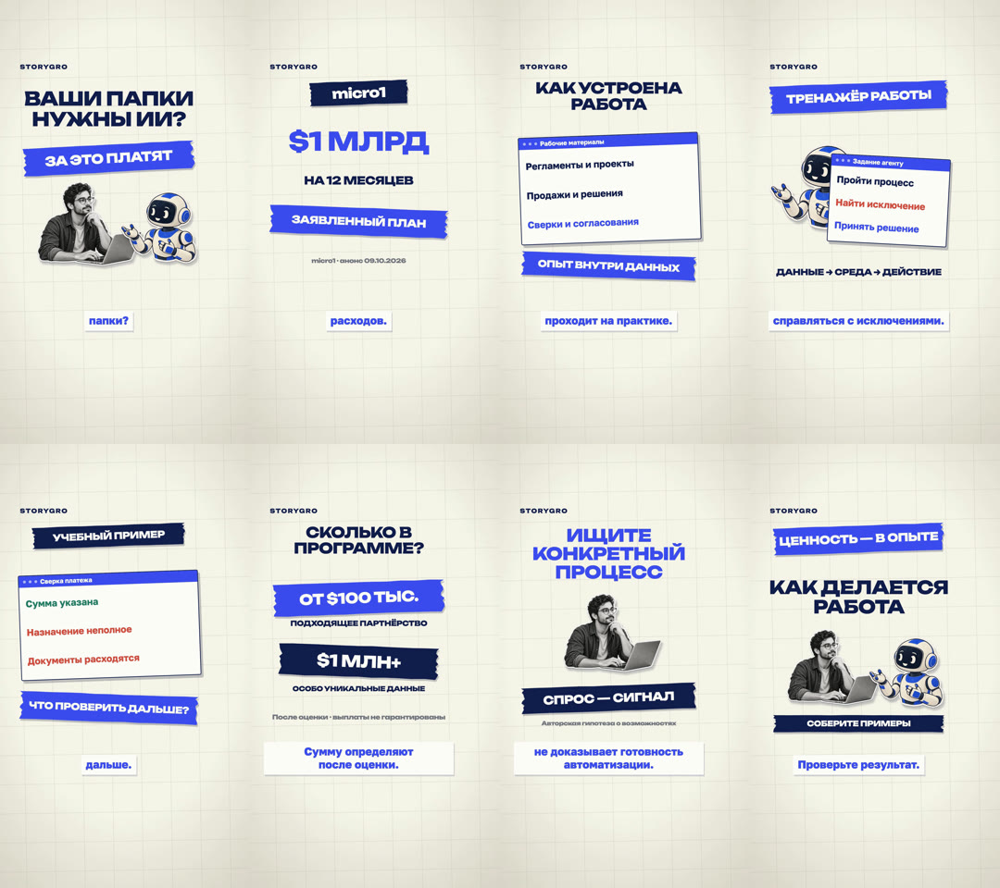

# Зачем micro1 покупает рабочие данные компаний

Текущий ролик по посту, присланному владельцем: рабочие данные → тренировочные среды → процессы, которые стоит изучать. Русский язык, Kokoro-RU Dima, 1080×1920, редакционный коллаж по визуальным приёмам YouTube-референса.

**77,13 с · 11/11 QA pass.** [Посмотреть и скачать ролик/пакет](https://github.com/eiler2005/Storygro/releases/tag/micro1-work-data-2026-10-19). Пробная версия для просмотра со звуком владельцем.



[Источники](sources.md) · [фактчек поста](../../research/micro1-work-data/README.md) · [постановка](DIRECTION.md) · [credits](CREDITS.md) · [проверки](REVIEW.md).

```sh
npm run storygro -- board content/videos/micro1-work-data/ru.reel.yaml
npm run storygro -- approve content/videos/micro1-work-data/ru.reel.yaml
npm run storygro -- render content/videos/micro1-work-data/ru.reel.yaml
npm run storygro -- package content/videos/micro1-work-data/episode.yaml
```

Генерируемые результаты находятся в `.reel/ru/`, пакеты — в `.reel/releases/`. Исходники, факты и выбранные assets входят в Git. Автоматической публикации в соцсети нет.
