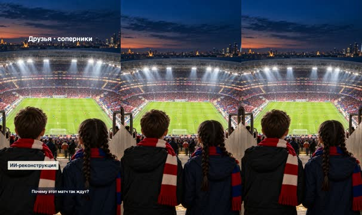
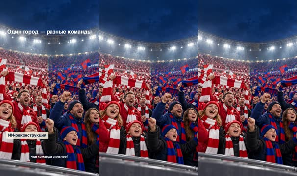
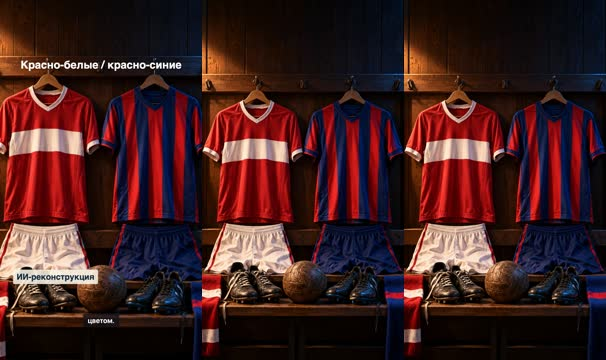
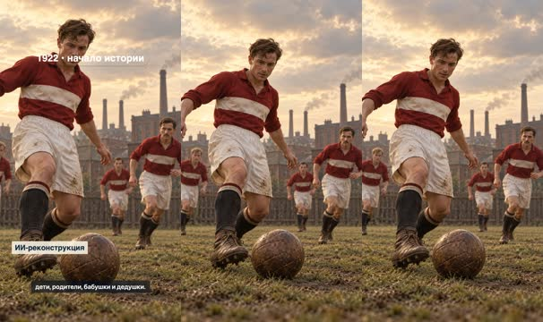
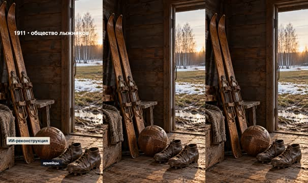
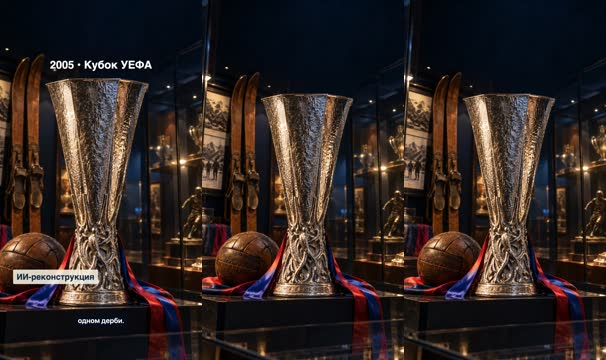
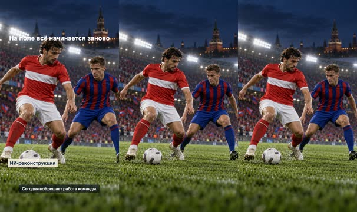
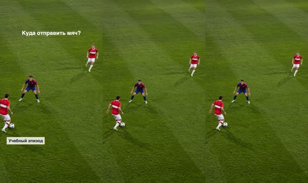
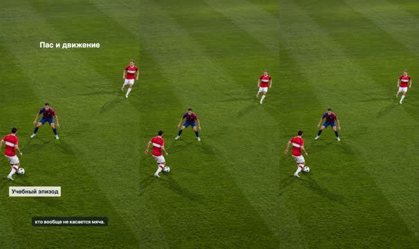
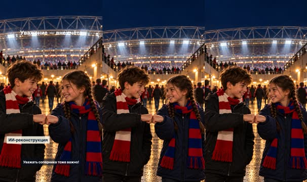

# План: Спартак и ЦСКА: секрет дерби

> Сгенерировано `storygro plan` из `ru.reel.yaml`, 2026-10-25. Не правьте этот файл: текст — в спецификации ролика, вопросы и заметки — в `review.yaml`. Затем `storygro plan` заново.

| | |
|---|---|
| Статус | **сценарий** · ждёт тебя: одобрить сценарий |
| Длительность | 126.1 с (по озвучке) · 10 сцен |
| Формат | 1080×1920, 30 fps · style `cartoon` |
| Голос | omnivoice · assets/voice/narrator-ru.wav · 0.9 |

## Одобрения

| | | Кто и когда |
|---|---|---|
| Сценарий | ⚙️ техническое (агент) | agent 2026-10-25 |
| Раскадровка | ⚙️ техническое (агент) | agent 2026-10-25 |
| Выпуск | ⏳ ждёт |   |

Одобрить: `storygro approve <spec> --step script|storyboard|release` (агент — с `--agent`).

## Вопросы

- [ ] **owner** · Подходят ли реалистичный стиль, темп OmniVoice B 0,90 и произношение ЦСКА / дерби / УЕФА?

**Заметки:** Owner requested a two-minute realistic GPT Image explainer for children; established audience 10–12 and vertical iPhone format retained. Rendered 126.093 seconds, 1080x1920 at 30 fps, with nine original GPT Image stills and ten animated scenes. OmniVoice B at speed 0.90. All generated images and storyboard frames visually inspected. Full MP4 technical QA is in .reel/ru/QA.md. No subjective audio listening or owner editorial/release approval recorded. This is a local family review copy, not publication. Historical uniforms, stadium and trophy are illustrative, not exact archival records.

## Хук

- Вариант 1 · **выбран**: «Один город. Два друга. Но шарфы — разных цветов! Саша болеет за «Спартак», а Аня — за ЦСКА. Сегодня они раскроют секрет московского дерби. Почему этот матч так ждут?»

## Сцены

### 1. intro · 0.0–11.6 с · `illustration`

кадр в ключевой момент, затем картинки сцены по порядку

**Голос:** Один город. Два друга. Но шарфы — разных цветов! Саша болеет за «Спартак», а Аня — за ЦСКА. Сегодня они раскроют секрет московского дерби. Почему этот матч так ждут?

**На экране:** «СПАРТАК × ЦСКА» · «Друзья • соперники» · «ИИ-реконструкция»

**Картинки:**

- Create one photorealistic cinematic image, portrait 9:16, for an educational football film for children 10-12 about Moscow Spartak vs CSKA derby. Opening image: two original fictional 12-year-old friends viewed from behind at the entrance to a huge football stadium at blue hour, a boy with short chestnut hair wearing a red-and-white scarf and dark autumn jacket, a girl with dark braided hair wearing a red-and-blue scarf and navy autumn jacket. They gaze down at brilliantly lit green football pitch. Detailed knit texture, realistic architecture, breath in cool air, floodlight beams, realistic peaceful spectators. Beautiful documentary photographic realism, 35mm lens, subtle grain, natural faces, high detail, not cartoon. Place children and pitch in middle and lower two thirds, calm dark sky in upper quarter reserved for overlaid title. No text, no letters, no numbers, no badges, no logos, no watermarks. No violence, no smoke flares. Fictional stadium visualization, not a claim of actual match footage. — ok
- `@next` Create one photorealistic cinematic image, portrait 9:16, for an educational football film for children 10-12 about Moscow Spartak vs CSKA derby. Opening image: two original fictional 12-year-old friends viewed from behind at the entrance to a huge football stadium at blue hour, a boy with short chestnut hair wearing a red-and-white scarf and dark autumn jacket, a girl with dark braided hair wearing a red-and-blue scarf and navy autumn jacket. They gaze down at brilliantly lit green football pitch. Detailed knit texture, realistic architecture, breath in cool air, floodlight beams, realistic peaceful spectators. Beautiful documentary photographic realism, 35mm lens, subtle grain, natural faces, high detail, not cartoon. Place children and pitch in middle and lower two thirds, calm dark sky in upper quarter reserved for overlaid title. No text, no letters, no numbers, no badges, no logos, no watermarks. No violence, no smoke flares. Fictional stadium visualization, not a claim of actual match footage. — ok

**Звук:** whoosh @7.0

**Факты:** `facts.intro.title` = «СПАРТАК × ЦСКА» · `facts.intro.label` = «Друзья • соперники» · `facts.visual.reconstruction` = «ИИ-реконструкция»

### 2. derby · 11.6–22.2 с · `illustration`

кадр в ключевой момент, затем картинки сцены по порядку

**Голос:** Дерби — встреча близких соперников, например команд одного города. Оба клуба из Москвы. После победы можно дружески поспорить, чья команда сильнее!

**На экране:** «ЧТО ТАКОЕ ДЕРБИ?» · «Один город — разные команды» · «ИИ-реконструкция»

**Картинки:**

- Photorealistic cinematic portrait 9:16 image for children explainer about Moscow football derby. Peaceful crowded stadium stands split visually into two adjacent color fields, red-and-white scarves on left and red-and-royal-blue scarves on right, viewed from pitch level looking upward across fans. Excited family-friendly adult fans cheering, scarf fabric details, warm human expressions, realistic varied faces, evening floodlights glowing through light mist. No violence or flares. Wide composition within portrait frame with main crowd in middle and lower half, clear dark blue upper quarter for title. No recognizable public people, no text, letters, digits, badges, sponsor marks, or watermarks. Fictional stadium visualization, no documentary authenticity; true photographic detail, not cartoon. — ok
- `@next` Photorealistic cinematic portrait 9:16 image for children explainer about Moscow football derby. Peaceful crowded stadium stands split visually into two adjacent color fields, red-and-white scarves on left and red-and-royal-blue scarves on right, viewed from pitch level looking upward across fans. Excited family-friendly adult fans cheering, scarf fabric details, warm human expressions, realistic varied faces, evening floodlights glowing through light mist. No violence or flares. Wide composition within portrait frame with main crowd in middle and lower half, clear dark blue upper quarter for title. No recognizable public people, no text, letters, digits, badges, sponsor marks, or watermarks. Fictional stadium visualization, no documentary authenticity; true photographic detail, not cartoon. — ok

**Звук:** whoosh @4.7

**Факты:** `facts.derby.title` = «ЧТО ТАКОЕ ДЕРБИ?» · `facts.derby.label` = «Один город — разные команды» · `facts.visual.reconstruction` = «ИИ-реконструкция»

### 3. kits · 22.2–33.6 с · `illustration`

кадр в ключевой момент, затем картинки сцены по порядку

**Голос:** «Спартак» называют красно-белыми, ЦСКА — красно-синими. Но у клуба бывает несколько комплектов формы. Следи ещё за эмблемой и составом, а не только за цветом.

**На экране:** «УЗНАЙ ПО ЦВЕТАМ» · «Красно-белые / красно-синие» · «ИИ-реконструкция»

**Картинки:**

- Photorealistic cinematic portrait 9:16 still for a children's explainer about Moscow Spartak vs CSKA football derby. Very detailed close-up of two traditional football shirts hanging side by side in a warm wooden stadium dressing room: on left Spartak-inspired red shirt with one broad white horizontal chest stripe and white shorts; on right CSKA-inspired shirt with broad red and deep blue vertical stripes and dark blue shorts. Exact cloth seams, breathable mesh, subtle worn leather ball below, boot laces, dramatic warm sidelight and cool blue shadows, authentic sports photography not illustration. No people. Shirts in middle and lower image; top quarter dark empty wooden wall for captions. No logos, letters, digits, sponsor marks or watermark. Educational illustrative kits rather than an exact season's official shirts. — ok
- `@next` Photorealistic cinematic portrait 9:16 still for a children's explainer about Moscow Spartak vs CSKA football derby. Very detailed close-up of two traditional football shirts hanging side by side in a warm wooden stadium dressing room: on left Spartak-inspired red shirt with one broad white horizontal chest stripe and white shorts; on right CSKA-inspired shirt with broad red and deep blue vertical stripes and dark blue shorts. Exact cloth seams, breathable mesh, subtle worn leather ball below, boot laces, dramatic warm sidelight and cool blue shadows, authentic sports photography not illustration. No people. Shirts in middle and lower image; top quarter dark empty wooden wall for captions. No logos, letters, digits, sponsor marks or watermark. Educational illustrative kits rather than an exact season's official shirts. — ok

**Звук:** whoosh @4.6

**Факты:** `facts.kits.title` = «УЗНАЙ ПО ЦВЕТАМ» · `facts.kits.label` = «Красно-белые / красно-синие» · `facts.visual.reconstruction` = «ИИ-реконструкция»

### 4. spartak · 33.6–46.6 с · `illustration`

кадр в ключевой момент, затем картинки сцены по порядку

**Голос:** История «Спартака» начинается в тысяча девятьсот двадцать втором году. Представь, сколько поколений болельщиков! Сегодня за команду могут болеть дети, родители, бабушки и дедушки.

**На экране:** «СПАРТАК: ИСТОРИЯ» · «1922 • начало истории» · «ИИ-реконструкция»

**Картинки:**

- Photorealistic historical reconstruction for children's football documentary, portrait 9:16. Early 1920s Moscow neighborhood football ground on Presnya, original fictional adult men wearing simple red cotton football shirts with broad white horizontal chest stripe and white shorts, old brown leather football in grass, low wooden fence, brick factory silhouettes far behind. Focus on one adult player's leather boots and ball foreground with teammates behind. Overcast golden afternoon, richly detailed rough wool, leather stitching, dusty grass, cinematic archival mood with restrained natural color. NOT an authentic historical photograph. No recognizable real people, no weapons, no politics, no lettering, no numbers, no badges or watermarks. Subjects central and lower frame, upper quarter uncluttered for title overlay. — ok
- `@next` Photorealistic historical reconstruction for children's football documentary, portrait 9:16. Early 1920s Moscow neighborhood football ground on Presnya, original fictional adult men wearing simple red cotton football shirts with broad white horizontal chest stripe and white shorts, old brown leather football in grass, low wooden fence, brick factory silhouettes far behind. Focus on one adult player's leather boots and ball foreground with teammates behind. Overcast golden afternoon, richly detailed rough wool, leather stitching, dusty grass, cinematic archival mood with restrained natural color. NOT an authentic historical photograph. No recognizable real people, no weapons, no politics, no lettering, no numbers, no badges or watermarks. Subjects central and lower frame, upper quarter uncluttered for title overlay. — ok

**Звук:** whoosh @5.2

**Факты:** `facts.spartak.title` = «СПАРТАК: ИСТОРИЯ» · `facts.spartak.label` = «1922 • начало истории» · `facts.visual.reconstruction` = «ИИ-реконструкция»

### 5. cska · 46.6–61.9 с · `illustration`

кадр в ключевой момент, затем картинки сцены по порядку

**Голос:** А история ЦСКА начинается ещё раньше: в тысяча девятьсот одиннадцатом. Неожиданный факт: его предшественник вырос из общества любителей лыжного спорта! Позже клуб стал связан с армией. Отсюда прозвище — армейцы.

**На экране:** «ЦСКА: НЕОЖИДАННОЕ НАЧАЛО» · «1911 • общество лыжников» · «ИИ-реконструкция»

**Картинки:**

- Photorealistic cinematic historical still life for children's educational documentary on CSKA Moscow origins in a skiing society in 1911, portrait 9:16. Old pair of wooden cross-country skis and leather bindings leaning beside a scuffed antique brown stitched football and simple football boots inside a modest early-twentieth-century wooden sports clubhouse. Through open door: early spring muddy grass field near Moscow birch trees, melting snow along edges, warm low sun. Detailed aged timber grain, leather, rope, metal, photographic realism, atmospheric restrained colours. No people, no trophy, no flags, no military objects. Main objects in middle and lower two thirds, upper quarter calm shadowed wall for overlay. No text, letters, digits, logos, watermarks. A symbolic reconstruction, not an authentic historical photograph. — ok
- `@next` Photorealistic cinematic historical still life for children's educational documentary on CSKA Moscow origins in a skiing society in 1911, portrait 9:16. Old pair of wooden cross-country skis and leather bindings leaning beside a scuffed antique brown stitched football and simple football boots inside a modest early-twentieth-century wooden sports clubhouse. Through open door: early spring muddy grass field near Moscow birch trees, melting snow along edges, warm low sun. Detailed aged timber grain, leather, rope, metal, photographic realism, atmospheric restrained colours. No people, no trophy, no flags, no military objects. Main objects in middle and lower two thirds, upper quarter calm shadowed wall for overlay. No text, letters, digits, logos, watermarks. A symbolic reconstruction, not an authentic historical photograph. — ok

**Звук:** whoosh @5.5

**Факты:** `facts.cska.title` = «ЦСКА: НЕОЖИДАННОЕ НАЧАЛО» · `facts.cska.label` = «1911 • общество лыжников» · `facts.visual.reconstruction` = «ИИ-реконструкция»

### 6. cup · 61.9–76.5 с · `illustration`

кадр в ключевой момент, затем картинки сцены по порядку

**Голос:** У армейцев есть европейская вершина. В две тысячи пятом году они выиграли Кубок УЕФА. В финале победили португальский «Спортинг»: три — один. Такой трофей получают за победу в целом турнире, не в одном дерби.

**На экране:** «ЕВРОПЕЙСКИЙ ТРОФЕЙ» · «2005 • Кубок УЕФА» · «ИИ-реконструкция»

**Картинки:**

- Photorealistic cinematic vertical 9:16 image for educational children football documentary about CSKA Moscow. A beautifully lit dark football museum display containing a tall silver UEFA Cup style trophy, distinctive narrow cylindrical hammered silver upper bowl widening towards top above a small irregular sculptural base, no handles, with red and royal-blue ribbons draped near its base; leather football, antique wooden cross-country skis leaning on wall in background hint at club's ski-society origins. Rich metal texture and specular light, deep navy and warm amber, realistic glass reflections. Trophy fills central lower half, dark clear upper quarter for overlay. No people, no text or digits or inscriptions anywhere, no logos, no watermark. This is a symbolic generated display, not an authentic museum photograph. High photographic realism, no cartoon. — ok
- `@next` Photorealistic cinematic vertical 9:16 image for educational children football documentary about CSKA Moscow. A beautifully lit dark football museum display containing a tall silver UEFA Cup style trophy, distinctive narrow cylindrical hammered silver upper bowl widening towards top above a small irregular sculptural base, no handles, with red and royal-blue ribbons draped near its base; leather football, antique wooden cross-country skis leaning on wall in background hint at club's ski-society origins. Rich metal texture and specular light, deep navy and warm amber, realistic glass reflections. Trophy fills central lower half, dark clear upper quarter for overlay. No people, no text or digits or inscriptions anywhere, no logos, no watermark. This is a symbolic generated display, not an authentic museum photograph. High photographic realism, no cartoon. — ok

**Звук:** whoosh @6.2

**Факты:** `facts.cup.title` = «ЕВРОПЕЙСКИЙ ТРОФЕЙ» · `facts.cup.label` = «2005 • Кубок УЕФА» · `facts.visual.reconstruction` = «ИИ-реконструкция»

### 7. rivalry · 76.5–87.8 с · `illustration`

кадр в ключевой момент, затем картинки сцены по порядку

**Голос:** Почему столько эмоций? За командами — память о победах, семейные истории, свои трибуны. Но старые трофеи не забивают голы. Сегодня всё решает работа команды.

**На экране:** «ИСТОРИЯ НЕ ЗАБИВАЕТ ГОЛЫ» · «На поле всё начинается заново» · «ИИ-реконструкция»

**Картинки:**

- Photorealistic cinematic sports photograph style, portrait 9:16, fictional Moscow Spartak versus CSKA football derby. Low field-level camera, one original adult male athlete in a plain red shirt with broad white horizontal chest stripe, white shorts and red socks controls a white football while an original adult opponent in red-and-blue broad vertical stripes, blue shorts and blue socks approaches to defend. Athletic natural anatomy, two players with distinct ordinary fictional faces, concentrated expressions, clean sporting contest without contact. Rich grass blades and flying dew, detailed boots, fabric, breathing, floodlights and blurred peaceful packed stadium at blue hour. Action central lower two thirds; calm dark upper quarter for title. No logos, digits, lettering, sponsor marks or watermarks. Not real players, not real match footage. Freeze frame clarity and cinematic depth, no cartoon. — ok
- `@next` Photorealistic cinematic sports photograph style, portrait 9:16, fictional Moscow Spartak versus CSKA football derby. Low field-level camera, one original adult male athlete in a plain red shirt with broad white horizontal chest stripe, white shorts and red socks controls a white football while an original adult opponent in red-and-blue broad vertical stripes, blue shorts and blue socks approaches to defend. Athletic natural anatomy, two players with distinct ordinary fictional faces, concentrated expressions, clean sporting contest without contact. Rich grass blades and flying dew, detailed boots, fabric, breathing, floodlights and blurred peaceful packed stadium at blue hour. Action central lower two thirds; calm dark upper quarter for title. No logos, digits, lettering, sponsor marks or watermarks. Not real players, not real match footage. Freeze frame clarity and cinematic depth, no cartoon. — ok

**Звук:** whoosh @6.1

**Факты:** `facts.rivalry.title` = «ИСТОРИЯ НЕ ЗАБИВАЕТ ГОЛЫ» · `facts.rivalry.label` = «На поле всё начинается заново» · `facts.visual.reconstruction` = «ИИ-реконструкция»

### 8. choice · 87.8–102.0 с · `illustration`

кадр в ключевой момент, затем картинки сцены по порядку

**Голос:** Теперь ты — футбольный детектив! В нашей вымышленной атаке игрока с мячом встречает защитник. Посмотри правее: партнёр свободен. Что умнее — бежать прямо на защитника или отдать пас?

**На экране:** «НАЙДИ СВОБОДНОГО» · «Куда отправить мяч?» · «Учебный эпизод»

**Картинки:**

- Photorealistic educational football tactical scene, vertical 9:16. High oblique aerial camera looking down at a real lush grass pitch during a fictional Moscow derby, exactly three adult outfield players visible, no other athletes. Lower-left foreground: attacker wearing red shirt with broad white horizontal chest stripe and white shorts, white football at his right boot. Directly ahead of him in center: defender wearing red and royal-blue vertical stripe shirt and dark blue shorts faces the ball carrier. Farther to the RIGHT at middle-right: a second attacker wearing same red shirt with broad white horizontal white stripe and white shorts is WIDE OPEN, with several meters clear space around him and clear diagonal passing lane from the ball. Real natural player anatomy, detailed turf, shadows and stadium floodlight glow, realistic sports photography. Goal may be outside frame; do NOT draw football goals or extra players. Top quarter less busy grass for overlay. No tactical lines or arrows, no lettering, no numbers, no logos, no watermark. Easy to understand spatial arrangement, no cartoon, no real player identities. — ok
- `@next` Photorealistic educational football tactical scene, vertical 9:16. High oblique aerial camera looking down at a real lush grass pitch during a fictional Moscow derby, exactly three adult outfield players visible, no other athletes. Lower-left foreground: attacker wearing red shirt with broad white horizontal chest stripe and white shorts, white football at his right boot. Directly ahead of him in center: defender wearing red and royal-blue vertical stripe shirt and dark blue shorts faces the ball carrier. Farther to the RIGHT at middle-right: a second attacker wearing same red shirt with broad white horizontal white stripe and white shorts is WIDE OPEN, with several meters clear space around him and clear diagonal passing lane from the ball. Real natural player anatomy, detailed turf, shadows and stadium floodlight glow, realistic sports photography. Goal may be outside frame; do NOT draw football goals or extra players. Top quarter less busy grass for overlay. No tactical lines or arrows, no lettering, no numbers, no logos, no watermark. Easy to understand spatial arrangement, no cartoon, no real player identities. — ok

**Звук:** whoosh @6.3

**Факты:** `facts.choice.title` = «НАЙДИ СВОБОДНОГО» · `facts.choice.label` = «Куда отправить мяч?» · `facts.visual.fiction` = «Учебный эпизод»

### 9. answer · 102.0–115.1 с · `illustration`

кадр в ключевой момент, затем картинки сцены по порядку

**Голос:** Пас! Защитнику придётся выбирать, за кем бежать. А футболист без мяча может снова открыться. Следи за такими перемещениями: иногда главный ход делает тот, кто вообще не касается мяча.

**На экране:** «СМОТРИ НЕ ТОЛЬКО НА МЯЧ» · «Пас и движение» · «Учебный эпизод»

**Картинки:**

- Photorealistic educational football tactical scene, vertical 9:16. High oblique aerial camera looking down at a real lush grass pitch during a fictional Moscow derby, exactly three adult outfield players visible, no other athletes. Lower-left foreground: attacker wearing red shirt with broad white horizontal chest stripe and white shorts, white football at his right boot. Directly ahead of him in center: defender wearing red and royal-blue vertical stripe shirt and dark blue shorts faces the ball carrier. Farther to the RIGHT at middle-right: a second attacker wearing same red shirt with broad white horizontal white stripe and white shorts is WIDE OPEN, with several meters clear space around him and clear diagonal passing lane from the ball. Real natural player anatomy, detailed turf, shadows and stadium floodlight glow, realistic sports photography. Goal may be outside frame; do NOT draw football goals or extra players. Top quarter less busy grass for overlay. No tactical lines or arrows, no lettering, no numbers, no logos, no watermark. Easy to understand spatial arrangement, no cartoon, no real player identities. — ok
- `@next` Photorealistic educational football tactical scene, vertical 9:16. High oblique aerial camera looking down at a real lush grass pitch during a fictional Moscow derby, exactly three adult outfield players visible, no other athletes. Lower-left foreground: attacker wearing red shirt with broad white horizontal chest stripe and white shorts, white football at his right boot. Directly ahead of him in center: defender wearing red and royal-blue vertical stripe shirt and dark blue shorts faces the ball carrier. Farther to the RIGHT at middle-right: a second attacker wearing same red shirt with broad white horizontal white stripe and white shorts is WIDE OPEN, with several meters clear space around him and clear diagonal passing lane from the ball. Real natural player anatomy, detailed turf, shadows and stadium floodlight glow, realistic sports photography. Goal may be outside frame; do NOT draw football goals or extra players. Top quarter less busy grass for overlay. No tactical lines or arrows, no lettering, no numbers, no logos, no watermark. Easy to understand spatial arrangement, no cartoon, no real player identities. — ok

**Звук:** chime @0.1

**Факты:** `facts.answer.title` = «СМОТРИ НЕ ТОЛЬКО НА МЯЧ» · `facts.answer.label` = «Пас и движение» · `facts.visual.fiction` = «Учебный эпизод»

### 10. close · 115.1–126.1 с · `illustration`

кадр в ключевой момент, затем картинки сцены по порядку

**Голос:** Саша и Аня болеют за разные команды, но остаются друзьями. На следующем дерби найди красивый пас у обеих команд. Уважать соперника тоже важно!

**На экране:** «СОПЕРНИКИ НА ПОЛЕ» · «Уважение — вне счёта» · «ИИ-реконструкция»

**Картинки:**

- Use the attached opening image as identity, clothing and mood reference for the two fictional friends. Generate a new photorealistic cinematic portrait 9:16 closing scene after the football game. Same original boy with short chestnut hair, dark charcoal autumn jacket and red-and-white knit scarf, same original girl with dark braided hair, navy jacket and red-and-blue knit scarf, both around 12, shown in friendly three-quarter view smiling at each other and doing a simple fist bump with one hand each. They are standing in a safe stadium concourse at night, realistic skin, rosy cheeks, textured scarves, hands anatomically natural, warm exit lights and softly blurred peaceful spectators, stadium illuminated behind. Friendship across different clubs. High photographic realism, not cartoon. Children centered in lower two thirds, dark clear upper quarter for final title. No text, lettering, digits, badges, logos, watermarks. Keep original identities, coat colours and scarf colours consistent with reference. — ok
- `@next` Use the attached opening image as identity, clothing and mood reference for the two fictional friends. Generate a new photorealistic cinematic portrait 9:16 closing scene after the football game. Same original boy with short chestnut hair, dark charcoal autumn jacket and red-and-white knit scarf, same original girl with dark braided hair, navy jacket and red-and-blue knit scarf, both around 12, shown in friendly three-quarter view smiling at each other and doing a simple fist bump with one hand each. They are standing in a safe stadium concourse at night, realistic skin, rosy cheeks, textured scarves, hands anatomically natural, warm exit lights and softly blurred peaceful spectators, stadium illuminated behind. Friendship across different clubs. High photographic realism, not cartoon. Children centered in lower two thirds, dark clear upper quarter for final title. No text, lettering, digits, badges, logos, watermarks. Keep original identities, coat colours and scarf colours consistent with reference. — ok

**Звук:** whoosh @4.2

**Факты:** `facts.close.title` = «СОПЕРНИКИ НА ПОЛЕ» · `facts.close.label` = «Уважение — вне счёта» · `facts.visual.reconstruction` = «ИИ-реконструкция»

## Факты и источники

| | |
|---|---|
| `facts.intro` | Original educational screenplay; fictional demonstration and editorial wording. |
| `facts.derby` | https://pfc-cska.com/ru/novosti/vse-novosti/32617-bileti-na-derbi-v-otkritoy-prodazhe/ — “Билеты на дерби в открытой продаже!” |
| `facts.kits` | https://pfc-cska.com/ru/novosti/vse-novosti/9312-pfk-cska-109-let/ — “1960 — 1994 — ЦСКА (Центральный Спортивный Клуб Армии)” |
| `facts.spartak` | https://spartak.com/ru/club/history — “Основан в 1922 году.” |
| `facts.cska` | https://pfc-cska.com/ru/club/o-klube/ — “ведущий свою историю от команды ОЛЛС (Общество любителей лыжного спорта), основанной в 1911 году.” |
| `facts.cup` | https://pfc-cska.com/ru/novosti/vse-novosti/4695-kubok-nash-6/ — “в Лиссабоне, красно-синие переиграли местный «Спортинг» со счетом 3:1.” |
| `facts.rivalry` | Original educational screenplay; fictional demonstration and editorial wording. |
| `facts.choice` | Original educational screenplay; fictional demonstration and editorial wording. |
| `facts.answer` | Original educational screenplay; fictional demonstration and editorial wording. |
| `facts.close` | Original educational screenplay; fictional demonstration and editorial wording. |
| `facts.visual` | Production disclosure: all pictures generated using GPT Image; no actual match footage. |

→ [sources.md](sources.md)

## Текст поста

> Почему два московских клуба — принципиальные соперники? История, цвета и футбольная задачка для детей 10–12 лет. Саша, Аня и игровой эпизод вымышлены. Факты проверены по официальным сайтам клубов. Все кадры — фотореалистичные изображения GPT Image с анимацией камеры, не документальная съёмка. Голос синтетический: OmniVoice B, скорость 0,90; не голос футболиста. Семейная версия, не связана с клубами. Веса OmniVoice: CC-BY-NC. Источники: sources.md.
