# Plan: Who gets rich on AI

> Generated by `storygro plan` from `en.reel.yaml`, 2026-10-28. Do not edit this file: the text lives in the reel spec, questions and notes in `review.yaml`. Then run `storygro plan` again.

| | |
|---|---|
| Status | **script** · waiting for you: approve the script |
| Length | 134.2 s (narrated) · 11 scenes |
| Format | 1080×1920, 30 fps · style `cartoon` |
| Voice | kokoro · am_michael · 1.18 |

## Approvals

| | | By, when |
|---|---|---|
| Script | ⏳ waiting |   |
| Storyboard | ⚙️ technical (agent) | agent 2026-10-28 |
| Release | ⏳ waiting |   |

Approve: `storygro approve <spec> --step script|storyboard|release` (agents add `--agent`).

## Questions

- [ ] **owner** · В исходном посте $725 млрд капитальных расходов приписаны Bloomberg. Подтвердить эту атрибуцию не удалось: найденный проверяемый источник — Yahoo Finance (Майлс Адленд, 30.04.2026, по отчётам за I квартал), и ролик ссылается на него, а число названо планом, а не потраченными деньгами. Оставляем так или нужна другая формулировка?
- [ ] **owner** · Оценка капзатрат за 2026 год менялась в течение года (≈$650 млрд в феврале по Bridgewater, ≈$700 млрд по CNBC, ≈$730 млрд в поздних подсчётах). Взята апрельская с датой на экране. Если к моменту публикации появится свежая — поменять число и пересобрать.
- [ ] **owner** · Русская и английская версии используют одни и те же картинки (идентичные промпты и файлы), различаются только слова и подписи. Это экономит генерацию и держит версии визуально одинаковыми. Если для англоязычной аудитории нужен другой визуальный ряд — скажите.
- [ ] **owner** · Для английской версии взят голос бренда по умолчанию — Kokoro am_michael на скорости 1.18 (1.0 давал 151 секунду, это выходило за две минуты). Владелец сравнивал только русские голоса. Нужна ли аудиция английских вариантов (Kokoro af_heart / qwen3-клон) перед релизом?
- [ ] **owner** · Обе версии вышли на верхней границе заказанного: русская 135 секунд, английская 134. Русскую ускорить нельзя — 0,90 это ваш выбор от 25.10.2026, поэтому она подрезана по тексту. Если нужно ближе к 1:45, скажите, какой блок сократить: историю 1873 года, разбор «производительность ≠ доход» или финал про владение.

**Notes:** Сделано по просьбе владельца 27.10.2026 из его поста «Кто разбогатеет на ИИ? Один неудобный урок из истории капитализма». Формат: 9:16, стиль cartoon, картинки GPT Image через Codex, две версии (ru, en) на общих кадрах. Структура выстроена по приёмам объяснительных роликов: холодный открывающий кадр (1873), загадка «кому достанутся деньги» в первой трети, перецепки на числах, одна мысль на сцену, развязка отвечает на вопрос из хука. Из пересказа убрано слово «революция» (в brand.yaml оно в списке избегаемых) и сравнение с промышленной революцией. Числа перепроверены заново, не взяты из поста на веру: атрибуция Bloomberg не подтвердилась (см. sources.md и вопрос capex-attribution), число ФРС подтвердилось точно (50,9%, II кв. 2026, ряд WFRBST01122). Иллюстративный пример со специалистом помечен на экране как пример, а не замер.

## Hook

- Variant 1 · **chosen**: «Autumn, 1873. Jay Cooke's bank collapses, and the New York exchange shuts for ten days. Almost one in four American railroads goes bankrupt.»

## Scenes

### 1. panic · 0.0–11.1 s · `illustration`

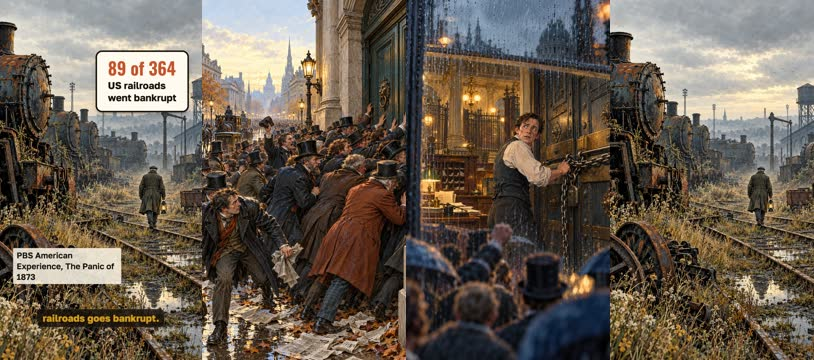

the frame at the key moment, then the scene's pictures in order

**Voice:** Autumn, 1873. Jay Cooke's bank collapses, and the New York exchange shuts for ten days. Almost one in four American railroads goes bankrupt.

**On screen:** «89 of 364» · «US railroads went bankrupt» · «PBS American Experience, The Panic of 1873»

**Pictures:**

- a dense crowd of men in top hats and long frock coats pressing against the closed stone doors of a city bank on a wet autumn morning in 1873, newspapers trampled underfoot, horse-drawn cabs behind them — ok
- `@bank` the heavy iron-bound doors of a nineteenth-century bank being chained shut from inside by a frightened clerk, seen through rain-streaked glass, the crowd blurred outside — ok
- `@rails` a vast railway yard of cold rusting steam locomotives standing abandoned under a low grey sky, weeds growing high between the rails, a lone watchman walking away — ok

**Sound:** thud @2.5, hit @6.9

**Facts:** `facts.panic.value.en` = «89 of 364» · `facts.panic.label.en` = «US railroads went bankrupt» · `facts.panic.sourceLine.en` = «PBS American Experience, The Panic of 1873»

### 2. paradox · 11.1–23.0 s · `illustration`

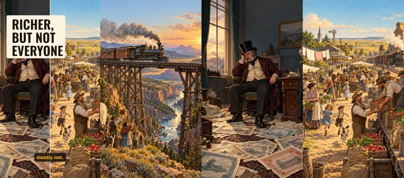

the frame at the key moment, then the scene's pictures in order

**Voice:** Here is the paradox. Those railroads became the best thing that ever happened to the American economy. The technology made society richer. The people who funded it, mostly not.

**On screen:** «Richer, but not everyone»

**Pictures:**

- a steam locomotive crossing a tall wooden trestle bridge over a wide canyon at golden hour in the American West, smoke trailing, tiny settlers waving from a wagon below — ok
- `@but` @tycoon alone in a dim emptied office, slumped in a chair, loose engraved share certificates scattered over the floor around his feet, an unlit lamp — ok

### 3. question · 23.0–29.0 s · `illustration`

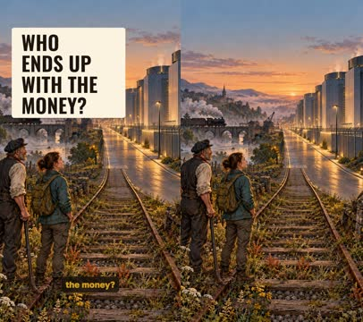

the frame at the key moment, then the scene's pictures in order

**Voice:** Which raises the question. If AI is the new railroad, who ends up with the money?

**On screen:** «Who ends up with the money?»

**Pictures:**

- a pair of old railway tracks running out of a misty nineteenth-century landscape and turning into the straight service road of an enormous modern data centre at dusk, cooling units glowing softly — ok

**Sound:** pop @2.0

### 4. book · 29.0–43.6 s · `illustration`

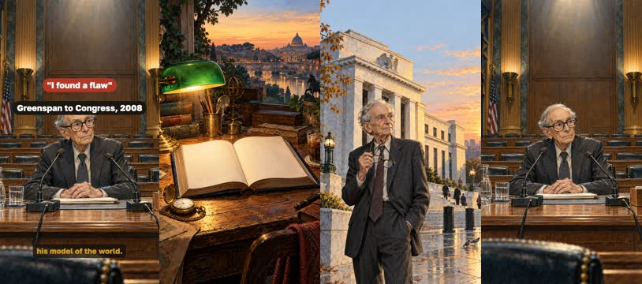

the frame at the key moment, then the scene's pictures in order

**Voice:** That is the thread of Capitalism in America, by Alan Greenspan and Adrian Wooldridge. Greenspan ran the Federal Reserve for nineteen years. In 2008 he told Congress: there was a flaw in his model of the world.

**On screen:** «1987–2006» · «chairman of the Federal Reserve» · «"I found a flaw"» · «Greenspan to Congress, 2008»

**Pictures:**

- a thick hardback history book lying open on a worn wooden desk under a green banker lamp, beside it a brass pocket watch and a cold cup of coffee, blank pages with no writing — ok
- `@authors` @banker standing thoughtfully in front of a tall marble central-bank building at dawn, holding his glasses in one hand — ok
- `@flaw` @banker sitting alone at a long witness table in a wood-panelled committee room, microphones in front of him, rows of empty seats behind, harsh overhead light — ok

**Sound:** thud @9.2

**Facts:** `facts.greenspan.value.en` = «1987–2006» · `facts.greenspan.label.en` = «chairman of the Federal Reserve» · `facts.greenspan.quote.en` = «"I found a flaw"» · `facts.greenspan.quoteLabel.en` = «Greenspan to Congress, 2008»

### 5. capex · 43.6–55.4 s · `illustration`

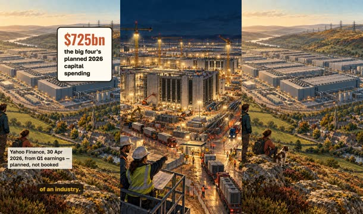

the frame at the key moment, then the scene's pictures in order

**Voice:** Microsoft, Amazon, Alphabet and Meta have planned up to $725bn of capital spending for the year. A building site the size of an industry.

**On screen:** «$725bn» · «the big four's planned 2026 capital spending» · «Yahoo Finance, 30 Apr 2026, from Q1 earnings — planned, not booked»

**Pictures:**

- an enormous data centre under construction at night, tower cranes lit by floodlights, concrete shells stretching to the horizon, convoys of trucks queuing at the gate — ok
- `@scale` a bird eye view of a colossal windowless data centre campus filling a valley, a small old farming town with a church spire tucked beside it for scale, power lines marching away over the hills — ok

**Sound:** hit @0.8

**Facts:** `facts.capex.value.en` = «$725bn» · `facts.capex.label.en` = «the big four's planned 2026 capital spending» · `facts.capex.sourceLine.en` = «Yahoo Finance, 30 Apr 2026, from Q1 earnings — planned, not booked»

### 6. flip · 55.4–64.3 s · `illustration`

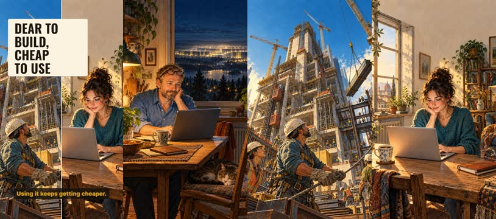

the frame at the key moment, then the scene's pictures in order

**Voice:** Access to what it produces costs tens of dollars a month. Building the technology keeps getting dearer. Using it keeps getting cheaper.

**On screen:** «Dear to build, cheap to use»

**Pictures:**

- @viktor sitting at a small kitchen table late in the evening with one laptop, a mug and a houseplant, warm lamplight, through the window behind him the distant glow of the vast data centre — ok
- `@asym` a towering construction site of steel and concrete seen from below, cranes against a hard blue sky, dozens of hard-hatted workers like ants — ok

### 7. trap · 64.3–78.9 s · `illustration`

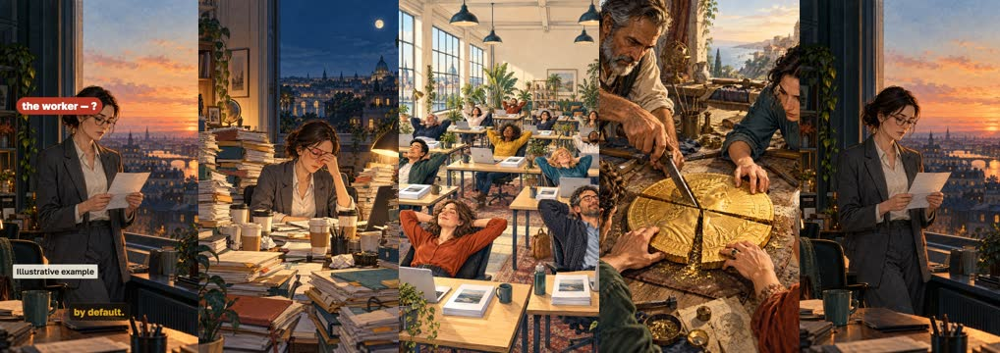

the frame at the key moment, then the scene's pictures in order

**Voice:** But productivity is not income. A week of research now takes a day. If everyone can do it, the price falls. The client gains; some goes to the employer, some to the vendor. The specialist gets no raise by default.

**On screen:** «a week» · «a day» · «the client» · «the employer» · «the model vendor» · «the worker — ?» · «Illustrative example»

**Pictures:**

- @anna at midnight almost buried behind towering stacks of reports and folders on her desk, seven paper coffee cups around her, rubbing her eyes — ok
- `@all` a long open-plan office where a dozen identical tidy desks each hold a glowing laptop and a neat finished report, every worker leaning back relaxed at the same moment, flat even daylight — ok
- `@split` a large gold coin on a workshop bench being carefully sliced into four uneven wedges with a chisel, four pairs of hands reaching in from the edges of the frame — ok
- `@worker` @anna standing by a window holding a thin paper payslip, looking at it with a flat tired expression, the office behind her already dark — ok

**Sound:** thud @11.2

**Facts:** `facts.specialist.before.en` = «a week» · `facts.specialist.after.en` = «a day» · `facts.split.client.en` = «the client» · `facts.split.employer.en` = «the employer» · `facts.split.vendor.en` = «the model vendor» · `facts.split.worker.en` = «the worker — ?» · `facts.specialist.label.en` = «Illustrative example»

### 8. owners · 78.9–92.3 s · `illustration`

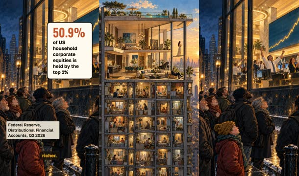

the frame at the key moment, then the scene's pictures in order

**Voice:** Ownership is already concentrated. More than half of all corporate equities in the United States belong to the richest one percent of families. A rising market, on its own, makes most people no richer.

**On screen:** «50.9%» · «of US household corporate equities is held by the top 1%» · «Federal Reserve, Distributional Financial Accounts, Q2 2026»

**Pictures:**

- a cutaway of a tall narrow apartment tower where one vast luxurious penthouse occupies the whole upper half of the building and dozens of tiny cramped flats are stacked in the lower half — ok
- `@stocks` a crowd of ordinary people on a cold pavement at night looking up through a plate-glass window at a bright trading floor where a line on a wall display climbs steeply, no words or figures on the display — ok

**Sound:** hit @0.5

**Facts:** `facts.equities.value.en` = «50.9%» · `facts.equities.label.en` = «of US household corporate equities is held by the top 1%» · `facts.equities.sourceLine.en` = «Federal Reserve, Distributional Financial Accounts, Q2 2026»

### 9. shift · 92.3–108.0 s · `illustration`

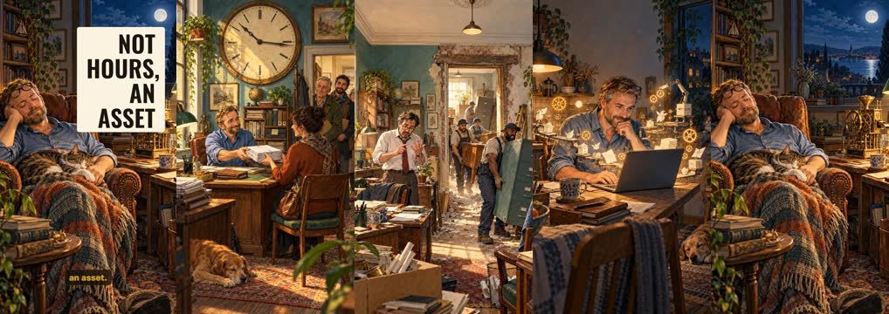

the frame at the key moment, then the scene's pictures in order

**Voice:** But one thing is different. Knowledge used to be sold as time: more clients, pricier projects. Growing meant people, an office, money. Now the accountant can build a service, the engineer can turn a method into a product. Not hours — an asset.

**On screen:** «Not hours, an asset»

**Pictures:**

- @viktor in a small office handing a client a neat stack of finished papers across the desk while an oversized wall clock above them dominates the room, a queue of three more clients waiting at the door — ok
- `@grow` a cramped old office being expanded: movers carrying in extra desks and filing cabinets through a narrow door, an overwhelmed manager counting on his fingers, plaster dust in the air — ok
- `@now` @viktor alone at his kitchen table building something on a laptop, around him float small glowing mechanical gears and tidy little paper machines assembling themselves, confident focused expression, warm night light — ok
- `@asset` @viktor asleep in an armchair at home with a blanket and a cat, while on the desk beside him a small tidy brass machine quietly keeps turning and dropping coins into a jar, moonlight through the window — ok

**Sound:** pop @8.8, chime @13.3

### 10. caveat · 108.0–118.0 s · `illustration`

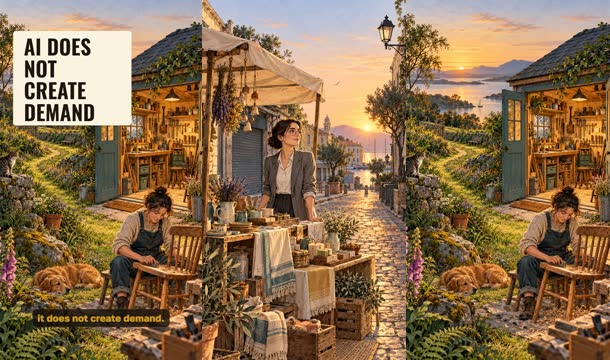

the frame at the key moment, then the scene's pictures in order

**Voice:** Not every one will work. It needs customers, trust, a feel for the market. Technology lowers the cost of building; it does not create demand.

**On screen:** «AI does not create demand»

**Pictures:**

- @anna standing hopefully beside a small handmade market stall of neatly arranged goods on an empty street at dawn, not a single customer in sight, shutters still down opposite — ok
- `@demand` a beautifully built little workshop with its door propped open and a welcome mat, perfect tools laid out inside, an empty path of untrodden grass leading to it — ok

### 11. close · 118.0–134.2 s · `illustration`

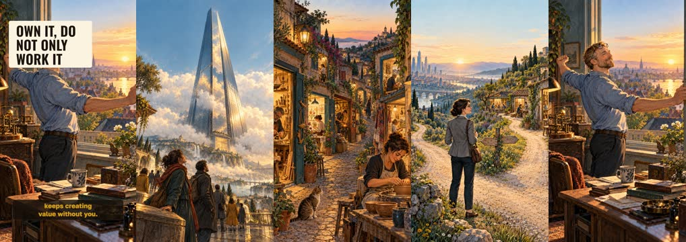

the frame at the key moment, then the scene's pictures in order

**Voice:** Capital keeps concentrating in a few giants — and at the same time thousands of small independent businesses become possible. Perhaps the real chance is not doing ten times more work, but owning something that keeps creating value without you.

**On screen:** «Own it, do not only work it»

**Pictures:**

- `@two` one colossal mirrored corporate tower rising alone above low clouds, seen from far below — ok
- `@chance` @anna standing at a fork in a country road at sunrise with a small bag, one path leading to distant towers and the other to a cluster of small bright workshops, she is looking at both — ok
- `@cta` @viktor opening a window at sunrise and stretching, behind him on the desk the small brass machine still turning by itself, first light filling the room — ok

**Sound:** chime @11.6

## Facts and sources

| | |
|---|---|
| `facts.panic` | PBS American Experience, «The Panic of 1873»: «89 of the country's 364 railroads crashed into bankruptcy»; Jay Cooke & Company closed its doors on 18 September 1873. Secondary source; no scholarly citation given for the count. |
| `facts.book` | Alan Greenspan, Adrian Wooldridge, «Capitalism in America: A History», Penguin Press, 16 October 2018, ISBN 978-0-7352-2244-1. Russian edition: «Капитализм в Америке. История», Альпина Паблишер. |
| `facts.greenspan` | Greenspan chaired the Federal Reserve from 11 August 1987 to 31 January 2006 — 18 years and 5 months. Testimony to the House Committee on Oversight and Government Reform, 23 October 2008 (NPR transcript): «I found a flaw. I don't know how significant or permanent it is. But I have been very distressed by that fact.» |
| `facts.capex` | Yahoo Finance, Myles Udland, 30 April 2026, «'Magnificent 7' earnings rush reveals AI spending surge, with hyperscaler capex set to reach $725 billion in 2026»: «As of Wednesday night's reports, that number is closer to $725 billion» — the big four hyperscalers (Microsoft, Amazon, Alphabet, Meta), against a pre-earnings high-end estimate of about $670 billion. A plan, not spend already booked; later 2026 tallies put the total near $730 billion. The owner's post attributed the figure to Bloomberg; that attribution could not be confirmed (sources.md). |
| `facts.equities` | Board of Governors of the Federal Reserve System, Distributional Financial Accounts, series WFRBST01122 «Share of Corporate Equities and Mutual Fund Shares Held by the Top 1% (99th to 100th Wealth Percentiles)»: 50.9 percent of aggregate, Q2 2026, not seasonally adjusted; page updated 18 September 2026. The Fed notes that hedge fund and private debt fund shares are still counted inside this category in the DFA. |
| `facts.specialist` | Illustrative example, not a measurement: our own restatement of the owner's post («специалиста, который раньше тратил неделю на подготовку исследования, а теперь делает его за день»). No study is claimed. |
| `facts.split` | Our own wording of the owner's post: «Выгоду получит заказчик, который платит меньше. Что-то достанется работодателю. Часть денег уйдёт поставщику модели. А специалисту вовсе не гарантировано повышение дохода.» A reasoning step, not a measured split. |
| `facts.shift` | Our own wording of the owner's post: «Человек перестаёт зарабатывать исключительно на собственных рабочих часах и получает возможность владеть продуктом, который приносит доход многократно.» An argument about a possibility, not a forecast. |

→ [sources.md](sources.md)

## Post text

> In 1873 Jay Cooke's bank failed on railway bonds and 89 of America's 364 railroads went into bankruptcy (PBS, American Experience). Yet the railroads turned out to be one of the best things that ever happened to the US economy. The technology made society richer — and the people who put money into it mostly did not get rich.
>
> That thread runs through Capitalism in America by Alan Greenspan and Adrian Wooldridge. Greenspan chaired the Federal Reserve from 1987 to 2006, and in 2008 he told Congress: "I found a flaw."
>
> Today Microsoft, Amazon, Alphabet and Meta have planned around $725bn of capital spending for 2026 (Yahoo Finance, 30 April 2026, from Q1 earnings — a plan, not money already booked). Access to the result costs tens of dollars a month. Building the technology keeps getting more expensive; using it keeps getting cheaper.
>
> But productivity is not income. If everyone can produce the week-long research in a day, the price of that research falls. And ownership is already concentrated: the top 1% of US households holds 50.9% of household corporate equities and mutual fund shares (Federal Reserve, Distributional Financial Accounts, Q2 2026).
>
> What genuinely changes: knowledge no longer has to be sold as time. An accountant can build a service; an engineer can turn a method into a product. Not hours — an asset. Not every project will work: AI lowers the cost of building, it does not create demand.
>
> Sources and caveats are in sources.md. The narration is synthetic (Kokoro) and the pictures are generated with GPT Image; see CREDITS.md.
