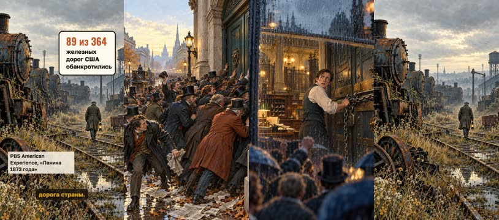
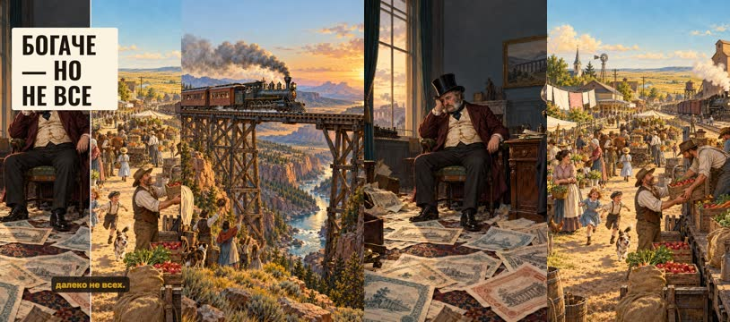
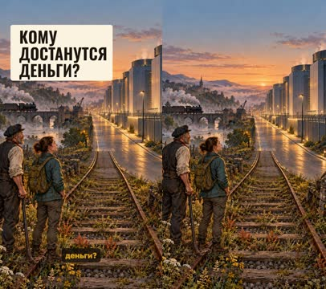
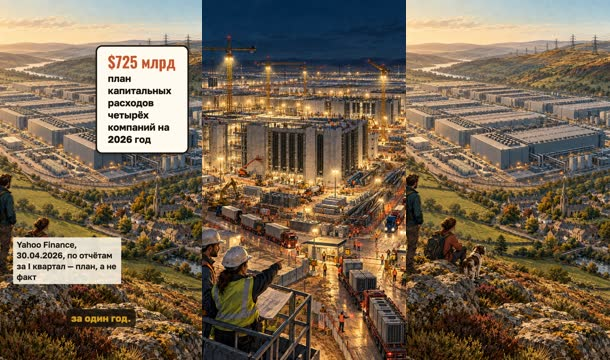
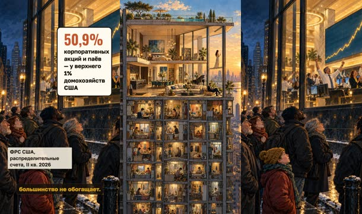
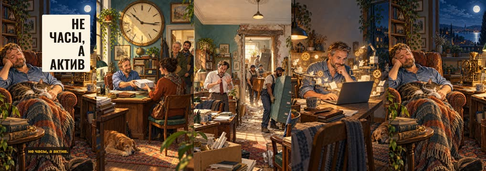
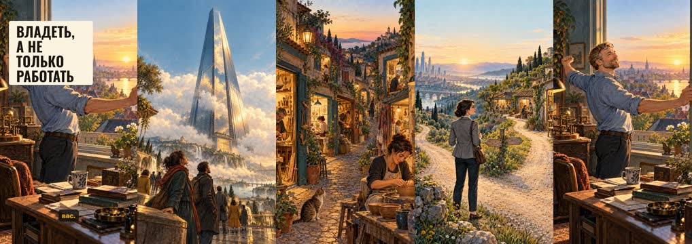

# План: Кто разбогатеет на ИИ

> Сгенерировано `storygro plan` из `ru.reel.yaml`, 2026-10-28. Не правьте этот файл: текст — в спецификации ролика, вопросы и заметки — в `review.yaml`. Затем `storygro plan` заново.

| | |
|---|---|
| Статус | **сценарий** · ждёт тебя: одобрить сценарий |
| Длительность | 135.2 с (по озвучке) · 11 сцен |
| Формат | 1080×1920, 30 fps · style `cartoon` |
| Голос | omnivoice · assets/voice/narrator-ru.wav · 0.9 |

## Одобрения

| | | Кто и когда |
|---|---|---|
| Сценарий | ⏳ ждёт |   |
| Раскадровка | ⚙️ техническое (агент) | agent 2026-10-28 |
| Выпуск | ⏳ ждёт |   |

Одобрить: `storygro approve <spec> --step script|storyboard|release` (агент — с `--agent`).

## Вопросы

- [ ] **owner** · В исходном посте $725 млрд капитальных расходов приписаны Bloomberg. Подтвердить эту атрибуцию не удалось: найденный проверяемый источник — Yahoo Finance (Майлс Адленд, 30.04.2026, по отчётам за I квартал), и ролик ссылается на него, а число названо планом, а не потраченными деньгами. Оставляем так или нужна другая формулировка?
- [ ] **owner** · Оценка капзатрат за 2026 год менялась в течение года (≈$650 млрд в феврале по Bridgewater, ≈$700 млрд по CNBC, ≈$730 млрд в поздних подсчётах). Взята апрельская с датой на экране. Если к моменту публикации появится свежая — поменять число и пересобрать.
- [ ] **owner** · Русская и английская версии используют одни и те же картинки (идентичные промпты и файлы), различаются только слова и подписи. Это экономит генерацию и держит версии визуально одинаковыми. Если для англоязычной аудитории нужен другой визуальный ряд — скажите.
- [ ] **owner** · Для английской версии взят голос бренда по умолчанию — Kokoro am_michael на скорости 1.18 (1.0 давал 151 секунду, это выходило за две минуты). Владелец сравнивал только русские голоса. Нужна ли аудиция английских вариантов (Kokoro af_heart / qwen3-клон) перед релизом?
- [ ] **owner** · Обе версии вышли на верхней границе заказанного: русская 135 секунд, английская 134. Русскую ускорить нельзя — 0,90 это ваш выбор от 25.10.2026, поэтому она подрезана по тексту. Если нужно ближе к 1:45, скажите, какой блок сократить: историю 1873 года, разбор «производительность ≠ доход» или финал про владение.

**Заметки:** Сделано по просьбе владельца 27.10.2026 из его поста «Кто разбогатеет на ИИ? Один неудобный урок из истории капитализма». Формат: 9:16, стиль cartoon, картинки GPT Image через Codex, две версии (ru, en) на общих кадрах. Структура выстроена по приёмам объяснительных роликов: холодный открывающий кадр (1873), загадка «кому достанутся деньги» в первой трети, перецепки на числах, одна мысль на сцену, развязка отвечает на вопрос из хука. Из пересказа убрано слово «революция» (в brand.yaml оно в списке избегаемых) и сравнение с промышленной революцией. Числа перепроверены заново, не взяты из поста на веру: атрибуция Bloomberg не подтвердилась (см. sources.md и вопрос capex-attribution), число ФРС подтвердилось точно (50,9%, II кв. 2026, ряд WFRBST01122). Иллюстративный пример со специалистом помечен на экране как пример, а не замер.

## Хук

- Вариант 1 · **выбран**: «Осень 1873. Банк Джея Кука рушится, биржа в Нью-Йорке закрывается на десять дней. Банкротится почти каждая четвёртая железная дорога страны.»

## Сцены

### 1. panic · 0.0–12.7 с · `illustration`

кадр в ключевой момент, затем картинки сцены по порядку

**Голос:** Осень 1873. Банк Джея Кука рушится, биржа в Нью-Йорке закрывается на десять дней. Банкротится почти каждая четвёртая железная дорога страны.

**На экране:** «89 из 364» · «железных дорог США обанкротились» · «PBS American Experience, «Паника 1873 года»»

**Картинки:**

- a dense crowd of men in top hats and long frock coats pressing against the closed stone doors of a city bank on a wet autumn morning in 1873, newspapers trampled underfoot, horse-drawn cabs behind them — ok
- `@bank` the heavy iron-bound doors of a nineteenth-century bank being chained shut from inside by a frightened clerk, seen through rain-streaked glass, the crowd blurred outside — ok
- `@rails` a vast railway yard of cold rusting steam locomotives standing abandoned under a low grey sky, weeds growing high between the rails, a lone watchman walking away — ok

**Звук:** thud @3.1, hit @8.6

**Факты:** `facts.panic.value.ru` = «89 из 364» · `facts.panic.label.ru` = «железных дорог США обанкротились» · `facts.panic.sourceLine.ru` = «PBS American Experience, «Паника 1873 года»»

### 2. paradox · 12.7–23.7 с · `illustration`

кадр в ключевой момент, затем картинки сцены по порядку

**Голос:** Парадокс: железные дороги оказались лучшим, что случалось с экономикой США. Технология сделала общество богаче. А вложившихся в неё — далеко не всех.

**На экране:** «Богаче — но не все»

**Картинки:**

- a steam locomotive crossing a tall wooden trestle bridge over a wide canyon at golden hour in the American West, smoke trailing, tiny settlers waving from a wagon below — ok
- `@but` @tycoon alone in a dim emptied office, slumped in a chair, loose engraved share certificates scattered over the floor around his feet, an unlit lamp — ok

### 3. question · 23.7–30.9 с · `illustration`

кадр в ключевой момент, затем картинки сцены по порядку

**Голос:** Отсюда вопрос. Если ИИ — новые железные дороги, кому достанутся деньги?

**На экране:** «Кому достанутся деньги?»

**Картинки:**

- a pair of old railway tracks running out of a misty nineteenth-century landscape and turning into the straight service road of an enormous modern data centre at dusk, cooling units glowing softly — ok

**Звук:** pop @1.6

### 4. book · 30.9–45.7 с · `illustration`

кадр в ключевой момент, затем картинки сцены по порядку

**Голос:** Об этом книга «Капитализм в Америке». Её авторы — Алан Гринспен и Адриан Вулдридж. Гринспен девятнадцать лет возглавлял центральный банк США. В 2008 он признал: в его модели мира нашёлся изъян.

**На экране:** «1987–2006» · «во главе ФРС США» · ««Я обнаружил изъян»» · «Гринспен, Конгресс, 2008»

**Картинки:**

- a thick hardback history book lying open on a worn wooden desk under a green banker lamp, beside it a brass pocket watch and a cold cup of coffee, blank pages with no writing — ok
- `@authors` @banker standing thoughtfully in front of a tall marble central-bank building at dawn, holding his glasses in one hand — ok
- `@flaw` @banker sitting alone at a long witness table in a wood-panelled committee room, microphones in front of him, rows of empty seats behind, harsh overhead light — ok

**Звук:** thud @10.0

**Факты:** `facts.greenspan.value.ru` = «1987–2006» · `facts.greenspan.label.ru` = «во главе ФРС США» · `facts.greenspan.quote.ru` = ««Я обнаружил изъян»» · `facts.greenspan.quoteLabel.ru` = «Гринспен, Конгресс, 2008»

### 5. capex · 45.7–58.1 с · `illustration`

кадр в ключевой момент, затем картинки сцены по порядку

**Голос:** Microsoft, Amazon, Alphabet и Meta запланировали на год до $725 млрд капитальных расходов. Стройка размером с целую отрасль — за один год.

**На экране:** «$725 млрд» · «план капитальных расходов четырёх компаний на 2026 год» · «Yahoo Finance, 30.04.2026, по отчётам за I квартал — план, а не факт»

**Картинки:**

- an enormous data centre under construction at night, tower cranes lit by floodlights, concrete shells stretching to the horizon, convoys of trucks queuing at the gate — ok
- `@scale` a bird eye view of a colossal windowless data centre campus filling a valley, a small old farming town with a church spire tucked beside it for scale, power lines marching away over the hills — ok

**Звук:** hit @0.3

**Факты:** `facts.capex.value.ru` = «$725 млрд» · `facts.capex.label.ru` = «план капитальных расходов четырёх компаний на 2026 год» · `facts.capex.sourceLine.ru` = «Yahoo Finance, 30.04.2026, по отчётам за I квартал — план, а не факт»

### 6. flip · 58.1–66.9 с · `illustration`

кадр в ключевой момент, затем картинки сцены по порядку

**Голос:** А доступ к результату — несколько десятков долларов в месяц. Строить технологию всё дороже. Пользоваться — всё дешевле.

**На экране:** «Строить дорого, пользоваться дёшево»

**Картинки:**

- @viktor sitting at a small kitchen table late in the evening with one laptop, a mug and a houseplant, warm lamplight, through the window behind him the distant glow of the vast data centre — ok
- `@asym` a towering construction site of steel and concrete seen from below, cranes against a hard blue sky, dozens of hard-hatted workers like ants — ok

### 7. trap · 66.9–82.5 с · `illustration`

кадр в ключевой момент, затем картинки сцены по порядку

**Голос:** Но производительность — не доход. Исследование недели делается за день. Но если это умеют все, цена падает. Выигрывает заказчик, часть берёт работодатель, часть — поставщик модели. Специалисту прибавка не достаётся.

**На экране:** «неделя» · «день» · «заказчик» · «работодатель» · «поставщик модели» · «специалист — ?» · «Пример, не замер»

**Картинки:**

- @anna at midnight almost buried behind towering stacks of reports and folders on her desk, seven paper coffee cups around her, rubbing her eyes — ok
- `@all` a long open-plan office where a dozen identical tidy desks each hold a glowing laptop and a neat finished report, every worker leaning back relaxed at the same moment, flat even daylight — ok
- `@split` a large gold coin on a workshop bench being carefully sliced into four uneven wedges with a chisel, four pairs of hands reaching in from the edges of the frame — ok
- `@worker` @anna standing by a window holding a thin paper payslip, looking at it with a flat tired expression, the office behind her already dark — ok

**Звук:** thud @12.9

**Факты:** `facts.specialist.before.ru` = «неделя» · `facts.specialist.after.ru` = «день» · `facts.split.client.ru` = «заказчик» · `facts.split.employer.ru` = «работодатель» · `facts.split.vendor.ru` = «поставщик модели» · `facts.split.worker.ru` = «специалист — ?» · `facts.specialist.label.ru` = «Пример, не замер»

### 8. owners · 82.5–94.7 с · `illustration`

кадр в ключевой момент, затем картинки сцены по порядку

**Голос:** Собственность уже сосредоточена. Больше половины корпоративных акций в США — у одного процента самых богатых семей. Рост рынка сам по себе большинство не обогащает.

**На экране:** «50,9%» · «корпоративных акций и паёв — у верхнего 1% домохозяйств США» · «ФРС США, распределительные счета, II кв. 2026»

**Картинки:**

- a cutaway of a tall narrow apartment tower where one vast luxurious penthouse occupies the whole upper half of the building and dozens of tiny cramped flats are stacked in the lower half — ok
- `@stocks` a crowd of ordinary people on a cold pavement at night looking up through a plate-glass window at a bright trading floor where a line on a wall display climbs steeply, no words or figures on the display — ok

**Звук:** hit @0.2

**Факты:** `facts.equities.value.ru` = «50,9%» · `facts.equities.label.ru` = «корпоративных акций и паёв — у верхнего 1% домохозяйств США» · `facts.equities.sourceLine.ru` = «ФРС США, распределительные счета, II кв. 2026»

### 9. shift · 94.7–111.2 с · `illustration`

кадр в ключевой момент, затем картинки сцены по порядку

**Голос:** Но отличие есть. Раньше знание продавали как время: больше клиентов, дороже проекты. Чтобы вырасти — люди, офис, деньги. Теперь бухгалтер соберёт сервис, инженер превратит методику в продукт. Это другая экономика: не часы, а актив.

**На экране:** «Не часы, а актив»

**Картинки:**

- @viktor in a small office handing a client a neat stack of finished papers across the desk while an oversized wall clock above them dominates the room, a queue of three more clients waiting at the door — ok
- `@grow` a cramped old office being expanded: movers carrying in extra desks and filing cabinets through a narrow door, an overwhelmed manager counting on his fingers, plaster dust in the air — ok
- `@now` @viktor alone at his kitchen table building something on a laptop, around him float small glowing mechanical gears and tidy little paper machines assembling themselves, confident focused expression, warm night light — ok
- `@asset` @viktor asleep in an armchair at home with a blanket and a cat, while on the desk beside him a small tidy brass machine quietly keeps turning and dropping coins into a jar, moonlight through the window — ok

**Звук:** pop @8.6, chime @13.1

### 10. caveat · 111.2–120.1 с · `illustration`

кадр в ключевой момент, затем картинки сцены по порядку

**Голос:** Взлетит не каждый. Нужны клиенты, доверие, понимание рынка. Технология удешевляет производство, но спрос не создаёт.

**На экране:** «Спрос не создаётся сам»

**Картинки:**

- @anna standing hopefully beside a small handmade market stall of neatly arranged goods on an empty street at dawn, not a single customer in sight, shutters still down opposite — ok
- `@demand` a beautifully built little workshop with its door propped open and a welcome mat, perfect tools laid out inside, an empty path of untrodden grass leading to it — ok

### 11. close · 120.1–135.2 с · `illustration`

кадр в ключевой момент, затем картинки сцены по порядку

**Голос:** Капитал концентрируется у гигантов — и рядом появляются тысячи маленьких дел. Может быть, главный шанс не в том, чтобы делать в десять раз больше, а в том, чтобы владеть тем, что создаёт ценность и без вас.

**На экране:** «Владеть, а не только работать»

**Картинки:**

- `@two` one colossal mirrored corporate tower rising alone above low clouds, seen from far below — ok
- `@chance` @anna standing at a fork in a country road at sunrise with a small bag, one path leading to distant towers and the other to a cluster of small bright workshops, she is looking at both — ok
- `@cta` @viktor opening a window at sunrise and stretching, behind him on the desk the small brass machine still turning by itself, first light filling the room — ok

**Звук:** chime @9.9

## Факты и источники

| | |
|---|---|
| `facts.panic` | PBS American Experience, «The Panic of 1873»: «89 of the country's 364 railroads crashed into bankruptcy»; Jay Cooke & Company closed its doors on 18 September 1873. Secondary source; no scholarly citation given for the count. |
| `facts.book` | Alan Greenspan, Adrian Wooldridge, «Capitalism in America: A History», Penguin Press, 16 October 2018, ISBN 978-0-7352-2244-1. Russian edition: «Капитализм в Америке. История», Альпина Паблишер. |
| `facts.greenspan` | Greenspan chaired the Federal Reserve from 11 August 1987 to 31 January 2006 — 18 years and 5 months. Testimony to the House Committee on Oversight and Government Reform, 23 October 2008 (NPR transcript): «I found a flaw. I don't know how significant or permanent it is. But I have been very distressed by that fact.» |
| `facts.capex` | Yahoo Finance, Myles Udland, 30 April 2026, «'Magnificent 7' earnings rush reveals AI spending surge, with hyperscaler capex set to reach $725 billion in 2026»: «As of Wednesday night's reports, that number is closer to $725 billion» — the big four hyperscalers (Microsoft, Amazon, Alphabet, Meta), against a pre-earnings high-end estimate of about $670 billion. A plan, not spend already booked; later 2026 tallies put the total near $730 billion. The owner's post attributed the figure to Bloomberg; that attribution could not be confirmed (sources.md). |
| `facts.equities` | Board of Governors of the Federal Reserve System, Distributional Financial Accounts, series WFRBST01122 «Share of Corporate Equities and Mutual Fund Shares Held by the Top 1% (99th to 100th Wealth Percentiles)»: 50.9 percent of aggregate, Q2 2026, not seasonally adjusted; page updated 18 September 2026. The Fed notes that hedge fund and private debt fund shares are still counted inside this category in the DFA. |
| `facts.specialist` | Illustrative example, not a measurement: our own restatement of the owner's post («специалиста, который раньше тратил неделю на подготовку исследования, а теперь делает его за день»). No study is claimed. |
| `facts.split` | Our own wording of the owner's post: «Выгоду получит заказчик, который платит меньше. Что-то достанется работодателю. Часть денег уйдёт поставщику модели. А специалисту вовсе не гарантировано повышение дохода.» A reasoning step, not a measured split. |
| `facts.shift` | Our own wording of the owner's post: «Человек перестаёт зарабатывать исключительно на собственных рабочих часах и получает возможность владеть продуктом, который приносит доход многократно.» An argument about a possibility, not a forecast. |

→ [sources.md](sources.md)

## Текст поста

> В 1873 году банк Джея Кука рухнул на железнодорожных облигациях, и 89 из 364 американских железных дорог ушли в банкротство (PBS, American Experience). При этом железные дороги оказались одним из лучших, что случалось с экономикой США. Технология сделала общество богаче — а богатыми стали далеко не все, кто в неё вложился.
>
> Об этом «Капитализм в Америке» Алана Гринспена и Адриана Вулдриджа. Гринспен возглавлял ФРС с 1987 по 2006 год, а в 2008-м сказал Конгрессу: «Я обнаружил изъян».
>
> Сегодня Microsoft, Amazon, Alphabet и Meta запланировали на 2026 год около $725 млрд капитальных расходов (Yahoo Finance, 30.04.2026, по отчётам за I квартал — это план, а не потраченные деньги). А доступ к результату стоит несколько десятков долларов в месяц. Строить технологию всё дороже, пользоваться — всё дешевле.
>
> Но производительность — не то же самое, что доход: если исследование за день умеют делать все, падает его цена. И собственность уже сосредоточена: 50,9% корпоративных акций американских домохозяйств у верхнего 1% (ФРС, распределительные счета, II кв. 2026).
>
> Что действительно меняется: знание больше не обязано продаваться как время. Бухгалтер может собрать сервис, инженер — превратить методику в продукт. Не часы, а актив. Взлетит не каждый проект: ИИ удешевляет производство, но спроса не создаёт.
>
> Источники и оговорки — в sources.md. Закадровый голос синтезирован (OmniVoice), картинки сгенерированы GPT Image; см. CREDITS.md.
