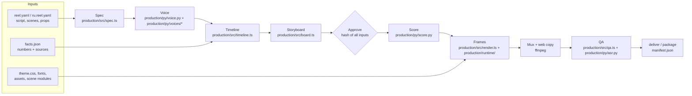
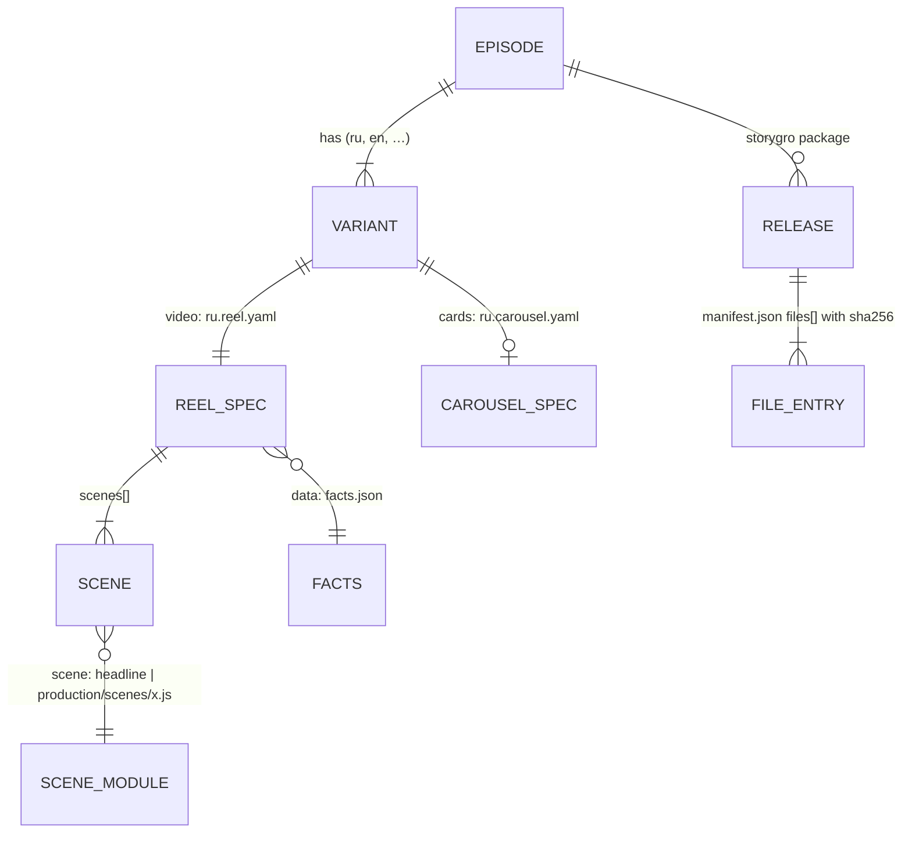
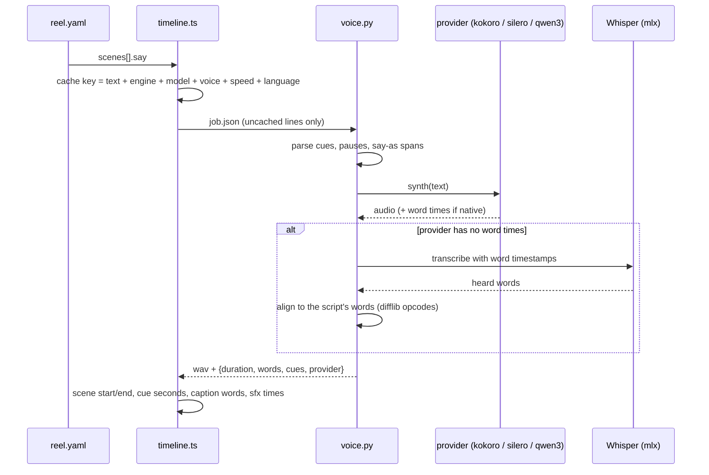

# Architecture

Repository layout update (2026-10-19): reusable engine code now lives under `production/`; authored videos are in `content/videos/`, ideas in `content/ideas/`, and topic research in `content/research/`. `/rc/` still mounts the engine. [ADR 0003](adr/0003-content-production-boundary.md) records the boundary and cache/approval consequences.

> **Audience:** contributors and coding agents working on Storygro · **Status:** v0.2 (October 2026)

Storygro turns a script written as data into checked, publishable media: narrated videos (landscape or 9:16), still cards and carousels, subtitles and a release folder with a manifest. Everything runs locally: a TypeScript CLI drives headless Chrome for pictures and a private Python environment for voices, speech recognition and audio. There is no server, account or database.

This page explains how the pieces fit. For day-to-day use see [workflows](workflows.md); for the script format see [writing a reel](writing-a-reel.md).

## The pipeline at a glance

| Stage | Code | Reads | Writes (in the variant's work folder) |
|---|---|---|---|
| Spec | `production/src/spec.ts` | `*.reel.yaml` | validated spec (zod); rejects duplicate ids and YAML texts split by a comma |
| Voice | `production/py/voice.py`, `production/py/voices/<engine>.py` via `production/src/timeline.ts` | `say` per scene | `voice/<scene>-<hash>.wav` + `.json` (words, cues, provider) |
| Timeline | `production/src/timeline.ts` | spec, voice, data files, safe-area profile | `timeline.json` |
| Storyboard | `production/src/board.ts` | timeline, live player | `board.html`, `board.pdf`, key frames in `board/` |
| Approve | `production/src/board.ts` | every input file | `approved.json` (hash + list of inputs) |
| Score | `production/py/score.py` | timeline, voice WAVs | `voice.wav`, `music.wav`, `sfx.wav`, `mix.wav` (48 kHz, −14 LUFS) |
| Frames | `production/src/render.ts`, `production/src/cdp.ts`, `production/runtime/` | timeline, scenes | silent H.264 stream piped to ffmpeg |
| Mux | `production/src/render.ts` | video + mix | `<name>.mp4` (master), `<name>-web.mp4` (≤ 25 MB) |
| Subtitles | `production/src/subtitles.ts` | timeline words | `<name>.srt`, `<name>.vtt` |
| Stills, cards | `production/src/render.ts` | timeline | `stills/*.png`, letterboxed share cards |
| QA | `production/src/qa.ts`, `production/py/asr.py` | master, mix, live DOM | `QA.md`, `qa.json`, `asr.json` |
| Deliver | `production/src/cli.ts` | work folder | a folder with the complete set + `manifest.json` |
| Package | `production/src/package.ts` | `episode.yaml` and its variants | `.reel/releases/<episode>-<date>/` + `manifest.json` |

The work folder is `.reel/` next to `reel.yaml`, or `.reel/<variant>/` for `<variant>.reel.yaml`. It is ignored by Git and can be deleted at any time; voice lines are cached there by content.

## Data model

Files are the source of truth. Each layer has a single owner:

- **Reel spec** (`reel: 1`, unchanged since the prototype): title, `lang`, `format`, `safe`, `voice`, `music`, `theme`, `overlay`, `captions`, `data`, `stills`, `cards`, `post`, `scenes[]`. Each scene has an `id`, a `scene` module, the narration `say`, optional `caption`, `pad`, `min`, `energy`, `sfx`, `transition` and `props`.
- **Facts** are JSON files bound into props with `xxxFrom: facts.path` (also inside arrays of objects). Numbers shown on screen must exist in a data file; QA reads them back from the rendered DOM.
- **Episode** (`episode: 1`) ties variants, carousels, sources and credits together for packaging. It is deliberately small; brand, series and publication records are planned (see the [implementation plan](planning/IMPLEMENTATION_PLAN.md)).

## Timing model

Durations come from the voice, never from hand-typed seconds.

- A scene lasts `pad[0] + voice + pad[1]` (or `min`). Rewriting a line re-times the whole reel.
- `{#cue}` in `say` marks the start of the next spoken word. Scenes, sound effects, stills and the music drop refer to cues by name, so they stay in sync after any edit.
- `{+1.5}` inserts exact silence inside a line (time to read a table).
- `[written](=spoken)` lets captions show `11%` while the voice says "eleven percent"; `[word](/phonemes/)` is Kokoro's pronunciation markup.
- Without TTS (`--no-voice` or `voice.engine: none`) the timeline estimates about 2.6 words a second so storyboards and carousels can be built before recording.

## Rendering: a deterministic DOM player

The visual layer is plain DOM, SVG and CSS driven by JavaScript — no React, no build step.

- `production/runtime/index.html` + `production/runtime/player.js` load `timeline.json`, mount every scene once, then expose `reel.seek(T)`. Each scene module returns `draw(t)`, a pure function of scene time ([scene contract](scene-contract.md)). Any frame can be drawn in any order, which is what makes stills, storyboards and frame-by-frame capture identical.
- Transitions (`fade`, `push`, `zoom`, `flash`, `cut`) are centred on scene boundaries; both scenes draw during the overlap.
- Captions are drawn by the player from the timeline's words, phrase by phrase with the spoken word highlighted.
- The player injects safe-area tokens (`--rc-safe-*`) from the format's platform profile before the theme loads, so a theme can still override them. `?guides=1` paints the platform UI zones for review.
- **Fail loud:** a scene that throws in `mount` or `draw`, an image that fails to load, a font that fails and a theme that fails are recorded in `window.__reelErrors`. Storyboard, stills and render refuse to continue unless `--allow-errors` is passed.
- `production/src/serve.ts` serves `/rc/` (the framework) and `/spec/` (the reel folder) on loopback; `production/src/cdp.ts` drives headless Chrome over the DevTools protocol with Node's built-in WebSocket (no Puppeteer or Playwright).
- `production/src/render.ts` seeks frame by frame, screenshots JPEG q95, pipes into ffmpeg (`libx264`, CRF 16, `-tune animation`, BT.709 limited range, `yuv420p`, faststart), muxes the mix as AAC 192 kb/s and makes a ≤ 25 MB web copy.

### Scene library

Two families live in `production/scenes/` ([catalog](scenes.md)):

- **Landscape product scenes** from the SlideCraft launch film: `statement`, `logo-reveal`, `chat`, `stack`, `grid`, `spotlight`, `pins`, `end-card`.
- **Cut-paper explainer scenes**, vertical-first: `headline`, `crowd`, `task-stack`, `ladder`, `stat`, `chart`, `steps`, `outro`. They share `production/runtime/paper.js` — paper grain (SVG turbulence), hand-cut edges (seeded `clip-path`), figures, scissors, marker, stamp, self-drawing strokes, text fitting and the safe content box. Colours and fonts come from theme tokens (`--pp-*`).

## Voices

`production/py/voice.py` owns the script syntax (cues, pauses, say-as, stress) and the output contract; providers only turn text into audio. See [voices](voices.md) for choosing and tuning them.

| Engine | Languages | Word timings | Speed | Licence | Notes |
|---|---|---|---|---|---|
| `kokoro` | English (US/UK), Russian via Kokoro-RU | EN native; RU Whisper alignment | native | EN Apache-2.0; RU weights OpenRAIL, code Apache-2.0 | RU uses a separate community checkpoint and RUAccent |
| `qwen3` | ru, en and others | Whisper alignment | tempo change after synthesis | Apache-2.0 (weights), MIT (mlx-audio) | Apple silicon; cloned from one reference clip so every scene has the same voice |
| `silero` | Russian | Whisper alignment | native (SSML rate) | MIT (CIS base models only) | explicit stress control; Cyrillic only |
| `none` | — | estimated | — | — | storyboards and carousels before recording |

Each line's JSON records the provider, model, voice, licence, how timings were found and what share of words aligned exactly.

## Audio

`production/py/score.py` builds everything from numbers — no samples, so the result is free to use: pads, bells, plucked arpeggio and sub bass that follow each scene's `energy`; kick, hats and claps only above 0.55; synthesized sound effects per kind (`whoosh`, `pop`, `tick`, `hit`, `riser`, `scratch`, `type`, `ding`, `chime`, `thud`, `swell`); a music grid anchored so `music.drop` lands on a downbeat; ducking under the voice (up to 78 %); integrated loudness −14 LUFS with a −1.2 dBFS limiter.

## Quality gates

Four gates stand between a script and a release. Each is explained in [quality](quality.md).

1. **Storyboard approval** — `approve` stores a hash of every input: the spec, data files, theme and the fonts it loads, overlay, scene modules (built-in and custom) and files the props point to. Changing any of them resets the approval; `render` refuses an unapproved script (`--force` overrides, `--draft` skips).
2. **Live checks while drawing** — scene, image, font and theme errors stop the render.
3. **QA of the delivered file** — container, codec, size, audio, length, loudness, frame-0 hook, black stretches, scene errors, numbers against the facts, text clear of the platform UI at every cue, and Whisper hearing ≥ 85 % of each scene's words. Results are `pass`, `fail` or `skip`; skipped is never reported as passed.
4. **Release gate** — `deliver` and `package` refuse missing files, failed or stale QA (a master newer than its QA run) and unapproved inputs, and write manifests with SHA-256 checksums, the Storygro commit and the voice providers.

## Technology and libraries

| Layer | What | Why | Licence |
|---|---|---|---|
| CLI, orchestration | Node.js ≥ 22.12, TypeScript 7 (checked with `tsc --noEmit`), run with `tsx` | one language for the CLI and the runtime; no build step | MIT / Apache-2.0 |
| Spec parsing | [`yaml`](https://eemeli.org/yaml/) 2.x, [`zod`](https://zod.dev) 4.x | readable scripts, strict validation with defaults | ISC / MIT |
| Browser | Chrome or Chromium, headless, driven over raw CDP | fonts, SVG, filters and CSS exactly as viewers see them | — |
| Runtime | plain ES modules (`production/runtime/kit.js`, `production/runtime/paper.js`, `production/scenes/*.js`) | `draw(t)` is easy to write for people and models | repository terms |
| Python env | Python 3.12 in `~/.storygro/venv`, created with [uv](https://docs.astral.sh/uv/) | isolated, reproducible, nothing system-wide | — |
| English voice | [Kokoro-82M](https://huggingface.co/hexgrad/Kokoro-82M) (`kokoro`, `misaki`, spaCy `en_core_web_sm`) | local, fast, word timings | Apache-2.0 / MIT |
| Russian and other voices | [Kokoro-RU](https://huggingface.co/zaakirio/kokoro-ru) + RUAccent; [Qwen3-TTS](https://github.com/QwenLM/Qwen3-TTS) via [mlx-audio](https://github.com/Blaizzy/mlx-audio); [Silero](https://github.com/snakers4/silero-models) CIS base + [silero-stress](https://github.com/snakers4/silero-stress) | local providers with separate model terms | Kokoro-RU weights OpenRAIL, code Apache-2.0; Qwen3/Silero Apache-2.0/MIT |
| Speech recognition | [mlx-whisper](https://github.com/ml-explore/mlx-examples) (`whisper-small.en`, `whisper-large-v3-turbo`) | QA and word alignment on Apple silicon | MIT |
| DSP | NumPy, SciPy, soundfile, [pyloudnorm](https://github.com/csteinmetz1/pyloudnorm) | music, effects, ducking, loudness | BSD / MIT |
| Encoding | ffmpeg from [`imageio-ffmpeg`](https://github.com/imageio/imageio-ffmpeg) (static binary in the venv) | no system ffmpeg needed | LGPL/GPL build of ffmpeg, BSD wrapper |
| Example fonts | Unbounded, Golos Text, Caveat; Liberation Sans/Serif | Cyrillic, open licences | OFL 1.1 |

Storygro uses [PolyForm Shield 1.0.0](../LICENSE), with [commercial-use guidance](../COMMERCIAL.md). Third-party components keep their own terms. The [technology/product map](technology.md) includes Kokoro-RU, idea selection and external signal sources.

## Design choices and their trade-offs

- **DOM + CDP.** A scene is a small ES module; any frame is reproducible; there is no scene build step. Capture is sequential (about 15–20 frames per second on an M5 Pro at 1080×1920). An alternative renderer (HyperFrames) is evaluated in [ADR 0001](adr/0001-renderer.md). Software, browser and asset licences remain distinct.
- **Python only where the models are.** Voices, ASR and DSP live in Python; everything else is TypeScript.
- **Voice first, picture second.** The storyboard is approved on real timings; visuals never set the pace.
- **Facts as data.** Scenes may not type numbers; the facts gate reads the DOM to enforce it.
- **Variants as sibling files.** `ru.reel.yaml` and `en.reel.yaml` share scenes, theme and assets but have their own scripts — translations are rewritten, not machine-copied.
- **Compatibility.** `reel: 1`, `reel.yaml`, `.reel/`, cue syntax, the `/rc/` URL, `npm run reel` and the `REELCRAFT_*` environment variables still work.

## Known limits

- ASR and the `qwen3` voice need Apple silicon (MLX); elsewhere QA reports the speech check as *skipped*, and `silero` or `kokoro` remain available.
- Safe-area profiles are estimates from published ad guidance and third-party measurements ([formats](formats.md)); check a real upload on a phone.
- QA finds technical defects. It does not judge whether a claim is true, whether the voice sounds natural or whether the story works — watch and listen before publishing.
- Publishing and analytics are planned, not implemented; `deliver` and `package` write local folders only.
