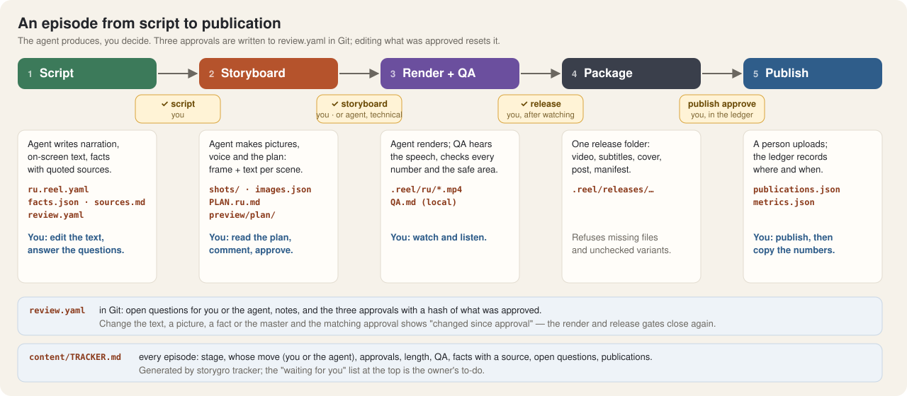

# The content workflow: plan, approvals, tracker

> **Audience:** the owner and the agents who make episodes · **Status:** v0.3 (October 2026)

An episode is many small decisions — a sentence, a number, a picture, a cut. This page explains how they are recorded so that a person can read the whole episode before anything is rendered, change any part of it, and approve it step by step, with every approval in Git. The commands are in [review and approve](../how-to/review-and-approve.md); the larger map is [workflow](workflow.md).

## The folder is the episode

Everything a person needs to judge an episode lives in its folder under `content/videos/<id>/` and is committed:

| File | What it is | Who edits it |
|---|---|---|
| `<lang>.reel.yaml` | the script: narration with cues, on-screen text, shots and their picture prompts, post text | agent writes; owner edits the words |
| `facts.json` | every number and quoted phrase on screen, each with `_source` (quote and reference) | agent; owner checks |
| `sources.md` | primary sources, quotes, caveats, what was left out | agent |
| `images.json` | how each generated picture was made: prompt, seed, model, licence, checksum | `storygro images` |
| `review.yaml` | open questions (for the owner or the agent), notes, and the approvals | owner writes questions and answers; `storygro approve` writes approvals |
| `PLAN.<variant>.md` + `preview/plan/<variant>/*.jpg` | the plan document: every scene with its rendered frame, its pictures, its text and facts | generated by `storygro plan` — never by hand |
| `README.md`, `CREDITS.md`, `episode.yaml` | what the episode is, who made what, its variants and series | agent |

Large media stays out of Git ([media policy](../reference/media-policy.md)): generated pictures (`shots/`), voice, renders and packages are rebuilt from the files above. The plan's preview strips are small JPEGs (each under 300 KiB), so a reviewer sees the episode on GitHub without running anything.

## Three approvals

| Step | What it covers | Who | What resets it |
|---|---|---|---|
| **Script** | title, narration, on-screen text and its positions, post text, facts and `sources.md` | the owner | any change to those words or facts |
| **Storyboard** | everything the render uses: the script plus pictures, scene code, theme, style, fonts | the owner, or the agent *technically* to make a review render | any change to an input of the render |
| **Release** | the rendered master that passed QA | the owner, after watching and listening | a new master or any change to the storyboard |

Each approval stores a hash of what it covers, the time, who approved and their role. `storygro render` needs a storyboard approval in the current state; `approve --step release` needs a master that passed QA. An approval that no longer matches shows as *changed since approval* in the plan and the tracker; nothing silently carries over.

The agent never records an owner approval. Run from a script, `storygro approve` refuses to guess who is approving: an agent passes `--agent` and gets a *technical* approval — enough to render a cut for review, shown with ⚙️, and still waiting for the owner. Technical QA is not editorial approval.

## The plan document

`storygro plan <spec>` voices the script (or estimates timings with `--no-voice`), renders the storyboard and writes `PLAN.<variant>.md`:

- status and whose move it is, length (narrated or estimated), format, voice, series;
- the three approvals and the open questions from `review.yaml`;
- the hook (chosen and alternative variants);
- per scene: time range, a strip with the rendered frame at the key moment followed by the scene's pictures, the narration, what is on screen, each picture's prompt and state, sound cues, the facts it uses and any number that is not in the facts;
- every fact with its source, and the post text.

It plays the role of the per-video plan document from the earlier shorts workflow (hook variants, scenes with voice, on-screen text and the chosen footage), but it is generated from the same files that render the video, so the plan and the video cannot drift apart.

## The tracker

`storygro tracker content/videos --md content/TRACKER.md` writes one table for every episode and variant: stage, whose move it is, the three approvals (✅ owner · ⚙️ agent, technical · ✏️ changed · ⏳ waiting · — not recorded), length, QA, how many facts have a source, open questions and publications from the [ledger](../reference/publication-ledger.md). At the top is the list of everything **waiting for you**.

| Stage | Means | Whose move |
|---|---|---|
| script | the script is not approved by the owner | owner: read the plan, edit, approve |
| storyboard | pictures or storyboard missing, or not approved by the owner | agent until pictures and board exist, then owner |
| release (watch the cut) | the storyboard is approved; the cut is missing or not approved | agent until QA passes, then owner |
| ready | all three approved | owner: publish (manual) |
| published | the ledger records a published post | — |

Approvals and questions come from Git; lengths, QA and renders are the state of the checkout that generated the tracker (the ignored `.reel/` folders). Episodes made before October 2026 have no script record ("—") and keep their old local storyboard approvals until someone approves them again.

## Why this shape

- **One source of truth.** The plan is generated from the reel spec, facts and pictures. Editing the plan by hand would create a second script; editing the spec updates both the plan and the video.
- **Approvals are cheap to give and cheap to lose.** A hash per step means approving takes one command and any later change is visible at once, instead of a review that silently applies to a different video.
- **Questions in the repository, not in a chat.** An open question in `review.yaml` shows in the plan and the tracker until someone answers it, and the answer stays next to the episode.
- **The owner's queue is explicit.** The tracker turns "what is waiting for me?" into a list, across series.

The first episode made this way is [«Не бунт, а открытая дверь»](../../content/videos/agents-open-door/README.md); its [plan](../../content/videos/agents-open-door/PLAN.ru.md) and [review record](../../content/videos/agents-open-door/review.yaml) show the format.
