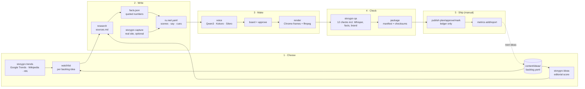
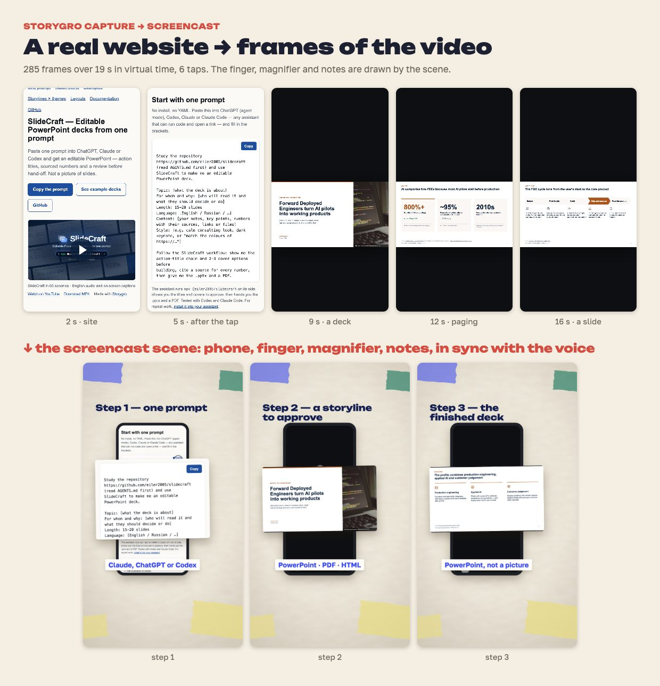
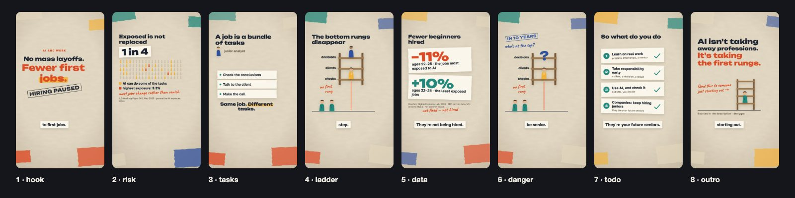

# The pipeline, end to end

> **Audience:** people and agents who want to see how a Storygro video goes from a signal to a release, with the real artefacts of one run. Details live in the linked documents; this page is the map.

Example run: 19 October 2026. A trend scan pointed at AI agents, the agent picked «Где проверять работу ИИ-агента», and the same day it was rendered, checked and packaged. The full story in Russian is in [content/research/ai-agent-checks](../../content/research/ai-agent-checks/README.md).

| Stage | Command | Writes | Doc |
|---|---|---|---|
| Signals | `storygro trends production/trends/sources.yaml --backlog content/ideas/backlog.yaml --md report.md` | JSON + Markdown report (ignored `content/.signals/`) | [choose a topic](../how-to/choose-a-topic.md) |
| Ranking | `storygro ideas content/ideas/backlog.yaml` | score per idea | [choose a topic](../how-to/choose-a-topic.md) |
| Research | agent workflow | `sources.md`, `facts.json`, `content/research/<id>/` | [production/research](../../production/research/WORKFLOW.md) |
| Screen recording | `storygro capture <x.capture.yaml>` | frames + `capture.json` in `.reel/captures/` | [product demo](../how-to/product-demo-from-a-website.md) |
| Narration | `storygro voice <spec>` | voice takes, `timeline.json` | [voices](../reference/voices.md) |
| Storyboard | `storygro board` → `storygro approve` | `board.html/pdf`, `approved.json` (hash of all inputs) | [quality](quality.md) |
| Render | `storygro render <spec>` | master + web MP4, SRT/VTT, stills | [architecture](architecture.md) |
| QA | `storygro qa <spec>` | `QA.md`, `qa.json` | [quality](quality.md) |
| Package | `storygro package <episode.yaml>` | release folder with `manifest.json` | [carousel and release](../how-to/carousel-and-release.md) |
| Series | `storygro series content/series/<id>.yaml` | status table of a rubric | [brand and series](../how-to/brand-and-series.md) |
| Publication | `storygro publish …`, `storygro metrics …` | ledger and metric snapshots, uploads nothing | [publish manually](../how-to/publish-manually.md) |

## 1. Choose: signals are context, the editor decides

`trends` reads three public sources without API keys: the Google Trends daily RSS (RU, US), Wikipedia top pages and per-article pageviews (RU, EN), and Hacker News (top stories and Algolia search counts). Each signal keeps its data date; a source that fails is reported, never replaced by stale data.

Two views come out of it:

- **Matches our focus** — current top items whose title contains one of the focus stems in `sources.yaml` (word-start match, so «ии» does not fire on «России»).
- **Watchlist** — for every backlog idea with a `watch:` block: Wikipedia daily views over the last 28 days against the 56 before, and HN story counts over 30 days against the 30-day average of the 90 before. Low volumes (< 50 views a day, < 10 stories) are shown but not turned into a ratio. The median ratio gives the momentum: ≥ 1.25 rising, ≤ 0.8 falling.

The editorial score (`ideas`) stays separate: six 0–5 ratings with published weights. Attention never enters it, because a popular subject is not evidence for a claim.

## 2. Write: every number has a quote

A content project is one folder, `content/videos/<id>/`: `episode.yaml` (variants, series), `<lang>.reel.yaml` (scenes, narration, cues, post text), `facts.json` (each on-screen number with a `sourceLine`), `sources.md`, `CREDITS.md`, theme and assets. The QA facts gate fails a render that shows a number not present in the data files (or in `allowNumbers` for step numbers and years).

A product demo can use a real website: `storygro capture` drives a phone-sized Chrome in virtual time — goto, scroll, tap, type, key — and stores a JPEG per frame plus the finger path and taps. The `screencast` scene puts it in a phone, draws the finger and tap ripples, and lines up a recorded tap with a narrated word (`align`). A magnifier (`focus`) enlarges the part of the screen the voice talks about.

## 3. Make: storyboard first, then frames

`voice` narrates each scene (Qwen3 with the owner-approved reference, Kokoro EN/RU, or Silero), measures the takes and resolves cues to seconds. `board` renders the key frame of each scene with the script beside it; `approve` stores a hash of every input (spec, scenes, facts, theme, fonts, images, captures). Changing any of them resets the approval.

`render` plays the scenes in headless Chrome: each scene is a pure `draw(t)`, the player seeks to every frame time, waits for images to decode, and takes a screenshot; ffmpeg encodes master and web MP4 and mixes voice, synthesised music and effects to −14 LUFS.

The frames above are from the English [AI and jobs](../../examples/ai-jobs/README.md) cut; the Russian frames of the trend-selected short are in [its folder](../../content/videos/ai-agent-checks/README.md).

## 4. Check: technical QA, then a human

`qa` checks the file (codec, size, audio, length, loudness, black frames, a non-empty first frame), the scenes (runtime errors, missing assets, safe area of the vertical platforms), the numbers (facts gate), the speech (Whisper per scene, ≥ 85 % of the words; number words match digits, «процент» matches %) and, when the spec names a brand profile, the brand rules (avoided phrases, synthetic-voice disclosure in the post). `series` shows every episode of a rubric with its length, approval, QA and latest package.

Skipped is not passed, and a pass is not editorial approval: the owner still watches and listens before anything is published.

## 5. Ship: a release, then a manual publication record

`package` refuses unapproved or failing variants (unless `--allow-incomplete`, which records the problems) and writes a release folder: master and web MP4, SRT/VTT, cover and stills, storyboard PDF, QA report, `post.md`, sources, credits and `manifest.json` with checksums, the engine commit and the voice provenance. Releases are attached to GitHub Releases, never committed.

Publishing stays a person's action. `publish plan → approve → mark published --url …` keeps a ledger of where each release went; `metrics add` stores snapshots with their source and window, and `metrics report` compares them. What performed well goes back into the backlog ratings by hand.

## What is deliberately not automated

- Choosing a topic: trends inform, the editor decides and writes the rationale into the backlog.
- Claims: an agent verifies each number against the primary source; the gate only checks that a number is traceable.
- Uploading to social platforms and reading their analytics: no accounts, no API calls; the ledger records what a person did.
