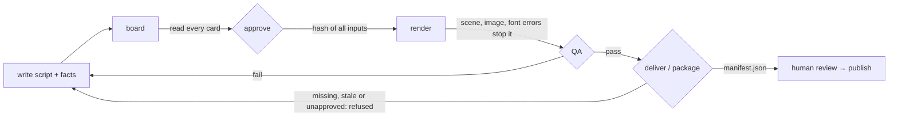

# Quality gates

> **Audience:** anyone producing a release, and agents running the QA loop · **Status:** v0.2

Storygro is built so that a mistake fails early and loudly instead of shipping quietly. There are four gates. Passing all of them means the file is technically sound and traceable — it does **not** mean the claims are true, the voice sounds natural or the story works. A person still watches and listens before anything is published.



## 1. Storyboard approval

`storygro board` draws one key frame per scene from the live player and writes `board.html` / `board.pdf`: time range, narration with cues and pauses, the text a viewer actually sees, sound, the safe-area outline and warnings. `storygro approve` records a SHA-1 over every input in `approved.json`:

| Input | Why it is hashed |
|---|---|
| the spec file | script, props, timing settings |
| data files (`data:`) | the numbers on screen |
| theme and every font or image it loads with `url()` | the look |
| overlay module | chrome drawn over every scene |
| every scene module used, built-in and custom | the code that draws the frames |
| files the props point to (images, references) | real material shown on screen |

Editing any of them resets the approval. `render` refuses an unapproved script; `--draft` renders a half-size preview without the gate and `--force` overrides it (and is visible in the release manifest as an unapproved input).

## 2. Live checks while drawing

The player records, and the storyboard, stills and render refuse:

- a scene module that fails to load or throws in `mount` (it would draw a red error panel);
- an exception in `draw(t)` at any frame;
- an image that fails to load, a font face that fails, a theme stylesheet that fails.

`--allow-errors` renders anyway — use it only to look at a broken frame.

## 3. QA of the delivered file

`render` runs QA at the end of a full render; `storygro qa <spec>` reruns it. Results go to `QA.md` (for people) and `qa.json` (for tools). Every check is `pass`, `fail` or `skip`. The verdict is `fail` if anything failed, `incomplete` if something was skipped, `pass` only if everything passed.

| Check | Passes when | What it does not tell you |
|---|---|---|
| Codec and pixels | H.264, `yuv420p`, BT.709 tagged | — |
| Size | frame size equals the spec | — |
| Audio track | an AAC stream exists | whether it sounds good |
| Length | within 0.5 s of the timeline | — |
| Loudness | integrated within ±1 LU of the target (−14 LUFS), true peak ≤ −0.5 dBFS | the balance of voice and music |
| Frame 0 is a hook | the first frame has real contrast (no fade from black) | whether the hook is interesting |
| No black stretches | no black segment ≥ 0.4 s (ffmpeg `blackdetect`) | — |
| Scenes render without errors | the live player loads every scene, image and font | — |
| Numbers come from the facts | every number visible on screen appears in a data file, `allowNumbers` or the narration | whether the source is right |
| Text clear of platform UI | at every cue, no visible text box reaches into the format's safe-area margins (elements marked `data-rc-safe-ignore` excepted) | how a specific phone renders the app UI |
| Whisper hears the script | per scene, ≥ 85 % of the script's words appear in what Whisper hears on the final mix (voice over music); Unicode-normalised, `ё` = `е`, spoken or written form; hyphenated and split compounds match («ИИ-агент» = «ИИ агент»), a run of number words matches its digits («двадцать четыре» = 24), «процент» matches `%` | naturalness, stress, tone, factual accuracy |
| Brand rules (only when the spec sets `brand:`) | no phrase from the profile's `avoid` list appears in narration, captions, on-screen props or the post, and the post mentions one of the disclosure words for its language | whether the tone fits; a disclaimer that quotes an avoided word needs a narrower phrase |

The speech check uses `whisper-small.en` for English and `whisper-large-v3-turbo` for other languages through mlx-whisper, with word timestamps. ASR segments can cross a scene boundary: individual words are assigned by their own times, rather than sending the entire segment to the scene containing its midpoint. Missing word timestamps fail the check. The overlap threshold stays at 85%.

Where MLX is unavailable the check is **skipped** and the verdict is `incomplete`, never `pass`. A full `render` now exits nonzero for failed or incomplete QA as well as writing the report.

### Fixing common failures

| Symptom | Likely cause | Fix |
|---|---|---|
| `props have keys without values ("…")` | a comma inside an unquoted `{ text: a, b }` | quote the text: `text: 'a, b'` |
| `unknown cue "x"` | a prop or `sfx` names a cue missing from `say` | add `{#x}` to `say` or fix the name |
| `prop xxxFrom: facts.y is not in the data` | wrong path or missing fact | fix `facts.json` |
| Numbers gate lists a value | a number typed into the YAML or a scene | move it into `facts.json` and bind it |
| Safe-area check lists text | text too close to an edge, or a long line | shorten it or let the scene fit it; for motion that legitimately leaves the frame, mark the element `data-rc-safe-ignore` |
| Whisper below 85 % on a scene | mispronounced word, abbreviation read as letters, music too loud | add a `[written](=spoken)` hint, rephrase, or lower `music.gain`; listen to the line |
| `only N% of the words aligned` while voicing | the TTS skipped or invented words | listen to that line and re-synthesise or rephrase |
| Approval reset after a small edit | any hashed input changed (see table above) | re-read the storyboard, approve again, re-render |

## 4. Release gate

`storygro deliver <spec> [dir]` copies one variant's complete set — master and web MP4, SRT and VTT, storyboard PDF, QA report, stills and cards — and writes `manifest.json`. It refuses when a file is missing, when QA failed or is stale (the master is newer than the last QA run) unless `--partial` or `--force` is given, and records any problem it was told to ignore.

`storygro package <episode.yaml> [dir]` does the same for every variant of an episode plus their carousels, post texts, sources and credits, and additionally refuses inputs that are not approved in their current state. Its manifest:

```json
{
  "release": "ai-jobs-2026-10-19-1a2b3c4d",
  "episode": { "id": "ai-jobs", "title": "…", "series": "explainers" },
  "engine": { "name": "storygro", "version": "0.2.0", "commit": "…", "dirty": false },
  "status": "ready-for-review",
  "published": false,
  "variants": [{ "id": "ru", "lang": "ru", "format": "1080×1920@30", "duration": 83.95,
                 "inputsHash": "…", "approved": { "approved": true }, "qa": { "verdict": "pass" },
                 "voice": [{ "engine": "qwen3", "model": "…", "timing": "whisper-aligned" }] }],
  "files": [{ "path": "ru/ai-jobs-ru.mp4", "bytes": 0, "sha256": "…" }]
}
```

`published: false` is literal: nothing in Storygro posts to a social account. Publishing is a separate, explicit step to a named account (planned).

## The human review that no gate replaces

Before publishing a release, on a phone, with sound:

1. Watch every variant start to finish. Is the first second worth stopping for? Is anything unreadable or covered by the app?
2. Listen for wrong stress, swallowed abbreviations, odd pauses and music that fights the voice.
3. Read every on-screen number against `sources.md`; check that the caveats travel with the numbers (the post text, the source line).
4. Read the post text and the carousel as a viewer who never saw the video.
5. Check the credits and the disclosure of synthetic voices.
