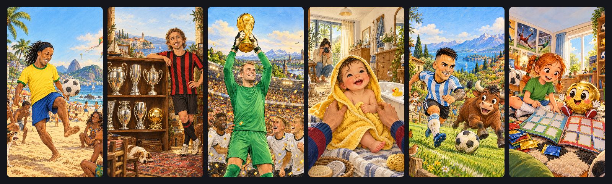

# Video formats

> **Audience:** whoever decides what kind of video to make — the owner, or an agent proposing a format · **Status:** October 2026, seven formats made at least once

Storygro makes several kinds of video from the same engine: a script and a facts file, a voice that sets the timing, scenes drawn as a function of time, the same approvals and the same QA. What changes between formats is the look, the length, where the pictures come from and what to check by eye. This page is the map; [how a video is made](workflow.md#from-an-idea-to-a-video-on-the-phone) is the recipe they share.

## At a glance

| Format | Best for | Length | Style · scenes | Pictures | Example |
|---|---|---|---|---|---|
| [Business explainer](#business-explainer) | one mechanism and two or three sourced numbers, for managers and specialists | 45–90 s | `cut-paper` · headline, crowd, task-stack, ladder, stat, chart, steps, outro | drawn by code | [AI and jobs](../../examples/ai-jobs/README.md), [ai-agent-checks](../../content/videos/ai-agent-checks/README.md) |
| [News collage](#news-collage) | a story from a post or an article, with people and documents | 60–95 s | `editorial-collage` · collage | cut-outs you supply | [micro1-work-data](../../content/videos/micro1-work-data/README.md) |
| [Product demo](#product-demo) | showing a real product working | 30–60 s | any · screencast + headline | a recorded website | [slidecraft-demo](../../content/videos/slidecraft-demo/README.md) |
| [Kinetic short](#kinetic-short) | a thesis, a quote, a mechanism in steps; Reels, Shorts, Telegram | 15–45 s | `kinetic-type` · kinetic, timeline, process, scale | drawn by code | [agent-motion-studio](../../content/videos/agent-motion-studio/README.md) |
| [Cartoon explainer](#cartoon-explainer) | a story about people and decisions, with a recurring cast | 1–15 min | `cartoon` · illustration | local model (mflux + Z-Image-Turbo) | [ai-buys-work-knowledge](../../content/videos/ai-buys-work-knowledge/README.md), [agents-open-door](../../content/videos/agents-open-door/README.md) |
| [High-quality cartoon](#high-quality-cartoon) | when the picture matters: recognisable real people, drawing-like detail | 1–2.5 min | `cartoon` + `images.provider: codex` · illustration, kinetic chapter cards | GPT Image through the Codex CLI | [football-stars-kids](../../content/videos/football-stars-kids/README.md), [matvey-mimo-vorot](../../content/videos/matvey-mimo-vorot/README.md) |
| [Children's list cartoon](#childrens-list-cartoon) | several real people for children, one cheerful fact each | ~2 min | the high-quality cartoon + an album overlay | GPT Image | [football-stars-kids](../../content/videos/football-stars-kids/README.md), [ballon-dor-kids](../../content/videos/ballon-dor-kids/README.md) |

## Choosing

1. A real product to show? — a **product demo**, often inside a business explainer.
2. Real people a viewer must recognise, or a picture that has to look hand-drawn and rich? — a **high-quality cartoon** (for children, the **list cartoon**).
3. A mechanism with numbers for adults? — a **business explainer**; if the story comes with documents and faces from a news item, a **news collage**.
4. One idea in under 45 seconds, or a quote? — a **kinetic short**.
5. A story with characters and decisions, longer than a minute? — a **cartoon explainer**; move it to GPT Image when the local pictures are too plain.

Every format keeps the same rules: every number on screen comes from `facts.json` with a source; the voice is recorded before the pictures are timed; the owner approves the script, the storyboard and the release; QA checks the file; a person watches and listens before anything is published.

## Business explainer

Paper cards, figures and marker strokes drawn by code; one visual mechanism per scene (a crowd where one in four is highlighted, a career ladder losing its bottom rungs). Nothing to generate, so it is fast and fully reproducible. Structure from the style: hook → mechanism → evidence → action → close. [Use a style](../how-to/use-a-style.md) · [tutorial](../tutorials/explainer-from-a-topic.md)

## News collage

Graph paper, photo or illustration cut-outs, torn labels, panels and arrows; the same objects return across scenes. The cut-outs are supplied (and licensed) by you; headlines and numbers are layers bound to the facts.

## Product demo

A scripted session on the real website is recorded in a phone frame (`storygro capture`) and played by the `screencast` scene with a finger, taps and a magnifier, each tap on a narrated word. [Product demo from a website](../how-to/product-demo-from-a-website.md)

## Kinetic short

  

Words land on springs as the narrator says them, an accent bar travels between lines with the beat, and diagrams are drawn in the same type: a timeline, an isometric process with a travelling token, sizes compared. Motion blur from sub-frames. Its chapter cards also work inside other formats. [Style](../../production/styles/kinetic-type/README.md)

## Cartoon explainer

Generated comic pictures with a recurring cast, a new one every few seconds with a slow camera move, burned-in captions, headlines and numbers drawn on top. Local pictures (about 25 s each on an M5 Pro, reproducible by seed, no account). They are clean but plain: faces are generic, and the model may draw brand stripes and crests it was told not to. [Cartoon tutorial](../tutorials/cartoon-explainer.md)

## High-quality cartoon

The same `cartoon` style with `images: { provider: codex, model: gpt-6-astra }`: pictures that look drawn (ink, coloured pencil, watercolour), with rich backgrounds and recognisable real people. Chosen after a side-by-side test on the same prompts ([comparison](../../content/videos/football-stars-kids/README.md#pictures)).

What it costs and what to watch:

- online, through a signed-in Codex CLI; about 40 s a picture, five per batch, three batches at once (25 pictures in about ten minutes); not reproducible by seed — `images.json` keeps prompt, model and checksum;
- the tool may decline a prompt (a real person with a baby); the others are kept and the missing one is named — rewrite that shot;
- name the person and one or two visible traits in every prompt; plain kits, no crests or logos; say in the post that the pictures are friendly caricatures;
- detailed pictures need the overlays placed per shot — headline as one surname, number badge away from the face (`badge.y`, `side`), labels low — and every face checked before rendering;
- the master file is large (a two-minute cartoon was 172 MB); send the web copy (≤ 25 MB).

A fairy-tale story with an original recurring cast works the same way: [«Мимо ворот»](../../content/videos/matvey-mimo-vorot/README.md) (episode 1 of the owner's series about a family of animals) describes each character once in `images.cast` and names them as `@matvey`, `@sofia` in the shot prompts — once per prompt, later by plain name — so 26 pictures keep the same faces and clothes. Name labels sit low (`y: 0.7`) above the captions, where the pictures rarely put a face.

## Children's list cartoon

The high-quality cartoon told as a collection: two hosts promise "fourteen stars and a fun fact about each", chapter cards group the list, one card per person with one checked fact a child can repeat, a progress rail of dots fills up, and the close asks a question to talk over with a parent. [How to make one](../how-to/kids-list-cartoon.md) · series [kids-football](../../content/series/kids-football.yaml)

## What the formats share

The voice (Qwen3 for Russian by default, with the pronunciation dictionary for names), synthesized music and effects, captions, safe areas for Reels and Shorts, the facts gate, the storyboard approval, QA (14 checks, including text inside its box and dictionary words keeping their stress) and the release package. The [registry](../reference/registry.md) lists every reel and the scenes each one uses; the [toolkit](../reference/toolkit.md) lists every method and tool by stage.
