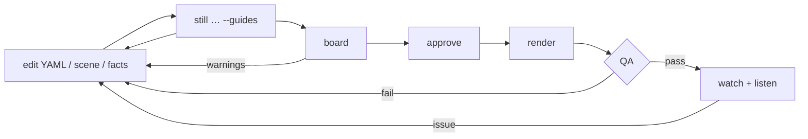

# Workflow

> **Audience:** people and AI agents producing content with Storygro · **Status:** v0.2 (October 2026)

Storygro is a toolkit an agent operates for you: you describe the outcome in plain language, the agent writes files and runs commands, and every step leaves an artifact you can check. This page is the map of the content workflow; [the pipeline](pipeline.md) walks the same path with screenshots of one real run, and [how we work](how-we-work.md) covers the project process around it — who decides what, which model does which job, and how changes reach Git.

## The content cycle

The three approvals are recorded in each episode's `review.yaml` in Git; the plan and the tracker show what is waiting for whom — see [the content workflow](content-workflow.md) and [review and approve](../how-to/review-and-approve.md). Everything in the diagram is implemented locally. Uploading is done by a person; `publish` records it and `metrics` stores the numbers they copy from the platform. Platform APIs (upload, analytics) are planned and need the owner's accounts ([implementation plan](../planning/IMPLEMENTATION_PLAN.md)).

## From an idea to a video on the phone

The recipe every format shares, as it was run for the October 2026 episodes. [Video formats](video-formats.md) says which look to pick; the commands are `npm run storygro -- <command>`.

**Instagram Reels:** use the owner-approved [full-frame standard](../adr/0007-instagram-reels.md) throughout this workflow. Start with `new … --target instagram-reels`; compose the background edge to edge and keep important text inside `safe: reels`. The [Reels recipe](../how-to/instagram-without-cropping.md) covers face/overlay collisions, caption review and retaining Original / 9:16 during upload. Safe margins must not turn into visible padding around a shrunken edit.

| # | Step | Who | Commands | Move on when |
|---|---|---|---|---|
| 1 | **Brief:** topic, audience, language, length, format | owner | — | the folder name, the target length and the format are agreed |
| 2 | **Research:** two candidate facts per point, each with a URL and a verbatim quote | a helper on a mid-size model collects; a small model re-reads every quote; the main agent decides | `trends`, `ideas` | `sources.md` holds the quotes, `facts.json` every on-screen number with `_source`; our own arithmetic is marked as ours |
| 3 | **Script** in the style's structure, numbers bound to facts | main agent | `new <folder> --style <id>` | the owner has approved the script |
| 4 | **Names and stress** (Russian) | main agent | `stress <spec> --lookup --write` | the dictionary diff is read; every name is checked or marked by hand |
| 5 | **Voice** | voice model | `voice <spec>` | the total is within the target; a scene that reads too fast or too slow is rewritten, not stretched |
| 6 | **Pictures** (illustrated formats) | image model | `images <spec> --dry-run`, then `images <spec>` | on a contact sheet: the people are recognisable, no text or logos, every shot present (rewrite a declined one) |
| 7 | **Layout** over the pictures | main agent | `still <spec> <scene@cue> --guides` | a still a second after every cue: no face under an overlay, text inside its box and the safe area |
| 8 | **Plan and storyboard** | main agent prepares; owner approves | `plan`, `board`, `approve --step storyboard --agent` | questions for the owner are in `review.yaml` |
| 9 | **Render and QA** | no model | `render <spec>` (`qa <spec>` to re-check) | `QA.md` has no failure; fix the cause, not the frame |
| 10 | **Watch and listen** | main agent, then the owner | frames sampled from the MP4; the web copy (≤ 25 MB) sent to the owner's phone | the owner's verdict; a fix goes back to step 3, 4 or 7 |
| 11 | **Release** | owner approves; agent packages; a person uploads | `approve --step release`, `package`, `publish` | the manifest and the ledger record |
| 12 | **Repository** | main agent | `plan`, `tracker content/videos --md content/TRACKER.md`, `npm run docs:registry`, `npm run check` | committed by explicit paths, without media |

**Length budget.** The Russian Qwen3 narrator at `speed: 1.12` came out at about two words a second over the whole video, pauses and the music intro included (240 words in 117.5 s, 186 in 89.1 s). Write about 120 words a minute and let `voice` measure the real length — a draft estimate is not narration timing.

Since 25 October 2026, new Russian scaffolds use the owner's selected OmniVoice B at `speed: 0.90`; Qwen3 ranks second and OmniVoice A third. Existing episodes keep their settings. The first complete B episode, [Spartak–CSKA](../../content/videos/spartak-cska-derby/REVIEW.md), has 264 timeline words in 126.09 seconds including pauses. Measure actual narration and shorten the script when needed; preserve the selected tempo. See [voices](../reference/voices.md) for setup, reference restoration and separate CC-BY-NC model terms.

**Time on one machine** (an M5 Pro, October 2026):

| Stage | Time |
|---|---|
| Local picture (mflux + Z-Image-Turbo) | about 25 s each |
| GPT Image through the Codex CLI | about 40 s each; five per batch, three batches at once: 25 pictures in about 10 min |
| Voice for a two-minute script | 1–2 min; cached lines are not re-synthesised |
| Render of a two-minute vertical cartoon | 4–5 min plus QA; motion blur `N` multiplies the capture time by `N` |

**What only a person checks.** QA proves the file is sound — loudness, safe areas, text in its box, the numbers, the speech, the stressed names. It does not say that a face looks like the person, that a fact is fun for a child, or that the voice sounds right. That is step 10, and nothing is published before it.

## Workflows that work today

| You want to… | Guide | Commands |
|---|---|---|
| Decide what kind of video to make | [Video formats](video-formats.md) | — |
| Pick a topic worth a video | [Choose a topic](../how-to/choose-a-topic.md) | `trends`, `ideas` |
| Make an explainer from a topic, end to end | [Tutorial](../tutorials/explainer-from-a-topic.md) | `voice`, `still`, `board`, `approve`, `render` |
| Write or edit the script | [Write a script](../how-to/write-a-script.md) | — |
| Improve Reels story and compare published outcomes | [Retention recipe and direction worksheet](../how-to/reels-retention.md) | `hooks:`, cues, `metrics` |
| Review an episode, answer questions, approve step by step | [Review and approve](../how-to/review-and-approve.md) | `plan`, `approve --step`, `tracker` |
| Ship Russian and English cuts | [Language variants](../how-to/language-variants.md) | `voice` per spec |
| Give the narrator a voice | [Design a voice](../how-to/design-a-voice.md) | `design_voice.py` |
| Demo a product on its real website | [Product demo](../how-to/product-demo-from-a-website.md) | `capture` |
| Make a children's cartoon about real people, with recognisable pictures | [Children's list cartoon](../how-to/kids-list-cartoon.md) | `images` (`provider: codex`), `still --guides` |
| Get Russian names stressed right | [Voices: pronunciation](../reference/voices.md#pronunciation-notes-russian) | `stress --lookup --write` |
| Add a visual mechanism | [Add a scene](../how-to/add-a-scene.md) | `still --guides` |
| Make cards and a release folder | [Carousel and release](../how-to/carousel-and-release.md) | `carousel`, `package`, `deliver` |
| Keep a rubric consistent | [Brand and series](../how-to/brand-and-series.md) | `series` |
| Publish and track numbers | [Publish manually](../how-to/publish-manually.md) | `publish`, `metrics` |

Every command and option: [CLI reference](../reference/cli.md).

## The edit loop

Changing the script re-times everything from the voice; changing scene code, theme, facts or assets resets the approval. Voice lines are cached, so re-rendering after a visual change does not re-synthesise. Fix the cause in a reusable module, not one video by its title or scene number.

## Roles for agents

[`agents/`](../../agents) describes three responsibilities — **director** (story, script, direction, review of stills and storyboard), **scene-builder** (scene modules against the direction and contract) and **qa** (gates and the fix loop). They are a division of responsibility, not an instruction to run several agents; one agent can play all three in turn. [How we work](how-we-work.md#people-agents-and-models) says which model fits which role.
