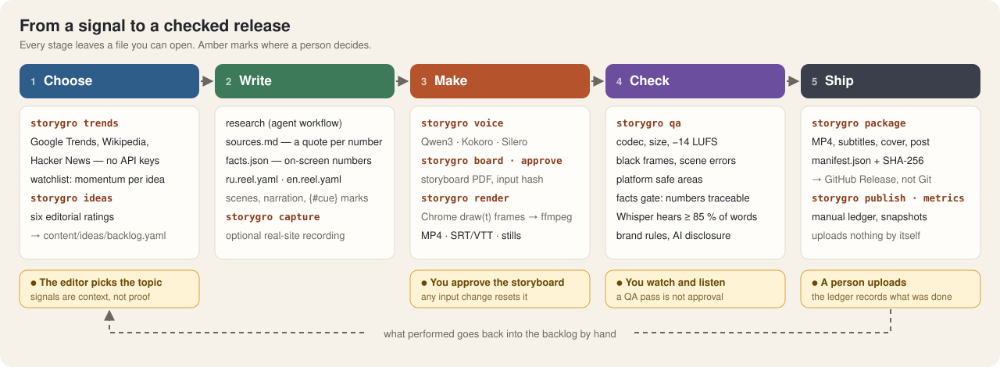
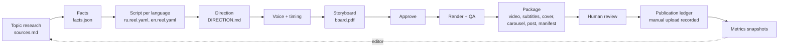
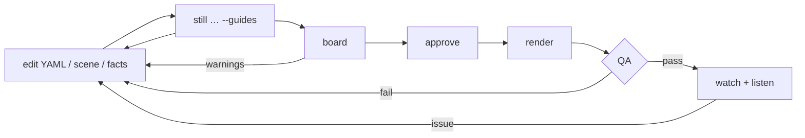

# Workflow

> **Audience:** people and AI agents producing content with Storygro · **Status:** v0.2 (October 2026)

Storygro is a toolkit an agent operates for you: you describe the outcome in plain language, the agent writes files and runs commands, and every step leaves an artifact you can check. This page is the map of the content workflow; [the pipeline](pipeline.md) walks the same path with screenshots of one real run, and [how we work](how-we-work.md) covers the project process around it — who decides what, which model does which job, and how changes reach Git.

## The content cycle

Everything in the diagram is implemented locally. Uploading is done by a person; `publish` records it and `metrics` stores the numbers they copy from the platform. Platform APIs (upload, analytics) are planned and need the owner's accounts ([implementation plan](../planning/IMPLEMENTATION_PLAN.md)).

## Workflows that work today

| You want to… | Guide | Commands |
|---|---|---|
| Pick a topic worth a video | [Choose a topic](../how-to/choose-a-topic.md) | `trends`, `ideas` |
| Make an explainer from a topic, end to end | [Tutorial](../tutorials/explainer-from-a-topic.md) | `voice`, `still`, `board`, `approve`, `render` |
| Write or edit the script | [Write a script](../how-to/write-a-script.md) | — |
| Ship Russian and English cuts | [Language variants](../how-to/language-variants.md) | `voice` per spec |
| Give the narrator a voice | [Design a voice](../how-to/design-a-voice.md) | `design_voice.py` |
| Demo a product on its real website | [Product demo](../how-to/product-demo-from-a-website.md) | `capture` |
| Add a visual mechanism | [Add a scene](../how-to/add-a-scene.md) | `still --guides` |
| Make cards and a release folder | [Carousel and release](../how-to/carousel-and-release.md) | `carousel`, `package`, `deliver` |
| Keep a rubric consistent | [Brand and series](../how-to/brand-and-series.md) | `series` |
| Publish and track numbers | [Publish manually](../how-to/publish-manually.md) | `publish`, `metrics` |

Every command and option: [CLI reference](../reference/cli.md).

## The edit loop

Changing the script re-times everything from the voice; changing scene code, theme, facts or assets resets the approval. Voice lines are cached, so re-rendering after a visual change does not re-synthesise. Fix the cause in a reusable module, not one video by its title or scene number.

## Roles for agents

[`agents/`](../../agents) describes three responsibilities — **director** (story, script, direction, review of stills and storyboard), **scene-builder** (scene modules against the direction and contract) and **qa** (gates and the fix loop). They are a division of responsibility, not an instruction to run several agents; one agent can play all three in turn. [How we work](how-we-work.md#people-agents-and-models) says which model fits which role.
