# What Storygro can do

> Capabilities that work today, by the job you want done, with pictures from real runs. Planned features are listed separately at the end. Every picture is a frame Storygro rendered.

## Pick a topic with evidence, not hype

`storygro trends` reads Google Trends RSS, Wikipedia pageviews and Hacker News without API keys, matches them against your focus terms and shows momentum for every idea in the backlog. The research part adds new GitHub repositories, Hugging Face papers, Russian Telegram channels, RSS feeds and X digests imported from Grok, sets loud headlines aside and orders a short list of picks, with links seen in several sources first. `storygro ideas` ranks the backlog by six explicit editorial ratings — attention never enters the score.


→ [Choose a topic](how-to/choose-a-topic.md)

## Study a reference video

`storygro transcript` turns a transcript pasted from a video page, a media file or a direct media URL into timed segments, Markdown and SRT, with the pace: words per minute for every minute, sentence length, every question and every number with its time. Frames show the cut rate and the visual language; the analysis goes into `content/research/references/`.

```text
✔ pasted: 18:26, 2377 words, 129 words/min, 214 sentences, 3 questions, 95 numbers
```

→ [Transcribe and analyse a reference](how-to/transcribe-a-reference.md) · [the analysis behind the cartoon style](../content/research/references/cYlePq4WQsk.md)

## Styles you can reuse

A style is a way of making videos that many episodes share: defaults, theme, scenes, pacing, script structure and, for illustrated styles, the picture model and a recurring cast. `storygro new <folder> --style cartoon` starts a project in it.

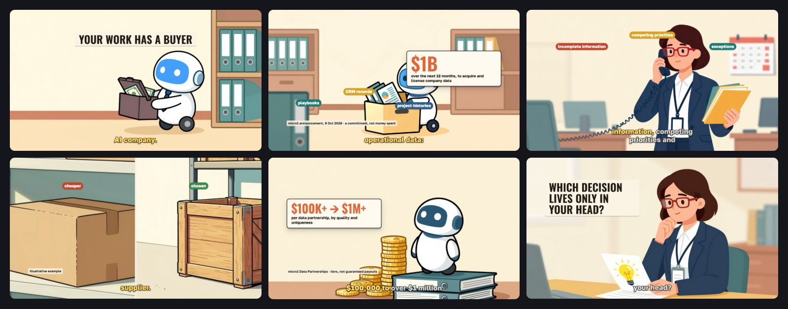

| Style | For | Pictures |
|---|---|---|
| `cartoon` | narrated explainers told through comic illustrations with a recurring cast, 16:9 by default | generated locally (mflux, Z-Image-Turbo) and recorded in `images.json` |
| `cut-paper` | vertical explainers on paper | drawn by code |
| `editorial-collage` | vertical explainers on graph paper with cut-outs | cut-outs you supply |

→ [Use a style](how-to/use-a-style.md) · [Cartoon tutorial](tutorials/cartoon-explainer.md) · [Styles reference](reference/styles.md)

## Write a video as data

A video is a YAML script: scenes, narration with `{#cue}` marks where pictures react, props, a post text. Numbers live in `facts.json` with a quoted source; scenes bind them and never type them.

```yaml
- id: data
  scene: stat
  say: 'В тесте тау-бенч лучший агент [2024](=двадцать четвёртого) года с первой попытки решал [61%](=шестьдесят один процент) задач. {#eight}Восемь раз подряд — меньше четверти.'
  sfx: [{ at: eight, kind: hit, gain: 0.5 }]
  props:
    items:
      - { valueFrom: facts.tau.pass1, labelFrom: facts.tau.pass1Label, tone: blue, at: 0.6 }
      - { valueFrom: facts.tau.pass8, labelFrom: facts.tau.pass8Label, tone: red, at: eight }
    sourceFrom: facts.tau.sourceLine
```

Durations come from the voice: rewrite a line and the whole video re-times; cues keep pictures and sound effects on their words. `[written](=spoken)` lets captions show `61%` while the narrator says the words. Russian and English cuts are sibling files that share facts, theme and assets.

→ [Write a script](how-to/write-a-script.md) · [Language variants](how-to/language-variants.md)

## Twenty-three animated scenes

Each scene is a small JavaScript module whose frame is a pure function of time, so any moment renders identically in stills, storyboards and the final video.

**Cut-paper explainers, vertical first** — paper grain, hand-cut edges, figures, marker strokes; colours and fonts from the theme:

<table>
  <tr>
    <td align="center" valign="top"><br><sub><b>headline</b><br>title, kicker, stamp</sub></td>
    <td align="center" valign="top"><br><sub><b>crowd</b><br>“1 in N” people</sub></td>
    <td align="center" valign="top"><br><sub><b>task-stack</b><br>a job as tasks</sub></td>
    <td align="center" valign="top"><br><sub><b>ladder</b><br>career rungs</sub></td>
    <td align="center" valign="top"><br><sub><b>stat</b><br>numbers + source</sub></td>
  </tr>
  <tr>
    <td align="center" valign="top"><br><sub><b>chart</b><br>bars and lines</sub></td>
    <td align="center" valign="top"><br><sub><b>steps</b><br>what to do</sub></td>
    <td align="center" valign="top"><br><sub><b>outro</b><br>the takeaway</sub></td>
    <td align="center" valign="top"><br><sub><b>collage</b><br>editorial collage</sub></td>
    <td align="center" valign="top"><br><sub><b>screencast</b><br>real screen recording</sub></td>
  </tr>
</table>

**Illustrated**, for the `cartoon` style — generated pictures that change on cues with a slow camera move, and overlays drawn by the page:

<p>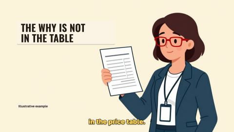<br><sub><b>illustration</b> · shots, camera moves, headline band, number badge, labels, source line</sub></p>

**Kinetic type**, for the `kinetic-type` style — words that land as they are spoken, and diagrams in the same type, all on springs and the music's beat:

<table>
  <tr>
    <td align="center" valign="top">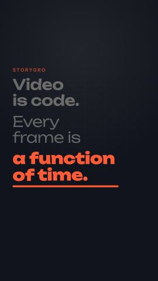<br><sub><b>kinetic</b><br>words on the voice</sub></td>
    <td align="center" valign="top">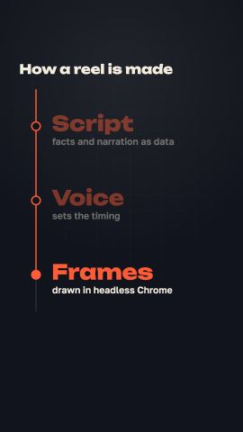<br><sub><b>timeline</b><br>an axis, node by node</sub></td>
    <td align="center" valign="top">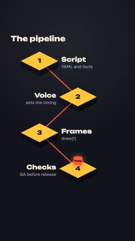<br><sub><b>process</b><br>isometric flow</sub></td>
    <td align="center" valign="top">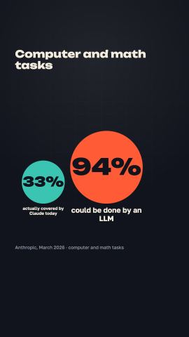<br><sub><b>scale</b><br>sizes compared</sub></td>
  </tr>
</table>

**Landscape product scenes**, from the SlideCraft launch film:

<table>
  <tr>
    <td align="center" valign="top">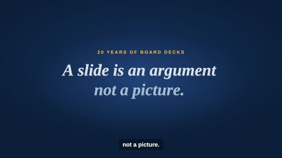<br><sub><b>statement</b></sub></td>
    <td align="center" valign="top">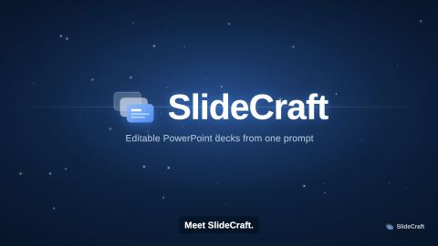<br><sub><b>logo-reveal</b></sub></td>
    <td align="center" valign="top">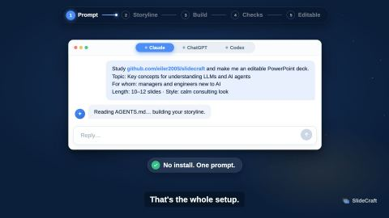<br><sub><b>chat</b></sub></td>
    <td align="center" valign="top">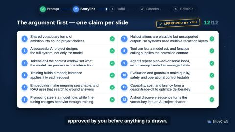<br><sub><b>stack</b></sub></td>
  </tr>
  <tr>
    <td align="center" valign="top">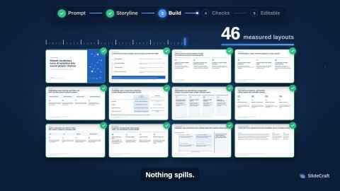<br><sub><b>grid</b></sub></td>
    <td align="center" valign="top">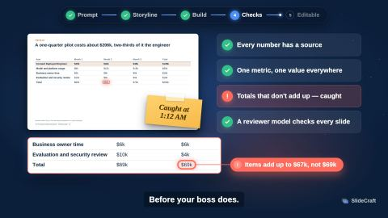<br><sub><b>spotlight</b></sub></td>
    <td align="center" valign="top">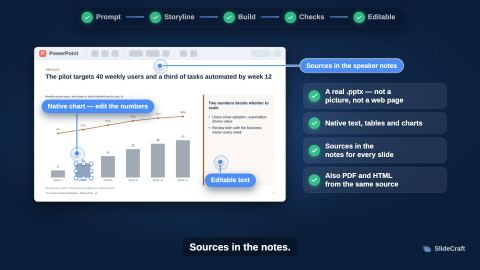<br><sub><b>pins</b></sub></td>
    <td align="center" valign="top">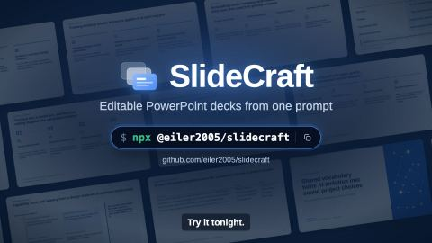<br><sub><b>end-card</b></sub></td>
  </tr>
</table>

→ [Scene catalog with every prop](reference/scenes.md) · [Add a scene](how-to/add-a-scene.md) · [Scene contract](reference/scene-contract.md)

## Motion that reads as designed

Scenes move on closed-form springs instead of linear tweens, can follow the music's beat grid (`ctx.beats`) and snap sound effects to it, and a reel can turn on motion blur from sub-frames (`format.blur`). Every frame is still a pure function of time.

→ [Scene contract: motion](reference/scene-contract.md#motion) · [formats: motion blur](reference/formats.md#motion-blur)

## Pictures of people children recognise

A reel can switch its pictures to GPT Image through the Codex CLI (`images.provider: codex`): recognisable, drawing-like caricatures with rich backgrounds, in batches, cropped to the frame and recorded in `images.json`. Overlays are placed per shot so no face is covered.

→ [Children's list cartoon](how-to/kids-list-cartoon.md) · [styles reference](reference/styles.md#in-the-reel)

## Find what exists

The [registry](reference/registry.md) lists every reel with its scene sequence, every style's story structure and every scene with the reels that use it; the [toolkit](reference/toolkit.md) lists every method and tool by stage. Both are generated and tested.

## Demo a product on its real website

`storygro capture` drives a phone-sized Chrome through a scripted session — go to, scroll, tap, type — in virtual time, and records every frame with the finger path. The `screencast` scene puts it in a phone, lines a recorded tap up with a narrated word and adds a magnifier where the voice points.


→ [Product demo from a website](how-to/product-demo-from-a-website.md)

## Local narration in Russian and English

| Engine | Languages | Runs on |
|---|---|---|
| Qwen3-TTS (mlx-audio) | Russian, English and more; one designed reference voice per language | Apple silicon |
| Kokoro-82M / Kokoro-RU + RUAccent | English; Russian | everywhere |
| Silero CIS | Russian, with explicit stress | everywhere |

Russian names and hard words live in one pronunciation dictionary (`production/voices/lexicon-ru.yaml`): the plan flags names nobody checked, `storygro stress --lookup` finds the stress of the exact word form in ru.wikipedia (searching the full name first — Лу́ка Модрич) and ru.wiktionary, and a phoneme model listens to checked words, speaks a line again when one comes out wrong and checks the final track in QA. Qwen3 gets dictionary marks only where a bench proved they help; it reads more cleanly without them.

Word timings come from the engine or from Whisper alignment. Music and sound effects are synthesised from numbers — no samples, nothing to license — and the mix is normalised to −14 LUFS with ducking under the voice. Each line records its provider, model and licence.

→ [Voices](reference/voices.md) · [Design a voice](how-to/design-a-voice.md)

## Every platform's shape

Native 9:16, 4:5, 1:1 and 16:9 presets; safe-area profiles for Reels and Shorts (organic and ads) with `--guides` overlays; burned-in captions phrase by phrase with the spoken word highlighted; SRT/VTT; covers, stills and carousels at 1080×1350.

→ [Formats, safe areas and captions](reference/formats.md) · [Carousel and release](how-to/carousel-and-release.md)

## A storyboard you approve before rendering

`storygro board` renders the key frame of every scene beside its narration, on-screen text, sound and warnings. `approve` stores a hash of every input — script, facts, theme, fonts, scene code, images, captures — and any later change resets it; `render` refuses an unapproved script.


## Technical QA on the finished file

Codec, dimensions, audio, length, −14 LUFS loudness, black frames, a non-empty first frame, scene and asset errors, text clear of the platform UI at every cue, no text sticking out of its card, band or label, every on-screen number traceable to a data file, Whisper hearing at least 85 % of each scene's words (names ASR spells its own way still count), checked dictionary words keeping their stress, and brand rules. Skipped is never reported as passed.


→ [Quality gates](explanation/quality.md)

## Releases you can trace

`storygro package` collects every variant — master and web MP4, subtitles, cover, stills, storyboard PDF, QA report, post text, carousel — with `manifest.json`: SHA-256 of every file, the engine commit, the voice providers and the QA verdicts. It refuses unapproved or failing variants. Releases go to GitHub Releases, never into Git.

`publish` and `metrics` keep a manual ledger: where each release was posted, by which account, with which link, and metric snapshots with their source and window. A brand profile checks avoided phrases and the synthetic-voice disclosure; a series shows every episode's status.

→ [Publish manually](how-to/publish-manually.md) · [Brand and series](how-to/brand-and-series.md)

## Planned, not implemented

- Uploading to Instagram, YouTube or TikTok through their APIs, and reading platform analytics. Today a person uploads and the ledger records it.
- A hosted service or accounts. Storygro runs on your machine.
- Unattended fact-checking: an agent verifies numbers against primary sources and a person accepts them; the facts gate only proves traceability.

See the [roadmap](../ROADMAP.md).
