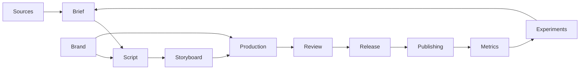

# Storygro — план реализации

Дата: 18 октября 2026 года. Решения владельца — в [README](README.md), основания выбора — в [исследовании](RESEARCH.md). Название и позиционирование уже выбраны. Этот план описывает целевой продукт; фактическое состояние переноса и проверки — в [MIGRATION](MIGRATION.md).

## Результат, к которому идём

Помощник для ИИ-агента, который превращает тему и источники в проверенный пакет материалов для Instagram и YouTube Shorts на русском и английском. Затем публикует подготовленные выпуски и помогает выбирать следующий контент по результатам. Первые пользователи — владелец, его продукты и личный бренд.

Первый законченный результат: один объясняющий вертикальный ролик, воспроизводимый из файлов проекта, с понятным гайдом. Не откладывать этот результат до готовности всей платформы.

## Статус на 19 октября 2026

| Этап | Статус | Чем подтверждено |
|---|---|---|
| 0. Самостоятельный проект | **готово** | перенос, история и чистка SlideCraft — [MIGRATION.md](MIGRATION.md) |
| 1. Первый explainer и проверка рендера | **готово**; сравнение с HyperFrames — пилот и [ADR 0001](../adr/0001-renderer.md) | пример [ai-jobs](../../examples/ai-jobs): RU и EN, 9:16, 84–85 с, QA пройден, кадры и переходы просмотрены |
| 2. Модель проекта и RU/EN | **готово в объёме файловой модели**: варианты `<lang>.reel.yaml`, `episode.yaml`, интерфейс голосов (`kokoro`, `qwen3`, `silero`), выравнивание Whisper, мультиязычный ASR со статусами pass/fail/skip | [voices](../reference/voices.md), [ADR 0002](../adr/0002-voice-providers.md), тесты `tests/engine.test.ts`. С 19.10 введены Brand (`content/brand.yaml`, проверка QA «Brand rules») и Series (`content/series/*.yaml`, `storygro series`), тесты `tests/brand.test.ts` |
| 3. Пакет контента и guide | **готово**: субтитры SRT/VTT, обложки, карусели со своим сценарием, тексты постов, `package` с manifest и SHA-256; документация workflow | [workflows](../explanation/workflow.md), [quality](../explanation/quality.md); короткая версия 20–40 с не делалась |
| 4. Другие способы производства | **готово для записи экрана**: `storygro capture` (сценарий действий в телефонном браузере, виртуальное время) и сцена `screencast` (палец, тапы, лупа, синхронизация тапа со словом) | демо [slidecraft-demo](../../content/videos/slidecraft-demo): 43,7 с, QA 12/12. Avatar/generated footage не подключались — нет темы, которой они нужны |
| 5. Публикация | **ручной адаптер готов**: журнал `storygro publish plan/approve/mark/checklist/list` с состояниями, дедупликацией и обязательным URL для `published`. API-адаптер **заблокирован**: нужны аккаунты владельца и решение (Postiz или прямые API) | [publishing](../reference/publication-ledger.md), `tests/publish.test.ts`; ничего не загружается автоматически |
| 6. Аналитика | **ручные снимки готовы**: `storygro metrics add/report` (источник, окно, время, без нулей вместо пропусков). Автосбор метрик заблокирован этапом 5 | [publishing § Metrics](../reference/publication-ledger.md#metrics) |

Дополнение 19 октября: выбран PolyForm Shield по модели SlideCraft; в русских примерах внедрён Kokoro-RU Dima. Добавлены карта технологий/продуктов, `content/`, отбор тем `ideas`, живые сигналы `trends` и деловой выпуск [future-of-work](../../content/videos/future-of-work). Для текущего [micro1-work-data](../../content/videos/micro1-work-data) владелец позднее выбрал прежний русский Qwen3 (проба C, speed 0.96); у остальных выпусков свои настройки. Доказательства проверки — в REVIEW.md соответствующего выпуска.

Дополнение 19 октября (вечер): `trends` расширен — Google Trends RSS (RU, US), фильтр фокуса по началу слова, watchlist по идеям бэклога (Wikipedia 28/56 дней, HN 30/90 дней, порог малого объёма, медиана → динамика) и отчёт `--md`. По нему выбран и сделан [ai-agent-checks](../../content/videos/ai-agent-checks) (51,6 с, QA 12/12); история выбора — [research/ai-agent-checks](../../content/research/ai-agent-checks/README.md). Весь конвейер с картинками — [pipeline](../explanation/pipeline.md). QA речи понимает числительные ↔ цифры, «процент» ↔ %, составные слова.

Решения, которые остаются за владельцем: аккаунты и способ публикации; бюджет на платные голоса; правка профиля бренда (`content/brand.yaml` — черновик агента) и первая публичная серия; редакционное одобрение перед публикацией в соцсети (ai-agent-checks и slidecraft-demo утверждены агентом только технически).

## Этап 0. Самостоятельный проект

Перенести `slidecraft/reelcraft/` в корень `/Users/DenisErmilov/aiprojects/storygro_proj` и репозиторий [eiler2005/Storygro](https://github.com/eiler2005/Storygro). Сохранить CLI, DOM runtime, сцены, Python audio, исторический пример, роли агентов и технические инструкции.

- Сохранить совместимость `reel: 1`, `reel.yaml`, `.reel/`, cue-маркеров, темы, overlay и `draw(t)`.
- Переименовать пользовательские команды и документацию в Storygro; старые переменные окружения оставить как fallback.
- Убрать неявную зависимость генератора демонстрационных картинок от соседней папки SlideCraft. Готовые картинки входят в пример; регенерация требует явного `SLIDECRAFT_ROOT`.
- Добавить lockfile, проверки контрактов переноса, CI, `.gitignore`, документацию для следующей LLM и уведомления к шрифтам.
- Не переносить `node_modules`, `.reel`, секреты, приватные презентации и системные шрифты. Исходное решение об отсутствии лицензии позже заменено на PolyForm Shield по поручению владельца.
- Исходный `reelcraft/` при аудите был untracked. Сохранить донор до отдельного решения об удалении.

Готовность: чистая установка зависимостей, проверка TypeScript, тесты независимости от донора, CLI, реальный кадр и короткий MP4; опубликованный исходный код и документация. Не выдавать smoke-проверку за полный просмотр нового финального ролика.

## Этап 1. Первый explainer и проверка рендера

Рабочая тема: «Как из одной идеи получить видео, карусель и пост». Использовать её только после появления показываемых возможностей. Для более раннего пилота — «Как агент превращает задачу в готовый результат». Это предложения, а не уже согласованный сценарий.

Пилот: 60–90 секунд, полноценная композиция 1080×1920, отдельные RU и EN варианты. Ключевые свойства:

- Объяснить один механизм: проблема → визуальная модель → изменение → следствие → вывод.
- Предметы и персонажи сохраняются между сценами. Движение показывает причинность, а не просто смену карточек.
- Проверять читаемость на телефоне и перекрытие интерфейсом платформы. Профили безопасных зон хранить отдельно и проверять по текущему интерфейсу.
- Озвучка задаёт реальные cue-времена. Русский текст может потребовать другой длительности и разбиения сцен.
- Из референса Черняка брать принципы подачи; не копировать персонажей, готовые кадры и голос. Бумажная аппликация — один из возможных стилей.

Сравнить текущий DOM-рендер с [HyperFrames](https://github.com/heygen-com/hyperframes) на одном сценарии и одинаковых ресурсах: время первого результата, число ручных исправлений, качество seek, воспроизводимость, читаемость, экспорт и стоимость. Достаточно малого прототипа в отдельном каталоге, без переписывания всего проекта. Итог записать в ADR. До появления данных основным остаётся извлечённый движок. Remotion рассматривать с учётом его собственной лицензии.

Готовность: реальные RU/EN MP4, storyboard, источники, проверенные кадры начала/середины/конца и переходов, прослушанный звук, описанные ограничения. Чёрные кадры, браузерные ошибки и отсутствующие assets должны приводить к явной ошибке, а не к «успешному» релизу.

## Этап 2. Модель проекта и RU/EN

Сначала локальные файлы; база данных нужна только при появлении конкретной задачи. Предлагаемые сущности:

| Сущность | Ответственность |
|---|---|
| Brand | Аудитория, голос бренда, визуальные правила, словарь и нежелательные формулировки |
| Series | Повторяемая тема, формат, рубрика, частота и целевой результат |
| Episode | Тема, источники, тезис, сценарий, факты и история редакций |
| Variant | Язык, hook, длительность, формат и CTA отдельной версии |
| Asset | Происхождение, автор, условия использования, путь и контрольная сумма |
| Release | Зафиксированный набор файлов, версии входов, проверки и одобренные назначения |
| Publication | Платформа, аккаунт, release/variant, состояние, идентификатор поста и время |
| MetricsSnapshot | Платформа, публикация, окно измерения, время получения и доступные показатели |

Файловый `reel.yaml` остаётся контрактом видеопроизводства. Новая модель связывает несколько артефактов вокруг выпуска; не заменять её одним бесконтрольным JSON с произвольными полями.

Интерфейс озвучки должен возвращать audio, duration, word timestamps, cue timestamps и данные провайдера. Сохранить Kokoro для существующего английского примера. RU-провайдера выбрать после проверки произношения, скорости, стоимости и допустимого использования голоса; поле `lang: ru` само по себе поддержку не добавляет.

ASR: Unicode-нормализация, разные языки, явные состояния passed/failed/skipped, переносимый backend вместо обязательного MLX. Проверить смешанный RU/EN текст, аббревиатуры, числа, паузы, ударения и повторный запуск. Кэш учитывать по содержимому, модели, голосу и настройкам.

Готовность: один выпуск связан с двумя самостоятельными языковыми вариантами; замена провайдера не меняет сцены; отсутствие ASR не выдаётся за успешную проверку.

## Этап 3. Пакет контента и guide

Из проверенного выпуска получать:

- RU и EN видео, обложки, субтитры и описания.
- Короткую версию примерно 20–40 секунд с собственным закончённым объяснением, когда тема позволяет.
- Карусель с отдельным сценарием карточек; случайные кадры из видео не считать готовой каруселью.
- Текст поста и варианты hook/CTA без выдуманных результатов продукта.
- Источники, credits, storyboard, QA-отчёт, manifest и готовые пути к файлам.

Гайд строить по модели «задача → запрос агенту → исходники → шаги → проверяемый результат», как в [Ryze tutorials](https://www.get-ryze.ai/roles/tutorials). Описывать команды, которые реально существуют. У будущих рецептов явно указывать статус. Не обещать сотню качественных роликов без проверки нескольких первых выпусков.

Готовность: другой агент проходит guide в чистом checkout, получает пакет, сверяет его с manifest и понимает, что можно публиковать. Факты и смысл сохраняются между форматами; для каждого материала видны источники и актуальная редакция.

## Этап 4. Другие способы производства

Добавить product demo на публичной функции SlideCraft и tutorial с воспроизводимыми действиями в интерфейсе. Запись экрана, выделение курсора и пояснения должны показывать реальное действие. Avatar, generated footage и paid video models — подключаемые способы производства, когда они помогают конкретной теме. Не привязывать ядро к fal/HeyGen/ElevenLabs только потому, что они встречаются в референсе.

## Этап 5. Публикация

Начать с одного адаптера. [Postiz](https://github.com/gitroomhq/postiz-app) — кандидат для интеграции через API, не обязательная часть ядра. Перед включением проверить поддерживаемые действия и метрики именно для аккаунтов владельца, требования Instagram/YouTube, разрешения приложения и текущую документацию. AGPL-компоненты не копировать в ядро без решения о совместимости лицензий.

Состояния публикации: draft → approved → queued → uploading → processing → published; failed/cancelled должны сохранять причину. Ответ API о приёме файла ещё не означает успешную публикацию.

- Release ID и platform/account/variant используются для дедупликации.
- После timeout сначала сверить состояние у провайдера, затем решать о повторе.
- Хранить внешний ID, URL и историю попыток; предусмотреть частичный успех для двух платформ.
- Начать с одобренного пакета и явно названного назначения. Плановая автопубликация появляется после настройки расписания, границ и режима проверки.
- Ключи — в локальном окружении/хранилище секретов, не в чате, Git и manifest.

Готовность: один материал опубликован в выбранные аккаунты без дублей; ошибки и промежуточные состояния воспроизводимо обрабатываются; обычный render работает без аккаунтов.

## Этап 6. Аналитика и следующий эксперимент

Сохранять исходное определение метрики, платформу, окно измерения и время снимка. Отсутствующее значение не превращать в ноль. Не смешивать различающиеся показатели Instagram и YouTube в одну «универсальную» цифру.

Связывать результаты с темой, языком, hook, длительностью, CTA и вариантом. Учитывать также затраты на производство, платные генерации и ручные исправления. Сравнивать серии сопоставимых выпусков; ранние наблюдения не считать доказательством причинности или гарантией роста.

После нескольких проверенных выпусков добавить пакетное производство: ограничения бюджета, число задач, повторное использование assets, отмена и видимые ошибки отдельных элементов. Конкретные числовые лимиты согласуются с владельцем при подключении платных провайдеров.

Готовность: агент предлагает следующий проверяемый эксперимент с опорой на сохранённые данные и явно отделяет факты от гипотез.

## Проверки по мере реализации

| Область | Что должно обнаруживаться |
|---|---|
| Перенос | Скрытая зависимость от донора, отсутствующие assets/сцены, неработающий lockfile |
| Сценарий | Дубли ID, несуществующие facts/cues, неверная последовательность |
| Approval | Изменение сценария или facts сбрасывает действующее одобрение; в будущем хешировать весь release |
| Render | Ошибки scene modules, произвольного seek, отсутствующие изображения, неправильный размер/тайминг |
| RU/EN | Разъезд озвучки/субтитров, потеря смысла, неподдерживаемый язык |
| Release | Артефакты от разных редакций, отсутствующие credits/источники |
| Publish | Дубли при повторе, ошибочный аккаунт, потеря частичного успеха |
| Metrics | Пропуски, другое окно времени, несовместимые определения |

Не писать тесты, повторяющие каждую строку реализации. Проверять пользовательские контракты и реальные риски изменений. Полные browser/audio проверки запускать при изменении соответствующего слоя.

## Решения, которые ещё предстоит принять

Лицензия проекта; RU voice/ASR provider и бюджет; итог сравнения рендереров; доступные возможности аккаунтов; профиль бренда и первая публичная серия. Эти вопросы не требуют заново обсуждать название или откладывать локальную реализацию.

За пределами первой версии: SaaS billing, редактор уровня CapCut, холодные сообщения/комментарии, отдельная SEO-платформа, обязательные аватары и автоматическое производство сотен материалов до проверки качества.
