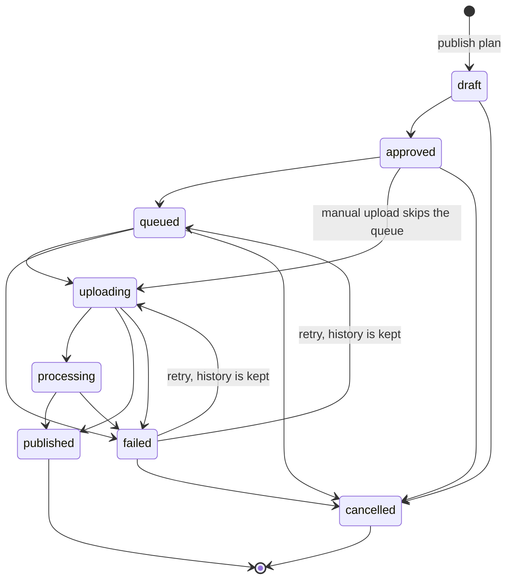

# Publication ledger and metrics

Storygro does not publish to social platforms. `package` ends with a release folder and `published: false` in its manifest. This page describes the next step that exists as code: a **file-based ledger** that records what a person uploaded where, and **metrics snapshots** that record what the platform showed afterwards. Both are plain JSON files that live in Git next to the content, so the owner can track uploads before any platform API is connected.

The only adapter is `manual`. A manual adapter records what a person did; it does not upload, schedule or read anything from a platform. Marking a publication `published` is a statement by a person that the post is live at a link. The module (`production/src/publish.ts`) makes no network calls and needs no accounts or keys.

> **Status.** The module, its schemas and tests exist. The `publish` and `metrics` commands below are wired into the CLI (`npm run storygro -- help`).

## Files

| File | Content |
|---|---|
| `content/publishing/publications.json` | `{ "ledger": 1, "publications": [...] }` — one entry per release, variant, platform and account |
| `content/publishing/metrics.json` | `{ "metrics": 1, "snapshots": [...] }` — what the platform reported, per publication and measurement window |

A missing file means an empty ledger. Files are validated on every load and save (unknown fields, a `published` entry without a link, duplicate ids and bad metric values are errors), so a hand edit that breaks the contract fails loudly instead of corrupting a report.

A publication:

```json
{
  "id": "ai-jobs-2026-10-20-abcd1234:instagram:handle:ru",
  "release": "ai-jobs-2026-10-20-abcd1234",
  "releaseDir": ".reel/releases/ai-jobs-2026-10-20",
  "episode": "ai-jobs",
  "variant": "ru",
  "lang": "ru",
  "platform": "instagram",
  "account": "@handle",
  "adapter": "manual",
  "state": "published",
  "files": [
    { "role": "video", "path": "ru/ai-jobs-ru-web.mp4", "sha256": "…" },
    { "role": "cover", "path": "ru/ai-jobs-ru-cover.png", "sha256": "…" },
    { "role": "subtitles", "path": "ru/ai-jobs-ru.srt", "sha256": "…" },
    { "role": "post", "path": "ru/post.md", "sha256": "…" }
  ],
  "createdAt": "2026-10-20T10:00:00.000Z",
  "updatedAt": "2026-10-20T11:30:00.000Z",
  "history": [
    { "at": "2026-10-20T10:05:00.000Z", "from": "draft", "to": "approved" },
    { "at": "2026-10-20T11:00:00.000Z", "from": "approved", "to": "uploading" },
    { "at": "2026-10-20T11:30:00.000Z", "from": "uploading", "to": "published", "note": "posted from the phone" }
  ],
  "url": "https://www.instagram.com/reel/…/"
}
```

`platform` is one of `instagram`, `youtube`, `tiktok`, `telegram`, `linkedin`, `other`. `file.path` is relative to `releaseDir` and is copied from the release `manifest.json` together with its SHA-256, so the ledger names the exact bytes that were approved. The optional `externalId` holds the platform's own post id; `error` holds the reason of the latest failure while the state is `failed`.

## Planning: what a publication is made from

`publish plan` reads the release `manifest.json` and picks the files of one variant by the `<variant>/` prefix:

| Role | File |
|---|---|
| video (required) | `<name>-web.mp4` if present, otherwise the master `<name>.mp4` |
| cover | `*-cover.png` |
| subtitles | `*.srt` |
| post | `post.md` |

The carousel folder is not searched, and a role with more than one candidate is refused rather than guessed. Planning is refused, with all reasons listed at once, when:

- the release `status` is not `ready-for-review`;
- the variant's `qa.verdict` is not `pass`;
- the variant's `approved.approved` is not `true`;
- there is no video file;
- the same release, platform, account and variant is already in the ledger in any state except `failed` or `cancelled` (override with `--again`, see the rules below).

The result is a `draft` publication. Nothing is uploaded.

## States



Any other move is an error that names the allowed next states. `published` and `cancelled` are final. Every move appends `{ at, from, to, note? }` to `history`.

- `published` requires a `url` (given with the move or recorded earlier). A platform accepting a file is not publication.
- `failed` requires a note, the reason. It is stored in `error` and in the history; a later retry clears `error` but the history keeps the reason.
- A reason for `cancelled` is optional but worth writing.
- To correct a wrong link after `published`, edit the JSON by hand; the file is validated on the next load.

## Commands

These commands will exist. Examples use the project runner; the ledger path defaults to `content/publishing/publications.json` and the metrics path to `content/publishing/metrics.json`.

```sh
npm run storygro -- publish plan <release-dir> --variant ru --platform instagram --account @handle
npm run storygro -- publish approve <id>
npm run storygro -- publish mark <id> <state> [--url …] [--external-id …] [--note …]
npm run storygro -- publish list
npm run storygro -- publish checklist <id>
npm run storygro -- metrics add <id> --window 7d --source "…" views=1200 likes=80
npm run storygro -- metrics report
```

| Command | What it does |
|---|---|
| `publish plan` | Checks the release and adds a `draft` publication for one variant and one named account |
| `publish approve` | `draft` → `approved`: the person confirms they watched the video and read the text |
| `publish mark` | Records a later state: `queued`, `uploading`, `processing`, `published` (needs `--url`), `failed` (needs `--note`), `cancelled` |
| `publish list` | A table of publications with state and link |
| `publish checklist` | Markdown for the person who uploads: platform and account, the exact files with SHA-256, the post text, and the steps |
| `metrics add` | Records one snapshot of a published publication |
| `metrics report` | A Markdown report with one table per platform and window |

A typical manual run:

1. `publish plan …`, then `publish approve <id>`.
2. `publish checklist <id>`; upload the files by hand as the named account.
3. When the post is live: `publish mark <id> published --url <link>`. If it failed: `publish mark <id> failed --note "<what happened>"`.
4. After a day, a week and so on, read the numbers from the platform and `metrics add` them with the source.
5. `metrics report`.

## Metrics

A snapshot is `{ publicationId, window, capturedAt, source, values }`:

- `window` is the measurement period the platform used: `24h`, `48h`, `7d`, `28d`, `90d` or `lifetime`.
- `capturedAt` is when the numbers were read, with a time zone.
- `source` is required free text saying where the numbers came from, for example "Instagram Insights, read by hand" or "YouTube Studio CSV export".
- `values` holds only the metrics that were actually reported. A missing metric stays absent and is shown as `—`; it is never filled with zero. An explicit `0` means the platform showed zero. The command line rejects `views=` (blank) for the same reason.

Snapshots are accepted only for publications in the `published` state. Names are checked per platform:

| Platform | Metrics |
|---|---|
| Instagram | `views`, `reach`, `likes`, `comments`, `shares`, `saves`, `follows`, `avgWatchSec` |
| YouTube | `views`, `likes`, `comments`, `shares`, `subscribersGained`, `avgViewDurationSec`, `avgPercentViewed` |
| TikTok, Telegram, LinkedIn, other | `views`, `likes`, `comments`, `shares` |

Any platform also accepts custom metrics whose name starts with `x-`, such as `x-profile-visits`. Values must be finite and not negative. A second snapshot with the same publication, window and `capturedAt` is rejected.

The report has one table per platform **and** window. Instagram and YouTube numbers are never in one column, because the platforms define "view" and "watch time" differently, and different windows are never compared side by side. Rows are publications; when a publication has several snapshots of the same window, the latest is shown and the count of earlier ones is stated. The report ends with:

> Snapshots are what the platform reported at capture time; compare only the same platform and window; early numbers are not evidence of cause.

Treat early numbers as observations. Compare comparable releases over the same window, together with the cost of producing them, before drawing a conclusion for the next experiment.

## Rules

- **Dedup key.** Release id + platform + account + variant. The account is compared case-insensitively without the leading `@`. A second plan is refused while an earlier one is `draft`, `approved`, `queued`, `uploading`, `processing` or `published`. After `failed` or `cancelled` a new plan is allowed. `--again` plans another one on purpose, for example a deliberate repost; its id gets a `:2`, `:3` suffix.
- **Retries after a timeout.** If an upload timed out or the app closed, first open the account and check whether the post exists. Only then retry. If it exists, mark `published` with its link; if it does not, mark `uploading` again (a retry from `failed` keeps the history). Uploading blindly is how duplicates appear.
- **Partial success.** One release goes to two platforms as two publications with separate states. One can be `published` while the other is `failed`.
- **Named destination.** A publication always names a platform and an account. There is no "publish everywhere".
- **Keys never in Git.** The manual adapter needs none. When an API adapter is added, keys and tokens live in the local environment or a secret store, not in chat, Git, the manifest or the ledger.
- **The ledger is a record, not proof.** Nothing verifies that the link is live or belongs to the named account. The SHA-256 values prove which files were approved, not which files were uploaded.
- **Editorial approval is separate.** `ready-for-review` and `pass` are technical states. Watch the video with sound and read the text before `publish approve`.

## Not implemented

- No API upload to Instagram, YouTube, TikTok or any other platform.
- No scheduling and no automatic publication.
- No automatic metrics collection; every snapshot is entered by a person.
- No comment, reply or direct-message handling.
- No hosted service or database; the files are the storage.

Candidate adapters, none chosen:

- [Postiz](https://github.com/gitroomhq/postiz-app) through its API. It is AGPL software, so it would be an external service that Storygro calls, not copied into the core.
- The official Instagram Graph API and the YouTube Data API directly.

Either needs the owner's accounts, app credentials and, for the official APIs, app review by the platform. Before enabling one, check which actions and metrics it really supports for those accounts, and keep it behind a small adapter interface like the voice providers. The `adapter` field of a publication is the place for the choice; today the only valid value is `manual`.
