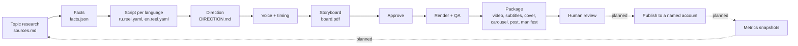
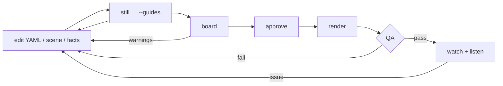

# Workflows

> **Audience:** people and AI agents producing content with Storygro · **Status:** v0.2 (October 2026)

Storygro is a toolkit an agent operates for you: you describe the outcome in plain language, the agent writes files and runs commands, and every step leaves an artifact you can check. This page walks through the workflows that work today and marks the ones that are planned.

## The content cycle



Everything up to the package and the human review is implemented. Publishing and analytics are planned and need the owner's accounts ([implementation plan](planning/IMPLEMENTATION_PLAN.md)).

## Commands

| Command | Does | Main outputs |
|---|---|---|
| `storygro voice <spec>` | narrates (cached), builds the timeline, prints scene lengths and words/second | `voice/`, `timeline.json` |
| `storygro still <spec> <at>… [--guides]` | PNG frames at moments (`12.5`, `scene`, `scene@cue`, `scene@2.0`) | `stills/` |
| `storygro board <spec>` | storyboard from the live player; facts and safe-area warnings | `board.html`, `board.pdf` |
| `storygro approve <spec>` | records the hash of every input | `approved.json` |
| `storygro preview <spec> [--guides]` | live preview with sound in the browser | — |
| `storygro score <spec>` | music, effects and voice mixed to −14 LUFS | `mix.wav` and stems |
| `storygro render <spec> [--draft] [--from s --to s]` | voice → score → frames → master + web MP4 → subtitles → stills → QA | `<name>.mp4`, `-web.mp4`, `.srt`, `.vtt`, `QA.md` |
| `storygro qa <spec>` | re-runs QA on the current master | `QA.md`, `qa.json` |
| `storygro subs <spec>` | rewrites SRT/VTT from the timeline | `<name>.srt`, `.vtt` |
| `storygro carousel <carousel-spec>` | one PNG per scene at its key moment | `carousel/NN-<id>.png` |
| `storygro deliver <spec> [dir]` | copies one variant's complete set + manifest (refuses gaps) | `~/Downloads/<name>/` |
| `storygro package <episode.yaml> [dir]` | collects all variants into one release + manifest (refuses gaps) | `.reel/releases/<id>/` |

Options: `--no-voice` (estimated timings), `--force` (skip the approval/QA gate, recorded), `--allow-errors`, `--partial`, `--allow-incomplete`, `--out <dir>`, `--port <n>`. Run `npm run storygro -- help` for the full list.

## 1. An explainer from a topic

**Ask your agent** (in a checkout of this repository):

> Read AGENTS.md and docs/workflows.md. Make a 60–90 second vertical explainer about "[topic]" for "[audience]" in Russian and English. After watching, a viewer should understand "[one idea]". Research current sources first and keep every number with its source and a quote. Show the mechanism with recurring objects, not a list of facts. Use the cut-paper scenes, a male narrator, and stop after the storyboard so I can approve it.

**What happens, with the files it leaves:**

1. **Research → `sources.md`.** Primary sources with date, method, a verbatim quote containing each number, confidence and caveats; a list of popular misquotes to avoid. The agent verifies the numbers it puts on screen in the primary documents itself.
2. **Facts → `facts.json`.** Every on-screen number and source line, with a `_source` note per block. Scenes bind values with `xxxFrom: facts.path`; QA reads them back from the screen.
3. **Script → `ru.reel.yaml`, `en.reel.yaml`.** One idea, one mechanism: problem → visual model → change → consequence → what to do. Each scene has a narration line with `{#cue}` markers where pictures must react. Written for each audience, not translated word for word ([writing a reel](writing-a-reel.md)).
4. **Direction → `DIRECTION.md`.** The feeling, the visual language and, per scene, what is on screen at each cue. Optional for small edits, important when several people or models build scenes.
5. **Voice.** `storygro voice ru.reel.yaml` prints every scene's real length. Cut words before designing pictures; listen to the lines; fix pronunciation with `[written](=spoken)` ([voices](voices.md)).
6. **Frames.** `storygro still ru.reel.yaml hook risk@share tasks@cut --guides` — look at the start, every cue and the end of each scene.
7. **Storyboard.** `storygro board ru.reel.yaml` → read `board.pdf`: narration, on-screen text, sound, key frames, warnings.
8. **Approve, render, QA.** `storygro approve …`, `storygro render …` (about 3.5 minutes for 85 s at 1080×1920 on an M5 Pro). QA must pass; fix and re-run every check, not only the one that failed ([quality](quality.md)).
9. **Watch and listen** on a phone before calling it done.

## 2. Language variants

Variants are sibling specs in one folder: `ru.reel.yaml` and `en.reel.yaml` share `theme.css`, `assets/`, `facts.json` and any custom scenes, but each has its own `lang`, voice, script and post text, and works in `.reel/ru/` and `.reel/en/`. A plain `reel.yaml` keeps working in `.reel/`.

- Rewrite rather than translate: the example uses an HSE estimate for Russia in the Russian cut and ILO's global index in the English one; the shared US data appears in both.
- Each language gets its own voice reference and pronunciation hints.
- Lengths differ (Russian narration ran 2.2 words/s, English 2.7); check both timelines.

## 3. Carousel, post text and the release package

```sh
storygro carousel examples/ai-jobs/ru.carousel.yaml    # 7 cards, 1080×1350
storygro carousel examples/ai-jobs/en.carousel.yaml
storygro package  examples/ai-jobs/episode.yaml        # → .reel/releases/ai-jobs-<date>/
```

`episode.yaml` lists the variants, their carousels, `sources.md` and `CREDITS.md`. Each video spec carries its `post:` (title, text, tags). The package contains, per variant: master and web MP4, SRT/VTT, cover and other stills, storyboard PDF, QA report, `post.md` and the carousel; at the root: sources, credits, `README.md` and `manifest.json` with SHA-256 for every file, the Storygro commit, the voice providers and the QA verdicts. It refuses unapproved inputs, missing files and failed or stale QA.

## 4. The edit loop



Changing the script re-times everything from the voice; changing scene code, theme, facts or assets resets the approval. Voice lines are cached, so re-rendering after a visual change does not re-synthesise.

## 5. Designing a narrator voice

```sh
npm run setup:ru
~/.storygro/venv/bin/python py/design_voice.py examples/<ep>/assets/voice/narrator-en.wav --lang en --seed 7 \
  --instruct "Calm, warm adult male narrator, native General American English, clear diction, documentary tone"
```

Then `voice: { engine: qwen3, voice: assets/voice/narrator-en.wav }`. Compare candidates by listening; the [voices](voices.md) page lists the measurements used for the example.

## 6. A new scene

1. Prefer props on an existing scene; write a new module only when the explanation needs a new visual mechanism.
2. One-off scenes live next to the reel (`examples/<ep>/scenes/x.js`); reusable ones in `scenes/`.
3. Follow the [scene contract](scene-contract.md): `mount(root, ctx)` builds the DOM and returns `draw(t)`, a pure function of time. Use `runtime/kit.js` and, for the cut-paper look, `runtime/paper.js`.
4. Check it with stills at every cue, at 9:16 and with `--guides`; add it to the [catalog](scenes.md).

## 7. The historical SlideCraft launch film and GIF

```sh
npm run storygro -- board examples/slidecraft-launch/reel.yaml
npm run storygro -- approve examples/slidecraft-launch/reel.yaml
npm run storygro -- render examples/slidecraft-launch/reel.yaml
SLIDECRAFT_ROOT=/path/to/slidecraft npx tsx examples/slidecraft-launch/gif/gif-story.ts   # the archived GIF
```

See the [production record](history/slidecraft-launch.md).

## 8. Review and (planned) publishing

Today the last automated step is `package`. The review checklist is in [quality](quality.md#the-human-review-that-no-gate-replaces). Publishing will be an explicit command against a named account and an approved release, with deduplication and recorded states (draft → approved → queued → uploading → processing → published, failed/cancelled with reasons); metrics will be stored as snapshots tied to the release and variant. Until then, upload the files from the package by hand.

## Roles for agents

[`agents/`](../agents/) describes three responsibilities — **director** (story, script, direction, review of stills and storyboard), **scene-builder** (scene modules against the direction and contract) and **qa** (gates and the fix loop). They are a division of responsibility, not an instruction to run several agents; one agent can play all three in turn.
