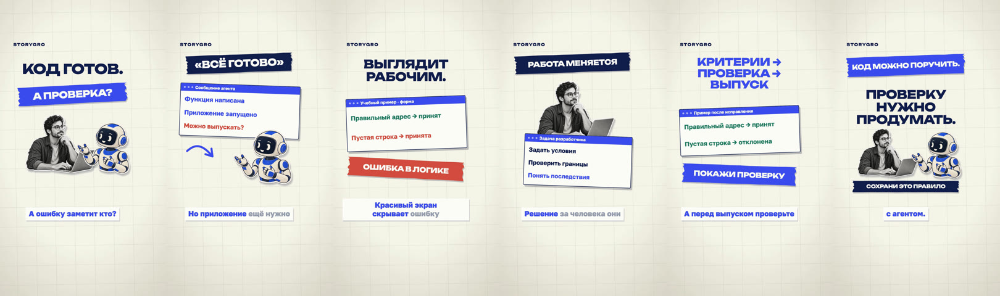

# Internal editorial collage fixture

An internal style exploration, not the owner's requested current topic. The fictional coding example was used to develop `production/scenes/collage.js`, original image cut-outs and a reproducible validation illustration. Work on that topic stopped when the owner supplied the micro1 post.

The current video is [micro1-work-data](../../content/videos/micro1-work-data/README.md). [Reference analysis](../../content/research/references/gHFDPVjbOco.md) · [asset prompts](ASSET_PROMPTS.md) · [sources](sources.md).

The fixture preserves its source files and local ignored artifacts; no public video release was created for it. Its old cached QA is historical evidence only: moving the folder and changing input paths invalidates approval and does not certify a new render.

Original image cut-outs are off Git. Restore them with `npm run assets:fetch`; paths and SHA-256 are recorded in [content/media-assets.json](../../content/media-assets.json). Small preview strips remain in Git; full-resolution covers remain local.
